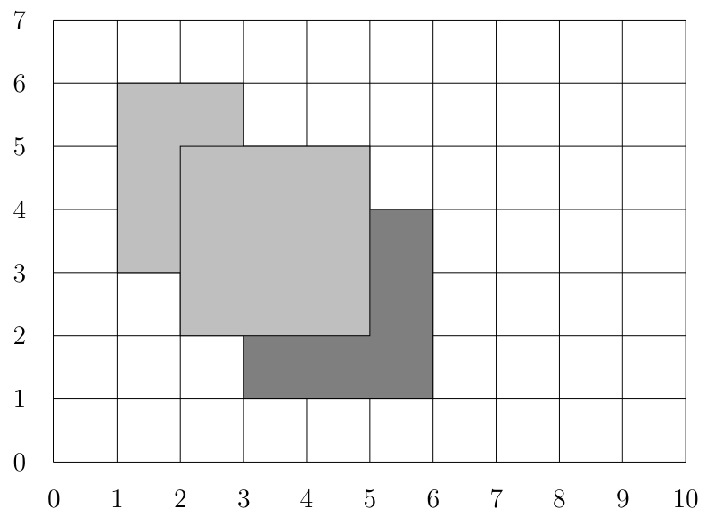

# What a Colorful Wall

Time limit: 3 seconds. Memory limit: 1024 megabytes.

## Problem Description

In a lovely park with green trees, red roses, blue skies and white clouds, there is a public wall where everyone can put up posters. Each poster's color is represented by a number. A newly posted poster covers the overlapping parts of older posters.

Given the coordinates and colors of $n$ posters, put them up in the given order and determine how many distinct colors remain visible on the resulting wall. The wall is initially blank. All posters are rectangles and cannot be rotated.

The following example puts up three posters in order.

1. A light-gray poster of color $1$, with top-left corner $(1,6)$ and bottom-right corner $(3,3)$.
2. A dark-gray poster of color $2$, with top-left corner $(3,4)$ and bottom-right corner $(6,1)$.
3. A light-gray poster of color $1$, with top-left corner $(2,5)$ and bottom-right corner $(5,2)$.



Both light gray and dark gray remain visible, so there are two visible colors.

## Input Format

Each test case begins with an integer $n$, the number of posters. Each of the following $n$ lines contains five integers $x_1,y_1,x_2,y_2,c$. The poster has top-left corner $(x_1,y_1)$, bottom-right corner $(x_2,y_2)$, and color $c$. Put up these $n$ posters in their input order.

## Output Format

For each test case, output one integer: the number of distinct colors visible on the resulting wall.

## Technical Specification

- $1\le n\le4000$.
- For every poster, $0\le x_1<x_2<2^{28}$, $0\le y_2<y_1<2^{28}$ and $1\le c\le n$.

## Sample 1

### Input

```text
3
1 6 3 3 1
3 4 6 1 2
2 5 5 2 1
```

### Output

```text
2
```

## Sample 2

### Input

```text
3
2 3 3 2 3
1 4 4 1 1
5 4 6 3 2
```

### Output

```text
2
```

## Sample 3

### Input

```text
3
0 1 2 0 1
0 1 1 0 2
2 1 3 0 2
```

### Output

```text
2
```
