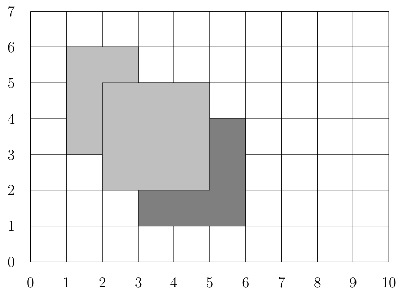

# 五彩缤纷的墙

时间限制：3 秒。内存限制：1024 兆字节。

## 题目描述

一座美丽的公园里有绿树、红玫瑰、蓝天和白云，还有一面供大家张贴海报的公共墙。每张海报的颜色用一个编号表示。新贴上的海报会覆盖旧海报与它重叠的部分。

给定 $n$ 张海报的位置和颜色，请按给定顺序张贴海报，并计算最终墙上能看到多少种不同颜色。最初墙面是空白的。所有海报都是矩形，且不能旋转。

下面的例子按顺序张贴三张海报。

1. 一张颜色编号为 $1$ 的浅灰色海报，左上角为 $(1,6)$，右下角为 $(3,3)$。
2. 一张颜色编号为 $2$ 的深灰色海报，左上角为 $(3,4)$，右下角为 $(6,1)$。
3. 一张颜色编号为 $1$ 的浅灰色海报，左上角为 $(2,5)$，右下角为 $(5,2)$。



最终浅灰色和深灰色都仍然可见，因此能看到两种颜色。

## 输入格式

每组测试数据首先包含一个整数 $n$，表示海报数。接下来 $n$ 行，每行包含五个整数 $x_1,y_1,x_2,y_2,c$。海报的左上角为 $(x_1,y_1)$，右下角为 $(x_2,y_2)$，颜色为 $c$。请按输入顺序张贴这 $n$ 张海报。

## 输出格式

对于每组测试数据，输出一个整数，表示最终墙上可见的不同颜色数。

## 数据范围

- $1\le n\le4000$。
- 每张海报都满足 $0\le x_1<x_2<2^{28}$、$0\le y_2<y_1<2^{28}$、$1\le c\le n$。

## 样例 1

### 输入

```text
3
1 6 3 3 1
3 4 6 1 2
2 5 5 2 1
```

### 输出

```text
2
```

## 样例 2

### 输入

```text
3
2 3 3 2 3
1 4 4 1 1
5 4 6 3 2
```

### 输出

```text
2
```

## 样例 3

### 输入

```text
3
0 1 2 0 1
0 1 1 0 2
2 1 3 0 2
```

### 输出

```text
2
```
