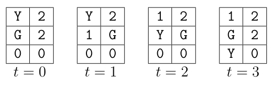

# The Treasure of the Sierra Jade

Time limit: 1 second. Memory limit: 1024 megabytes.

## Problem Description

Congratulations on finding the treasure of the Sierra Jade! Your last mission is to transport it down the mountain to a river, where a boat will pick you up. The heavy treasure is carried on a cart that you cannot push uphill. The mountain is patrolled by guards, each following a cyclic route. Your mission fails if you meet a guard at the same location. Given the map and patrol routes, find the minimum number of turns needed to reach any part of the river.

## Input Format

The first line contains an integer $N$, the number of test cases. Each case begins with two integers $n$ and $m$, the map's width and height. The following $m$ lines each contain $n$ integers describing the altitudes of the $n\times m$ cells. The $x$-th number on the $y$-th line gives the altitude of cell $(x-1,y-1)$.

A cell of altitude $0$ is part of the river. The river need not be connected; reaching any altitude-$0$ cell succeeds. Next are two integers $x_s$ and $y_s$, your initial location where the treasure was found. Cell $(x_s,y_s)$ is not in the river.

Next is an integer $g$, the number of guards. Each of the next $g$ lines describes one guard. The first integer $k_i$ is the number of cells on that guard's route, followed by $2k_i$ integers giving the cells $x_{i,1},y_{i,1},x_{i,2},y_{i,2},\ldots,x_{i,k_i},y_{i,k_i}$. The guard visits these cells in order, moving once each turn, and repeats from the first cell after reaching the last. Consecutive route cells need not be adjacent. Guards never visit river cells or the initial cell $(x_s,y_s)$, out of respect for the treasure.

Initially each guard is at the first cell of its route, and you are at your initial cell. In each turn you move first, then every guard moves to the next cell on its route. You may stay where you are or move the cart to one of the four adjacent cells whose altitude is no greater than your current cell's altitude. You are caught in either of these situations:

1. You move to a cell currently occupied by at least one guard.
2. You move to or stay at a cell that at least one guard will move to later in the same turn.

The following figure illustrates the first sample case. `Y` marks you and `G` marks the guard. In the first turn you must stay at $(0,0)$: cell $(1,0)$ is higher, while cell $(0,1)$ contains the guard. In the second turn you move to $(0,1)$. In the third turn you reach the river at $(0,2)$ and succeed.



## Output Format

Output $N$ lines, one per test case. Each line contains the minimum number of turns needed to transport the treasure to any river cell, or $-1$ if this is impossible.

## Technical Specification

- $1\le N\le10$.
- $0<n,m\le40$.
- $0\le g\le10$.
- $0<k_i\le8$.
- All coordinates are integers. The horizontal coordinate is between $0$ and $n-1$, the vertical coordinate is between $0$ and $m-1$, and every altitude is an integer between $0$ and $2^{20}$, inclusive.

## Sample 1

### Input

```text
5
2 3
1 2
1 2
0 0
0 0
1
3 0 1 1 1 1 1
2 3
1 2
1 2
0 0
0 0
1
2 0 1 1 1
2 3
1 2
1 2
0 0
1 0
0
2 3
1 2
1 2
0 0
1 0
2
1 0 1
1 1 1
3 3
1 2 1
1 1 1
0 2 0
1 0
1
3 0 1 1 1 2 1
```

### Output

```text
3
-1
2
-1
3
```
