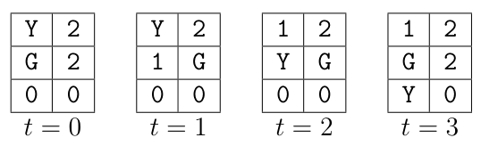

# 翡翠山的宝藏

时间限制：1 秒。内存限制：1024 兆字节。

## 题目描述

恭喜你找到了翡翠山的宝藏！最后的任务是把宝藏运下山，到达河流，那里有船来接你。沉重的宝藏装在一辆小车上，你无法推着它上坡。山上有一些守卫，每个守卫都沿着一条循环路线巡逻。如果你与守卫处在同一个位置，任务就会失败。给定地图和巡逻路线，求到达河流任意位置所需的最少回合数。

## 输入格式

第一行包含一个整数 $N$，表示测试用例数。每个测试用例首先包含两个整数 $n$ 和 $m$，分别表示地图的宽度和高度。接下来 $m$ 行，每行 $n$ 个整数，描述 $n\times m$ 个格子的海拔。第 $y$ 行的第 $x$ 个数表示格子 $(x-1,y-1)$ 的海拔。

海拔为 $0$ 的格子属于河流。河流不一定连通，只要到达任意一个海拔为 $0$ 的格子就算成功。接下来给出两个整数 $x_s$ 和 $y_s$，表示发现宝藏时你的初始位置。格子 $(x_s,y_s)$ 不属于河流。

接下来是一个整数 $g$，表示守卫数。之后 $g$ 行分别描述每个守卫。每行第一个整数 $k_i$ 表示该守卫路线中的格子数，随后 $2k_i$ 个整数依次给出这些格子：$x_{i,1},y_{i,1},x_{i,2},y_{i,2},\ldots,x_{i,k_i},y_{i,k_i}$。守卫每回合按顺序移动到下一个格子，到达最后一个格子后再回到第一个格子并继续循环。路线中相邻的两个位置不一定是地图上相邻的格子。出于对宝藏的敬畏，守卫不会巡逻河流格子，也永远不会进入初始格子 $(x_s,y_s)$。

开始时，每个守卫都位于自己路线中的第一个格子，你位于初始格子。每个回合先由你移动，再由所有守卫移动到各自路线中的下一个格子。你可以原地等待，也可以把小车推到上下左右四个相邻格子之一，但目标格子的海拔必须不高于当前格子。以下任意一种情况都会使你被抓住：

1. 你移动到的格子当前至少有一个守卫。
2. 你移动到或停留的格子，在同一回合稍后至少会有一个守卫移入。

下面的原稿配图展示第一个样例中的第一个测试用例。`Y` 表示你，`G` 表示守卫。第一回合必须停在 $(0,0)$：格子 $(1,0)$ 更高，而格子 $(0,1)$ 被守卫占据。第二回合移动到 $(0,1)$。第三回合到达河流格子 $(0,2)$，任务成功。



## 输出格式

输出 $N$ 行，每个测试用例一行。每行包含把宝藏运到任意河流格子所需的最少回合数；若无法完成，输出 $-1$。

## 数据范围

- $1\le N\le10$。
- $0<n,m\le40$。
- $0\le g\le10$。
- $0<k_i\le8$。
- 所有坐标均为整数。横坐标在 $0$ 到 $n-1$ 之间，纵坐标在 $0$ 到 $m-1$ 之间，海拔是 $0$ 到 $2^{20}$ 之间的整数，均包含两端。

## 样例 1

### 输入

```text
5
2 3
1 2
1 2
0 0
0 0
1
3 0 1 1 1 1 1
2 3
1 2
1 2
0 0
0 0
1
2 0 1 1 1
2 3
1 2
1 2
0 0
1 0
0
2 3
1 2
1 2
0 0
1 0
2
1 0 1
1 1 1
3 3
1 2 1
1 1 1
0 2 0
1 0
1
3 0 1 1 1 2 1
```

### 输出

```text
3
-1
2
-1
3
```
