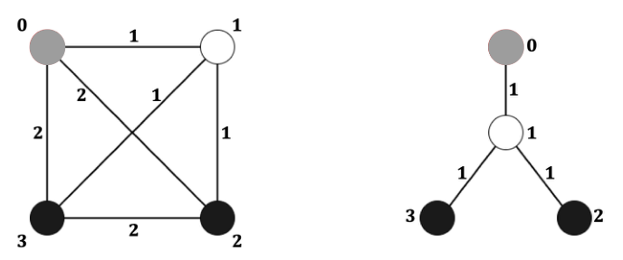

# Transportation Network

Time limit: 3 seconds. Memory limit: 1024 megabytes.

## Problem Description

A retail company owns convenience stores and a central warehouse in a city. Goods travel from the warehouse to the stores, and customers can also send packages between stores. The company's logistics team wants to redesign its transportation network.

The original network is a simple undirected complete graph $G=(V,E,w)$, with vertex set $V=\{0,1,\ldots,n-1\}$, edge set $E=\{\{x,y\}\mid x,y\in V,\ x\ne y\}$ and weight function $w:E\to\{1,2\}$. Vertex $0$ represents the warehouse, while vertices $1,2,\ldots,n-1$ represent the $n-1$ stores. Every edge represents a possible transportation link; its weight is the cost of establishing that link.

The vertices in $V\setminus\{0\}$ are partitioned into disjoint sets $S$ and $U$. Stores in $S$ are on main streets, and stores in $U$ are in alleys. Every non-warehouse vertex belongs to exactly one of $S$ and $U$. The edge weights are defined as follows.

- For the warehouse: $w(\{0,s\})=1$ when $s\in S$, and $w(\{0,u\})=2$ when $u\in U$.
- For distinct main-street stores: $w(\{s,s'\})=2$ when $s,s'\in S$ and $s\ne s'$.
- Between the two store classes: $w(\{s,u\})=1$ when $s\in S$ and $u\in U$.
- For distinct alley stores: $w(\{u,u'\})=2$ when $u,u'\in U$ and $u\ne u'$.

A rooted tree has a specified root $r$. Every vertex $v$ has a unique path $P(v)$ to $r$. Its neighbor toward the root is its parent; the other neighbors are its children. A non-root vertex's depth is the number of edges on its path to the root. The tree's depth is the maximum vertex depth.

The team wants a special depth-two spanning tree $T$ satisfying these conditions:

1. Its root is vertex $0$.
2. Its depth is at most $2$.
3. It contains every vertex of the original network.
4. The root is adjacent to exactly $p$ vertices, called hubs. Each remaining non-root vertex is adjacent to exactly one hub.

For vertices $u$ and $v$, let $w_T(u,v)$ be the sum of edge weights on their unique path in $T$. Define the routing cost as

$$W(T)=\sum_{u\in V}\sum_{v\in V}w_T(u,v).$$

The team wants to minimize this routing cost. A tree achieving the minimum is called a critical transportation network.



The original figure shows an example with $n=4$ and $p=1$. The original graph $G$ is on the left: the gray vertex is $0$, the white vertex is in $S$, and black vertices are in $U$. A critical transportation network is on the right.

Given $G$ and a positive integer $p$, compute the minimum routing cost.

## Input Format

The first line contains an integer $L$ with $L\le16$, the number of test cases. Each case begins with three space-separated integers $n$, $|S|$ and $p$. The following line contains $|S|$ space-separated integers identifying the vertices in $S$, each satisfying $1\le s\le n-1$. The sum of $|S|$ over all test cases is at most $300000$.

## Output Format

For each test case, output one line containing the minimum routing cost as a positive integer.

## Technical Specification

- $3\le n\le10^6$ for each test case.
- $|S|+|U|\ge p$.
- $1\le|S|\le p\le n-1$.

## Sample 1

### Input

```text
2
4 1 1
1
6 2 3
1 4
```

### Output

```text
18
68
```
