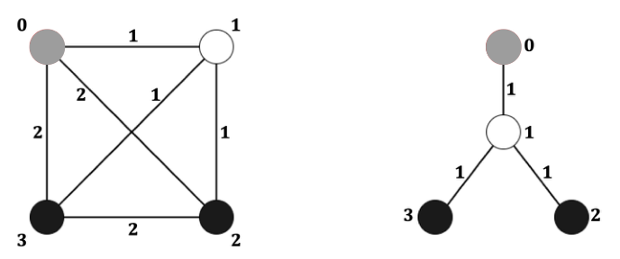

# 运输网络

时间限制：3 秒。内存限制：1024 兆字节。

## 题目描述

一家零售公司在城市里拥有许多便利店和一个中心仓库。商品从仓库运到便利店，顾客也能在便利店之间寄送包裹。公司的物流团队希望重新设计运输网络。

原运输网络是一个简单无向完全图 $G=(V,E,w)$，顶点集为 $V=\{0,1,\ldots,n-1\}$，边集为 $E=\{\{x,y\}\mid x,y\in V,\ x\ne y\}$，边权函数为 $w:E\to\{1,2\}$。顶点 $0$ 表示仓库，顶点 $1,2,\ldots,n-1$ 表示 $n-1$ 家便利店。每条边表示一条可以建立的运输线路，边权表示建立该线路的费用。

将 $V\setminus\{0\}$ 中的顶点划分为互不相交的集合 $S$ 和 $U$。集合 $S$ 中的便利店位于主干道上，集合 $U$ 中的便利店位于小巷中。每个非仓库顶点都恰好属于 $S$、$U$ 中的一个。边权定义如下。

- 仓库到便利店：若 $s\in S$，则 $w(\{0,s\})=1$；若 $u\in U$，则 $w(\{0,u\})=2$。
- 两家不同的主干道便利店之间：若 $s,s'\in S$ 且 $s\ne s'$，则 $w(\{s,s'\})=2$。
- 两类便利店之间：若 $s\in S$ 且 $u\in U$，则 $w(\{s,u\})=1$。
- 两家不同的小巷便利店之间：若 $u,u'\in U$ 且 $u\ne u'$，则 $w(\{u,u'\})=2$。

有根树有一个指定的根 $r$。每个顶点 $v$ 到 $r$ 都有唯一的路径 $P(v)$。路径上朝向根的相邻顶点是它的父亲，其余相邻顶点是它的孩子。非根顶点的深度是它到根的路径所包含的边数，树的深度是所有顶点深度的最大值。

团队希望构造一棵特殊的两层生成树 $T$，满足以下条件：

1. 根为顶点 $0$。
2. 深度至多为 $2$。
3. 包含原运输网络中的所有顶点。
4. 根恰好与 $p$ 个顶点相邻，这些顶点称为枢纽。其余每个非根顶点都恰好与一个枢纽相邻。

对于顶点 $u$ 和 $v$，令 $w_T(u,v)$ 表示它们在 $T$ 中的唯一路径上的边权之和。定义运输总成本为

$$W(T)=\sum_{u\in V}\sum_{v\in V}w_T(u,v).$$

团队希望使这个成本最小。达到最小成本的树称为关键运输网络。



原稿配图展示 $n=4$、$p=1$ 的例子。左侧是原图 $G$：灰色顶点为 $0$，白色顶点属于 $S$，黑色顶点属于 $U$。右侧是一种关键运输网络。

给定 $G$ 和正整数 $p$，请计算最小运输总成本。

## 输入格式

第一行包含一个整数 $L$，满足 $L\le16$，表示测试用例数。每个测试用例首先包含三个以空格分隔的整数 $n$、$|S|$ 和 $p$。接下来一行包含 $|S|$ 个以空格分隔的整数，给出属于 $S$ 的顶点编号，每个编号满足 $1\le s\le n-1$。所有测试用例的 $|S|$ 之和不超过 $300000$。

## 输出格式

对于每个测试用例，输出一行，包含一个正整数，表示最小运输总成本。

## 数据范围

- 每个测试用例满足 $3\le n\le10^6$。
- $|S|+|U|\ge p$。
- $1\le|S|\le p\le n-1$。

## 样例 1

### 输入

```text
2
4 1 1
1
6 2 3
1 4
```

### 输出

```text
18
68
```
