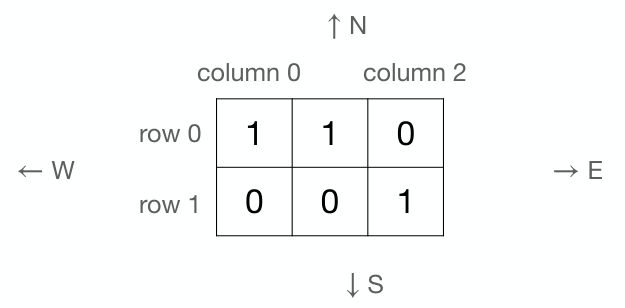

# Escaping the Foggy Forest

Time limit: 1 second. Memory limit: 1024 megabytes.

## Problem Description

Nobi is walking in a foggy forest and tries to locate himself using a map. The forest is divided into $m\times n$ regions, represented by a matrix with rows numbered from $0$ through $m-1$ and columns from $0$ through $n-1$. Entry $M(r,c)$ describes the region in row $r$, column $c$. Each entry is either $1$, for tall trees, or $0$, for bushes. Bushes surround the forest, so every region outside the map is treated as $0$.

Because of the heavy fog, Nobi can observe only his current region, the region directly in front of him and the region on his right. He does not know which direction he is facing. Find all possible regions where he could be, assuming that he faces one of the four directions `N`, `E`, `S` and `W`.

Here is an example with a $2\times3$ matrix.



Suppose Nobi sees tall trees in his current region and in front of him, corresponding to $1$, and bushes on his right, corresponding to $0$. One possible location is $M(0,0)$: its value is $M(0,0)=1$, and when facing `E`, the region in front has $M(0,1)=1$, while the region to the right has $M(1,0)=0$. Another possible location is $M(0,1)$: its value is $M(0,1)=1$, and when facing `W`, the front region has $M(0,0)=1$, while the region on the right is outside the map and is treated as $0$.

## Input Format

The first line of a test case contains two integers $m$ and $n$, the number of rows and columns. Rows are indexed from $0$ through $m-1$ and columns from $0$ through $n-1$. The following $m$ lines each contain $n$ integers describing the map. The last line contains three integers $s$, $f$ and $r$, describing what Nobi observes in his current region, directly in front and on his right, respectively.

## Output Format

Each output line contains the row and column indices of one possible location. Nobi is guaranteed to be inside the forest. List regions in increasing row order; among regions in the same row, list them in increasing column order.

## Technical Specification

- $1\le m,n\le100$.
- Every matrix entry is $0$ or $1$.
- $s,f,r\in\{0,1\}$.

## Sample 1

### Input

```text
2 3
1 1 0
0 0 1
1 1 0
```

### Output

```text
0 0
0 1
```
