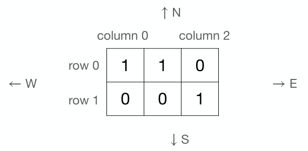

# 逃离迷雾森林

时间限制：1 秒。内存限制：1024 兆字节。

## 题目描述

Nobi 正走在一片雾气弥漫的森林里，试图利用地图确定自己的位置。森林被划分为 $m\times n$ 个区域，用一个矩阵表示，行号为 $0$ 到 $m-1$，列号为 $0$ 到 $n-1$。元素 $M(r,c)$ 对应第 $r$ 行、第 $c$ 列的区域。每个元素要么为 $1$，表示高大的树木；要么为 $0$，表示灌木。森林外围都是灌木，因此地图外的所有区域都视为 $0$。

由于浓雾，Nobi 只能观察自己所在的区域、正前方的区域和右侧的区域。他不知道自己朝向哪个方向。假设他只可能面向 `N`、`E`、`S`、`W` 四个方向之一，请找出他可能所在的所有区域。

下面是一个 $2\times3$ 矩阵的例子。



假设 Nobi 看到当前位置和正前方都是高大的树木，对应 $1$，右侧是灌木，对应 $0$。一个可能的位置是 $M(0,0)$：该处满足 $M(0,0)=1$，当面朝 `E` 时，前方满足 $M(0,1)=1$，右侧满足 $M(1,0)=0$。另一个可能的位置是 $M(0,1)$：该处满足 $M(0,1)=1$，当面朝 `W` 时，前方满足 $M(0,0)=1$，右侧在地图之外，视为 $0$。

## 输入格式

每组测试数据的第一行包含两个整数 $m$ 和 $n$，分别表示行数和列数。行号为 $0$ 到 $m-1$，列号为 $0$ 到 $n-1$。接下来 $m$ 行，每行包含 $n$ 个整数，描述地图。最后一行包含三个整数 $s$、$f$ 和 $r$，分别表示 Nobi 在当前位置、正前方和右侧观察到的情况。

## 输出格式

每行输出一个可能位置的行号和列号。保证 Nobi 位于森林内部。按行号从小到大输出；行号相同时，按列号从小到大输出。

## 数据范围

- $1\le m,n\le100$。
- 每个矩阵元素为 $0$ 或 $1$。
- $s,f,r\in\{0,1\}$。

## 样例 1

### 输入

```text
2 3
1 1 0
0 0 1
1 1 0
```

### 输出

```text
0 0
0 1
```
