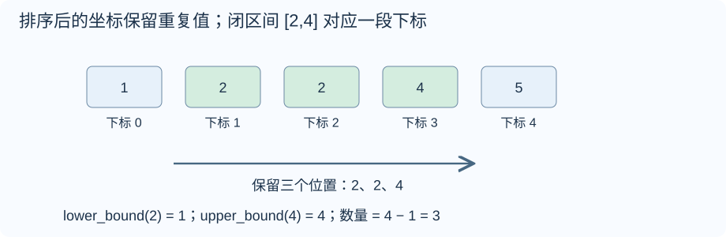
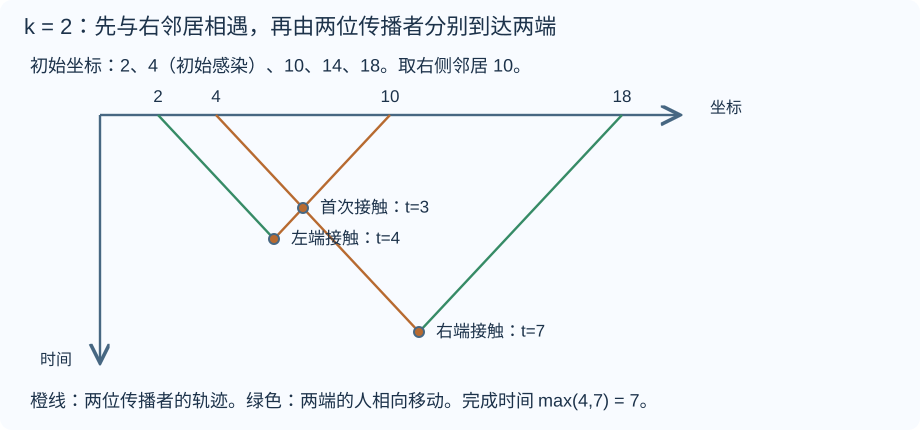
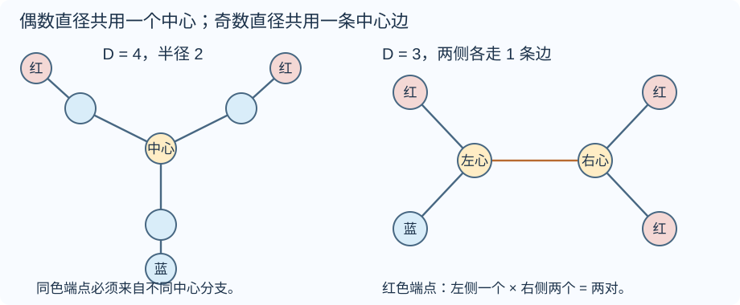
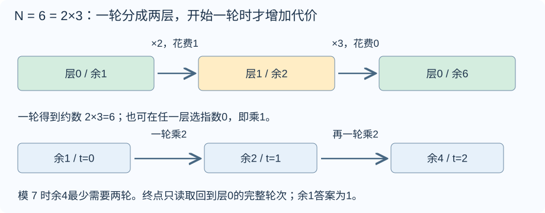

# ABC 482 题解

> 比赛：[ABC 482](https://atcoder.jp/contests/abc482)
> 语言：C++17。收录 B–F，A 为签到题略。 G 的第三方模型换算难度为 2500，超过当前补写上限；目录难度为 CF-EQ 换算，并非官方分值。

## 目录

| 题号 | 题名 | 考点 | 难度 |
|---|---|---|---|
| B | Blank Bingo | 枚举 | 800 |
| C | Band Count | 二分查找[主] + 排序 | 1000 |
| D | Wannabe Zombie | 结论与计数 | 1200 |
| E | Diameter Endpoint Colors | 树的直径[主] + BFS + 组合计数 | 1700 |
| F | Mod M Divisor | 最短路[主] + 素数 + 取模与同余 | 2200 |


## B. Blank Bingo

### 题意

[原题链接](https://atcoder.jp/contests/abc482/tasks/abc482_b)

给定 $5\times5$ 棋盘，$\verb@o@$ 已标记，$\verb@.@$ 未标记。最少补多少个标记，才能让某一整行、整列或完整对角线的五格全部标记？

### 从零讲：vector：长度可变的连续数组

<details>
<summary>展开可复用的基础知识</summary>

#### vector：长度可变的连续数组

$\verb@vector<T>@$ 保存一串同类型的元素，适合按下标访问、扫描、排序。$\verb@T@$ 是元素类型，例如 $\verb@vector<int>@$ 保存整数，$\verb@vector<pair<int,int>>@$ 保存整数对，$\verb@vector<vector<int>>@$ 可保存每个顶点各自的邻居。需要 $\verb@<vector>@$。

```cxx
vector<int> a(3, 7);   // 三个元素，内容是 7、7、7
a.push_back(9);       // 在末尾追加，现在长度为 4
int x = a[1];         // 从 0 编号，这里得到 7
a[1] = 2;            // 改第二个元素
int n = int(a.size());
```

$\verb@vector<int> a(3)@$ 创建三个值为零的元素；$\verb@a.reserve(3)@$ 只预留容量，元素数仍为零，此时不能访问 $\verb@a[0]@$。长度 $\verb@size()@$ 与容量 $\verb@capacity()@$ 是不同概念。

下标访问为 $O(1)$，遍历为 $O(n)$。末尾追加通常为 $O(1)$；容量不足时会分配更大的连续空间并搬移元素，这次可能为 $O(n)$，一连串追加的平均成本称为摊还 $O(1)$。中间插入或删除会搬移后续元素，最坏 $O(n)$。内存是元素量的 $O(n)$，并可能预留部分尚未使用的容量。

$\verb@begin()@$ 指向首元素，$\verb@end()@$ 指向尾后位置，$\verb@sort(a.begin(),a.end())@$ 操作整个数组。$\verb@a[i]@$ 不检查越界；下标须满足 $0\le i<\mathrm{size}$。$\verb@at(i)@$ 会检查越界并抛异常。空数组不能访问 $\verb@front()@$、$\verb@back()@$；$\verb@pop_back()@$ 也要求非空。

扩容后指向旧存储的迭代器、引用和指针会失效。遍历的同时 $\verb@push_back@$，不能假定此前取得的引用仍可用。读取大数组的函数常用 $\verb@const vector<int>& a@$ 按常量引用传入，既不复制也禁止通过该引用修改；$\verb@vector<int> a@$ 按值传参则复制内容。选择副本还是引用取决于是否要保留独立数据。


</details>

### 思路

先任选一条准备补满的线。假设它有三个 $\verb@o@$ 和两个 $\verb@.@$，则这两个未标记格都必须补，至少两次；只补它们也确实足够，所以该线的代价就是空格数。


获胜线总共十二条。先按行枚举，同时统计相应列；再单独统计两个对角线。程序下标从零开始，主对角线满足 $j=i$，副对角线满足 $j=4-i$。每统计完一条线，就用其中 $\verb@.@$ 的数量更新最小值。

为什么不会漏掉更好的方案？任何完成 Bingo 的结果至少有一条获胜线；它原先的所有 $\verb@.@$ 都已被补齐，操作数不可能比这条线的空格数还少。反过来，取十二条线中空格最少的那条，恰好补这些格子就能获胜。上下界相同。

已有 Bingo 时，一条线的空格数为零，答案自然为零。题目棋盘固定为五乘五，循环工作量是常数，时间、空间均为 $O(1)$。

### 参考代码

```cpp
#include <bits/stdc++.h>
using namespace std;
int main() {
    vector<string> s(5);
    for (auto &row : s) cin >> row;
    int answer = 5;
    for (int i = 0; i < 5; ++i) {
        int row = 0, column = 0;
        for (int j = 0; j < 5; ++j) { row += s[i][j] == '.'; column += s[j][i] == '.'; }
        answer = min(answer, min(row, column));
    }
    int main_diagonal = 0, other_diagonal = 0;
    for (int i = 0; i < 5; ++i) { main_diagonal += s[i][i] == '.'; other_diagonal += s[i][4 - i] == '.'; }
    cout << min(answer, min(main_diagonal, other_diagonal)) << '\n';
}
```

### 易错点

需要五个格全部在棋盘内的完整对角线，只有两条。把未标记格 $\verb@.@$ 作为代价；已经 Bingo 时答案为零。


## C. Band Count

### 题意

[原题链接](https://atcoder.jp/contests/abc482/tasks/abc482_c)

$H\times W$ 网格上放有 $N$ 枚棋子，每枚的位置不同。回答 $Q$ 次查询：统计行号在 $[u,d]$ 内的棋子数，或列号在 $[l,r]$ 内的棋子数。$H,W\le10^9$，$N,Q\le3\times10^5$。

### 从零讲：lower_bound 与 upper_bound：从位置到数量

<details>
<summary>展开可复用的基础知识</summary>

#### lower_bound 与 upper_bound：从位置到数量

#### 什么时候使用

有一批可以比较大小的数据，需要反复问“小于某数的有几个”“某个值出现几次”“第一个达到要求的元素在哪”。先排序，再查边界，能避免每次从头扫描。这里先讨论从小到大的 $\verb@vector<int>@$，头文件为 $\verb@<algorithm>@$ 和 $\verb@<vector>@$，适用于 C++17。

#### 先弄清返回的是什么

$\verb@a.begin()@$ 指向第一个元素，$\verb@a.end()@$ 指向末元素之后的空位置。$\verb@[a.begin(), a.end())@$ 包含左端、不包含右端。迭代器可以理解为指向容器中某个位置的标记；它不是元素的值，也不是数量。

设有序数组为 $[1,2,2,2,5,8]$，下标从零开始，查询 $x=2$：


- $\verb@lower_bound(a.begin(), a.end(), x)@$ 返回第一个**大于等于** $\verb@x@$ 的位置，这里是下标一。
- $\verb@upper_bound(a.begin(), a.end(), x)@$ 返回第一个**严格大于** $\verb@x@$ 的位置，这里是下标四。

把名字与等号绑定记忆：$\verb@lower_bound@$ 是相等区间的左边界，$\verb@upper_bound@$ 是相等区间的右边界；没有相等元素时两条边界重合。两个函数均不保证命中 $\verb@x@$。

```cxx
vector<int> a{1, 2, 2, 2, 5, 8};
int x = 2;
auto lo = lower_bound(a.begin(), a.end(), x);
auto hi = upper_bound(a.begin(), a.end(), x);
int less = int(lo - a.begin());          // 1 个元素 < 2
int lessEqual = int(hi - a.begin());     // 4 个元素 <= 2
int equal = int(hi - lo);                // 3 个元素 == 2
```

#### 为什么“位置减 begin”可以计数

$\verb@lo@$ 之前恰有下标 $0$ 到 $0$ 的一个元素。一般地，第一个大于等于 $x$ 的位置如果是 $k$，它前面的下标为 $0,1,\ldots,k-1$，恰有 $k$ 个；有序性保证这 $k$ 个全部严格小于 $x$，之后没有漏下的小数。对 $\verb@vector@$，$\verb@lo-a.begin()@$ 就是跨过的格子数 $k$。

同理，$\verb@hi@$ 之前全部不大于 $x$，所以它的下标就是不大于 $x$ 的数量。令数组长度为 $n$，便有：

| 要统计的元素 | C++ 表达式 | 本例结果 |
|---|---|---|
| 小于 $x$ | $\verb@lo - a.begin()@$ | $1$ |
| 不大于 $x$ | $\verb@hi - a.begin()@$ | $4$ |
| 大于等于 $x$ | $\verb@a.end() - lo@$ | $5$ |
| 大于 $x$ | $\verb@a.end() - hi@$ | $2$ |
| 等于 $x$ | $\verb@hi - lo@$ | $3$ |

因此，函数本身找的是分界位置，计数来自分界两边的长度。查询闭区间 $[L,R]$ 中的数量（保证 $L\le R$），用 $\verb@upper_bound(..., R)-lower_bound(..., L)@$；这也避免了写 $\verb@L-1@$ 时可能发生的整数下溢。

#### 底层怎样二分

下面返回下标，展示 $\verb@lower_bound@$ 的核心逻辑，不依赖库函数：

```cxx
int first_ge(const vector<int>& a, int x) {
    int left = 0, right = int(a.size());
    // 答案在位置 [left, right] 内；待判断元素在 [left, right)。
    while (left < right) {
        int mid = left + (right - left) / 2;
        if (a[mid] < x) left = mid + 1;
        else right = mid;
    }
    return left;  // 可以等于 a.size()，表示没有符合条件的元素
}
```

若中点小于 $x$，它左侧都小于 $x$，连同中点一起排除；否则答案不会在中点右侧，把右边界移到中点，保留中点本身作为可能答案。每次排除约一半候选，区间长度从 $n$ 变成约 $n/2,n/4,\ldots$，经过约 $\log_2 n$ 次就剩一个边界，所以时间为 $O(\log n)$，额外空间为 $O(1)$。

实现 $\verb@upper_bound@$ 时，把 $\verb@a[mid] < x@$ 改为 $\verb@a[mid] <= x@$：遇到相等也继续向右，才能越过全部重复值。比如六个数查二，$\verb@lower_bound@$ 的左边界、右边界和中点三个下标依次为 $(0,6,3)$、$(0,3,1)$、$(0,1,0)$，最终返回一；$\verb@upper_bound@$ 依次为 $(0,6,3)$、$(4,6,5)$、$(4,5,4)$，最终返回四。

#### 使用条件和边界

第一次排序花 $O(n\log n)$，之后 $q$ 次查询共花 $O(q\log n)$。每次查询前都重新排序，会丢掉复用有序数组的优势。若还需要原来的配对、编号或顺序，应另存原数据，再排序供查询的副本。

查零时两条边界都在 $\verb@begin()@$；查十时都在 $\verb@end()@$；查三时都指向五。空数组也会返回 $\verb@end()@$，计数自然为零。**可以拿 $\verb@end()@$ 计算长度，不能解引用它。** 查是否存在应写 $\verb@it != a.end() && *it == x@$。

一般前提是比较条件能把范围分成两段；完整升序是最易保证的方式。普通乱序数组不能直接套用。降序或自定义排序必须使用匹配的比较器，不能沿用上表的自然大小解释。

$\verb@vector@$、数组的随机访问迭代器支持常数时间跳到中点和相减，所以总时间为 $O(\log n)$。$\verb@list@$ 或 $\verb@set@$ 的迭代器不支持相减，通用二分虽然比较次数是对数，迭代器移动却可能达到线性；在 $\verb@set@$、$\verb@map@$ 上优先用成员函数 $\verb@s.lower_bound(x)@$、$\verb@s.upper_bound(x)@$，它们沿树查找为 $O(\log n)$。成员函数得到的迭代器到 $\verb@begin()@$ 的距离仍未必能快速计算。

规范核对：[C++ 工作草案：二分边界算法](https://eel.is/c++draft/alg.binary.search)。本文只使用 C++17 已有接口。


</details>

### 从零讲：vector：长度可变的连续数组

<details>
<summary>展开可复用的基础知识</summary>

#### vector：长度可变的连续数组

$\verb@vector<T>@$ 保存一串同类型的元素，适合按下标访问、扫描、排序。$\verb@T@$ 是元素类型，例如 $\verb@vector<int>@$ 保存整数，$\verb@vector<pair<int,int>>@$ 保存整数对，$\verb@vector<vector<int>>@$ 可保存每个顶点各自的邻居。需要 $\verb@<vector>@$。

```cxx
vector<int> a(3, 7);   // 三个元素，内容是 7、7、7
a.push_back(9);       // 在末尾追加，现在长度为 4
int x = a[1];         // 从 0 编号，这里得到 7
a[1] = 2;            // 改第二个元素
int n = int(a.size());
```

$\verb@vector<int> a(3)@$ 创建三个值为零的元素；$\verb@a.reserve(3)@$ 只预留容量，元素数仍为零，此时不能访问 $\verb@a[0]@$。长度 $\verb@size()@$ 与容量 $\verb@capacity()@$ 是不同概念。

下标访问为 $O(1)$，遍历为 $O(n)$。末尾追加通常为 $O(1)$；容量不足时会分配更大的连续空间并搬移元素，这次可能为 $O(n)$，一连串追加的平均成本称为摊还 $O(1)$。中间插入或删除会搬移后续元素，最坏 $O(n)$。内存是元素量的 $O(n)$，并可能预留部分尚未使用的容量。

$\verb@begin()@$ 指向首元素，$\verb@end()@$ 指向尾后位置，$\verb@sort(a.begin(),a.end())@$ 操作整个数组。$\verb@a[i]@$ 不检查越界；下标须满足 $0\le i<\mathrm{size}$。$\verb@at(i)@$ 会检查越界并抛异常。空数组不能访问 $\verb@front()@$、$\verb@back()@$；$\verb@pop_back()@$ 也要求非空。

扩容后指向旧存储的迭代器、引用和指针会失效。遍历的同时 $\verb@push_back@$，不能假定此前取得的引用仍可用。读取大数组的函数常用 $\verb@const vector<int>& a@$ 按常量引用传入，既不复制也禁止通过该引用修改；$\verb@vector<int> a@$ 按值传参则复制内容。选择副本还是引用取决于是否要保留独立数据。


</details>

### 思路

题目查询的是横带或竖带，另一维没有限制。对行查询，每枚棋子只留下自己的行号；对列查询，只留下列号。这样二维位置转成两份一维数组，二者分别排序即可。



图中行坐标为 $[1,2,2,4,5]$。查询闭区间 $[2,4]$ 时，第一个不小于二的位置是下标一，第一个大于四的位置是下标四。有效下标为一、二、三，共 $4-1=3$ 个。

#### 为什么是这两种边界

设 $L$ 为第一个 $\ge l$ 的位置，$R$ 为第一个 $>r$ 的位置。排好序后，$[0,L)$ 全部太小，$[R,N)$ 全部太大，保留的是左闭右开区间 $[L,R)$，因此长度为 $R-L$。右侧使用严格大于，才能保留等于右端点的所有重复元素。

代码的 $\verb@lower_bound@$ 和 $\verb@upper_bound@$ 返回迭代器。对 $\verb@vector@$，两个迭代器相减就是它们之间的元素个数，不是两个坐标值相减。可以返回 $\verb@end()@$，这仅表示边界落在最后元素之后；这里只做相减，没有解引用它。

行号重复必须保留。例如第一、第二枚棋子分别位于 $(2,1)$、$(2,3)$，它们是不同棋子，查询第二行要计两枚，不能对行数组去重。题目坐标最大为 $10^9$，但棋子仅 $3\times10^5$ 枚，所以按棋子数存储，而非按整个网格开数组。

$\verb@const vector<int>& v = ...@$ 给选中的行数组或列数组起一个只读引用，不复制整份数组。排序只做两次，每次 $O(N\log N)$；每次二分不断将候选区间折半，$O(\log N)$，总时间 $O(N\log N+Q\log N)$、空间 $O(N)$。

### 参考代码

```cpp
#include <bits/stdc++.h>
using namespace std;
int main() {
    ios::sync_with_stdio(false);
    cin.tie(nullptr);
    int H, W, N, Q;
    cin >> H >> W >> N >> Q;
    vector<int> rows(N), columns(N);
    for (int i = 0; i < N; ++i) cin >> rows[i] >> columns[i];
    sort(rows.begin(), rows.end());
    sort(columns.begin(), columns.end());
    while (Q--) {
        int type, l, r;
        cin >> type >> l >> r;
        const vector<int> &v = type == 1 ? rows : columns;
        // 第一个 > r 的位置，减去第一个 >= l 的位置。
        cout << upper_bound(v.begin(), v.end(), r) - lower_bound(v.begin(), v.end(), l) << '\n';
    }
}
```

### 易错点

不能对重复行号或列号去重。右边界用 $\verb@upper_bound(r)@$，不是 $\verb@lower_bound(r)@$；所有查询区间均为闭区间。


## D. Wannabe Zombie

### 题意

[原题链接](https://atcoder.jp/contests/abc482/tasks/abc482_d)

$N$ 个人位于严格递增的偶数坐标 $X_i$。初始仅第 $k$ 人感染；所有人及感染者均能以不超过一的速度自由移动，同位置接触就传播。对每个 $k$，求所有人感染的最短时间。$N\le2\times10^5$，$0\le X_i\le10^9$。

### 从零讲：整数类型、整除与溢出

<details>
<summary>展开可复用的基础知识</summary>

#### 整数类型、整除与溢出

计算前先看每一步可能达到的范围。常见环境中 $\verb@int@$ 是 32 位，上界约 $2.1\times10^9$；$\verb@long long@$ 至少 64 位，常见有符号 64 位上界约 $9.22\times10^{18}$。$\verb@using ll = long long;@$ 只是为已有类型起别名。

```cxx
int a = 100000, b = 100000;
long long wrong = a * b;      // 右边先按 int 乘，可能已溢出
long long right = 1LL * a * b; // 先把运算提升到 long long
```

不能指望“接收结果的变量够大”修复此前已经溢出的计算。先提高操作数类型，再做乘法。超过 64 位时，GCC 的 $\verb@__int128@$ 可作中间量，但它不是标准 C++17 类型，也没有标准流输出重载；先证明范围，再选择工具。

整数 $\verb@/@$ 对有符号数向零截断：$\verb@7/3==2@$、$\verb@-7/3==-2@$。对非负数才等于向下取整。余数满足 $\verb@a == (a/b)*b + a%b@$，除数不能为零；要将余数归入 $[0,m-1]$（$m>0$），可用 $\verb@(a % m + m) % m@$，同时保证中间加法不溢出。

非负 $a$、正 $b$ 的向上取整可写 $\verb@a/b + (a%b != 0)@$，比 $\verb@(a+b-1)/b@$ 更容易避免加法溢出。比较平方时也应在宽类型内计算；浮点数不适合作为大整数相等的默认判断方式。

$\verb@size()@$ 返回无符号类型。空容器上写 $\verb@size()-1@$ 会绕到很大的数，逆序遍历可以先转成有符号、确认长度，或使用逆向迭代器。$\verb@abs@$ 对最小有符号数无法在同类型中表达其正值，需先约束输入差值范围。一般机器整数运算按常数时间估算，宽类型解决表示范围，不改变算法的增长阶。


</details>

### 从零讲：vector：长度可变的连续数组

<details>
<summary>展开可复用的基础知识</summary>

#### vector：长度可变的连续数组

$\verb@vector<T>@$ 保存一串同类型的元素，适合按下标访问、扫描、排序。$\verb@T@$ 是元素类型，例如 $\verb@vector<int>@$ 保存整数，$\verb@vector<pair<int,int>>@$ 保存整数对，$\verb@vector<vector<int>>@$ 可保存每个顶点各自的邻居。需要 $\verb@<vector>@$。

```cxx
vector<int> a(3, 7);   // 三个元素，内容是 7、7、7
a.push_back(9);       // 在末尾追加，现在长度为 4
int x = a[1];         // 从 0 编号，这里得到 7
a[1] = 2;            // 改第二个元素
int n = int(a.size());
```

$\verb@vector<int> a(3)@$ 创建三个值为零的元素；$\verb@a.reserve(3)@$ 只预留容量，元素数仍为零，此时不能访问 $\verb@a[0]@$。长度 $\verb@size()@$ 与容量 $\verb@capacity()@$ 是不同概念。

下标访问为 $O(1)$，遍历为 $O(n)$。末尾追加通常为 $O(1)$；容量不足时会分配更大的连续空间并搬移元素，这次可能为 $O(n)$，一连串追加的平均成本称为摊还 $O(1)$。中间插入或删除会搬移后续元素，最坏 $O(n)$。内存是元素量的 $O(n)$，并可能预留部分尚未使用的容量。

$\verb@begin()@$ 指向首元素，$\verb@end()@$ 指向尾后位置，$\verb@sort(a.begin(),a.end())@$ 操作整个数组。$\verb@a[i]@$ 不检查越界；下标须满足 $0\le i<\mathrm{size}$。$\verb@at(i)@$ 会检查越界并抛异常。空数组不能访问 $\verb@front()@$、$\verb@back()@$；$\verb@pop_back()@$ 也要求非空。

扩容后指向旧存储的迭代器、引用和指针会失效。遍历的同时 $\verb@push_back@$，不能假定此前取得的引用仍可用。读取大数组的函数常用 $\verb@const vector<int>& a@$ 按常量引用传入，既不复制也禁止通过该引用修改；$\verb@vector<int> a@$ 按值传参则复制内容。选择副本还是引用取决于是否要保留独立数据。


</details>

### 思路

先看 $X=(2,4,10,14,18)$、初始感染在四的位置。让它向右走，右邻居十向左走；它们在时刻三、坐标七相遇。感染后两人仍各沿原方向走，成为左右两个传播源。



左端二向右移动，与原本从十出发的人在时刻四相遇；右端十八向左移动，与原本从四出发的人在时刻七相遇。因此这个方案用时七。传播者也会在路途中感染中间的人，中间人的相遇时间不晚于更远端点。

#### 为什么只需要比较两个邻居

人和感染者的移动能力完全相同。两个人相遇后，把他们未来的行走轨迹对调，所有位置上的人或感染者集合都不变；若其中有人感染，接触瞬间两人都会感染。因此可以消除交错，按原来从左到右的顺序考虑第一次接触。这时初始感染者的第一个新接触必能包含左邻居或右邻居。

先讨论左邻居存在并且最先被感染的情况。

#### 左侧方案的两个必要下界

初始感染位置为 $X_k$，信息沿任何一条传播链的空间速度都不超过一。左端的人也最多每秒向传播源靠近一，因此感染左端至少需要
$$T\ge\frac{X_k-X_1}{2}.$$

第二个下界不能只看右端到 $X_k$ 的距离，因为最初还要向左完成第一次接触。设这次接触发生于时刻 $\tau$、位置 $P$。左邻居从 $X_{k-1}$ 出发，故 $P\le X_{k-1}+\tau$。第一次接触以后，所有感染传播的最右位置在时刻 $T$ 都不超过
$$P+(T-\tau)\le X_{k-1}+T.$$
右端的人到时刻 $T$ 最靠左也只是 $X_N-T$。要相遇，必须有 $X_N-T\le X_{k-1}+T$，即
$$T\ge\frac{X_N-X_{k-1}}2.$$
所以左侧方案至少需要两个下界的较大值。

#### 同时达到这两个下界

让编号小于 $k$ 的所有人以速度一向右走，从第 $k$ 人开始向右的所有人以速度一向左走。初始感染者和左邻居迎面相遇，然后继续原方向。左端与原感染者相遇于 $(X_k-X_1)/2$；右端与原左邻居相遇于 $(X_N-X_{k-1})/2$。中间的人距离更近，均在此前感染。于是
$$T_L=\frac{\max(X_k-X_1,X_N-X_{k-1})}{2}.$$

先感染右邻居完全对称，得到
$$T_R=\frac{\max(X_{k+1}-X_1,X_N-X_k)}2.$$
分别检查邻居是否存在，再取较小值。初始在端点时，唯一方案退化为两端距离的一半；单人无须传播，用时零。坐标全为偶数，上述差均为偶数，整数除二不会损失精度。每个人只检查两种情况，总时间 $O(N)$、保存坐标的空间 $O(N)$。

可对照 [官方题解](https://atcoder.jp/contests/abc482/editorial/28014) 核查两种首接触方案；本页图示和参考程序独立编写。

### 参考代码

```cpp
#include <bits/stdc++.h>
using namespace std;
int main() {
    ios::sync_with_stdio(false);
    cin.tie(nullptr);
    int n;
    cin >> n;
    vector<long long> x(n);
    for (auto &v : x) cin >> v;
    for (int k = 0; k < n; ++k) {
        if (n == 1) { cout << 0 << '\n'; continue; }
        long long answer = LLONG_MAX;
        // 先感染左邻居，两位传播者再分别向两端移动。
        if (k > 0) answer = min(answer, max(x[k] - x[0], x[n - 1] - x[k - 1]) / 2);
        // 对称地考虑先感染右邻居。
        if (k + 1 < n) answer = min(answer, max(x[k + 1] - x[0], x[n - 1] - x[k]) / 2);
        cout << answer << '\n';
    }
}
```

### 易错点

所有人都能移动，不能把人固定在初始位置。不要仅用到两端的距离除二；最初朝哪侧传播也有限制。邻居不存在时跳过该式，单人单独输出零。


## E. Diameter Endpoint Colors

### 题意

[原题链接](https://atcoder.jp/contests/abc482/tasks/abc482_e)

给定 $N$ 点无权树及每点颜色 $C_v$，统计同色无序点对 $u<v$，要求两点距离恰好为整棵树的直径。$2\le N\le2\times10^5$，$1\le C_v\le N$。

### 从零讲：queue、deque 与 stack：处理顺序也是规则

<details>
<summary>展开可复用的基础知识</summary>

#### queue、deque 与 stack：处理顺序也是规则

$\verb@queue@$ 是先进先出：先进入的先处理，适合按层扩展；$\verb@stack@$ 是后进先出：最后放入的先处理，适合嵌套配对与回退；$\verb@deque@$ 支持两端加入删除，适合滑动窗口和 0-1 BFS。它们不能按方便程度随意互换，处理顺序会影响算法成立的理由。

```cxx
queue<int> q;
q.push(3); q.push(5);
int first = q.front(); // 3
q.pop();              // 删除 3，pop 不返回元素
stack<int> st;
st.push(3); st.push(5);
int last = st.top();   // 5
st.pop();
```

$\verb@deque@$ 的接口是 $\verb@push_back@$、$\verb@push_front@$、$\verb@pop_back@$、$\verb@pop_front@$、$\verb@front@$、$\verb@back@$。在常用默认底层容器下，这些端点操作为常数时间；保存 $n$ 项需要 $O(n)$ 空间。$\verb@stack@$ 和 $\verb@queue@$ 是限制了接口的适配器，也可选择其它底层容器。

任何 $\verb@front@$、$\verb@back@$、$\verb@top@$ 或弹出操作前都须保证非空；先读元素再弹出。遍历图时，容器只规定“谁先处理”，仍需另存访问标记；若不限制同一个状态反复入队，有限图也可能无限重复处理。


</details>

### 从零讲：vector：长度可变的连续数组

<details>
<summary>展开可复用的基础知识</summary>

#### vector：长度可变的连续数组

$\verb@vector<T>@$ 保存一串同类型的元素，适合按下标访问、扫描、排序。$\verb@T@$ 是元素类型，例如 $\verb@vector<int>@$ 保存整数，$\verb@vector<pair<int,int>>@$ 保存整数对，$\verb@vector<vector<int>>@$ 可保存每个顶点各自的邻居。需要 $\verb@<vector>@$。

```cxx
vector<int> a(3, 7);   // 三个元素，内容是 7、7、7
a.push_back(9);       // 在末尾追加，现在长度为 4
int x = a[1];         // 从 0 编号，这里得到 7
a[1] = 2;            // 改第二个元素
int n = int(a.size());
```

$\verb@vector<int> a(3)@$ 创建三个值为零的元素；$\verb@a.reserve(3)@$ 只预留容量，元素数仍为零，此时不能访问 $\verb@a[0]@$。长度 $\verb@size()@$ 与容量 $\verb@capacity()@$ 是不同概念。

下标访问为 $O(1)$，遍历为 $O(n)$。末尾追加通常为 $O(1)$；容量不足时会分配更大的连续空间并搬移元素，这次可能为 $O(n)$，一连串追加的平均成本称为摊还 $O(1)$。中间插入或删除会搬移后续元素，最坏 $O(n)$。内存是元素量的 $O(n)$，并可能预留部分尚未使用的容量。

$\verb@begin()@$ 指向首元素，$\verb@end()@$ 指向尾后位置，$\verb@sort(a.begin(),a.end())@$ 操作整个数组。$\verb@a[i]@$ 不检查越界；下标须满足 $0\le i<\mathrm{size}$。$\verb@at(i)@$ 会检查越界并抛异常。空数组不能访问 $\verb@front()@$、$\verb@back()@$；$\verb@pop_back()@$ 也要求非空。

扩容后指向旧存储的迭代器、引用和指针会失效。遍历的同时 $\verb@push_back@$，不能假定此前取得的引用仍可用。读取大数组的函数常用 $\verb@const vector<int>& a@$ 按常量引用传入，既不复制也禁止通过该引用修改；$\verb@vector<int> a@$ 按值传参则复制内容。选择副本还是引用取决于是否要保留独立数据。


</details>

### 从零讲：整数类型、整除与溢出

<details>
<summary>展开可复用的基础知识</summary>

#### 整数类型、整除与溢出

计算前先看每一步可能达到的范围。常见环境中 $\verb@int@$ 是 32 位，上界约 $2.1\times10^9$；$\verb@long long@$ 至少 64 位，常见有符号 64 位上界约 $9.22\times10^{18}$。$\verb@using ll = long long;@$ 只是为已有类型起别名。

```cxx
int a = 100000, b = 100000;
long long wrong = a * b;      // 右边先按 int 乘，可能已溢出
long long right = 1LL * a * b; // 先把运算提升到 long long
```

不能指望“接收结果的变量够大”修复此前已经溢出的计算。先提高操作数类型，再做乘法。超过 64 位时，GCC 的 $\verb@__int128@$ 可作中间量，但它不是标准 C++17 类型，也没有标准流输出重载；先证明范围，再选择工具。

整数 $\verb@/@$ 对有符号数向零截断：$\verb@7/3==2@$、$\verb@-7/3==-2@$。对非负数才等于向下取整。余数满足 $\verb@a == (a/b)*b + a%b@$，除数不能为零；要将余数归入 $[0,m-1]$（$m>0$），可用 $\verb@(a % m + m) % m@$，同时保证中间加法不溢出。

非负 $a$、正 $b$ 的向上取整可写 $\verb@a/b + (a%b != 0)@$，比 $\verb@(a+b-1)/b@$ 更容易避免加法溢出。比较平方时也应在宽类型内计算；浮点数不适合作为大整数相等的默认判断方式。

$\verb@size()@$ 返回无符号类型。空容器上写 $\verb@size()-1@$ 会绕到很大的数，逆序遍历可以先转成有符号、确认长度，或使用逆向迭代器。$\verb@abs@$ 对最小有符号数无法在同类型中表达其正值，需先约束输入差值范围。一般机器整数运算按常数时间估算，宽类型解决表示范围，不改变算法的增长阶。


</details>

### 思路

树中两点只有一条简单路径，直径是最长路径的边数。任意一条直径的中点也是整棵树的中心：直径长为偶数时，中点落在一个顶点；奇数时，落在一条边的正中。所有直径都经过相同中心。



#### 先找到实际中心

无权树中，从任意点 BFS 找到最远点 $a$，$a$ 是一条直径的端点；再从 $a$ BFS 找到最远点 $b$，得到直径长度 $D$。BFS 按距离逐层展开，树只有唯一路径，所以发现邻居时距离加一即可。第二次保存父指针，从 $b$ 沿父亲走到 $a$，便得到完整直径路径。

两次最远点法的依据可从树路径的分叉看出：把一条最长路径的两端记为 $p,q$，任意顶点接到这条路径的位置唯一；到任意分支端点的距离由接入点与分支长度组成。若一个离起点最远的点不能作为最长路径端点，将它与 $p,q$ 中较远的一端相连就会得到更长的路径，与原路径最长矛盾。第二次从这个端点取最远点，就得到直径。

#### 偶数直径：先查询一批，再加入一批

令 $D=2r$，中心为 $z$。以 $z$ 为根，任何点深度至多 $r$，否则它与某个直径端点的路径会超过直径。两个点要相距 $2r$，必须各在深度 $r$，而且来自不同中心分支；同分支路径会在中心之前汇合，长度更短。

用 $\verb@seen[c]@$ 保存已经处理过的分支中颜色 $c$ 的端点数。当前分支先完整收集深度为 $r$ 的端点，对其中每个颜色 $c$ 累加 $\verb@seen[c]@$；全部查询结束后，再为这些颜色逐一增加 $\verb@seen@$。

假设先前分支有三个红端点，本分支有两个红端点，就增加 $3\times2$ 对。不能一边查询一边加入当前分支，否则本分支的第二个红端点会与第一个配对，把不够直径长度的点对也算进去。

#### 奇数直径：中心边两侧配对

令 $D=2r+1$，中心边两端为 $z_1,z_2$。删除这条边后，直径的两个端点必须一边一个，分别离本侧中心 $r$ 条边；路径长度恰好是 $r+1+r$。

先收集左侧端点颜色，再收集右侧端点。若颜色 $c$ 的左右数量为 $L_c,R_c$，它贡献 $L_cR_c$ 对。每份配对左右身份唯一，不会因无序点对再除二。图中红端点左侧一个、右侧两个，贡献两对。

参考程序的 $\verb@endpoint_colors@$ 使用显式栈保存“点、父亲、深度”，到目标深度后收集颜色，不再向下扩展；树没有其他环，所以跳过父亲即可。$\verb@const vector<...>&@$ 是只读引用，避免每次调用复制整棵树。所有分支累计只遍历 $O(N)$ 个点，两次 BFS 也是线性；总时间、空间均为 $O(N)$。星形树同色叶子可形成约 $N^2/2$ 对，答案必须用 $\verb@long long@$。

### 参考代码

```cpp
#include <bits/stdc++.h>
using namespace std;
int farthest(int start, const vector<vector<int>> &g, vector<int> &dist, vector<int> &parent) {
    int n = g.size();
    dist.assign(n, -1); parent.assign(n, -1);
    queue<int> q;
    q.push(start); dist[start] = 0;
    int best = start;
    while (!q.empty()) {
        int v = q.front(); q.pop();
        if (dist[v] > dist[best]) best = v;
        for (int u : g[v]) if (dist[u] == -1) {
            dist[u] = dist[v] + 1; parent[u] = v; q.push(u);
        }
    }
    return best;
}
vector<int> endpoint_colors(int root, int blocked, int depth, int target,
                            const vector<vector<int>> &g, const vector<int> &color) {
    vector<int> result;
    vector<array<int, 3>> st = {{root, blocked, depth}};
    while (!st.empty()) {
        auto item = st.back(); st.pop_back();
        int v = item[0], parent = item[1], d = item[2];
        if (d == target) { result.push_back(color[v]); continue; }
        for (int u : g[v]) if (u != parent) st.push_back({u, v, d + 1});
    }
    return result;
}
int main() {
    ios::sync_with_stdio(false);
    cin.tie(nullptr);
    int n;
    cin >> n;
    vector<vector<int>> g(n);
    for (int i = 1, u, v; i < n; ++i) { cin >> u >> v; --u; --v; g[u].push_back(v); g[v].push_back(u); }
    vector<int> color(n);
    for (int &c : color) cin >> c;
    vector<int> dist, parent;
    int a = farthest(0, g, dist, parent);
    int b = farthest(a, g, dist, parent);
    int diameter = dist[b], radius = diameter / 2;
    vector<int> path;
    for (int v = b; v != -1; v = parent[v]) path.push_back(v);
    vector<long long> seen(n + 1);
    long long answer = 0;
    if (diameter % 2 == 1) {
        int left = path[radius], right = path[radius + 1];
        for (int c : endpoint_colors(left, right, 0, radius, g, color)) ++seen[c];
        for (int c : endpoint_colors(right, left, 0, radius, g, color)) answer += seen[c];
    } else {
        int center = path[radius];
        for (int u : g[center]) {
            vector<int> group = endpoint_colors(u, center, 1, radius, g, color);
            // 当前分支只与先前分支配对，避免同分支误计。
            for (int c : group) answer += seen[c];
            for (int c : group) ++seen[c];
        }
    }
    cout << answer << '\n';
}
```

### 易错点

偶数直径必须排除同分支点对，整批查询后再整批加入。奇数直径按中心边分左右。直径长度是边数；$N=2$ 对应半径零，也应统计两侧中心本身。


## F. Mod M Divisor

### 题意

[原题链接](https://atcoder.jp/contests/abc482/tasks/abc482_f)

给定 $N\le10^{14}$、$M\le4\times10^5$。对每个 $0\le k<M$，求最小正整数 $t$，使 $N^t$ 存在一个正约数 $x$ 满足 $x\equiv k\pmod M$；不存在输出负一。

### 从零讲：queue、deque 与 stack：处理顺序也是规则

<details>
<summary>展开可复用的基础知识</summary>

#### queue、deque 与 stack：处理顺序也是规则

$\verb@queue@$ 是先进先出：先进入的先处理，适合按层扩展；$\verb@stack@$ 是后进先出：最后放入的先处理，适合嵌套配对与回退；$\verb@deque@$ 支持两端加入删除，适合滑动窗口和 0-1 BFS。它们不能按方便程度随意互换，处理顺序会影响算法成立的理由。

```cxx
queue<int> q;
q.push(3); q.push(5);
int first = q.front(); // 3
q.pop();              // 删除 3，pop 不返回元素
stack<int> st;
st.push(3); st.push(5);
int last = st.top();   // 5
st.pop();
```

$\verb@deque@$ 的接口是 $\verb@push_back@$、$\verb@push_front@$、$\verb@pop_back@$、$\verb@pop_front@$、$\verb@front@$、$\verb@back@$。在常用默认底层容器下，这些端点操作为常数时间；保存 $n$ 项需要 $O(n)$ 空间。$\verb@stack@$ 和 $\verb@queue@$ 是限制了接口的适配器，也可选择其它底层容器。

任何 $\verb@front@$、$\verb@back@$、$\verb@top@$ 或弹出操作前都须保证非空；先读元素再弹出。遍历图时，容器只规定“谁先处理”，仍需另存访问标记；若不限制同一个状态反复入队，有限图也可能无限重复处理。


</details>

### 从零讲：vector：长度可变的连续数组

<details>
<summary>展开可复用的基础知识</summary>

#### vector：长度可变的连续数组

$\verb@vector<T>@$ 保存一串同类型的元素，适合按下标访问、扫描、排序。$\verb@T@$ 是元素类型，例如 $\verb@vector<int>@$ 保存整数，$\verb@vector<pair<int,int>>@$ 保存整数对，$\verb@vector<vector<int>>@$ 可保存每个顶点各自的邻居。需要 $\verb@<vector>@$。

```cxx
vector<int> a(3, 7);   // 三个元素，内容是 7、7、7
a.push_back(9);       // 在末尾追加，现在长度为 4
int x = a[1];         // 从 0 编号，这里得到 7
a[1] = 2;            // 改第二个元素
int n = int(a.size());
```

$\verb@vector<int> a(3)@$ 创建三个值为零的元素；$\verb@a.reserve(3)@$ 只预留容量，元素数仍为零，此时不能访问 $\verb@a[0]@$。长度 $\verb@size()@$ 与容量 $\verb@capacity()@$ 是不同概念。

下标访问为 $O(1)$，遍历为 $O(n)$。末尾追加通常为 $O(1)$；容量不足时会分配更大的连续空间并搬移元素，这次可能为 $O(n)$，一连串追加的平均成本称为摊还 $O(1)$。中间插入或删除会搬移后续元素，最坏 $O(n)$。内存是元素量的 $O(n)$，并可能预留部分尚未使用的容量。

$\verb@begin()@$ 指向首元素，$\verb@end()@$ 指向尾后位置，$\verb@sort(a.begin(),a.end())@$ 操作整个数组。$\verb@a[i]@$ 不检查越界；下标须满足 $0\le i<\mathrm{size}$。$\verb@at(i)@$ 会检查越界并抛异常。空数组不能访问 $\verb@front()@$、$\verb@back()@$；$\verb@pop_back()@$ 也要求非空。

扩容后指向旧存储的迭代器、引用和指针会失效。遍历的同时 $\verb@push_back@$，不能假定此前取得的引用仍可用。读取大数组的函数常用 $\verb@const vector<int>& a@$ 按常量引用传入，既不复制也禁止通过该引用修改；$\verb@vector<int> a@$ 按值传参则复制内容。选择副本还是引用取决于是否要保留独立数据。


</details>

### 从零讲：整数类型、整除与溢出

<details>
<summary>展开可复用的基础知识</summary>

#### 整数类型、整除与溢出

计算前先看每一步可能达到的范围。常见环境中 $\verb@int@$ 是 32 位，上界约 $2.1\times10^9$；$\verb@long long@$ 至少 64 位，常见有符号 64 位上界约 $9.22\times10^{18}$。$\verb@using ll = long long;@$ 只是为已有类型起别名。

```cxx
int a = 100000, b = 100000;
long long wrong = a * b;      // 右边先按 int 乘，可能已溢出
long long right = 1LL * a * b; // 先把运算提升到 long long
```

不能指望“接收结果的变量够大”修复此前已经溢出的计算。先提高操作数类型，再做乘法。超过 64 位时，GCC 的 $\verb@__int128@$ 可作中间量，但它不是标准 C++17 类型，也没有标准流输出重载；先证明范围，再选择工具。

整数 $\verb@/@$ 对有符号数向零截断：$\verb@7/3==2@$、$\verb@-7/3==-2@$。对非负数才等于向下取整。余数满足 $\verb@a == (a/b)*b + a%b@$，除数不能为零；要将余数归入 $[0,m-1]$（$m>0$），可用 $\verb@(a % m + m) % m@$，同时保证中间加法不溢出。

非负 $a$、正 $b$ 的向上取整可写 $\verb@a/b + (a%b != 0)@$，比 $\verb@(a+b-1)/b@$ 更容易避免加法溢出。比较平方时也应在宽类型内计算；浮点数不适合作为大整数相等的默认判断方式。

$\verb@size()@$ 返回无符号类型。空容器上写 $\verb@size()-1@$ 会绕到很大的数，逆序遍历可以先转成有符号、确认长度，或使用逆向迭代器。$\verb@abs@$ 对最小有符号数无法在同类型中表达其正值，需先约束输入差值范围。一般机器整数运算按常数时间估算，宽类型解决表示范围，不改变算法的增长阶。


</details>

### 思路

例如 $N=6,M=7$，一轮可以选择约数一、二、三、六。余四不能在一轮得到，但两轮各选二，乘积四就是 $6^2$ 的约数，所以答案为二。



#### 先把大整数约数变成逐轮选择

分解
$$N=p_0^{a_0}p_1^{a_1}\cdots p_{s-1}^{a_{s-1}}.$$
那么 $N^t$ 的约数恰好是每个 $p_j$ 的指数位于 $[0,ta_j]$ 的乘积。任取这种指数，可以分配到 $t$ 份中，使每份对应指数在 $[0,a_j]$ 内；把各素因子的分配组合起来，就是 $t$ 个 $N$ 的约数。反过来，$t$ 个约数相乘，每种素因子指数自然不超过 $ta_j$。所以两种描述等价。

若以余数为点、每次乘一个约数为边，普通 BFS 就能得到最少轮数。但约数个数可能很大，每个余数都枚举全部约数会过慢。真正要优化的是“一次选择约数”的边，而不是计算 $N^t$。

#### 将一条大选择拆成素因子层

一个 $N$ 的约数可以独立选择每个指数 $e_j\in[0,a_j]$。状态 $(j,r)$ 记录下一步处理第 $j$ 个素因子及当前余数。枚举当前指数后，去下一层，最后一层再回第零层：
$$ (j,r)\longrightarrow ((j+1)\bmod s,\ r p_j^e\bmod M),\quad 0\le e\le a_j.$$

在第零层向外走时支付一轮，其他层付零。这样走完整个循环恰好选择了一个约数，任何约数都能通过这一轮的指数选择得到，既没有漏掉，也没有允许多用素因子。图中先乘二、再乘三，完整一轮得到六。

起点是空乘积一，故初始状态为 $(0,1\bmod M)$、距离零。为了只读取完整轮次，参考程序最终只查看第零层：即使某个余数在中间层出现，也可以把本轮剩余指数全部取零，花费不变地回到第零层，因此这种读取不会丢失更优答案。

#### 0-1 BFS 为什么能按这个顺序计算

最短路的“距离”在这里是开始过多少轮，不是原数大小，也不是乘了多少个素因子。边权只有零、一：从当前距离 $d$ 出发，零权边仍是 $d$，应优先处理；一权边到 $d+1$，排在后面。因此用双端队列：零权松弛 $\verb@push_front@$，一权松弛 $\verb@push_back@$。

队列始终按待处理的最短距离展开，第一次正式取出的状态距离已最优，$\verb@done@$ 防止重复扫描其出边。虽然一个状态可能先被较大距离加入，再被较小距离改进，但改进项会排到相应更早的位置，旧项随后被 $\verb@done@$ 跳过。

$\verb@dist[layer*M+residue]@$ 将二维状态摊平成一维数组。处理某层时从当前余数开始反复乘 $p_j$ 并取模，就依次得到指数零、一、二等对应的余数，不需要保存巨大幂。素因子先模 $M$，中间乘积至多 $(M-1)^2$，用 $\verb@long long@$ 足够。

#### 正轮数与不可达

起点余数 $1\bmod M$ 的最短路为零，但题目要求正整数 $t$；约数一属于 $N^1$，因此把零改成一。其他可达余数的距离本来就为正。距离仍为无穷大的输出负一。$N=1$ 没有素因子层，只有余数 $1\bmod M$ 可达，直接输出，避免除以零层数。$M=1$ 也有效，此时唯一余数是零。

状态数为 $Ms$，每个余数对应的总出边数为 $\sum_j(a_j+1)$。由于 $\sum_j a_j\le\log_2N$，隐式建图总时间 $O(M\log N)$；试除分解另外需要 $O(\sqrt N)$，空间 $O(Ms)$。可对照 [官方分层图解法](https://atcoder.jp/contests/abc482/editorial/28017)；本程序只读取完整轮次，以统一终点含义。

### 参考代码

```cpp
#include <bits/stdc++.h>
using namespace std;
int main() {
    ios::sync_with_stdio(false);
    cin.tie(nullptr);
    long long n;
    int m;
    cin >> n >> m;
    vector<pair<int, int>> factors;
    for (long long p = 2; p * p <= n; p += (p == 2 ? 1 : 2)) {
        if (n % p != 0) continue;
        int exponent = 0;
        while (n % p == 0) { n /= p; ++exponent; }
        factors.push_back({int(p % m), exponent});
    }
    if (n > 1) factors.push_back({int(n % m), 1});
    if (factors.empty()) {
        for (int r = 0; r < m; ++r) cout << (r == 1 % m ? 1 : -1) << '\n';
        return 0;
    }
    int layers = factors.size(), inf = 1000000000;
    vector<int> dist(layers * m, inf);
    vector<char> done(layers * m);
    deque<int> q;
    dist[1 % m] = 0; q.push_back(1 % m);
    while (!q.empty()) {
        int id = q.front(); q.pop_front();
        if (done[id]) continue;
        done[id] = 1;
        int layer = id / m, residue = id % m;
        int next_layer = (layer + 1) % layers;
        int cost = layer == 0;
        long long next_residue = residue;
        for (int e = 0; e <= factors[layer].second; ++e) {
            int to = next_layer * m + int(next_residue);
            if (dist[id] + cost < dist[to]) {
                dist[to] = dist[id] + cost;
                // 开始新一轮花费一，其余因子层不增加轮数。
                if (cost == 0) q.push_front(to); else q.push_back(to);
            }
            next_residue = next_residue * factors[layer].first % m;
        }
    }
    // 只读回到第零层的完整轮次；t 必须是正整数。
    for (int r = 0; r < m; ++r) cout << (dist[r] == inf ? -1 : max(1, dist[r])) << '\n';
}
```

### 易错点

指数零必须允许，约数一不能漏。只要完整一轮开始时加一次代价。题目求正整数轮数，起点答案是一；$N=1$ 没有素因子，须单独处理。


## 实测记录

5 份参考程序与独立基准均已编译，参考程序无警告。
官方样例 13 组、边界 18 条、随机对拍 2900 组全过；各题随机种子见归档验证脚本。
极限计时：B 0.006 s；C 0.126 s；D 0.028 s；E 0.064/0.065 s；F 0.035/0.063/0.023 s，每例三次取最小，均通过题面时限。
默认版与详细版逐题读取同一份验证源码；文档格式、代码一致性和渲染另有验收日志。
