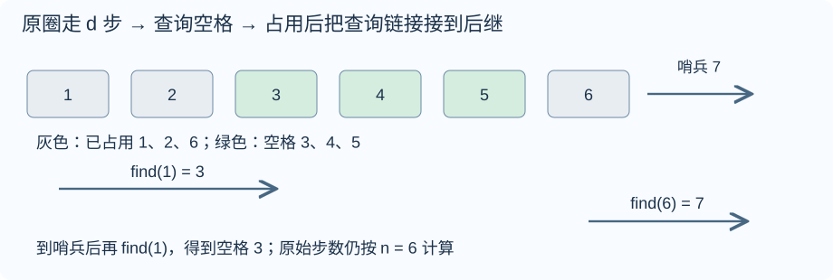
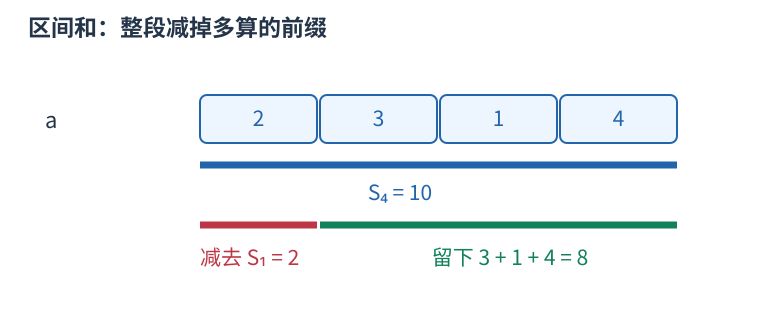
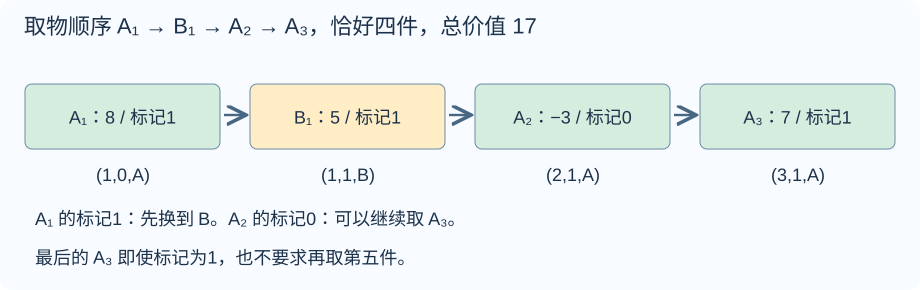
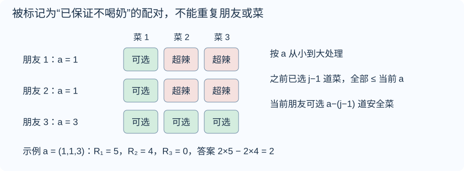
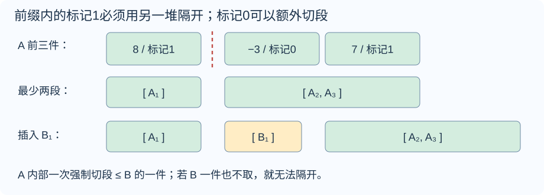

# 周赛 168 题解

> 比赛：[周赛 168](https://ac.nowcoder.com/acm/contest/142559)
> 语言：C++17。收录 B–G，A 为签到题略。 难度为题面与算法复核估分，非牛客官方评级。

## 目录

| 题号 | 题名 | 考点 | 难度 |
|---|---|---|---|
| B | 小月的屏幕 | 模拟 | 900 |
| C | 小月的同余 | 前缀和[主] + 取模与同余 | 1000 |
| D | 小月的储物格 | 并查集[主] + 模拟 | 1200 |
| E | 小月的栈（Easy） | 线性 DP[主] + 前缀和 | 1600 |
| F | 小月的川菜 | 组合计数[主] + 线性 DP | 2000 |
| G | 小月的栈（Hard） | 结论与计数[主] + 前缀和 | 1900 |


## B. 小月的屏幕

### 题意

[原题链接](https://ac.nowcoder.com/acm/contest/142559/B)

给定 $n\times m$ 的屏幕，$\verb@#@$ 表示故障像素，$\verb@.@$ 表示正常像素。统计最外圈中的 $\verb@#@$ 个数。$1\le n,m\le2000$，$nm\le4\times10^5$。

### 从零讲：vector：长度可变的连续数组

<details>
<summary>展开可复用的基础知识</summary>

#### vector：长度可变的连续数组

$\verb@vector<T>@$ 保存一串同类型的元素，适合按下标访问、扫描、排序。$\verb@T@$ 是元素类型，例如 $\verb@vector<int>@$ 保存整数，$\verb@vector<pair<int,int>>@$ 保存整数对，$\verb@vector<vector<int>>@$ 可保存每个顶点各自的邻居。需要 $\verb@<vector>@$。

```cxx
vector<int> a(3, 7);   // 三个元素，内容是 7、7、7
a.push_back(9);       // 在末尾追加，现在长度为 4
int x = a[1];         // 从 0 编号，这里得到 7
a[1] = 2;            // 改第二个元素
int n = int(a.size());
```

$\verb@vector<int> a(3)@$ 创建三个值为零的元素；$\verb@a.reserve(3)@$ 只预留容量，元素数仍为零，此时不能访问 $\verb@a[0]@$。长度 $\verb@size()@$ 与容量 $\verb@capacity()@$ 是不同概念。

下标访问为 $O(1)$，遍历为 $O(n)$。末尾追加通常为 $O(1)$；容量不足时会分配更大的连续空间并搬移元素，这次可能为 $O(n)$，一连串追加的平均成本称为摊还 $O(1)$。中间插入或删除会搬移后续元素，最坏 $O(n)$。内存是元素量的 $O(n)$，并可能预留部分尚未使用的容量。

$\verb@begin()@$ 指向首元素，$\verb@end()@$ 指向尾后位置，$\verb@sort(a.begin(),a.end())@$ 操作整个数组。$\verb@a[i]@$ 不检查越界；下标须满足 $0\le i<\mathrm{size}$。$\verb@at(i)@$ 会检查越界并抛异常。空数组不能访问 $\verb@front()@$、$\verb@back()@$；$\verb@pop_back()@$ 也要求非空。

扩容后指向旧存储的迭代器、引用和指针会失效。遍历的同时 $\verb@push_back@$，不能假定此前取得的引用仍可用。读取大数组的函数常用 $\verb@const vector<int>& a@$ 按常量引用传入，既不复制也禁止通过该引用修改；$\verb@vector<int> a@$ 按值传参则复制内容。选择副本还是引用取决于是否要保留独立数据。


</details>

### 思路

先看图中的四个绿色边缘。最上方的一行、最下方的一行、最左列和最右列共同组成外圈。


如果把四条边分别求和，角会被两条边重复访问。更直接的办法是逐格扫描：读到一个格子时，判断它是否属于上述四条边的并集，只决定一次“计或不计”。

程序下标从零开始，所以边界条件是 $i=0$、$i=n-1$、$j=0$、$j=m-1$ 中至少一个成立，再检查当前字符是否为 $\verb@#@$。逻辑或 $\verb@||@$ 只给出一个真假结果，即使四个条件同时成立，也只执行一次累加。

例如 $n=1$ 时，每个格子都满足 $i=0$，整行都是外圈；无须另外补一份特殊处理。总共检查 $nm$ 个格子，时间 $O(nm)$；代码只保存当前行字符串，额外空间 $O(m)$。

### 参考代码

```cpp
#include <bits/stdc++.h>
using namespace std;
int main() {
    ios::sync_with_stdio(false);
    cin.tie(nullptr);
    int n, m, ans = 0;
    cin >> n >> m;
    for (int i = 0; i < n; ++i) {
        string s;
        cin >> s;
        for (int j = 0; j < m; ++j) {
            // 用一个条件取边界的并集，角和单行、单列均只计一次。
            if (s[j] == '#' && (i == 0 || i == n - 1 || j == 0 || j == m - 1)) ++ans;
        }
    }
    cout << ans << '\n';
}
```

### 易错点

四个角只计一次。$n=1$ 或 $m=1$ 时，所有格子都属于外圈；不要套用只适用于长宽至少为二的周长公式。


## C. 小月的同余

### 题意

[原题链接](https://ac.nowcoder.com/acm/contest/142559/C)

给定 $n$ 个整数及正整数 $m$，统计满足
$$a_1+\cdots+a_i\equiv a_i+\cdots+a_n\pmod m$$
的位置 $i$。两边都包含 $a_i$。$n\le2\times10^5$，$|a_i|\le10^9$，$m\le10^9$。

### 从零讲：整数类型、整除与溢出

<details>
<summary>展开可复用的基础知识</summary>

#### 整数类型、整除与溢出

计算前先看每一步可能达到的范围。常见环境中 $\verb@int@$ 是 32 位，上界约 $2.1\times10^9$；$\verb@long long@$ 至少 64 位，常见有符号 64 位上界约 $9.22\times10^{18}$。$\verb@using ll = long long;@$ 只是为已有类型起别名。

```cxx
int a = 100000, b = 100000;
long long wrong = a * b;      // 右边先按 int 乘，可能已溢出
long long right = 1LL * a * b; // 先把运算提升到 long long
```

不能指望“接收结果的变量够大”修复此前已经溢出的计算。先提高操作数类型，再做乘法。超过 64 位时，GCC 的 $\verb@__int128@$ 可作中间量，但它不是标准 C++17 类型，也没有标准流输出重载；先证明范围，再选择工具。

整数 $\verb@/@$ 对有符号数向零截断：$\verb@7/3==2@$、$\verb@-7/3==-2@$。对非负数才等于向下取整。余数满足 $\verb@a == (a/b)*b + a%b@$，除数不能为零；要将余数归入 $[0,m-1]$（$m>0$），可用 $\verb@(a % m + m) % m@$，同时保证中间加法不溢出。

非负 $a$、正 $b$ 的向上取整可写 $\verb@a/b + (a%b != 0)@$，比 $\verb@(a+b-1)/b@$ 更容易避免加法溢出。比较平方时也应在宽类型内计算；浮点数不适合作为大整数相等的默认判断方式。

$\verb@size()@$ 返回无符号类型。空容器上写 $\verb@size()-1@$ 会绕到很大的数，逆序遍历可以先转成有符号、确认长度，或使用逆向迭代器。$\verb@abs@$ 对最小有符号数无法在同类型中表达其正值，需先约束输入差值范围。一般机器整数运算按常数时间估算，宽类型解决表示范围，不改变算法的增长阶。


</details>

### 从零讲：vector：长度可变的连续数组

<details>
<summary>展开可复用的基础知识</summary>

#### vector：长度可变的连续数组

$\verb@vector<T>@$ 保存一串同类型的元素，适合按下标访问、扫描、排序。$\verb@T@$ 是元素类型，例如 $\verb@vector<int>@$ 保存整数，$\verb@vector<pair<int,int>>@$ 保存整数对，$\verb@vector<vector<int>>@$ 可保存每个顶点各自的邻居。需要 $\verb@<vector>@$。

```cxx
vector<int> a(3, 7);   // 三个元素，内容是 7、7、7
a.push_back(9);       // 在末尾追加，现在长度为 4
int x = a[1];         // 从 0 编号，这里得到 7
a[1] = 2;            // 改第二个元素
int n = int(a.size());
```

$\verb@vector<int> a(3)@$ 创建三个值为零的元素；$\verb@a.reserve(3)@$ 只预留容量，元素数仍为零，此时不能访问 $\verb@a[0]@$。长度 $\verb@size()@$ 与容量 $\verb@capacity()@$ 是不同概念。

下标访问为 $O(1)$，遍历为 $O(n)$。末尾追加通常为 $O(1)$；容量不足时会分配更大的连续空间并搬移元素，这次可能为 $O(n)$，一连串追加的平均成本称为摊还 $O(1)$。中间插入或删除会搬移后续元素，最坏 $O(n)$。内存是元素量的 $O(n)$，并可能预留部分尚未使用的容量。

$\verb@begin()@$ 指向首元素，$\verb@end()@$ 指向尾后位置，$\verb@sort(a.begin(),a.end())@$ 操作整个数组。$\verb@a[i]@$ 不检查越界；下标须满足 $0\le i<\mathrm{size}$。$\verb@at(i)@$ 会检查越界并抛异常。空数组不能访问 $\verb@front()@$、$\verb@back()@$；$\verb@pop_back()@$ 也要求非空。

扩容后指向旧存储的迭代器、引用和指针会失效。遍历的同时 $\verb@push_back@$，不能假定此前取得的引用仍可用。读取大数组的函数常用 $\verb@const vector<int>& a@$ 按常量引用传入，既不复制也禁止通过该引用修改；$\verb@vector<int> a@$ 按值传参则复制内容。选择副本还是引用取决于是否要保留独立数据。


</details>

### 思路

先弄清中间元素属于哪边。图中取第三个位置，左边累加到五，右边从五开始，因此这个五出现在两个和中。


令 $S=a_1+\cdots+a_n$，$P_{i-1}$ 表示当前位置之前的和。则
$$L_i=P_{i-1}+a_i,\qquad R_i=S-P_{i-1}.$$

后缀从 $i$ 开始，所以减去的是 $P_{i-1}$；若误减 $P_i$，就把右边应有的 $a_i$ 一并删掉了。代码按照这个顺序计算：先用旧 $\verb@prefix@$ 得到 $\verb@suffix@$，再执行 $\verb@prefix += x@$。

两个整数同余的定义是它们的差为 $m$ 的整数倍，所以只需判断
$$m\mid(L_i-R_i).$$
例如图中 $L_i=6$、$R_i=12$，差为负六，仍能被三整除。C++ 中负数 $\verb@%@$ 的结果可能为负，但整除时余数始终为零；这里比较是否为零即可，不必分别规范化两个余数。

读取数组时求 $S$，扫描时只维护一个累计和。最多 $2\times10^5$ 个绝对值为 $10^9$ 的数相加，超过 $\verb@int@$，使用 $\verb@long long@$。两次线性扫描，时间 $O(n)$，保存数组的空间 $O(n)$。

### 参考代码

```cpp
#include <bits/stdc++.h>
using namespace std;
int main() {
    ios::sync_with_stdio(false);
    cin.tie(nullptr);
    int n;
    long long m, total = 0, prefix = 0;
    cin >> n >> m;
    vector<long long> a(n);
    for (auto &x : a) { cin >> x; total += x; }
    int ans = 0;
    for (long long x : a) {
        // 此时 prefix 是当前位置之前的和；两边都包含当前的 x。
        long long suffix = total - prefix;
        prefix += x;
        if ((prefix - suffix) % m == 0) ++ans;
    }
    cout << ans << '\n';
}
```

### 易错点

后缀必须在更新前缀之前计算。不要直接比较可能一正一负的 C++ 余数；比较差模 $m$ 是否为零。$m=1$ 时全部位置合法。


## D. 小月的储物格

### 题意

[原题链接](https://ac.nowcoder.com/acm/contest/142559/D)

$n$ 个储物格构成环，起初全空，人从一号开始。每轮先沿原环走 $d_i$ 步，经过已占用格也算步数；若终点已占用，就向前找到第一个空格并占用。求占用格标签和、最后位置。$1\le m\le n\le2\times10^5$，$d_i\le10^9$，标签可为负数。

### 从零讲：整数类型、整除与溢出

<details>
<summary>展开可复用的基础知识</summary>

#### 整数类型、整除与溢出

计算前先看每一步可能达到的范围。常见环境中 $\verb@int@$ 是 32 位，上界约 $2.1\times10^9$；$\verb@long long@$ 至少 64 位，常见有符号 64 位上界约 $9.22\times10^{18}$。$\verb@using ll = long long;@$ 只是为已有类型起别名。

```cxx
int a = 100000, b = 100000;
long long wrong = a * b;      // 右边先按 int 乘，可能已溢出
long long right = 1LL * a * b; // 先把运算提升到 long long
```

不能指望“接收结果的变量够大”修复此前已经溢出的计算。先提高操作数类型，再做乘法。超过 64 位时，GCC 的 $\verb@__int128@$ 可作中间量，但它不是标准 C++17 类型，也没有标准流输出重载；先证明范围，再选择工具。

整数 $\verb@/@$ 对有符号数向零截断：$\verb@7/3==2@$、$\verb@-7/3==-2@$。对非负数才等于向下取整。余数满足 $\verb@a == (a/b)*b + a%b@$，除数不能为零；要将余数归入 $[0,m-1]$（$m>0$），可用 $\verb@(a % m + m) % m@$，同时保证中间加法不溢出。

非负 $a$、正 $b$ 的向上取整可写 $\verb@a/b + (a%b != 0)@$，比 $\verb@(a+b-1)/b@$ 更容易避免加法溢出。比较平方时也应在宽类型内计算；浮点数不适合作为大整数相等的默认判断方式。

$\verb@size()@$ 返回无符号类型。空容器上写 $\verb@size()-1@$ 会绕到很大的数，逆序遍历可以先转成有符号、确认长度，或使用逆向迭代器。$\verb@abs@$ 对最小有符号数无法在同类型中表达其正值，需先约束输入差值范围。一般机器整数运算按常数时间估算，宽类型解决表示范围，不改变算法的增长阶。


</details>

### 从零讲：vector：长度可变的连续数组

<details>
<summary>展开可复用的基础知识</summary>

#### vector：长度可变的连续数组

$\verb@vector<T>@$ 保存一串同类型的元素，适合按下标访问、扫描、排序。$\verb@T@$ 是元素类型，例如 $\verb@vector<int>@$ 保存整数，$\verb@vector<pair<int,int>>@$ 保存整数对，$\verb@vector<vector<int>>@$ 可保存每个顶点各自的邻居。需要 $\verb@<vector>@$。

```cxx
vector<int> a(3, 7);   // 三个元素，内容是 7、7、7
a.push_back(9);       // 在末尾追加，现在长度为 4
int x = a[1];         // 从 0 编号，这里得到 7
a[1] = 2;            // 改第二个元素
int n = int(a.size());
```

$\verb@vector<int> a(3)@$ 创建三个值为零的元素；$\verb@a.reserve(3)@$ 只预留容量，元素数仍为零，此时不能访问 $\verb@a[0]@$。长度 $\verb@size()@$ 与容量 $\verb@capacity()@$ 是不同概念。

下标访问为 $O(1)$，遍历为 $O(n)$。末尾追加通常为 $O(1)$；容量不足时会分配更大的连续空间并搬移元素，这次可能为 $O(n)$，一连串追加的平均成本称为摊还 $O(1)$。中间插入或删除会搬移后续元素，最坏 $O(n)$。内存是元素量的 $O(n)$，并可能预留部分尚未使用的容量。

$\verb@begin()@$ 指向首元素，$\verb@end()@$ 指向尾后位置，$\verb@sort(a.begin(),a.end())@$ 操作整个数组。$\verb@a[i]@$ 不检查越界；下标须满足 $0\le i<\mathrm{size}$。$\verb@at(i)@$ 会检查越界并抛异常。空数组不能访问 $\verb@front()@$、$\verb@back()@$；$\verb@pop_back()@$ 也要求非空。

扩容后指向旧存储的迭代器、引用和指针会失效。遍历的同时 $\verb@push_back@$，不能假定此前取得的引用仍可用。读取大数组的函数常用 $\verb@const vector<int>& a@$ 按常量引用传入，既不复制也禁止通过该引用修改；$\verb@vector<int> a@$ 按值传参则复制内容。选择副本还是引用取决于是否要保留独立数据。


</details>

### 思路

原题包含两种不同的移动，必须分开：先在原来的 $n$ 个格子上走 $d_i$ 步，再从终点开始跳过占用格。第一步不能改成“在剩余空格中走 $d_i$ 步”。

图中灰格一、二、六已占用。如果步数计算落在六号，先查询六以后的空格，发现已经越过末尾，再从一号查，最终到三号。



#### 如何让查询跳过整段占用格

给每个编号一个 $\verb@parent_link@$。空格 $x$ 指向自己，表示“当前第一个空格就是我”；占用它以后，改为指向它后面的第一个空格。哨兵 $n+1$ 一直指向自己。

查询沿链接走到一个指向自己的位置。随后再走一遍刚才的路径，把这些位置全部直接指向终点，这称为路径压缩。它改变的是查询路线，不会改变编号和步数。若终点后来也被占用，它会继续指向更靠后的空格，因此旧链接仍然正确。

例如一号先指向二号，二号被占用后指向三号。查询一号时沿 $1\to2\to3$ 得到三号，并压缩成 $1\to3$。之后再查询一号，就不用重复检查二号。

#### 每轮如何落到代码

将一基编号转成零基，再加步数并取模：
$$start=1+((pos-1+d_i)\bmod n).$$
查询 $\verb@find_next(start)@$，得到哨兵时改为 $\verb@find_next(1)@$。加上该格标签，记录它为新的 $\verb@pos@$，再执行 $\verb@parent_link[pos]=find_next(pos+1)@$。

每轮开始前还剩至少一个空格，因为 $m\le n$；所以环绕后一定能找到。最后一轮占用最后空格时，允许链接接到哨兵，之后不再进行下一轮查询。

初始化使用 $\verb@iota(begin,end,0)@$，它把左闭右开范围依次填成零、一、二等整数，不返回填好的数组，而是直接修改原范围。代码使用迭代循环压缩路径，避免长度为 $n$ 的递归链。这里没有按秩合并，不直接套用一般并查集的更强摊还界；保守总时间 $O((n+m)\log n)$、空间 $O(n)$，足够本题规模。

### 参考代码

```cpp
#include <bits/stdc++.h>
using namespace std;
vector<int> parent_link;
int find_next(int x) {
    int root = x;
    while (parent_link[root] != root) root = parent_link[root];
    // 路径压缩：以后直接跳到当前第一个可用位置。
    while (x != root) { int next = parent_link[x]; parent_link[x] = root; x = next; }
    return root;
}
int main() {
    ios::sync_with_stdio(false);
    cin.tie(nullptr);
    int n, m;
    cin >> n >> m;
    vector<long long> a(n + 1);
    for (int i = 1; i <= n; ++i) cin >> a[i];
    parent_link.resize(n + 2);
    iota(parent_link.begin(), parent_link.end(), 0);
    int pos = 1;
    long long answer = 0;
    for (int turn = 0; turn < m; ++turn) {
        long long d;
        cin >> d;
        // d 按原来的 n 个格子计算，不能只在空格中数步数。
        int start = 1 + (pos - 1 + d) % n;
        pos = find_next(start);
        if (pos == n + 1) pos = find_next(1);
        answer += a[pos];
        parent_link[pos] = find_next(pos + 1);
    }
    cout << answer << ' ' << pos << '\n';
}
```

### 易错点

取模的模数始终是原来的 $n$。必须给 $n+1$ 留空间，不能读取它的标签。标签可能为负，累计和用 $\verb@long long@$。


## E. 小月的栈（Easy）

### 题意

[原题链接](https://ac.nowcoder.com/acm/contest/142559/E)

两堆物品各按从顶到底给出价值和零一标记。恰好取 $k$ 件：刚取标记零，可以从任意非空堆继续；刚取标记一，必须换堆。最大化总价值；无法完成输出 $\verb@IMPOSSIBLE@$。每组 $n,m,k\le2000$，$k\le n+m$，价值绝对值不超过 $10^9$；各参数总和分别不超过 $2\times10^4$。

### 从零讲：整数类型、整除与溢出

<details>
<summary>展开可复用的基础知识</summary>

#### 整数类型、整除与溢出

计算前先看每一步可能达到的范围。常见环境中 $\verb@int@$ 是 32 位，上界约 $2.1\times10^9$；$\verb@long long@$ 至少 64 位，常见有符号 64 位上界约 $9.22\times10^{18}$。$\verb@using ll = long long;@$ 只是为已有类型起别名。

```cxx
int a = 100000, b = 100000;
long long wrong = a * b;      // 右边先按 int 乘，可能已溢出
long long right = 1LL * a * b; // 先把运算提升到 long long
```

不能指望“接收结果的变量够大”修复此前已经溢出的计算。先提高操作数类型，再做乘法。超过 64 位时，GCC 的 $\verb@__int128@$ 可作中间量，但它不是标准 C++17 类型，也没有标准流输出重载；先证明范围，再选择工具。

整数 $\verb@/@$ 对有符号数向零截断：$\verb@7/3==2@$、$\verb@-7/3==-2@$。对非负数才等于向下取整。余数满足 $\verb@a == (a/b)*b + a%b@$，除数不能为零；要将余数归入 $[0,m-1]$（$m>0$），可用 $\verb@(a % m + m) % m@$，同时保证中间加法不溢出。

非负 $a$、正 $b$ 的向上取整可写 $\verb@a/b + (a%b != 0)@$，比 $\verb@(a+b-1)/b@$ 更容易避免加法溢出。比较平方时也应在宽类型内计算；浮点数不适合作为大整数相等的默认判断方式。

$\verb@size()@$ 返回无符号类型。空容器上写 $\verb@size()-1@$ 会绕到很大的数，逆序遍历可以先转成有符号、确认长度，或使用逆向迭代器。$\verb@abs@$ 对最小有符号数无法在同类型中表达其正值，需先约束输入差值范围。一般机器整数运算按常数时间估算，宽类型解决表示范围，不改变算法的增长阶。


</details>

### 从零讲：vector：长度可变的连续数组

<details>
<summary>展开可复用的基础知识</summary>

#### vector：长度可变的连续数组

$\verb@vector<T>@$ 保存一串同类型的元素，适合按下标访问、扫描、排序。$\verb@T@$ 是元素类型，例如 $\verb@vector<int>@$ 保存整数，$\verb@vector<pair<int,int>>@$ 保存整数对，$\verb@vector<vector<int>>@$ 可保存每个顶点各自的邻居。需要 $\verb@<vector>@$。

```cxx
vector<int> a(3, 7);   // 三个元素，内容是 7、7、7
a.push_back(9);       // 在末尾追加，现在长度为 4
int x = a[1];         // 从 0 编号，这里得到 7
a[1] = 2;            // 改第二个元素
int n = int(a.size());
```

$\verb@vector<int> a(3)@$ 创建三个值为零的元素；$\verb@a.reserve(3)@$ 只预留容量，元素数仍为零，此时不能访问 $\verb@a[0]@$。长度 $\verb@size()@$ 与容量 $\verb@capacity()@$ 是不同概念。

下标访问为 $O(1)$，遍历为 $O(n)$。末尾追加通常为 $O(1)$；容量不足时会分配更大的连续空间并搬移元素，这次可能为 $O(n)$，一连串追加的平均成本称为摊还 $O(1)$。中间插入或删除会搬移后续元素，最坏 $O(n)$。内存是元素量的 $O(n)$，并可能预留部分尚未使用的容量。

$\verb@begin()@$ 指向首元素，$\verb@end()@$ 指向尾后位置，$\verb@sort(a.begin(),a.end())@$ 操作整个数组。$\verb@a[i]@$ 不检查越界；下标须满足 $0\le i<\mathrm{size}$。$\verb@at(i)@$ 会检查越界并抛异常。空数组不能访问 $\verb@front()@$、$\verb@back()@$；$\verb@pop_back()@$ 也要求非空。

扩容后指向旧存储的迭代器、引用和指针会失效。遍历的同时 $\verb@push_back@$，不能假定此前取得的引用仍可用。读取大数组的函数常用 $\verb@const vector<int>& a@$ 按常量引用传入，既不复制也禁止通过该引用修改；$\verb@vector<int> a@$ 按值传参则复制内容。选择副本还是引用取决于是否要保留独立数据。


</details>

### 从零讲：前缀和：一段和由两段前缀相减

<details>
<summary>展开可复用的基础知识</summary>

#### 前缀和：一段和由两段前缀相减

一串数需要反复询问连续一段的总和，逐段扫描会重复加很多相同元素。先保存从头到每个位置的累计量，就能复用这些工作。

对从一编号的数组定义 $S_0=0$，$S_i=a_1+\cdots+a_i$。例如 $a=[2,3,1,4]$，前缀为 $S=[0,2,5,6,10]$。



查询 $[2,4]$ 时，$S_4$ 包含第一个数，减去 $S_1$ 后留下 $3+1+4=8$。一般地，$S_r-S_{l-1}$ 中前 $l-1$ 项逐项抵消，只留下第 $l$ 到第 $r$ 项。

```cxx
vector<long long> s(n + 1, 0);
for (int i = 1; i <= n; ++i) s[i] = s[i - 1] + a[i];
long long sum = s[r] - s[l - 1];
```

预处理 $O(n)$ 时间和空间，每次查询 $O(1)$，比 $q$ 次逐段扫描的最坏 $O(nq)$ 更适合大量静态区间和。若使用从零编号的原数组，也可定义 $P_i$ 为前 $i$ 项之和，查询闭区间 $[l,r]$ 为 $P_{r+1}-P_l$；不要混用两套下标。

前缀可以累积满足条件的次数，把每项变成零或一；也可以保存异或，此时相同前缀通过异或抵消。最小值没有同样的可逆减法，不能直接套区间最小值。原数组改变后，后续许多前缀都受影响；频繁在线修改时可考虑树状数组或线段树。

首个空前缀零不可漏，累加类型要覆盖总和。数学上的减法可能得到负值，别让无符号类型把它变成巨大正数。


</details>

### 思路

例如先取 A 堆的八，标记是一，下一步就不能继续取 A。换到 B 取五后，可以回 A；A 的下一件为负三且标记零，又允许留在 A 取七。图中的总价值是 $8+5-3+7=17$。



#### 状态为什么不保存最大价值

同一堆只能从顶端取，所以取 $i$ 件时恰好取到它的前 $i$ 件，不存在另一种物品集合。设两堆的价值前缀和为 $A_i,B_j$，无论怎样穿插，取完这两个前缀的价值都是 $A_i+B_j$。穿插顺序只影响合法性。

因此定义 $\verb@can[i][j][0]@$：A 已取 $i$ 件、B 已取 $j$ 件，且最后一件来自 A，是否存在合法顺序。$\verb@can[i][j][1]@$ 的最后一件来自 B。仅有 $i,j$ 不够，因为下一步的限制来自“刚取的物品”；同样的前缀，结束在不同堆上，后续选择不同。

#### 将规则逐条写成转移

准备取 A 的第 $i+1$ 件时，必须有 $i<n$，并满足以下条件之一：

- 还没取过物品，允许任选第一堆；
- 最后来自 B，换到 A 总是满足标记规则；
- 最后来自 A，且 A 的第 $i$ 件标记为零，可以不换堆。

成立就把 $\verb@can[i+1][j][0]@$ 置为真。对 B 完全对称。代码从较小 $i,j$ 向较大下标推进，每条转移只增加其中一个下标，因此读取的前驱已经算好。到 $k$ 件后无需再取，即使最后标记为一，也没有额外要求。

最后枚举 $\max(0,k-m)\le i\le\min(n,k)$，令 $j=k-i$。只要任一结束堆可达，就用前缀和更新答案。$k=0$ 直接对应空方案，价值为零。其余合法方案可能全为负，答案初值必须用极小值，不能从零开始。

$\verb@array<char,2>@$ 保存两个可达标记，是固定长度二的数组；外层两个 $\verb@vector@$ 分别按 $i,j$ 组织，初始化为两个零。算法复杂度为 $O(nm)$ 时间与 $O(nm+n+m)$ 空间。该版本的二维规模可接受，代码不依赖困难版的额外判据。

### 参考代码

```cpp
#include <bits/stdc++.h>
using namespace std;
int main() {
    ios::sync_with_stdio(false);
    cin.tie(nullptr);
    int T;
    cin >> T;
    while (T--) {
        int n, m, k;
        cin >> n >> m >> k;
        vector<long long> a(n + 1), b(m + 1);
        vector<int> c(n + 1), d(m + 1);
        for (int i = 1; i <= n; ++i) { cin >> a[i] >> c[i]; a[i] += a[i - 1]; }
        for (int j = 1; j <= m; ++j) { cin >> b[j] >> d[j]; b[j] += b[j - 1]; }
        vector<vector<array<char, 2>>> can(n + 1, vector<array<char, 2>>(m + 1, {0, 0}));
        for (int i = 0; i <= n && i <= k; ++i) {
            for (int j = 0; j <= m && i + j <= k; ++j) {
                bool empty = i + j == 0;
                if (i < n && (empty || can[i][j][1] || (can[i][j][0] && c[i] == 0)))
                    can[i + 1][j][0] = 1;
                if (j < m && (empty || can[i][j][0] || (can[i][j][1] && d[j] == 0)))
                    can[i][j + 1][1] = 1;
            }
        }
        long long best = LLONG_MIN;
        for (int i = max(0, k - m); i <= min(n, k); ++i) {
            int j = k - i;
            // 相同前缀的总价值固定；DP 只需记录能否到达。
            if (k == 0 || can[i][j][0] || can[i][j][1]) best = max(best, a[i] + b[j]);
        }
        if (best == LLONG_MIN) cout << "IMPOSSIBLE\n";
        else cout << best << '\n';
    }
}
```

### 易错点

必须恰好取 $k$ 件，不能因为下一件为负而提前停止。零件的空方案合法；最后一件标记一不会强制多取一件。


## F. 小月的川菜

### 题意

[原题链接](https://ac.nowcoder.com/acm/contest/142559/F)

将辣度 $1,\ldots,n$ 的菜一一分给 $n$ 位朋友。朋友 $i$ 收到辣度大于 $a_i$ 的菜就喝一杯奶。求恰好两人喝奶的分配数，模 $10^9+7$。$2\le n\le400$，$0\le a_i\le n$，所有测试的 $n$ 之和不超过四百。

### 从零讲：整数类型、整除与溢出

<details>
<summary>展开可复用的基础知识</summary>

#### 整数类型、整除与溢出

计算前先看每一步可能达到的范围。常见环境中 $\verb@int@$ 是 32 位，上界约 $2.1\times10^9$；$\verb@long long@$ 至少 64 位，常见有符号 64 位上界约 $9.22\times10^{18}$。$\verb@using ll = long long;@$ 只是为已有类型起别名。

```cxx
int a = 100000, b = 100000;
long long wrong = a * b;      // 右边先按 int 乘，可能已溢出
long long right = 1LL * a * b; // 先把运算提升到 long long
```

不能指望“接收结果的变量够大”修复此前已经溢出的计算。先提高操作数类型，再做乘法。超过 64 位时，GCC 的 $\verb@__int128@$ 可作中间量，但它不是标准 C++17 类型，也没有标准流输出重载；先证明范围，再选择工具。

整数 $\verb@/@$ 对有符号数向零截断：$\verb@7/3==2@$、$\verb@-7/3==-2@$。对非负数才等于向下取整。余数满足 $\verb@a == (a/b)*b + a%b@$，除数不能为零；要将余数归入 $[0,m-1]$（$m>0$），可用 $\verb@(a % m + m) % m@$，同时保证中间加法不溢出。

非负 $a$、正 $b$ 的向上取整可写 $\verb@a/b + (a%b != 0)@$，比 $\verb@(a+b-1)/b@$ 更容易避免加法溢出。比较平方时也应在宽类型内计算；浮点数不适合作为大整数相等的默认判断方式。

$\verb@size()@$ 返回无符号类型。空容器上写 $\verb@size()-1@$ 会绕到很大的数，逆序遍历可以先转成有符号、确认长度，或使用逆向迭代器。$\verb@abs@$ 对最小有符号数无法在同类型中表达其正值，需先约束输入差值范围。一般机器整数运算按常数时间估算，宽类型解决表示范围，不改变算法的增长阶。


</details>

### 从零讲：vector：长度可变的连续数组

<details>
<summary>展开可复用的基础知识</summary>

#### vector：长度可变的连续数组

$\verb@vector<T>@$ 保存一串同类型的元素，适合按下标访问、扫描、排序。$\verb@T@$ 是元素类型，例如 $\verb@vector<int>@$ 保存整数，$\verb@vector<pair<int,int>>@$ 保存整数对，$\verb@vector<vector<int>>@$ 可保存每个顶点各自的邻居。需要 $\verb@<vector>@$。

```cxx
vector<int> a(3, 7);   // 三个元素，内容是 7、7、7
a.push_back(9);       // 在末尾追加，现在长度为 4
int x = a[1];         // 从 0 编号，这里得到 7
a[1] = 2;            // 改第二个元素
int n = int(a.size());
```

$\verb@vector<int> a(3)@$ 创建三个值为零的元素；$\verb@a.reserve(3)@$ 只预留容量，元素数仍为零，此时不能访问 $\verb@a[0]@$。长度 $\verb@size()@$ 与容量 $\verb@capacity()@$ 是不同概念。

下标访问为 $O(1)$，遍历为 $O(n)$。末尾追加通常为 $O(1)$；容量不足时会分配更大的连续空间并搬移元素，这次可能为 $O(n)$，一连串追加的平均成本称为摊还 $O(1)$。中间插入或删除会搬移后续元素，最坏 $O(n)$。内存是元素量的 $O(n)$，并可能预留部分尚未使用的容量。

$\verb@begin()@$ 指向首元素，$\verb@end()@$ 指向尾后位置，$\verb@sort(a.begin(),a.end())@$ 操作整个数组。$\verb@a[i]@$ 不检查越界；下标须满足 $0\le i<\mathrm{size}$。$\verb@at(i)@$ 会检查越界并抛异常。空数组不能访问 $\verb@front()@$、$\verb@back()@$；$\verb@pop_back()@$ 也要求非空。

扩容后指向旧存储的迭代器、引用和指针会失效。遍历的同时 $\verb@push_back@$，不能假定此前取得的引用仍可用。读取大数组的函数常用 $\verb@const vector<int>& a@$ 按常量引用传入，既不复制也禁止通过该引用修改；$\verb@vector<int> a@$ 按值传参则复制内容。选择副本还是引用取决于是否要保留独立数据。


</details>

### 思路

直接挑两位喝奶的人，再给所有人分菜，会同时受到“菜不能重复”和“其余人必须安全”的约束。先把问题改成较容易计数的对象：任选一些朋友，给他们分配不同的安全菜，剩余朋友暂时不处理。

#### 安全菜集合为什么便于递推

朋友阈值为 $a$ 时，安全菜正好是编号 $1$ 到 $a$。把朋友按阈值递增排序，只改变处理顺序，不合并同阈值的不同朋友。



令 $R_j$ 表示在已经处理的朋友里选中 $j$ 人，并给每人一份不同安全菜的方案数；未被选中的朋友没有分菜。起点 $R_0=1$，代表什么都不选。

处理阈值为 $a$ 的新朋友时，可以不选他，也可以选他。如果此前选了 $j-1$ 人，由于他们的阈值都不大于 $a$，已经用掉的 $j-1$ 道菜全部位于当前安全集合 $\{1,\ldots,a\}$，且互不重复。因此恰好剩 $a-(j-1)$ 道菜可选：
$$R_j\gets R_j+R_{j-1}\max(0,a-j+1).$$
这个乘数数的是“当前朋友可选的安全菜”，不是当前剩余朋友数。倒序更新 $j$，保证右侧的 $R_{j-1}$ 来自处理当前朋友之前，避免一位朋友被重复选中。

#### 留出两个人，为什么还不是答案

选中 $n-2$ 位朋友并保证安全后，剩两位分剩下的两道菜，有 $2!=2$ 种排列。所以 $S_2=2R_{n-2}$。类似地，留一位得到 $S_1=R_{n-1}$，全部保证安全得到 $S_0=R_n$。

这些数会把喝奶人数不足两人的分配重复算入。固定一份实际分配，若有 $b$ 位喝奶，所有喝奶的人必须落在“留出、不保证安全”的集合里。于是：

| 实际 $b$ | 留出两人的选法 | 留出一人的选法 | 不留人的选法 |
|---|---|---|---|
| 零 | 任意选两人：$\binom n2$ | 任意选一人：$n$ | 一种 |
| 一 | 喝奶者加另一人：$n-1$ | 只能是喝奶者：一种 | 无 |
| 二 | 只能是两位喝奶者：一种 | 无 | 无 |
| 大于二 | 放不下全部喝奶者 | 放不下 | 放不下 |

先用 $S_2-(n-1)S_1$ 消掉恰好一人喝奶的分配。全不喝奶的每份方案，此时系数为 $\binom n2-n(n-1)=-\binom n2$；再加 $\binom n2 S_0$，也把它们消掉。因此
$$\boxed{\text{ans}=2R_{n-2}-(n-1)R_{n-1}+\binom n2R_n}.$$

图中 $a=(1,1,3)$，递推得到 $R_1=5,R_2=4,R_3=0$，答案 $2\times5-2\times4=2$。实际两份分配为 $(2,3,1)$ 和 $(3,2,1)$：前两位都喝奶，第三位安全。

所有递推和最后组合都对 $10^9+7$ 取模。乘法先在 $\verb@long long@$ 中进行；最后可能得到负余数，再加模数并取模。$\binom n2=n(n-1)/2$ 是一个普通整数，先算整除再取模，无须乘法逆元。排序后二维递推，时间 $O(n^2)$、额外空间 $O(n)$。

### 参考代码

```cpp
#include <bits/stdc++.h>
using namespace std;
const long long MOD = 1000000007;
int main() {
    ios::sync_with_stdio(false);
    cin.tie(nullptr);
    int T;
    cin >> T;
    while (T--) {
        int n;
        cin >> n;
        vector<int> a(n);
        for (int &x : a) cin >> x;
        sort(a.begin(), a.end());
        vector<long long> rook(n + 1);
        rook[0] = 1;
        for (int i = 0; i < n; ++i) {
            // 倒序保证 rook[j-1] 仍属于处理当前朋友之前。
            for (int j = i + 1; j >= 1; --j) {
                long long choices = max(0, a[i] - j + 1);
                rook[j] = (rook[j] + rook[j - 1] * choices) % MOD;
            }
        }
        long long pairs = 1LL * n * (n - 1) / 2 % MOD;
        long long ans = (2 * rook[n - 2] - (n - 1) * rook[n - 1] + pairs * rook[n]) % MOD;
        cout << (ans + MOD) % MOD << '\n';
    }
}
```

### 易错点

安全条件是菜编号小于等于阈值。重复阈值的朋友仍互相区分。滚动数组必须倒序更新；$n=2$ 时要正确保留 $R_0=1$。


## G. 小月的栈（Hard）

### 题意

[原题链接](https://ac.nowcoder.com/acm/contest/142559/G)

两堆从顶到底给出价值和标记，恰好取 $k$ 件并最大化总价值。刚取标记一必须换堆，标记零可以任选下一堆；无法完成输出 $\verb@IMPOSSIBLE@$。本题 $n,m\le2\times10^5$，$0\le k\le n+m$，各组 $n,m$ 总和分别不超过 $2\times10^5$，$k$ 总和不超过 $4\times10^5$。

### 从零讲：整数类型、整除与溢出

<details>
<summary>展开可复用的基础知识</summary>

#### 整数类型、整除与溢出

计算前先看每一步可能达到的范围。常见环境中 $\verb@int@$ 是 32 位，上界约 $2.1\times10^9$；$\verb@long long@$ 至少 64 位，常见有符号 64 位上界约 $9.22\times10^{18}$。$\verb@using ll = long long;@$ 只是为已有类型起别名。

```cxx
int a = 100000, b = 100000;
long long wrong = a * b;      // 右边先按 int 乘，可能已溢出
long long right = 1LL * a * b; // 先把运算提升到 long long
```

不能指望“接收结果的变量够大”修复此前已经溢出的计算。先提高操作数类型，再做乘法。超过 64 位时，GCC 的 $\verb@__int128@$ 可作中间量，但它不是标准 C++17 类型，也没有标准流输出重载；先证明范围，再选择工具。

整数 $\verb@/@$ 对有符号数向零截断：$\verb@7/3==2@$、$\verb@-7/3==-2@$。对非负数才等于向下取整。余数满足 $\verb@a == (a/b)*b + a%b@$，除数不能为零；要将余数归入 $[0,m-1]$（$m>0$），可用 $\verb@(a % m + m) % m@$，同时保证中间加法不溢出。

非负 $a$、正 $b$ 的向上取整可写 $\verb@a/b + (a%b != 0)@$，比 $\verb@(a+b-1)/b@$ 更容易避免加法溢出。比较平方时也应在宽类型内计算；浮点数不适合作为大整数相等的默认判断方式。

$\verb@size()@$ 返回无符号类型。空容器上写 $\verb@size()-1@$ 会绕到很大的数，逆序遍历可以先转成有符号、确认长度，或使用逆向迭代器。$\verb@abs@$ 对最小有符号数无法在同类型中表达其正值，需先约束输入差值范围。一般机器整数运算按常数时间估算，宽类型解决表示范围，不改变算法的增长阶。


</details>

### 从零讲：vector：长度可变的连续数组

<details>
<summary>展开可复用的基础知识</summary>

#### vector：长度可变的连续数组

$\verb@vector<T>@$ 保存一串同类型的元素，适合按下标访问、扫描、排序。$\verb@T@$ 是元素类型，例如 $\verb@vector<int>@$ 保存整数，$\verb@vector<pair<int,int>>@$ 保存整数对，$\verb@vector<vector<int>>@$ 可保存每个顶点各自的邻居。需要 $\verb@<vector>@$。

```cxx
vector<int> a(3, 7);   // 三个元素，内容是 7、7、7
a.push_back(9);       // 在末尾追加，现在长度为 4
int x = a[1];         // 从 0 编号，这里得到 7
a[1] = 2;            // 改第二个元素
int n = int(a.size());
```

$\verb@vector<int> a(3)@$ 创建三个值为零的元素；$\verb@a.reserve(3)@$ 只预留容量，元素数仍为零，此时不能访问 $\verb@a[0]@$。长度 $\verb@size()@$ 与容量 $\verb@capacity()@$ 是不同概念。

下标访问为 $O(1)$，遍历为 $O(n)$。末尾追加通常为 $O(1)$；容量不足时会分配更大的连续空间并搬移元素，这次可能为 $O(n)$，一连串追加的平均成本称为摊还 $O(1)$。中间插入或删除会搬移后续元素，最坏 $O(n)$。内存是元素量的 $O(n)$，并可能预留部分尚未使用的容量。

$\verb@begin()@$ 指向首元素，$\verb@end()@$ 指向尾后位置，$\verb@sort(a.begin(),a.end())@$ 操作整个数组。$\verb@a[i]@$ 不检查越界；下标须满足 $0\le i<\mathrm{size}$。$\verb@at(i)@$ 会检查越界并抛异常。空数组不能访问 $\verb@front()@$、$\verb@back()@$；$\verb@pop_back()@$ 也要求非空。

扩容后指向旧存储的迭代器、引用和指针会失效。遍历的同时 $\verb@push_back@$，不能假定此前取得的引用仍可用。读取大数组的函数常用 $\verb@const vector<int>& a@$ 按常量引用传入，既不复制也禁止通过该引用修改；$\verb@vector<int> a@$ 按值传参则复制内容。选择副本还是引用取决于是否要保留独立数据。


</details>

### 从零讲：前缀和：一段和由两段前缀相减

<details>
<summary>展开可复用的基础知识</summary>

#### 前缀和：一段和由两段前缀相减

一串数需要反复询问连续一段的总和，逐段扫描会重复加很多相同元素。先保存从头到每个位置的累计量，就能复用这些工作。

对从一编号的数组定义 $S_0=0$，$S_i=a_1+\cdots+a_i$。例如 $a=[2,3,1,4]$，前缀为 $S=[0,2,5,6,10]$。


查询 $[2,4]$ 时，$S_4$ 包含第一个数，减去 $S_1$ 后留下 $3+1+4=8$。一般地，$S_r-S_{l-1}$ 中前 $l-1$ 项逐项抵消，只留下第 $l$ 到第 $r$ 项。

```cxx
vector<long long> s(n + 1, 0);
for (int i = 1; i <= n; ++i) s[i] = s[i - 1] + a[i];
long long sum = s[r] - s[l - 1];
```

预处理 $O(n)$ 时间和空间，每次查询 $O(1)$，比 $q$ 次逐段扫描的最坏 $O(nq)$ 更适合大量静态区间和。若使用从零编号的原数组，也可定义 $P_i$ 为前 $i$ 项之和，查询闭区间 $[l,r]$ 为 $P_{r+1}-P_l$；不要混用两套下标。

前缀可以累积满足条件的次数，把每项变成零或一；也可以保存异或，此时相同前缀通过异或抵消。最小值没有同样的可逆减法，不能直接套区间最小值。原数组改变后，后续许多前缀都受影响；频繁在线修改时可考虑树状数组或线段树。

首个空前缀零不可漏，累加类型要覆盖总和。数学上的减法可能得到负值，别让无符号类型把它变成巨大正数。


</details>

### 思路

考虑图中 A 的前三件、B 的第一件。A 的第一件标记一，取完以后必须插入 B，才能继续取 A 的第二件；A 的第二件标记零，所以第二、三件可以连取。合法顺序为 A、B、A、A。



#### 先确定取哪些物品

从一堆取 $i$ 件，只可能拿它的前 $i$ 件。因此枚举取 A 的数量 $i$，B 就必须取 $j=k-i$ 件，价值为 $A_i+B_j$。困难只剩“这两个前缀能否穿插”。

若 A 的前 $i-1$ 件中有 $q_A$ 个标记一，每个后面都还要继续拿 A 的下一件，中间必有至少一件 B。不同强制间隔需要不同 B 物品，所以 $q_A\le j$。对称得到 $q_B\le i$。注意只数到倒数第二件：整个过程可以结束在当前前缀的最后一件，它的标记不强迫多取。

#### 为什么这两个条件也足够

将 A 前缀在每个内部标记一之后切开。得到至少 $q_A+1$ 段，每段内部所有相邻取物都合法，因为只有标记零后才会继续留在同堆。如果需要更多段，还可以在任意未切开的零后切，因此 A 的可选段数覆盖区间 $[q_A+1,i]$。B 的可选段数覆盖 $[q_B+1,j]$。

两种段交替排列，只要求段数相差不超过一。若 A 的最小段数不超过 B 的最小段数，就先让 B 取最小段数，再把 A 增加到相同数量或少一；能做到是因为 $q_B+1\le i+1$。另一种大小关系完全对称，使用 $q_A+1\le j+1$。于是两条必要条件恰好也保证了交替拼接存在。

段与段之间换堆，无论段尾标记零还是一都合法。段内又不会越过未切开的标记一，因此整个拼接合法。若只有一堆取非空前缀，另一堆数量为零，条件强迫其所有内部标记为零，直接取该前缀就行。两边都空则是 $k=0$，答案零。

#### 线性实现

分别预处理价值前缀和 $\verb@a,b@$ 与标记一的数量前缀和 $\verb@ones_a,ones_b@$。枚举
$$\max(0,k-m)\le i\le\min(n,k),\quad j=k-i.$$
以 $\verb@ones_a[i-1]@$、$\verb@ones_b[j-1]@$ 作两次比较；前缀为空时取零。检查与取价值都是 $O(1)$，所以总时间 $O(n+m+k)$，空间 $O(n+m)$。

与“总价值非负”的问题不同，本题可以被迫取负价值物品。使用 $\verb@LLONG_MIN@$ 区分完全不可行，任何可行值即使为负，也要参与最大值比较。

### 参考代码

```cpp
#include <bits/stdc++.h>
using namespace std;
int main() {
    ios::sync_with_stdio(false);
    cin.tie(nullptr);
    int T;
    cin >> T;
    while (T--) {
        int n, m, k;
        cin >> n >> m >> k;
        vector<long long> a(n + 1), b(m + 1);
        vector<int> ones_a(n + 1), ones_b(m + 1);
        for (int i = 1, flag; i <= n; ++i) {
            cin >> a[i] >> flag; a[i] += a[i - 1]; ones_a[i] = ones_a[i - 1] + flag;
        }
        for (int j = 1, flag; j <= m; ++j) {
            cin >> b[j] >> flag; b[j] += b[j - 1]; ones_b[j] = ones_b[j - 1] + flag;
        }
        long long best = LLONG_MIN;
        for (int i = max(0, k - m); i <= min(n, k); ++i) {
            int j = k - i;
            // 仅统计前缀内部的强制换堆；最后一件后无须继续取。
            int cut_a = i ? ones_a[i - 1] : 0;
            int cut_b = j ? ones_b[j - 1] : 0;
            if (cut_a <= j && cut_b <= i) best = max(best, a[i] + b[j]);
        }
        if (best == LLONG_MIN) cout << "IMPOSSIBLE\n";
        else cout << best << '\n';
    }
}
```

### 易错点

计数是前 $i-1$、前 $j-1$ 件，不含各前缀最后一件。空前缀不能访问下标负一。所有合法值都可能为负；不可行才输出 $\verb@IMPOSSIBLE@$。


## 实测记录

6 份参考程序与独立基准均已编译，参考程序无警告。
官方样例 13 组、边界 23 条、随机对拍 4600 组全过；各题随机种子见归档验证脚本。
极限计时：B 0.006 s；C 0.021 s；D 0.033 s；E 0.011 s；F 0.007 s；G 0.052/0.055 s，每例三次取最小，均通过题面时限。
默认版与详细版逐题读取同一份验证源码；文档格式、代码一致性和渲染另有验收日志。
