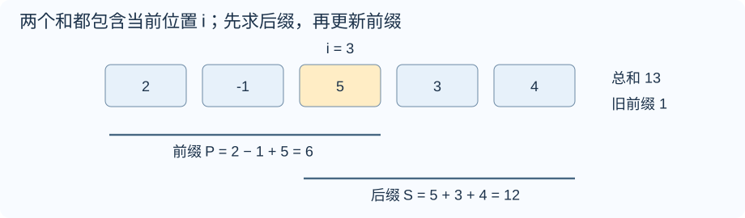
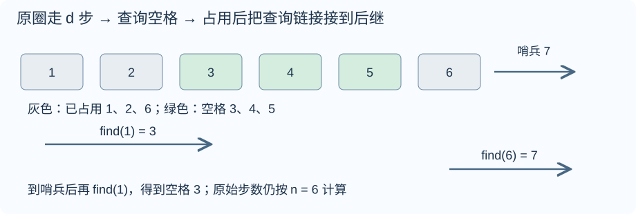
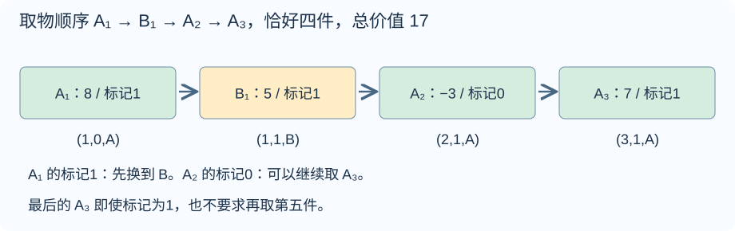
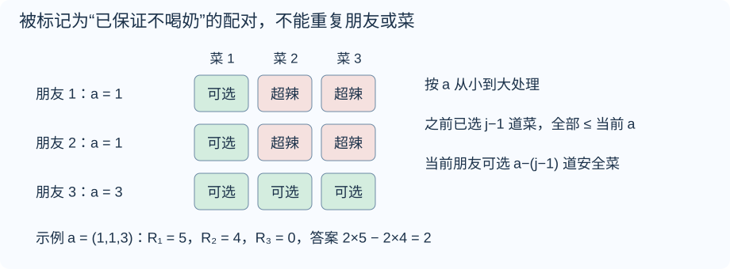
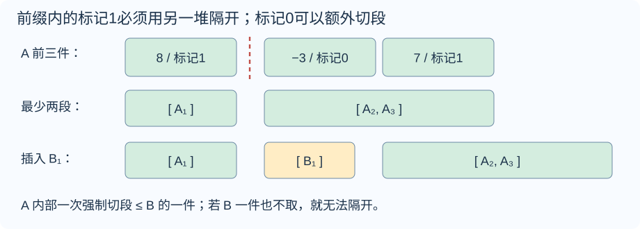

# 周赛 168 题解

> 比赛：[周赛 168](https://ac.nowcoder.com/acm/contest/142559)
> 语言：C++17。收录 B–G，A 为签到题略。 难度为题面与算法复核估分，非牛客官方评级。

## 目录

| 题号 | 题名 | 考点 | 难度 |
|---|---|---|---|
| B | 小月的屏幕 | 模拟 | 900 |
| C | 小月的同余 | 前缀和[主] + 取模与同余 | 1000 |
| D | 小月的储物格 | 并查集[主] + 模拟 | 1200 |
| E | 小月的栈（Easy） | 线性 DP[主] + 前缀和 | 1600 |
| F | 小月的川菜 | 组合计数[主] + 线性 DP | 2000 |
| G | 小月的栈（Hard） | 结论与计数[主] + 前缀和 | 1900 |


## B. 小月的屏幕

### 题意

[原题链接](https://ac.nowcoder.com/acm/contest/142559/B)

给定 $n\times m$ 的屏幕，$\verb@#@$ 表示故障像素，$\verb@.@$ 表示正常像素。统计最外圈中的 $\verb@#@$ 个数。$1\le n,m\le2000$，$nm\le4\times10^5$。

### 从零讲：vector：长度可变的连续数组

<details>
<summary>展开可复用的基础知识</summary>

#### vector：长度可变的连续数组

$\verb@vector<T>@$ 保存一串同类型的元素，适合按下标访问、扫描、排序。$\verb@T@$ 是元素类型，例如 $\verb@vector<int>@$ 保存整数，$\verb@vector<pair<int,int>>@$ 保存整数对，$\verb@vector<vector<int>>@$ 可保存每个顶点各自的邻居。需要 $\verb@<vector>@$。

```cxx
vector<int> a(3, 7);   // 三个元素，内容是 7、7、7
a.push_back(9);       // 在末尾追加，现在长度为 4
int x = a[1];         // 从 0 编号，这里得到 7
a[1] = 2;            // 改第二个元素
int n = int(a.size());
```

$\verb@vector<int> a(3)@$ 创建三个值为零的元素；$\verb@a.reserve(3)@$ 只预留容量，元素数仍为零，此时不能访问 $\verb@a[0]@$。长度 $\verb@size()@$ 与容量 $\verb@capacity()@$ 是不同概念。

下标访问为 $O(1)$，遍历为 $O(n)$。末尾追加通常为 $O(1)$；容量不足时会分配更大的连续空间并搬移元素，这次可能为 $O(n)$，一连串追加的平均成本称为摊还 $O(1)$。中间插入或删除会搬移后续元素，最坏 $O(n)$。内存是元素量的 $O(n)$，并可能预留部分尚未使用的容量。

$\verb@begin()@$ 指向首元素，$\verb@end()@$ 指向尾后位置，$\verb@sort(a.begin(),a.end())@$ 操作整个数组。$\verb@a[i]@$ 不检查越界；下标须满足 $0\le i<\mathrm{size}$。$\verb@at(i)@$ 会检查越界并抛异常。空数组不能访问 $\verb@front()@$、$\verb@back()@$；$\verb@pop_back()@$ 也要求非空。

扩容后指向旧存储的迭代器、引用和指针会失效。遍历的同时 $\verb@push_back@$，不能假定此前取得的引用仍可用。读取大数组的函数常用 $\verb@const vector<int>& a@$ 按常量引用传入，既不复制也禁止通过该引用修改；$\verb@vector<int> a@$ 按值传参则复制内容。选择副本还是引用取决于是否要保留独立数据。


</details>

### 思路

逐格扫描，用“位于第一行、最后一行、第一列、最后一列之一”判断是否在外圈。每个格子只访问一次，满足边界条件且为 $\verb@#@$ 就加一，因此角不会重复计数，单行、单列也自动适用。


时间 $O(nm)$，逐行读入时额外空间 $O(m)$。

### 参考代码

```cpp
#include <bits/stdc++.h>
using namespace std;
int main() {
    ios::sync_with_stdio(false);
    cin.tie(nullptr);
    int n, m, ans = 0;
    cin >> n >> m;
    for (int i = 0; i < n; ++i) {
        string s;
        cin >> s;
        for (int j = 0; j < m; ++j) {
            // 用一个条件取边界的并集，角和单行、单列均只计一次。
            if (s[j] == '#' && (i == 0 || i == n - 1 || j == 0 || j == m - 1)) ++ans;
        }
    }
    cout << ans << '\n';
}
```

### 易错点

四个角只计一次。$n=1$ 或 $m=1$ 时，所有格子都属于外圈；不要套用只适用于长宽至少为二的周长公式。


## C. 小月的同余

### 题意

[原题链接](https://ac.nowcoder.com/acm/contest/142559/C)

给定 $n$ 个整数及正整数 $m$，统计满足
$$a_1+\cdots+a_i\equiv a_i+\cdots+a_n\pmod m$$
的位置 $i$。两边都包含 $a_i$。$n\le2\times10^5$，$|a_i|\le10^9$，$m\le10^9$。

### 从零讲：整数类型、整除与溢出

<details>
<summary>展开可复用的基础知识</summary>

#### 整数类型、整除与溢出

计算前先看每一步可能达到的范围。常见环境中 $\verb@int@$ 是 32 位，上界约 $2.1\times10^9$；$\verb@long long@$ 至少 64 位，常见有符号 64 位上界约 $9.22\times10^{18}$。$\verb@using ll = long long;@$ 只是为已有类型起别名。

```cxx
int a = 100000, b = 100000;
long long wrong = a * b;      // 右边先按 int 乘，可能已溢出
long long right = 1LL * a * b; // 先把运算提升到 long long
```

不能指望“接收结果的变量够大”修复此前已经溢出的计算。先提高操作数类型，再做乘法。超过 64 位时，GCC 的 $\verb@__int128@$ 可作中间量，但它不是标准 C++17 类型，也没有标准流输出重载；先证明范围，再选择工具。

整数 $\verb@/@$ 对有符号数向零截断：$\verb@7/3==2@$、$\verb@-7/3==-2@$。对非负数才等于向下取整。余数满足 $\verb@a == (a/b)*b + a%b@$，除数不能为零；要将余数归入 $[0,m-1]$（$m>0$），可用 $\verb@(a % m + m) % m@$，同时保证中间加法不溢出。

非负 $a$、正 $b$ 的向上取整可写 $\verb@a/b + (a%b != 0)@$，比 $\verb@(a+b-1)/b@$ 更容易避免加法溢出。比较平方时也应在宽类型内计算；浮点数不适合作为大整数相等的默认判断方式。

$\verb@size()@$ 返回无符号类型。空容器上写 $\verb@size()-1@$ 会绕到很大的数，逆序遍历可以先转成有符号、确认长度，或使用逆向迭代器。$\verb@abs@$ 对最小有符号数无法在同类型中表达其正值，需先约束输入差值范围。一般机器整数运算按常数时间估算，宽类型解决表示范围，不改变算法的增长阶。


</details>

### 从零讲：vector：长度可变的连续数组

<details>
<summary>展开可复用的基础知识</summary>

#### vector：长度可变的连续数组

$\verb@vector<T>@$ 保存一串同类型的元素，适合按下标访问、扫描、排序。$\verb@T@$ 是元素类型，例如 $\verb@vector<int>@$ 保存整数，$\verb@vector<pair<int,int>>@$ 保存整数对，$\verb@vector<vector<int>>@$ 可保存每个顶点各自的邻居。需要 $\verb@<vector>@$。

```cxx
vector<int> a(3, 7);   // 三个元素，内容是 7、7、7
a.push_back(9);       // 在末尾追加，现在长度为 4
int x = a[1];         // 从 0 编号，这里得到 7
a[1] = 2;            // 改第二个元素
int n = int(a.size());
```

$\verb@vector<int> a(3)@$ 创建三个值为零的元素；$\verb@a.reserve(3)@$ 只预留容量，元素数仍为零，此时不能访问 $\verb@a[0]@$。长度 $\verb@size()@$ 与容量 $\verb@capacity()@$ 是不同概念。

下标访问为 $O(1)$，遍历为 $O(n)$。末尾追加通常为 $O(1)$；容量不足时会分配更大的连续空间并搬移元素，这次可能为 $O(n)$，一连串追加的平均成本称为摊还 $O(1)$。中间插入或删除会搬移后续元素，最坏 $O(n)$。内存是元素量的 $O(n)$，并可能预留部分尚未使用的容量。

$\verb@begin()@$ 指向首元素，$\verb@end()@$ 指向尾后位置，$\verb@sort(a.begin(),a.end())@$ 操作整个数组。$\verb@a[i]@$ 不检查越界；下标须满足 $0\le i<\mathrm{size}$。$\verb@at(i)@$ 会检查越界并抛异常。空数组不能访问 $\verb@front()@$、$\verb@back()@$；$\verb@pop_back()@$ 也要求非空。

扩容后指向旧存储的迭代器、引用和指针会失效。遍历的同时 $\verb@push_back@$，不能假定此前取得的引用仍可用。读取大数组的函数常用 $\verb@const vector<int>& a@$ 按常量引用传入，既不复制也禁止通过该引用修改；$\verb@vector<int> a@$ 按值传参则复制内容。选择副本还是引用取决于是否要保留独立数据。


</details>

### 思路

先求总和 $\verb@total@$，再扫描位置。进入当前位置时，$\verb@prefix@$ 是它之前的和，因此后缀为 $\verb@total-prefix@$；再把当前元素加入 $\verb@prefix@$，便得到本题的两个和。



同余等价于差能被 $m$ 整除，直接判断 $\verb@(prefix-suffix)%m==0@$。这也避免了 C++ 中一正一负的余数表示不同的问题。图中两边为六和十二，若 $m=3$，该位置合法。

时间 $O(n)$，空间 $O(n)$；和及差用 $\verb@long long@$。

### 参考代码

```cpp
#include <bits/stdc++.h>
using namespace std;
int main() {
    ios::sync_with_stdio(false);
    cin.tie(nullptr);
    int n;
    long long m, total = 0, prefix = 0;
    cin >> n >> m;
    vector<long long> a(n);
    for (auto &x : a) { cin >> x; total += x; }
    int ans = 0;
    for (long long x : a) {
        // 此时 prefix 是当前位置之前的和；两边都包含当前的 x。
        long long suffix = total - prefix;
        prefix += x;
        if ((prefix - suffix) % m == 0) ++ans;
    }
    cout << ans << '\n';
}
```

### 易错点

后缀必须在更新前缀之前计算。不要直接比较可能一正一负的 C++ 余数；比较差模 $m$ 是否为零。$m=1$ 时全部位置合法。


## D. 小月的储物格

### 题意

[原题链接](https://ac.nowcoder.com/acm/contest/142559/D)

$n$ 个储物格构成环，起初全空，人从一号开始。每轮先沿原环走 $d_i$ 步，经过已占用格也算步数；若终点已占用，就向前找到第一个空格并占用。求占用格标签和、最后位置。$1\le m\le n\le2\times10^5$，$d_i\le10^9$，标签可为负数。

### 从零讲：整数类型、整除与溢出

<details>
<summary>展开可复用的基础知识</summary>

#### 整数类型、整除与溢出

计算前先看每一步可能达到的范围。常见环境中 $\verb@int@$ 是 32 位，上界约 $2.1\times10^9$；$\verb@long long@$ 至少 64 位，常见有符号 64 位上界约 $9.22\times10^{18}$。$\verb@using ll = long long;@$ 只是为已有类型起别名。

```cxx
int a = 100000, b = 100000;
long long wrong = a * b;      // 右边先按 int 乘，可能已溢出
long long right = 1LL * a * b; // 先把运算提升到 long long
```

不能指望“接收结果的变量够大”修复此前已经溢出的计算。先提高操作数类型，再做乘法。超过 64 位时，GCC 的 $\verb@__int128@$ 可作中间量，但它不是标准 C++17 类型，也没有标准流输出重载；先证明范围，再选择工具。

整数 $\verb@/@$ 对有符号数向零截断：$\verb@7/3==2@$、$\verb@-7/3==-2@$。对非负数才等于向下取整。余数满足 $\verb@a == (a/b)*b + a%b@$，除数不能为零；要将余数归入 $[0,m-1]$（$m>0$），可用 $\verb@(a % m + m) % m@$，同时保证中间加法不溢出。

非负 $a$、正 $b$ 的向上取整可写 $\verb@a/b + (a%b != 0)@$，比 $\verb@(a+b-1)/b@$ 更容易避免加法溢出。比较平方时也应在宽类型内计算；浮点数不适合作为大整数相等的默认判断方式。

$\verb@size()@$ 返回无符号类型。空容器上写 $\verb@size()-1@$ 会绕到很大的数，逆序遍历可以先转成有符号、确认长度，或使用逆向迭代器。$\verb@abs@$ 对最小有符号数无法在同类型中表达其正值，需先约束输入差值范围。一般机器整数运算按常数时间估算，宽类型解决表示范围，不改变算法的增长阶。


</details>

### 从零讲：vector：长度可变的连续数组

<details>
<summary>展开可复用的基础知识</summary>

#### vector：长度可变的连续数组

$\verb@vector<T>@$ 保存一串同类型的元素，适合按下标访问、扫描、排序。$\verb@T@$ 是元素类型，例如 $\verb@vector<int>@$ 保存整数，$\verb@vector<pair<int,int>>@$ 保存整数对，$\verb@vector<vector<int>>@$ 可保存每个顶点各自的邻居。需要 $\verb@<vector>@$。

```cxx
vector<int> a(3, 7);   // 三个元素，内容是 7、7、7
a.push_back(9);       // 在末尾追加，现在长度为 4
int x = a[1];         // 从 0 编号，这里得到 7
a[1] = 2;            // 改第二个元素
int n = int(a.size());
```

$\verb@vector<int> a(3)@$ 创建三个值为零的元素；$\verb@a.reserve(3)@$ 只预留容量，元素数仍为零，此时不能访问 $\verb@a[0]@$。长度 $\verb@size()@$ 与容量 $\verb@capacity()@$ 是不同概念。

下标访问为 $O(1)$，遍历为 $O(n)$。末尾追加通常为 $O(1)$；容量不足时会分配更大的连续空间并搬移元素，这次可能为 $O(n)$，一连串追加的平均成本称为摊还 $O(1)$。中间插入或删除会搬移后续元素，最坏 $O(n)$。内存是元素量的 $O(n)$，并可能预留部分尚未使用的容量。

$\verb@begin()@$ 指向首元素，$\verb@end()@$ 指向尾后位置，$\verb@sort(a.begin(),a.end())@$ 操作整个数组。$\verb@a[i]@$ 不检查越界；下标须满足 $0\le i<\mathrm{size}$。$\verb@at(i)@$ 会检查越界并抛异常。空数组不能访问 $\verb@front()@$、$\verb@back()@$；$\verb@pop_back()@$ 也要求非空。

扩容后指向旧存储的迭代器、引用和指针会失效。遍历的同时 $\verb@push_back@$，不能假定此前取得的引用仍可用。读取大数组的函数常用 $\verb@const vector<int>& a@$ 按常量引用传入，既不复制也禁止通过该引用修改；$\verb@vector<int> a@$ 按值传参则复制内容。选择副本还是引用取决于是否要保留独立数据。


</details>

### 思路

每轮的原始起点是 $1+((pos-1+d_i)\bmod n)$。真正需要优化的是之后“寻找第一个空格”的过程。

用后继链接维护 $\verb@find_next(x)@$：返回编号至少为 $x$ 的第一个空格，不存在则返回哨兵 $n+1$。空格最初指向自己；占用 $x$ 后，把它指向 $\verb@find_next(x+1)@$。查找时压缩经过的链接，避免反复逐格跳过已占用部分。



从原始起点查询，若得到哨兵，再查询一号，就实现环绕。最后一次全部占满后不再查询，哨兵始终保留。

路径压缩但不按秩合并，保守总时间界为 $O((n+m)\log n)$，空间 $O(n)$。标签和用 $\verb@long long@$。

### 参考代码

```cpp
#include <bits/stdc++.h>
using namespace std;
vector<int> parent_link;
int find_next(int x) {
    int root = x;
    while (parent_link[root] != root) root = parent_link[root];
    // 路径压缩：以后直接跳到当前第一个可用位置。
    while (x != root) { int next = parent_link[x]; parent_link[x] = root; x = next; }
    return root;
}
int main() {
    ios::sync_with_stdio(false);
    cin.tie(nullptr);
    int n, m;
    cin >> n >> m;
    vector<long long> a(n + 1);
    for (int i = 1; i <= n; ++i) cin >> a[i];
    parent_link.resize(n + 2);
    iota(parent_link.begin(), parent_link.end(), 0);
    int pos = 1;
    long long answer = 0;
    for (int turn = 0; turn < m; ++turn) {
        long long d;
        cin >> d;
        // d 按原来的 n 个格子计算，不能只在空格中数步数。
        int start = 1 + (pos - 1 + d) % n;
        pos = find_next(start);
        if (pos == n + 1) pos = find_next(1);
        answer += a[pos];
        parent_link[pos] = find_next(pos + 1);
    }
    cout << answer << ' ' << pos << '\n';
}
```

### 易错点

取模的模数始终是原来的 $n$。必须给 $n+1$ 留空间，不能读取它的标签。标签可能为负，累计和用 $\verb@long long@$。


## E. 小月的栈（Easy）

### 题意

[原题链接](https://ac.nowcoder.com/acm/contest/142559/E)

两堆物品各按从顶到底给出价值和零一标记。恰好取 $k$ 件：刚取标记零，可以从任意非空堆继续；刚取标记一，必须换堆。最大化总价值；无法完成输出 $\verb@IMPOSSIBLE@$。每组 $n,m,k\le2000$，$k\le n+m$，价值绝对值不超过 $10^9$；各参数总和分别不超过 $2\times10^4$。

### 从零讲：整数类型、整除与溢出

<details>
<summary>展开可复用的基础知识</summary>

#### 整数类型、整除与溢出

计算前先看每一步可能达到的范围。常见环境中 $\verb@int@$ 是 32 位，上界约 $2.1\times10^9$；$\verb@long long@$ 至少 64 位，常见有符号 64 位上界约 $9.22\times10^{18}$。$\verb@using ll = long long;@$ 只是为已有类型起别名。

```cxx
int a = 100000, b = 100000;
long long wrong = a * b;      // 右边先按 int 乘，可能已溢出
long long right = 1LL * a * b; // 先把运算提升到 long long
```

不能指望“接收结果的变量够大”修复此前已经溢出的计算。先提高操作数类型，再做乘法。超过 64 位时，GCC 的 $\verb@__int128@$ 可作中间量，但它不是标准 C++17 类型，也没有标准流输出重载；先证明范围，再选择工具。

整数 $\verb@/@$ 对有符号数向零截断：$\verb@7/3==2@$、$\verb@-7/3==-2@$。对非负数才等于向下取整。余数满足 $\verb@a == (a/b)*b + a%b@$，除数不能为零；要将余数归入 $[0,m-1]$（$m>0$），可用 $\verb@(a % m + m) % m@$，同时保证中间加法不溢出。

非负 $a$、正 $b$ 的向上取整可写 $\verb@a/b + (a%b != 0)@$，比 $\verb@(a+b-1)/b@$ 更容易避免加法溢出。比较平方时也应在宽类型内计算；浮点数不适合作为大整数相等的默认判断方式。

$\verb@size()@$ 返回无符号类型。空容器上写 $\verb@size()-1@$ 会绕到很大的数，逆序遍历可以先转成有符号、确认长度，或使用逆向迭代器。$\verb@abs@$ 对最小有符号数无法在同类型中表达其正值，需先约束输入差值范围。一般机器整数运算按常数时间估算，宽类型解决表示范围，不改变算法的增长阶。


</details>

### 从零讲：vector：长度可变的连续数组

<details>
<summary>展开可复用的基础知识</summary>

#### vector：长度可变的连续数组

$\verb@vector<T>@$ 保存一串同类型的元素，适合按下标访问、扫描、排序。$\verb@T@$ 是元素类型，例如 $\verb@vector<int>@$ 保存整数，$\verb@vector<pair<int,int>>@$ 保存整数对，$\verb@vector<vector<int>>@$ 可保存每个顶点各自的邻居。需要 $\verb@<vector>@$。

```cxx
vector<int> a(3, 7);   // 三个元素，内容是 7、7、7
a.push_back(9);       // 在末尾追加，现在长度为 4
int x = a[1];         // 从 0 编号，这里得到 7
a[1] = 2;            // 改第二个元素
int n = int(a.size());
```

$\verb@vector<int> a(3)@$ 创建三个值为零的元素；$\verb@a.reserve(3)@$ 只预留容量，元素数仍为零，此时不能访问 $\verb@a[0]@$。长度 $\verb@size()@$ 与容量 $\verb@capacity()@$ 是不同概念。

下标访问为 $O(1)$，遍历为 $O(n)$。末尾追加通常为 $O(1)$；容量不足时会分配更大的连续空间并搬移元素，这次可能为 $O(n)$，一连串追加的平均成本称为摊还 $O(1)$。中间插入或删除会搬移后续元素，最坏 $O(n)$。内存是元素量的 $O(n)$，并可能预留部分尚未使用的容量。

$\verb@begin()@$ 指向首元素，$\verb@end()@$ 指向尾后位置，$\verb@sort(a.begin(),a.end())@$ 操作整个数组。$\verb@a[i]@$ 不检查越界；下标须满足 $0\le i<\mathrm{size}$。$\verb@at(i)@$ 会检查越界并抛异常。空数组不能访问 $\verb@front()@$、$\verb@back()@$；$\verb@pop_back()@$ 也要求非空。

扩容后指向旧存储的迭代器、引用和指针会失效。遍历的同时 $\verb@push_back@$，不能假定此前取得的引用仍可用。读取大数组的函数常用 $\verb@const vector<int>& a@$ 按常量引用传入，既不复制也禁止通过该引用修改；$\verb@vector<int> a@$ 按值传参则复制内容。选择副本还是引用取决于是否要保留独立数据。


</details>

### 从零讲：前缀和：一段和由两段前缀相减

<details>
<summary>展开可复用的基础知识</summary>

#### 前缀和：一段和由两段前缀相减

一串数需要反复询问连续一段的总和，逐段扫描会重复加很多相同元素。先保存从头到每个位置的累计量，就能复用这些工作。

对从一编号的数组定义 $S_0=0$，$S_i=a_1+\cdots+a_i$。例如 $a=[2,3,1,4]$，前缀为 $S=[0,2,5,6,10]$。


查询 $[2,4]$ 时，$S_4$ 包含第一个数，减去 $S_1$ 后留下 $3+1+4=8$。一般地，$S_r-S_{l-1}$ 中前 $l-1$ 项逐项抵消，只留下第 $l$ 到第 $r$ 项。

```cxx
vector<long long> s(n + 1, 0);
for (int i = 1; i <= n; ++i) s[i] = s[i - 1] + a[i];
long long sum = s[r] - s[l - 1];
```

预处理 $O(n)$ 时间和空间，每次查询 $O(1)$，比 $q$ 次逐段扫描的最坏 $O(nq)$ 更适合大量静态区间和。若使用从零编号的原数组，也可定义 $P_i$ 为前 $i$ 项之和，查询闭区间 $[l,r]$ 为 $P_{r+1}-P_l$；不要混用两套下标。

前缀可以累积满足条件的次数，把每项变成零或一；也可以保存异或，此时相同前缀通过异或抵消。最小值没有同样的可逆减法，不能直接套区间最小值。原数组改变后，后续许多前缀都受影响；频繁在线修改时可考虑树状数组或线段树。

首个空前缀零不可漏，累加类型要覆盖总和。数学上的减法可能得到负值，别让无符号类型把它变成巨大正数。


</details>

### 思路

取走的一定是两堆的两个前缀。若分别取了 $i,j$ 件，总价值固定为 $A_i+B_j$，只需判断这些前缀是否能按规则取到。

设 $\verb@can[i][j][0/1]@$ 分别表示取了这两个前缀、最后来自 A/B 堆的状态是否可达。从 A 状态继续取 A，要求刚取的 $c_i=0$；从 B 状态取 A，总是允许，只要 A 尚未空。向 B 的转移对称。空状态可以任选第一堆。



最终枚举 $i+j=k$ 的可达状态，取 $A_i+B_j$ 最大值。可达性与价值分开保存，因此负价值不会被误判为不可达。

时间 $O(nm)$，空间 $O(nm+n+m)$；只处理 $i+j\le k$ 的状态。

### 参考代码

```cpp
#include <bits/stdc++.h>
using namespace std;
int main() {
    ios::sync_with_stdio(false);
    cin.tie(nullptr);
    int T;
    cin >> T;
    while (T--) {
        int n, m, k;
        cin >> n >> m >> k;
        vector<long long> a(n + 1), b(m + 1);
        vector<int> c(n + 1), d(m + 1);
        for (int i = 1; i <= n; ++i) { cin >> a[i] >> c[i]; a[i] += a[i - 1]; }
        for (int j = 1; j <= m; ++j) { cin >> b[j] >> d[j]; b[j] += b[j - 1]; }
        vector<vector<array<char, 2>>> can(n + 1, vector<array<char, 2>>(m + 1, {0, 0}));
        for (int i = 0; i <= n && i <= k; ++i) {
            for (int j = 0; j <= m && i + j <= k; ++j) {
                bool empty = i + j == 0;
                if (i < n && (empty || can[i][j][1] || (can[i][j][0] && c[i] == 0)))
                    can[i + 1][j][0] = 1;
                if (j < m && (empty || can[i][j][0] || (can[i][j][1] && d[j] == 0)))
                    can[i][j + 1][1] = 1;
            }
        }
        long long best = LLONG_MIN;
        for (int i = max(0, k - m); i <= min(n, k); ++i) {
            int j = k - i;
            // 相同前缀的总价值固定；DP 只需记录能否到达。
            if (k == 0 || can[i][j][0] || can[i][j][1]) best = max(best, a[i] + b[j]);
        }
        if (best == LLONG_MIN) cout << "IMPOSSIBLE\n";
        else cout << best << '\n';
    }
}
```

### 易错点

必须恰好取 $k$ 件，不能因为下一件为负而提前停止。零件的空方案合法；最后一件标记一不会强制多取一件。


## F. 小月的川菜

### 题意

[原题链接](https://ac.nowcoder.com/acm/contest/142559/F)

将辣度 $1,\ldots,n$ 的菜一一分给 $n$ 位朋友。朋友 $i$ 收到辣度大于 $a_i$ 的菜就喝一杯奶。求恰好两人喝奶的分配数，模 $10^9+7$。$2\le n\le400$，$0\le a_i\le n$，所有测试的 $n$ 之和不超过四百。

### 从零讲：整数类型、整除与溢出

<details>
<summary>展开可复用的基础知识</summary>

#### 整数类型、整除与溢出

计算前先看每一步可能达到的范围。常见环境中 $\verb@int@$ 是 32 位，上界约 $2.1\times10^9$；$\verb@long long@$ 至少 64 位，常见有符号 64 位上界约 $9.22\times10^{18}$。$\verb@using ll = long long;@$ 只是为已有类型起别名。

```cxx
int a = 100000, b = 100000;
long long wrong = a * b;      // 右边先按 int 乘，可能已溢出
long long right = 1LL * a * b; // 先把运算提升到 long long
```

不能指望“接收结果的变量够大”修复此前已经溢出的计算。先提高操作数类型，再做乘法。超过 64 位时，GCC 的 $\verb@__int128@$ 可作中间量，但它不是标准 C++17 类型，也没有标准流输出重载；先证明范围，再选择工具。

整数 $\verb@/@$ 对有符号数向零截断：$\verb@7/3==2@$、$\verb@-7/3==-2@$。对非负数才等于向下取整。余数满足 $\verb@a == (a/b)*b + a%b@$，除数不能为零；要将余数归入 $[0,m-1]$（$m>0$），可用 $\verb@(a % m + m) % m@$，同时保证中间加法不溢出。

非负 $a$、正 $b$ 的向上取整可写 $\verb@a/b + (a%b != 0)@$，比 $\verb@(a+b-1)/b@$ 更容易避免加法溢出。比较平方时也应在宽类型内计算；浮点数不适合作为大整数相等的默认判断方式。

$\verb@size()@$ 返回无符号类型。空容器上写 $\verb@size()-1@$ 会绕到很大的数，逆序遍历可以先转成有符号、确认长度，或使用逆向迭代器。$\verb@abs@$ 对最小有符号数无法在同类型中表达其正值，需先约束输入差值范围。一般机器整数运算按常数时间估算，宽类型解决表示范围，不改变算法的增长阶。


</details>

### 从零讲：vector：长度可变的连续数组

<details>
<summary>展开可复用的基础知识</summary>

#### vector：长度可变的连续数组

$\verb@vector<T>@$ 保存一串同类型的元素，适合按下标访问、扫描、排序。$\verb@T@$ 是元素类型，例如 $\verb@vector<int>@$ 保存整数，$\verb@vector<pair<int,int>>@$ 保存整数对，$\verb@vector<vector<int>>@$ 可保存每个顶点各自的邻居。需要 $\verb@<vector>@$。

```cxx
vector<int> a(3, 7);   // 三个元素，内容是 7、7、7
a.push_back(9);       // 在末尾追加，现在长度为 4
int x = a[1];         // 从 0 编号，这里得到 7
a[1] = 2;            // 改第二个元素
int n = int(a.size());
```

$\verb@vector<int> a(3)@$ 创建三个值为零的元素；$\verb@a.reserve(3)@$ 只预留容量，元素数仍为零，此时不能访问 $\verb@a[0]@$。长度 $\verb@size()@$ 与容量 $\verb@capacity()@$ 是不同概念。

下标访问为 $O(1)$，遍历为 $O(n)$。末尾追加通常为 $O(1)$；容量不足时会分配更大的连续空间并搬移元素，这次可能为 $O(n)$，一连串追加的平均成本称为摊还 $O(1)$。中间插入或删除会搬移后续元素，最坏 $O(n)$。内存是元素量的 $O(n)$，并可能预留部分尚未使用的容量。

$\verb@begin()@$ 指向首元素，$\verb@end()@$ 指向尾后位置，$\verb@sort(a.begin(),a.end())@$ 操作整个数组。$\verb@a[i]@$ 不检查越界；下标须满足 $0\le i<\mathrm{size}$。$\verb@at(i)@$ 会检查越界并抛异常。空数组不能访问 $\verb@front()@$、$\verb@back()@$；$\verb@pop_back()@$ 也要求非空。

扩容后指向旧存储的迭代器、引用和指针会失效。遍历的同时 $\verb@push_back@$，不能假定此前取得的引用仍可用。读取大数组的函数常用 $\verb@const vector<int>& a@$ 按常量引用传入，既不复制也禁止通过该引用修改；$\verb@vector<int> a@$ 按值传参则复制内容。选择副本还是引用取决于是否要保留独立数据。


</details>

### 思路

先计数“挑出若干位朋友，并保证他们不喝奶”的部分配对。令 $R_j$ 为挑出 $j$ 位朋友、给他们分配不同安全菜的方案数。把阈值排序后，处理当前阈值 $a$ 时，原先 $j-1$ 道已选安全菜都不超过 $a$，故新增配对有 $a-j+1$ 种。



不选择当前朋友，原 $R_j$ 保留；选择则增加 $R_{j-1}(a-j+1)$，系数为负时视为零。倒序更新 $j$。

记 $S_2=2R_{n-2}$、$S_1=R_{n-1}$、$S_0=R_n$，含义分别为留出二、一、零位朋友任意分配。对于实际有 $b$ 人喝奶的一份完整分配，三项的计数次数如下：

| 实际喝奶人数 | $S_2$ | $S_1$ | $S_0$ |
|---|---|---|---|
| 零 | $\binom n2$ | $n$ | 一 |
| 一 | $n-1$ | 一 | 零 |
| 二 | 一 | 零 | 零 |
| 多于二 | 零 | 零 | 零 |

所以答案是
$$S_2-(n-1)S_1+\binom n2 S_0=2R_{n-2}-(n-1)R_{n-1}+\binom n2R_n.$$
代入每一行可见：只保留实际恰好两人喝奶的方案，各一次。时间 $O(n^2)$，空间 $O(n)$。

### 参考代码

```cpp
#include <bits/stdc++.h>
using namespace std;
const long long MOD = 1000000007;
int main() {
    ios::sync_with_stdio(false);
    cin.tie(nullptr);
    int T;
    cin >> T;
    while (T--) {
        int n;
        cin >> n;
        vector<int> a(n);
        for (int &x : a) cin >> x;
        sort(a.begin(), a.end());
        vector<long long> rook(n + 1);
        rook[0] = 1;
        for (int i = 0; i < n; ++i) {
            // 倒序保证 rook[j-1] 仍属于处理当前朋友之前。
            for (int j = i + 1; j >= 1; --j) {
                long long choices = max(0, a[i] - j + 1);
                rook[j] = (rook[j] + rook[j - 1] * choices) % MOD;
            }
        }
        long long pairs = 1LL * n * (n - 1) / 2 % MOD;
        long long ans = (2 * rook[n - 2] - (n - 1) * rook[n - 1] + pairs * rook[n]) % MOD;
        cout << (ans + MOD) % MOD << '\n';
    }
}
```

### 易错点

安全条件是菜编号小于等于阈值。重复阈值的朋友仍互相区分。滚动数组必须倒序更新；$n=2$ 时要正确保留 $R_0=1$。


## G. 小月的栈（Hard）

### 题意

[原题链接](https://ac.nowcoder.com/acm/contest/142559/G)

两堆从顶到底给出价值和标记，恰好取 $k$ 件并最大化总价值。刚取标记一必须换堆，标记零可以任选下一堆；无法完成输出 $\verb@IMPOSSIBLE@$。本题 $n,m\le2\times10^5$，$0\le k\le n+m$，各组 $n,m$ 总和分别不超过 $2\times10^5$，$k$ 总和不超过 $4\times10^5$。

### 从零讲：整数类型、整除与溢出

<details>
<summary>展开可复用的基础知识</summary>

#### 整数类型、整除与溢出

计算前先看每一步可能达到的范围。常见环境中 $\verb@int@$ 是 32 位，上界约 $2.1\times10^9$；$\verb@long long@$ 至少 64 位，常见有符号 64 位上界约 $9.22\times10^{18}$。$\verb@using ll = long long;@$ 只是为已有类型起别名。

```cxx
int a = 100000, b = 100000;
long long wrong = a * b;      // 右边先按 int 乘，可能已溢出
long long right = 1LL * a * b; // 先把运算提升到 long long
```

不能指望“接收结果的变量够大”修复此前已经溢出的计算。先提高操作数类型，再做乘法。超过 64 位时，GCC 的 $\verb@__int128@$ 可作中间量，但它不是标准 C++17 类型，也没有标准流输出重载；先证明范围，再选择工具。

整数 $\verb@/@$ 对有符号数向零截断：$\verb@7/3==2@$、$\verb@-7/3==-2@$。对非负数才等于向下取整。余数满足 $\verb@a == (a/b)*b + a%b@$，除数不能为零；要将余数归入 $[0,m-1]$（$m>0$），可用 $\verb@(a % m + m) % m@$，同时保证中间加法不溢出。

非负 $a$、正 $b$ 的向上取整可写 $\verb@a/b + (a%b != 0)@$，比 $\verb@(a+b-1)/b@$ 更容易避免加法溢出。比较平方时也应在宽类型内计算；浮点数不适合作为大整数相等的默认判断方式。

$\verb@size()@$ 返回无符号类型。空容器上写 $\verb@size()-1@$ 会绕到很大的数，逆序遍历可以先转成有符号、确认长度，或使用逆向迭代器。$\verb@abs@$ 对最小有符号数无法在同类型中表达其正值，需先约束输入差值范围。一般机器整数运算按常数时间估算，宽类型解决表示范围，不改变算法的增长阶。


</details>

### 从零讲：vector：长度可变的连续数组

<details>
<summary>展开可复用的基础知识</summary>

#### vector：长度可变的连续数组

$\verb@vector<T>@$ 保存一串同类型的元素，适合按下标访问、扫描、排序。$\verb@T@$ 是元素类型，例如 $\verb@vector<int>@$ 保存整数，$\verb@vector<pair<int,int>>@$ 保存整数对，$\verb@vector<vector<int>>@$ 可保存每个顶点各自的邻居。需要 $\verb@<vector>@$。

```cxx
vector<int> a(3, 7);   // 三个元素，内容是 7、7、7
a.push_back(9);       // 在末尾追加，现在长度为 4
int x = a[1];         // 从 0 编号，这里得到 7
a[1] = 2;            // 改第二个元素
int n = int(a.size());
```

$\verb@vector<int> a(3)@$ 创建三个值为零的元素；$\verb@a.reserve(3)@$ 只预留容量，元素数仍为零，此时不能访问 $\verb@a[0]@$。长度 $\verb@size()@$ 与容量 $\verb@capacity()@$ 是不同概念。

下标访问为 $O(1)$，遍历为 $O(n)$。末尾追加通常为 $O(1)$；容量不足时会分配更大的连续空间并搬移元素，这次可能为 $O(n)$，一连串追加的平均成本称为摊还 $O(1)$。中间插入或删除会搬移后续元素，最坏 $O(n)$。内存是元素量的 $O(n)$，并可能预留部分尚未使用的容量。

$\verb@begin()@$ 指向首元素，$\verb@end()@$ 指向尾后位置，$\verb@sort(a.begin(),a.end())@$ 操作整个数组。$\verb@a[i]@$ 不检查越界；下标须满足 $0\le i<\mathrm{size}$。$\verb@at(i)@$ 会检查越界并抛异常。空数组不能访问 $\verb@front()@$、$\verb@back()@$；$\verb@pop_back()@$ 也要求非空。

扩容后指向旧存储的迭代器、引用和指针会失效。遍历的同时 $\verb@push_back@$，不能假定此前取得的引用仍可用。读取大数组的函数常用 $\verb@const vector<int>& a@$ 按常量引用传入，既不复制也禁止通过该引用修改；$\verb@vector<int> a@$ 按值传参则复制内容。选择副本还是引用取决于是否要保留独立数据。


</details>

### 从零讲：前缀和：一段和由两段前缀相减

<details>
<summary>展开可复用的基础知识</summary>

#### 前缀和：一段和由两段前缀相减

一串数需要反复询问连续一段的总和，逐段扫描会重复加很多相同元素。先保存从头到每个位置的累计量，就能复用这些工作。

对从一编号的数组定义 $S_0=0$，$S_i=a_1+\cdots+a_i$。例如 $a=[2,3,1,4]$，前缀为 $S=[0,2,5,6,10]$。


查询 $[2,4]$ 时，$S_4$ 包含第一个数，减去 $S_1$ 后留下 $3+1+4=8$。一般地，$S_r-S_{l-1}$ 中前 $l-1$ 项逐项抵消，只留下第 $l$ 到第 $r$ 项。

```cxx
vector<long long> s(n + 1, 0);
for (int i = 1; i <= n; ++i) s[i] = s[i - 1] + a[i];
long long sum = s[r] - s[l - 1];
```

预处理 $O(n)$ 时间和空间，每次查询 $O(1)$，比 $q$ 次逐段扫描的最坏 $O(nq)$ 更适合大量静态区间和。若使用从零编号的原数组，也可定义 $P_i$ 为前 $i$ 项之和，查询闭区间 $[l,r]$ 为 $P_{r+1}-P_l$；不要混用两套下标。

前缀可以累积满足条件的次数，把每项变成零或一；也可以保存异或，此时相同前缀通过异或抵消。最小值没有同样的可逆减法，不能直接套区间最小值。原数组改变后，后续许多前缀都受影响；频繁在线修改时可考虑树状数组或线段树。

首个空前缀零不可漏，累加类型要覆盖总和。数学上的减法可能得到负值，别让无符号类型把它变成巨大正数。


</details>

### 思路

固定取 A 的前 $i$ 件、B 的前 $j$ 件，其中 $i+j=k$。令 $q_A$ 为 A 前 $i-1$ 件中的标记一个数，$q_B$ 为 B 前 $j-1$ 件中的标记一个数；空前缀对应零。可行条件恰好为
$$q_A\le j,\qquad q_B\le i.$$



必要性：A 内部的每个标记一都要求下一件来自 B，至少需要 $q_A$ 件 B，反向同理。

充分性：非空 A 前缀在内部标记一后强制切段，最少 $q_A+1$ 段；在标记零后还可继续切，故段数可取 $[q_A+1,i]$。B 同理为 $[q_B+1,j]$。两条不等式保证可以各选一个段数，差不超过一；将两类段交替排列即可。若某前缀为空，条件保证另一堆除最后一件外全为零，直接连续取完。

枚举合法 $i$，由两堆前缀和得到价值，由标记一的前缀计数检查条件，取最大。时间 $O(n+m+k)$，空间 $O(n+m)$。

### 参考代码

```cpp
#include <bits/stdc++.h>
using namespace std;
int main() {
    ios::sync_with_stdio(false);
    cin.tie(nullptr);
    int T;
    cin >> T;
    while (T--) {
        int n, m, k;
        cin >> n >> m >> k;
        vector<long long> a(n + 1), b(m + 1);
        vector<int> ones_a(n + 1), ones_b(m + 1);
        for (int i = 1, flag; i <= n; ++i) {
            cin >> a[i] >> flag; a[i] += a[i - 1]; ones_a[i] = ones_a[i - 1] + flag;
        }
        for (int j = 1, flag; j <= m; ++j) {
            cin >> b[j] >> flag; b[j] += b[j - 1]; ones_b[j] = ones_b[j - 1] + flag;
        }
        long long best = LLONG_MIN;
        for (int i = max(0, k - m); i <= min(n, k); ++i) {
            int j = k - i;
            // 仅统计前缀内部的强制换堆；最后一件后无须继续取。
            int cut_a = i ? ones_a[i - 1] : 0;
            int cut_b = j ? ones_b[j - 1] : 0;
            if (cut_a <= j && cut_b <= i) best = max(best, a[i] + b[j]);
        }
        if (best == LLONG_MIN) cout << "IMPOSSIBLE\n";
        else cout << best << '\n';
    }
}
```

### 易错点

计数是前 $i-1$、前 $j-1$ 件，不含各前缀最后一件。空前缀不能访问下标负一。所有合法值都可能为负；不可行才输出 $\verb@IMPOSSIBLE@$。


## 实测记录

6 份参考程序与独立基准均已编译，参考程序无警告。
官方样例 13 组、边界 23 条、随机对拍 4600 组全过；各题随机种子见归档验证脚本。
极限计时：B 0.006 s；C 0.021 s；D 0.033 s；E 0.011 s；F 0.007 s；G 0.052/0.055 s，每例三次取最小，均通过题面时限。
默认版与详细版逐题读取同一份验证源码；文档格式、代码一致性和渲染另有验收日志。
