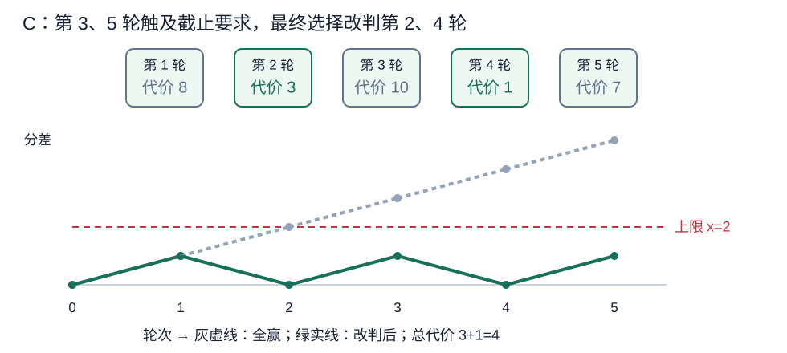
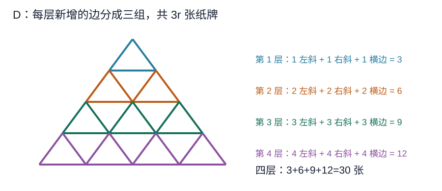
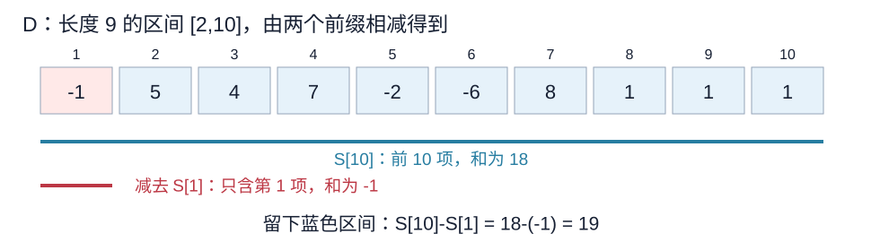
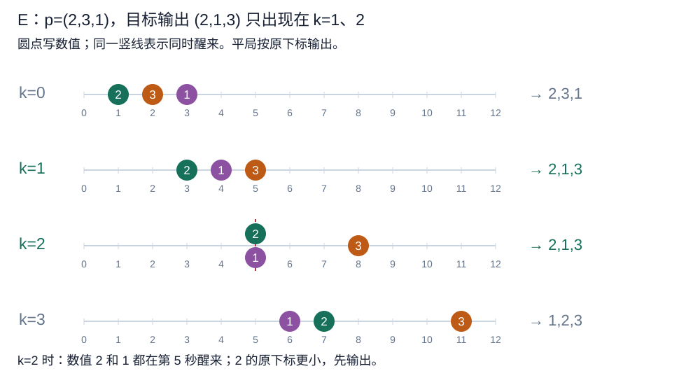
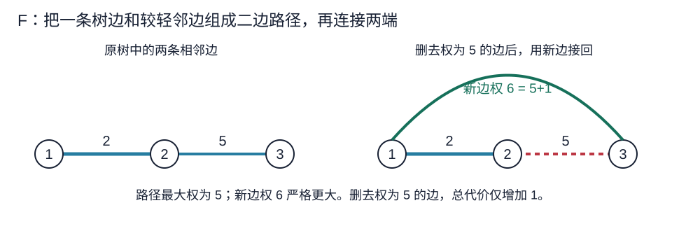
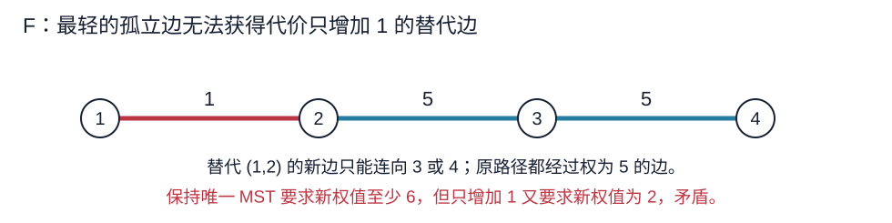
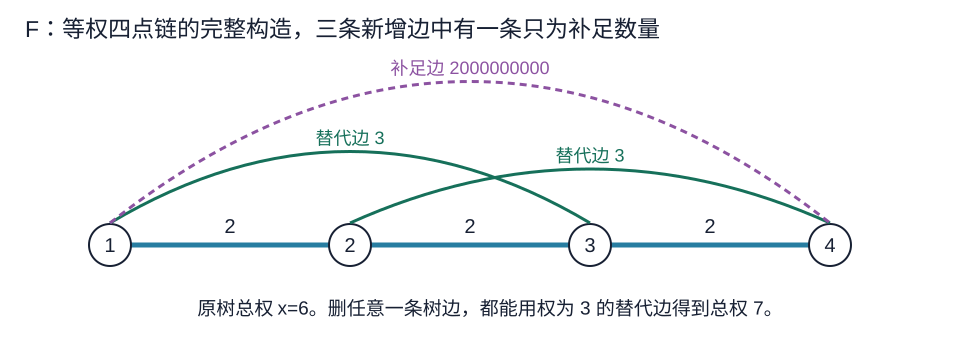

# 小白月赛 139 详细题解

> 比赛：[牛客小白月赛 139](https://ac.nowcoder.com/acm/contest/141882)
> 语言：C++17。收录 B–F；A 为签到题略。难度为 CF-EQ 估分，并非牛客官方评级。

[阅读默认版](139题解.md)，[阅读详细版](139详细题解.md)

## 目录

| 题号 | 题名 | 考点 | 难度 |
|---|---|---|---|
| B | 奶龙的奇妙公式 | 结论与计数 | 900 |
| C | 小芳的比赛 | 贪心[主] + 堆 | 1600 |
| D | 小苯的纸牌屋 | 枚举[主] + 前缀和 | 1400 |
| E | 小芳的睡眠排序 | 结论与计数 | 1700 |
| F | 小芳的最小生成树 | 构造[主] + 生成树 | 2200 |

## B. 奶龙的奇妙公式

### 题意

[原题链接](https://ac.nowcoder.com/acm/contest/141882/B)

给定正整数数组，计算

$$\sum_{i=1}^{n}\sum_{j=i}^{n}\left(\min(a_i,a_j)+\max(0,a_j-a_i)\right).$$

每组 $1\le n\le2\times10^5$、$1\le a_i\le10^6$；所有测试的 $n$ 之和不超过 $2\times10^5$。

### 从零讲：整数类型与乘法的计算顺序

<details>
<summary>展开基础知识</summary>

整数类型决定能表示的范围。常见竞赛环境的 $\verb@int@$ 上界为 $2^{31}-1$，约为 $2.1\times10^9$；$\verb@long long@$ 的上界至少为 $2^{63}-1$，约为 $9.22\times10^{18}$。累加很多大数、求较长区间和时，应先估算结果，再选择类型。

```cxx
int a = 100000, b = 100000;
long long value = 1LL * a * b;
```

<code>1LL</code> 是 $\verb@long long@$ 常量，使右侧从第一次乘法起就在较宽的类型中计算。只把接收变量写成 $\verb@long long@$，不能修复右侧已发生的 $\verb@int@$ 溢出。若一个乘数本身已是 $\verb@long long@$，也会先将另一个乘数提升类型。

非负整数的除法向下取整，例如 <code>7/3</code> 得到二。负整数除法向零截断，因此不能直接当作数学上的向下取整。除数不得为零。选用较宽类型不会改变循环次数，时间复杂度仍按算法本身计算。

</details>

### 思路

#### 从一项开始消掉复杂写法

原式有两个下标，看上去需要枚举全部 $i\le j$，共 $n(n+1)/2$ 对。先不要写双循环，看看一对数到底贡献什么。

若前面的数为二、后面的数为五，最小值为二，后减前的正差为三，两者加起来恰好为五。若前面的数为五、后面的数为二，最小值为二，正差为零，加起来仍是后面的二。

一般地，$a_j\ge a_i$ 时，

$$\min(a_i,a_j)+\max(0,a_j-a_i)=a_i+(a_j-a_i)=a_j;$$

$a_j<a_i$ 时，

$$\min(a_i,a_j)+\max(0,a_j-a_i)=a_j+0=a_j.$$

相等时归入第一种即可。因此无论大小关系如何，一对下标的贡献永远等于右端点对应的数。

#### 一个右端点被算了几次

以 $(2,5,1)$ 为例，按右端点分组：

| 右端点 $j$ | 可选的左端点 $i$ | 每一对的贡献 | 这一组贡献 |
|---|---|---|---|
| 一 | 一 | 二 | 二 |
| 二 | 一、二 | 五 | 十 |
| 三 | 一、二、三 | 一 | 三 |

固定 $j$，条件 $1\le i\le j$ 给出恰好 $j$ 对下标；每一对都贡献 $a_j$，所以这一组为 $j a_j$。每对下标只属于它自己的右端点组，没有重算，也没有遗漏。

$$\boxed{\mathrm{ans}=\sum_{j=1}^{n}j\,a_j}.$$

代码的 $\verb@ans += j * a@$ 就是在加入这一整组的贡献，不是在只计数一个区间。输入时按顺序读到第 $j$ 项，立即计算，无须保存历史。

#### 范围和复杂度

当全部元素均为 $10^6$ 时，答案达到上界

$$10^6\frac{n(n+1)}2\le20\,000\,100\,000\,000\,000.$$

这个数超过 $\verb@int@$，小于常见 64 位有符号整数上界。代码将读入值和答案都声明为 $\verb@long long@$，乘法也在这个类型内计算。

每个数只读一次并做常数次运算，时间复杂度 $O(n)$，额外空间 $O(1)$。

### 参考代码

```cpp
#include <bits/stdc++.h>
using namespace std;

int main() {
    ios::sync_with_stdio(false);
    cin.tie(nullptr);
    int T;
    cin >> T;
    while (T--) {
        int n;
        cin >> n;
        long long ans = 0;
        for (int j = 1; j <= n; ++j) {
            long long a;
            cin >> a;
            // 原式中每一项都等于 a_j，它对应 j 个左端点。
            ans += j * a;
        }
        cout << ans << '\n';
    }
}
```

### 易错点

系数是从一开始的右端点 $j$；$i=j$ 的项也包含在内。乘法和答案都要在 $\verb@long long@$ 范围内计算。

## C. 小芳的比赛

### 题意

[原题链接](https://ac.nowcoder.com/acm/contest/141882/C)

原本每轮小芳获胜。改判第 $i$ 轮让小苯获胜需要代价 $c_i>0$。设两人的分差为“小芳得分减小苯得分”，要求每个前缀的分差不超过 $x$，最终分差严格大于零。求最小代价，无解输出 $-1$。

每组 $1\le x\le n\le2\times10^5$、$c_i\le10^9$；所有测试的 $n$ 之和不超过 $2\times10^5$。过程中允许小芳落后，题目没有规定分差下限。

### 从零讲：小根堆与 priority_queue

<details>
<summary>展开基础知识</summary>

优先队列用来反复取当前集合中的最小值或最大值，不要求取出后还能按插入顺序遍历。C++ 的 $\verb@priority_queue@$ 默认取最大值；下面的第三个模板参数将它改为小根堆：

```cxx
priority_queue<long long, vector<long long>, greater<long long>> h;
h.push(8);
h.push(3);
h.push(10);
long long cheapest = h.top(); // 返回 3，堆仍有三项
h.pop();                     // 删除 3，不返回数值
```

第一个参数是元素类型，第二个参数 $\verb@std::vector<long long>@$ 是底层数组，$\verb@std::greater<long long>@$ 规定较小值优先。使用 queue、vector、functional；参考程序的 $\verb@<bits/stdc++.h>@$ 是 GCC 提供的汇总头文件。

堆在完全二叉树中维护“父节点不大于孩子”。新值放到末尾后沿父节点上移；删除堆顶时将末尾放到根，再沿较小的孩子下移。树高为 $O(\log m)$，所以有 $m$ 个元素时，$\verb@push@$、<code>pop</code> 为 $O(\log m)$，<code>top</code> 为 $O(1)$，空间为 $O(m)$。底层数组整体并没有排好序。

只有非空堆才能调用 <code>top</code>、<code>pop</code>；可用 <code>empty()</code> 判断。相同的代价值可以存多次，弹出一次只删除一个元素。堆适合不断加入候选、反复取最小值，不支持直接定位并删除任意中间元素。

</details>

### 从零讲：整数类型与累加范围

<details>
<summary>展开基础知识</summary>

整数类型决定能表示的范围。常见竞赛环境的 $\verb@int@$ 上界为 $2^{31}-1$，约为 $2.1\times10^9$；$\verb@long long@$ 的上界至少为 $2^{63}-1$，约为 $9.22\times10^{18}$。累加很多大数、求较长区间和时，应先估算结果，再选择类型。

```cxx
int a = 100000, b = 100000;
long long value = 1LL * a * b;
```

<code>1LL</code> 是 $\verb@long long@$ 常量，使右侧从第一次乘法起就在较宽的类型中计算。只把接收变量写成 $\verb@long long@$，不能修复右侧已发生的 $\verb@int@$ 溢出。若一个乘数本身已是 $\verb@long long@$，也会先将另一个乘数提升类型。

非负整数的除法向下取整，例如 <code>7/3</code> 得到二。负整数除法向零截断，因此不能直接当作数学上的向下取整。除数不得为零。选用较宽类型不会改变循环次数，时间复杂度仍按算法本身计算。

</details>

### 思路

#### 把比分改写成“必须选几场”

一轮原本使分差增加一；改判后改为减少一，两种结果相差二。前 $i$ 轮若选了 $t_i$ 次改判，分差为

$$d_i=(i-t_i)-t_i=i-2t_i.$$

赞助商的前缀要求 $d_i\le x$，也就是

$$t_i\ge\max\left(0,\left\lceil\frac{i-x}{2}\right\rceil\right).$$

这个下界只在某些轮次增加一。那些轮次就是必须完成新一次选择的截止时间。问题变成：每到截止时间，前面必须累计选够规定次数，怎样选代价最小？

#### 跟着样例选择两场

取 $n=5$、$x=2$，代价为 $(8,3,10,1,7)$。前两轮暂时全赢，分差一、二，仍合法。到第三轮若还全赢，分差会变成三，必须在前三轮中改一场；最便宜的是第二轮，代价三。



确定改第二轮后，前三轮分差变为一、零、一。第四轮继续赢，分差变为二；第五轮又到三，必须从尚未改判的前五轮中再选一场。此时可选代价为八、十、一、七，选第四轮的一。

最终改第二、四轮，分差依次为一、零、一、零、一；所有前缀不超过二，最终仍严格获胜，总花费四。

小根堆正好维护“扫描过、尚未被选中”的代价。每轮先加入新代价；若 $\verb@i-2*changed>x@$，堆顶就是当前可用的最便宜改判。弹出表示这场从候选集合进入最终选择集合。

这里没有要求当场做出不可撤销的判罚。我们在规划整场方案，扫描到第三轮时可以把第二轮放入最终改判集合。代价无需和下标一起存，因为题目只输出最小总花费。

#### 为什么补选旧轮次不会破坏前面的条件

选中第 $j$ 轮，会让第 $j$ 轮及之后的分差全部下降二，更早的分差不变。题目只有分差上限，没有分差下限，因此已经满足上限的前缀仍然满足。

例如 $n=3$、$x=1$，代价为 $(1,100,100)$，第二轮触发补选时可以选第一轮。最终分差为 $(-1,0,1)$，中途小芳落后也完全合法，最小花费为一。若额外限制小芳不能落后，会把正确方案错误排除。

上一轮处理后分差已不超过 $x$，新一轮最多增加一；一次改判降低二，所以一个 <code>if</code> 就足够，既不需要补选多场，也不需要反复弹堆。

#### 贪心的交换理由

按截止时间依次比较贪心和某个最优方案。假设已将最优方案调整为包含之前所有贪心选择，记这些选择为 $G$。

现在扫描到时刻 $i$，前缀要求又增加一次选择。最优方案必须在前 $i$ 轮中，除 $G$ 以外还选至少一轮。若它已选堆顶 $g$，无需调整；否则取其中一轮 $h$，换成 $g$。

- 费用方面，$g$ 是所有已扫描、未选轮次中的最小代价，所以 $c_g\le c_h$。
- 对时刻 $i$ 之前的前缀，原有贪心选择 $G$ 本身已满足要求；即使换掉 $h$，仍保留完整的 $G$。
- 对时刻 $i$ 及以后的前缀，$g,h$ 都在前 $i$ 轮中，一换一不改变该前缀的改判次数。

因此能在不增费、不破坏前缀条件的情况下，让最优方案再包含本次贪心选择。重复这个过程，最优方案可以包含最终全部贪心选择。若还有其他改判，将它们删除后仍保留一个满足所有前缀的贪心集合；由于代价为正，多余改判不会有利。

#### 最后一轮还要严格获胜

每次只在前缀要求强迫时改判，最终次数是

$$K=\max\left(0,\left\lceil\frac{n-x}{2}\right\rceil\right).$$

任何合法方案都至少改 $K$ 场。若 $n-2K\le0$，最少改判都不能让小芳获胜，更多改判只会使分差更小，因此无解。若 $n-2K>0$，贪心集合同时满足前缀条件和最终条件，交换论证已经保证它的代价最小。

例如两轮且 $x=1$：全赢的最终分差二超限，改一场的最终分差零又不能赢，所以无解。只检查前缀条件就会漏掉这一点。

每个代价入堆一次、最多出堆一次，时间复杂度 $O(n\log n)$，额外空间 $O(n)$。总代价最大达到 $10^9n$ 的量级，用 $\verb@long long@$ 保存。

### 参考代码

```cpp
#include <bits/stdc++.h>
using namespace std;

int main() {
    ios::sync_with_stdio(false);
    cin.tie(nullptr);
    int T;
    cin >> T;
    while (T--) {
        int n, x;
        cin >> n >> x;
        priority_queue<long long, vector<long long>, greater<long long>> heap;
        long long ans = 0;
        int changed = 0;
        for (int i = 1; i <= n; ++i) {
            long long c;
            cin >> c;
            heap.push(c);
            if (i - 2 * changed > x) {
                // 当前前缀必须再改一场，选尚未改判的最小代价。
                ans += heap.top();
                heap.pop();
                ++changed;
            }
        }
        // 改判只会降低小芳的分差，最少次数仍不能赢就无解。
        cout << (n - 2 * changed > 0 ? ans : -1) << '\n';
    }
}
```

### 易错点

堆中保留过去尚未选中的轮次；一次改判使分差减少二。允许过程中分差为负，最终却必须严格为正。无解时也要读完当前组输入。

## D. 小苯的纸牌屋

### 题意

[原题链接](https://ac.nowcoder.com/acm/contest/141882/D)

选择数组中的一个非空连续区间，使用其中所有纸牌搭成题图规定的正整数层纸牌屋。每条边都要一张纸牌，不能浪费。求合法区间的最大权值和。

每组 $3\le n\le2\times10^5$、$-10^9\le a_i\le10^9$；所有测试的 $n$ 之和不超过 $2\times10^5$。

### 从零讲：vector、下标与初始极小值

<details>
<summary>展开基础知识</summary>

$\verb@std::vector<T>@$ 是连续存放同一种类型元素的动态数组，需要 vector。$\verb@std::vector<int> a(n,0);@$ 建立恰好 $n$ 个零，合法下标为 $0$ 到 $n-1$；$\verb@vector<int> pos(n+1)@$ 则可使用下标 $n$。建数组需要 $O(n)$ 时间与空间，按下标访问为 $O(1)$。

```cxx
vector<int> a(3, 0);
a[1] = 7;                  // 现在是 0,7,0
a.push_back(9);             // 尾部追加，现在有四项
int last = a.back();        // 返回最后一项 9，不删除
a.pop_back();              // 删除最后一项，不返回它
```

$\verb@size()@$ 返回当前元素数量；$\verb@push_back@$ 均摊为 $O(1)$，扩容时会搬运已有元素，所以单次可能为 $O(n)$。$\verb@pop_back@$ 为 $O(1)$，空数组不能调用 <code>back</code> 或 $\verb@pop_back@$，也不能访问 $\verb@a[0]@$。$\verb@operator[]@$ 不负责检查越界。

扩容会使原来的迭代器、指针和引用失效；需要长期引用某一元素时，要确认之后不会扩容。$\verb@size()@$ 的返回类型是无符号整数，避免空数组上写 $\verb@size()-1@$。$\verb@static_cast<int>(a.size())@$ 是显式转成整数，应先保证数量没有超过 $\verb@int@$ 的表示范围。


取所有候选的最大值时，初始答案必须不大于任何合法结果。$\verb@numeric_limits<long long>::lowest()@$ 返回该整数类型能表示的最小值，需要 limits。它比直接写零适合处理所有候选均为负数的情况。

$\verb@std::max(a,b)@$ 返回两个同类型值中较大的一个，不会自动改写参数；所以更新最大值写成 $\verb@ans=std::max(ans,candidate);@$。$\verb@int length = static_cast<int>(len);@$ 在本题已经检查 $\mathrm{len}\le n\le2\times10^5$ 后才使用，转换不会丢失数值。

</details>

### 从零讲：整数乘法与负数

<details>
<summary>展开基础知识</summary>

整数类型决定能表示的范围。常见竞赛环境的 $\verb@int@$ 上界为 $2^{31}-1$，约为 $2.1\times10^9$；$\verb@long long@$ 的上界至少为 $2^{63}-1$，约为 $9.22\times10^{18}$。累加很多大数、求较长区间和时，应先估算结果，再选择类型。

```cxx
int a = 100000, b = 100000;
long long value = 1LL * a * b;
```

<code>1LL</code> 是 $\verb@long long@$ 常量，使右侧从第一次乘法起就在较宽的类型中计算。只把接收变量写成 $\verb@long long@$，不能修复右侧已发生的 $\verb@int@$ 溢出。若一个乘数本身已是 $\verb@long long@$，也会先将另一个乘数提升类型。

非负整数的除法向下取整，例如 <code>7/3</code> 得到二。负整数除法向零截断，因此不能直接当作数学上的向下取整。除数不得为零。选用较宽类型不会改变循环次数，时间复杂度仍按算法本身计算。

</details>

### 思路

#### 先弄清楚纸牌屋允许哪些长度

题图画的是三角网格，每条线段都代表一张纸牌，最底部横边也算。按从上到下的层次看，第 $r$ 层新增的边可以分成三组：$r$ 条向左下的斜边、$r$ 条向右下的斜边、$r$ 条底部横边，总计 $3r$ 条。



图中四种颜色分别表示四层新增的边，不同层不重复计数。每条斜边按它落到的下一层归属，横边按它所在层归属，所以所有边都有唯一归属。

$k$ 层的张数为

$$L_k=\sum_{r=1}^{k}3r=3\frac{k(k+1)}2.$$

于是 $L_1=3$、$L_2=9$、$L_3=18$、$L_4=30$。例如长度八的区间即使权值全为正，也不能拿来搭一个完整纸牌屋；长度九则可以。

由于 $L_k\le n$ 才有可能取到这么长的子数组，而 $L_k\ge3k^2/2$，需要枚举的层数不超过 $\sqrt{2n/3}$。当 $n=200000$ 时，最多枚举到 $k=364$。

#### 固定长度后，怎样快速求所有区间和

设 $S[0]=0$，$S[r]=a_1+a_2+\cdots+a_r$。它叫前缀和：保存从起点一直加到某一位置的总和。

若固定区间长度为 $L$、右端点为 $r$，左端点就只能是 $r-L+1$。$S[r]$ 包含从第一项到右端点的所有数；其中前 $r-L$ 项不属于目标区间，而且它们完整包含在 $S[r]$ 中，所以减去 $S[r-L]$，正好留下需要的连续段：

$$\sum_{i=r-L+1}^{r}a_i=S[r]-S[r-L].$$



以题目第二组数据为例，整个数组总和为十八，第一项为负一。长度九、右端点十对应区间 $[2,10]$，所以答案候选为

$$S[10]-S[1]=18-(-1)=19.$$

负数并不影响前缀相减：这里减去一个负数，意味着从总和中移除那一项，结果反而增加。

预处理时用 $\verb@s[i]=s[i-1]+a@$，每个元素读一次。此后每个区间只需两次数组访问和一次减法，为 $O(1)$。

#### 把两层枚举对应到候选对象

外层枚举层数 $k$，算出唯一合法长度 $L_k$；内层枚举右端点 $r=L_k$ 到 $n$，左端点随之确定。第一个右端点 $r=L_k$ 对应从第一项开始的区间，需要使用 $S[0]$，所以数组必须多留这一项。

所有合法选择都有某个正整数层数，也就有唯一长度；同一长度下又有唯一右端点。程序每次 $\verb@max@$ 比较的就是这样一个合法区间，既不遗漏，也不重复。

不能直接求任意长度的最大子段和，因为那可能选出无法搭屋的长度；也不能在枚举完一个长度后就停止，负数使不同长度的最优值没有单调关系。

#### 初始化与复杂度

区间要求非空。若数组为 $(-5,-4,-3,-2,-1)$，只有长度三能用，最大和为负六。若把答案从零开始更新，程序会输出一个不存在的空区间。

代码使用 $\verb@numeric_limits<long long>::lowest()@$ 作为初值。$n\ge3$ 保证至少存在一个长度三的候选，最终答案一定被更新。前缀和的绝对值至多 $2\times10^{14}$，需用 $\verb@long long@$；长度公式用 <code>3LL</code> 提前提升类型。

总时间为 $O(n\sqrt n)$，额外空间为 $O(n)$。这里不是遍历全部 $O(n^2)$ 种区间长度，而只遍历至多三百六十四种合法长度。

### 参考代码

```cpp
#include <bits/stdc++.h>
using namespace std;

int main() {
    ios::sync_with_stdio(false);
    cin.tie(nullptr);
    int T;
    cin >> T;
    while (T--) {
        int n;
        cin >> n;
        vector<long long> s(n + 1, 0);
        for (int i = 1; i <= n; ++i) {
            long long a;
            cin >> a;
            s[i] = s[i - 1] + a;
        }
        long long ans = numeric_limits<long long>::lowest();
        for (int k = 1; ; ++k) {
            long long len = 3LL * k * (k + 1) / 2;
            if (len > n) break;
            // 固定合法长度，再枚举右端点；非空区间也可能全为负。
            for (int r = static_cast<int>(len); r <= n; ++r) {
                ans = max(ans, s[r] - s[r - len]);
            }
        }
        cout << ans << '\n';
    }
}
```

### 易错点

按题图计入底部横边，最小合法长度是三；不能套用不含底边的纸牌屋公式。区间非空，答案可能为负。

## E. 小芳的睡眠排序

### 题意

[原题链接](https://ac.nowcoder.com/acm/contest/141882/E)

原排列中下标为 $i$、数值为 $p_i$ 的元素在第 $i$ 秒开始睡眠，在第 $i+kp_i$ 秒醒来。按醒来时刻输出，时刻相同则原下标较小者先输出。给出原排列 $p$ 和目标排列 $q$，求能产生 $q$ 的非负整数 $k$ 的数量，无穷多个时输出 <code>inf</code>。

每组 $1\le n\le2\times10^5$；所有测试的 $n$ 之和不超过 $2\times10^5$。

### 从零讲：vector 与逆排列的下标

<details>
<summary>展开基础知识</summary>

$\verb@std::vector<T>@$ 是连续存放同一种类型元素的动态数组，需要 vector。$\verb@std::vector<int> a(n,0);@$ 建立恰好 $n$ 个零，合法下标为 $0$ 到 $n-1$；$\verb@vector<int> pos(n+1)@$ 则可使用下标 $n$。建数组需要 $O(n)$ 时间与空间，按下标访问为 $O(1)$。

```cxx
vector<int> a(3, 0);
a[1] = 7;                  // 现在是 0,7,0
a.push_back(9);             // 尾部追加，现在有四项
int last = a.back();        // 返回最后一项 9，不删除
a.pop_back();              // 删除最后一项，不返回它
```

$\verb@size()@$ 返回当前元素数量；$\verb@push_back@$ 均摊为 $O(1)$，扩容时会搬运已有元素，所以单次可能为 $O(n)$。$\verb@pop_back@$ 为 $O(1)$，空数组不能调用 <code>back</code> 或 $\verb@pop_back@$，也不能访问 $\verb@a[0]@$。$\verb@operator[]@$ 不负责检查越界。

扩容会使原来的迭代器、指针和引用失效；需要长期引用某一元素时，要确认之后不会扩容。$\verb@size()@$ 的返回类型是无符号整数，避免空数组上写 $\verb@size()-1@$。$\verb@static_cast<int>(a.size())@$ 是显式转成整数，应先保证数量没有超过 $\verb@int@$ 的表示范围。


若数组是一到 $n$ 的排列，每个值恰好出现一次，就可以用另一个数组记录它的位置。对 $(3,1,2)$ 执行 $\verb@pos[p[i]]=i@$ 后得到 $\mathrm{pos}[3]=1$、$\mathrm{pos}[1]=2$、$\mathrm{pos}[2]=3$。建立数组需要 $O(n)$ 时间，之后由数值查原位置为 $O(1)$。有重复值时，一个数只存一个下标会覆盖旧信息，不能直接套用。

$\verb@std::min(a,b)@$、$\verb@std::max(a,b)@$ 分别返回较小、较大的值；要维护逐渐收紧的范围，可写 $\verb@low=std::max(low,new_low);@$、$\verb@high=std::min(high,new_high);@$。它们只比较两个数，均为 $O(1)$，并不会自动保证最终范围非空。

</details>

### 思路

#### 先把“原下标”和“目标顺序”分开

入睡时间取决于原排列位置，不能用目标排列中的位置计算。先建立 $\mathrm{pos}[v]$，表示数值 $v$ 在原排列中的下标。随后它的醒来时刻是

$$t_v=\mathrm{pos}[v]+kv.$$

完整比较顺序是二元组 $(t_v,\mathrm{pos}[v])$：先比较醒来时刻，再比较原下标。原排列是排列，因此原下标也各不相同，任意两个元素都有确定的先后顺序。

#### 用一个例子同时看上界、下界和平局

取原排列 $p=(2,3,1)$、目标 $q=(2,1,3)$。原位置为 $\mathrm{pos}[2]=1$、$\mathrm{pos}[3]=2$、$\mathrm{pos}[1]=3$。



第一对目标是先二后一。二的原位置较小，可以同时醒来，所以要求

$$1+2k\le3+k\quad\Longleftrightarrow\quad k\le2.$$

第二对目标是先一后三。一的原位置更大，同时醒来时三会先输出，因此必须严格早醒：

$$3+k<2+3k\quad\Longleftrightarrow\quad1<2k\quad\Longleftrightarrow\quad k\ge1.$$

合起来是 $1\le k\le2$，恰好两个整数。图中 $k=2$ 时二和一同时在第五秒醒来，原下标一的二先输出，所以端点二必须计入。

#### 为什么检查相邻元素就足够

把目标写成 $q_1,q_2,\ldots,q_n$。若每对相邻元素对应的二元组都递增，那么由比较关系的传递性，任意更早目标位置的二元组都小于更后位置，目标排列就是整体排序结果。

反过来，只要某对相邻元素比较顺序反了，实际输出就不可能等于目标。因此这 $n-1$ 个约束既必要也充分，不需要检查全部元素对。

#### 相邻数值递增时，只可能给下界

设相邻目标先 $u$ 后 $v$，且 $u<v$。数值较小的 $u$ 睡眠时长增加得更慢。

如果 $\mathrm{pos}[u]<\mathrm{pos}[v]$，则它入睡更早，睡得也更短，对每个非负 $k$ 都先醒，无须增加约束。

如果 $\mathrm{pos}[u]>\mathrm{pos}[v]$，平局会把顺序排成先 $v$ 后 $u$，必须严格满足

$$\mathrm{pos}[u]+ku<\mathrm{pos}[v]+kv.$$

移项时，将较小数值对应的项放到右侧得到

$$k(v-u)>\mathrm{pos}[u]-\mathrm{pos}[v].$$

右边为正，除数 $v-u$ 也为正。非负整数除法给出的商是向下取整，而这里要求严格大于，所以最小整数是

$$\left\lfloor\frac{\mathrm{pos}[u]-\mathrm{pos}[v]}{v-u}\right\rfloor+1.$$

尤其当分子恰好整除分母时，也必须再加一，否则会错误允许平局。程序用这项收紧 <code>low</code>。

#### 相邻数值递减时，只可能给上界或无解

现在 $u>v$。如果 $\mathrm{pos}[u]>\mathrm{pos}[v]$，$u$ 同时具有“更晚入睡”和“睡得更久”两个劣势，对 $k\ge0$ 都无法先输出，直接把区间标记为空。

否则 $\mathrm{pos}[u]<\mathrm{pos}[v]$，允许平局，因此要求

$$\mathrm{pos}[u]+ku\le\mathrm{pos}[v]+kv,$$

即

$$k(u-v)\le\mathrm{pos}[v]-\mathrm{pos}[u].$$

两侧差值均为正，最大合法整数为

$$\left\lfloor\frac{\mathrm{pos}[v]-\mathrm{pos}[u]}{u-v}\right\rfloor.$$

这次是小于等于，恰好整除时商本身合法，不能减一。程序用它收紧 <code>high</code>。

#### 交集为什么仍然只是一个区间

每对相邻元素只给出一个整数下界、一个整数上界或无解。所有要求同时满足，等价于取最大下界、最小上界，并加入 $k\ge0$。

所有有限上界都不超过 $n-1$：分子至多为 $n-1$，分母至少为一。下界也至多为 $n$。所以可以初始化 $\verb@low=0, high=n;@$，其中 $\verb@high==n@$ 专门表示从未得到有限上界。

先检查 $\verb@if (low > high)@$，此时没有合法参数，输出零。若交集非空而 $\verb@high==n@$，参数只受下界限制，输出 <code>inf</code>；否则从下界到上界逐个计数，数量为 $\mathrm{high}-\mathrm{low}+1$。必须先检查空集，避免将已经无解的情况误判成无穷。

例如 $p=(4,2,1,3)$、$q=(2,1,4,3)$，第一对给 $k\le1$，第二对给 $k\ge1$，第三对给 $k\le3$，交集仅含一。$n=1$ 时没有相邻对，也就没有上界，答案为 <code>inf</code>。

记录位置、读取目标、扫描相邻对均为线性时间，时间复杂度 $O(n)$，额外空间 $O(n)$。计算的都是位置差与数值差，参考程序无需实际计算可能很大的醒来时刻。

### 参考代码

```cpp
#include <bits/stdc++.h>
using namespace std;

int main() {
    ios::sync_with_stdio(false);
    cin.tie(nullptr);
    int T;
    cin >> T;
    while (T--) {
        int n;
        cin >> n;
        vector<int> pos(n + 1), q(n);
        for (int i = 1; i <= n; ++i) {
            int v;
            cin >> v;
            pos[v] = i;
        }
        for (int i = 0; i < n; ++i) cin >> q[i];
        int low = 0, high = n;
        // 有限上界至多为 n-1，故用 n 表示尚无上界。
        for (int i = 0; i + 1 < n; ++i) {
            int u = q[i], v = q[i + 1];
            if (u < v) {
                if (pos[u] > pos[v]) {
                    // 原来较晚入睡的 u 必须严格早醒，平局会让 v 先输出。
                    low = max(low, (pos[u] - pos[v]) / (v - u) + 1);
                }
            } else {
                if (pos[u] > pos[v]) {
                    high = -1;
                } else {
                    // 原来较早入睡的 u 可以和 v 同时醒来。
                    high = min(high, (pos[v] - pos[u]) / (u - v));
                }
            }
        }
        if (low > high) cout << 0 << '\n';
        else if (high == n) cout << "inf\n";
        else cout << high - low + 1 << '\n';
    }
}
```

### 易错点

平局比较原下标；较晚入睡者要严格早醒，不能把所有条件都写成小于等于。先检查空交集，再判断 <code>inf</code>。

## F. 小芳的最小生成树

### 题意

[原题链接](https://ac.nowcoder.com/acm/contest/141882/F)

给定正边权树 $T$，恰好添加 $n-1$ 条边，使所得图无自环、无重边。要求原树是唯一的最小生成树；删除任意一条原树边后，图仍连通，且最小生成树总权恰好比原树增加一。输出构造或 <code>No</code>。

每组 $4\le n\le2\times10^5$，原边权不超过 $10^9$，新增边权不超过 $2\times10^9$；所有测试的 $n$ 之和不超过 $2\times10^5$。

### 从零讲：边的结构体、pair、set 与引用

<details>
<summary>展开基础知识</summary>

<code>struct</code> 可以把一个对象的多个字段放在一起。例如 $\verb@struct Edge { int u,v,w; };@$ 保存边的两个端点和权值；$\verb@Edge e{1,3,6};@$ 建立一条边，$\verb@e.w@$ 访问权值。

$\verb@std::pair<int,int>@$ 保存两个整数，分别通过 <code>.first</code>、<code>.second</code> 访问。为了将无向边统一表示，先把端点排成较小值在前，例如把 $(3,1)$ 统一成 $(1,3)$。两个 <code>pair</code> 的默认比较先比第一项，第一项相等再比第二项。

$\verb@std::set<T>@$ 维护不重复的、有序的元素集合，需要 set；<code>pair</code> 需要 utility。底层平衡搜索树使插入、查找的时间为 $O(\log m)$，保存 $m$ 项使用 $O(m)$ 空间。

```cxx
set<pair<int,int>> edges;
auto result = edges.insert({1, 3}); // 第一次插入
bool fresh = result.second;        // true
bool again = edges.insert({1, 3}).second; // false，没有再加一项
```

<code>insert</code> 返回一个二元组：第一项是指向集合中该值的迭代器，第二项是本次是否新插入。这里只需第二项即可完成去重，无须解引用迭代器。<code>set</code> 中元素不能直接修改；要改变键应先删除旧键再插入新键。

$\verb@const Edge &e = edges[i]@$ 给原数组元素取只读别名，避免复制。要保证引用使用期间元素仍存在且数组未扩容。本题 <code>edges</code> 一开始就固定大小，此后不追加，所以该引用有效。$\verb@for (int v : {e.u,e.v})@$ 依次取两个端点；$\verb@for (const Edge &e : added)@$ 依次只读访问已构造的边。这两种范围循环都按元素数量计算时间。

</details>

### 从零讲：vector 的大小与引用有效期

<details>
<summary>展开基础知识</summary>

$\verb@std::vector<T>@$ 是连续存放同一种类型元素的动态数组，需要 vector。$\verb@std::vector<int> a(n,0);@$ 建立恰好 $n$ 个零，合法下标为 $0$ 到 $n-1$；$\verb@vector<int> pos(n+1)@$ 则可使用下标 $n$。建数组需要 $O(n)$ 时间与空间，按下标访问为 $O(1)$。

```cxx
vector<int> a(3, 0);
a[1] = 7;                  // 现在是 0,7,0
a.push_back(9);             // 尾部追加，现在有四项
int last = a.back();        // 返回最后一项 9，不删除
a.pop_back();              // 删除最后一项，不返回它
```

$\verb@size()@$ 返回当前元素数量；$\verb@push_back@$ 均摊为 $O(1)$，扩容时会搬运已有元素，所以单次可能为 $O(n)$。$\verb@pop_back@$ 为 $O(1)$，空数组不能调用 <code>back</code> 或 $\verb@pop_back@$，也不能访问 $\verb@a[0]@$。$\verb@operator[]@$ 不负责检查越界。

扩容会使原来的迭代器、指针和引用失效；需要长期引用某一元素时，要确认之后不会扩容。$\verb@size()@$ 的返回类型是无符号整数，避免空数组上写 $\verb@size()-1@$。$\verb@static_cast<int>(a.size())@$ 是显式转成整数，应先保证数量没有超过 $\verb@int@$ 的表示范围。

</details>

### 思路

#### 先看完整答案准备长什么样

对每条树边 $e=(u,v)$、权值 $w$，寻找另一条与它共享端点、权值不超过 $w$ 的树边。假设找到 $(v,z)$，就添加 $(u,z)$，新权值取 $w+1$。这些新增边去重后，如果不足 $n-1$ 条，再用很重的非树边补足。



图中两条原边权为二、五。为了保护权为五的边，把路径两端相连，赋权六。删掉权为五的边后，原路径被切断，新边仍能连接两部分，总权只增加一。

下面依次解释：新边为什么不会抢走原树的最优地位；为什么这类邻边是可行性的精确条件；最后怎样处理重边和数量要求。

#### 唯一最小生成树对应什么边权条件

生成树包含全部顶点、连通且无环，恰好有 $n-1$ 条边。原图已经是一棵树，所以任意两点之间有唯一一条原路径。新增一条边后，它和这条原路径形成一个环。

设新增边为 $f=(a,b)$，权值 $W$，原路径最大边权为 $M$。如果 $W<M$，删除路径上一条最大边、加入 $f$，就能得到更轻的生成树；如果 $W=M$，会得到另一棵同样轻的生成树。因此原树要唯一最优，必须有

$$W>M.$$

这个条件对每条新增边都满足时，也足够保证原树唯一最优。证明时任取另一棵生成树 $S$，从中选一条不属于原树的边 $f$。把 $f$ 从 $S$ 中删除，树分成两个连通部分。原树上连接 $f$ 两端的路径一定跨越这两部分，因此存在一条原树边 $h$ 可以换入。

因为 $w_h\le M<W$，这次交换严格减小总权，并且少了一条新增边。重复直到全部换回原树，就说明任何其他生成树都严格更重。所有边权都是整数，每次交换还至少减少一。

这段交换同时说明另一个关键事实：**如果 $S$ 中有 $r$ 条新增边，那么它的总权至少为 $x+r$。** 因为换回原树恰好需要 $r$ 次交换，每次至少减一，最终总权为 $x$。

#### 总权只增加一，强迫答案只换一条边

删除原树边 $e$ 后，题目要求最小生成树总权为 $x+1$。上面的结论表明，这棵生成树只能包含一条新增边：包含两条就至少重二；不包含新增边又无法补上被删边。

所以它必须恰好是

$$T-e+f.$$

这要求新边 $f$ 的原树路径经过 $e$，才能接通删除 $e$ 后形成的两部分；若 $e$ 权值为 $w$，还要求

$$x-w+w_f=x+1,\qquad w_f=w+1.$$

同时，唯一最小生成树条件要求 $w_f$ 严格大于整条原路径的最大权值。由于边权为整数，路径上的所有原边权必须不超过 $w$。

因此，保护当前边等价于：找到一条至少含两条边、经过当前边、所有边权都不超过 $w$ 的路径。至少含两条边来自简单图要求——若路径只有当前这一条边，新边就与原树边重合。

#### 为什么只看一条相邻边就够了

若这样的路径存在，在当前边旁边必有另一条路径边与它共享端点，而且该邻边权不超过 $w$。这是必要条件。

若确实有一条权值不超过 $w$ 的邻边，直接取两条边组成的路径，它的最大权值就是 $w$。连接两端，新增权为 $w+1$，立刻满足所有局部要求，这是充分条件。

于是得到充要判据：

$$\boxed{\text{每条树边，都有另一条与它共享端点且权值不更大的树边。}}$$



图中的权为一的边，唯一相邻边权为五。要用非重边跨过它，至少要走到顶点三，原路径最大权为五，新增权必须至少为六；而只增加一又要求新增权为二，矛盾，所以整组无解。

注意并不是“整棵树最小权值出现至少两次”就够了。两条最轻边若被重边隔开，各自仍可能没有合格邻边；判据必须对每条边在它的两个端点附近检查。

#### 怎样在常数时间内查到合格邻边

对于一个端点 $v$，只需知道所有与 $v$ 相接的边中，除当前边以外最轻的是哪条。预处理保存两个边编号：$\verb@first[v]@$ 为最轻边，$\verb@second[v]@$ 为次轻边。

读入边时，在它的两个端点分别更新这两项。如果新边比最轻边更轻，旧最轻边降为次轻；否则只考虑是否更新次轻。权值相等的两条边也必须分别保存，因为它们是不同候选，等权邻边完全合法。

处理编号为 $i$ 的边时，若 $\verb@first[v]@$ 不是自己，就选它；否则选 $\verb@second[v]@$。若候选不存在，或权值超过当前边，再尝试另一端。两端都失败就输出 <code>No</code>。

若当前边的另一个端点为 <code>end</code>，相邻边与它共享 <code>center</code>，设相邻边两个端点为 $a,b$，那么另一个端点就是 $a+b-\mathrm{center}$。程序连接 <code>end</code> 与这个顶点，赋当前边权加一。

#### 同一个方案被两条树边提出怎么办

二边路径的两个端点不可能已有原树边，否则原树中会有三角环。因此这里不会与原树直接重边，但两条树边可能提出同一新增边。

例如等权路径 $1-2-3$，第一条边可借第二条保护自己，第二条也可借第一条保护自己，两者都提出连接 $(1,3)$。保留一次即可，这条边在分别删除两条原边的不同询问中都可使用；题目不是要求同时删除所有原边。

若两条边都能借对方，则两边权值分别不超过对方，必然相等，提出的新增权值也相同，不会出现保留了错误权值的冲突。树上两点间路径唯一，也不可能有另一个中间顶点提出同一二边路径。

$\verb@::key(u,v)@$ 将无向边端点规范成较小在前，<code>set</code> 同时记录原树边和已经添加的边。只有插入成功时才将这条边加入输出数组。

#### 为什么还要补边，以及补边会不会破坏要求



在图中，原树三条边权都为二。新增 $(1,3,3)$、$(2,4,3)$ 已能保护所有原边：前者保护前两条，后者保护后两条。但题目要求恰好加三条，所以还要添加一条 $(1,4,2\times10^9)$。

原树总权为六。删任意一条原边，总能换入一条权为三的替代边，得到总权七。所有新增边又都严格重于各自原路径最大边，所以原树依然唯一最优；整数性保证删边后的生成树不可能轻于七。补足边权很大，也不会改变这两个结论。

一般地，去重前每条原树边只提出一条方案，去重后至多 $n-1$ 条。还有多少不同非树边可选？从全部无向点对中扣除原树的 $n-1$ 对，得到

$$\binom n2-(n-1)=\frac{(n-1)(n-2)}2.$$

$n\ge4$ 时这个数量至少为 $n-1$，所以一定有足够点对补满。枚举尚未使用的点对，赋权 $2\times10^9$：不超过输出上限，又严格大于所有原树边。

补边的双循环不是平方复杂度。它在总数达到 $n-1$ 后立即停止；整个过程中，只会跳过原树和已添加边，总共不足 $2n$ 对，成功加入也不足 $n$ 对，所以实际扫描只有 $O(n)$ 对。每次通过 <code>set</code> 查重或插入花费 $O(\log n)$。

#### 完整算法与复杂度

读入时保存所有边，并更新各点最轻、次轻边编号；遍历每条原边，从两个端点找合格邻边，失败即无解，否则生成替代边并去重；最后枚举空闲点对补足数量，再统一输出。

保存两条最轻边和检查所有原边都为 $O(n)$，<code>set</code> 操作合计 $O(n\log n)$，所以总时间复杂度 $O(n\log n)$，额外空间 $O(n)$。构造边的权值为 $w+1\le10^9+1$，补足边权为 $2\times10^9$，均符合输出范围。

### 参考代码

```cpp
#include <bits/stdc++.h>
using namespace std;

struct Edge {
    int u, v, w;
};

pair<int, int> key(int u, int v) {
    if (u > v) swap(u, v);
    return {u, v};
}

int main() {
    ios::sync_with_stdio(false);
    cin.tie(nullptr);
    int T;
    cin >> T;
    while (T--) {
        int n;
        cin >> n;
        vector<Edge> edges(n - 1);
        vector<int> first(n + 1, -1), second(n + 1, -1);
        set<pair<int, int>> used;
        for (int i = 0; i < n - 1; ++i) {
            Edge &e = edges[i];
            cin >> e.u >> e.v >> e.w;
            used.insert(key(e.u, e.v));
            for (int v : {e.u, e.v}) {
                // 每个顶点保存最轻和次轻的两条边的编号。
                if (first[v] == -1 || e.w < edges[first[v]].w) {
                    second[v] = first[v];
                    first[v] = i;
                } else if (second[v] == -1 || e.w < edges[second[v]].w) {
                    second[v] = i;
                }
            }
        }
        vector<Edge> added;
        bool ok = true;
        for (int i = 0; i < n - 1; ++i) {
            const Edge &e = edges[i];
            int center = e.u, end = e.v;
            int j = (first[center] == i ? second[center] : first[center]);
            if (j == -1 || edges[j].w > e.w) {
                center = e.v;
                end = e.u;
                j = (first[center] == i ? second[center] : first[center]);
            }
            if (j == -1 || edges[j].w > e.w) {
                ok = false;
                break;
            }
            int other = edges[j].u + edges[j].v - center;
            pair<int, int> p = key(end, other);
            // 距离为二的两个端点一定不是原树边；重复方案只留一次。
            if (used.insert(p).second) added.push_back({p.first, p.second, e.w + 1});
        }
        if (!ok) {
            cout << "No\n";
            continue;
        }
        // 补足 n-1 条。已有边对不足 2n，扫描到足额只需 O(n) 次候选。
        for (int u = 1; u <= n && static_cast<int>(added.size()) < n - 1; ++u) {
            for (int v = u + 1; v <= n && static_cast<int>(added.size()) < n - 1; ++v) {
                if (used.insert({u, v}).second) added.push_back({u, v, 2000000000});
            }
        }
        cout << "Yes\n";
        for (const Edge &e : added) cout << e.u << ' ' << e.v << ' ' << e.w << '\n';
    }
}
```

### 易错点

“另一条边”必须排除当前边自身，等权邻边合法。无向点对先规范顺序再去重；替代边去重后仍需补到恰好 $n-1$ 条。不能只检查全局最小权值是否重复。

## 实测记录

编译：五份参考程序及五份独立暴力均以 -O2 -std=c++17 -Wall -Wextra 编译通过，无警告。
官方样例：B–F 各一组全过；F 使用构造判定器。边界：B 3 条、C 5 条、D 5 条、E 5 条、F 5 条全过。
有界穷举：B 363、C 6015、D 3267、E 15017、F 2432 组全过；F 判定器拒绝五种损坏输出。
随机对拍：B 300 组（seed=13902）、C 1000 组（seed=13903）、D 300 组（seed=13904）、E 1000 组（seed=13905）、F 1000 组（seed=13906）全一致。
极限计时：B 0.019 s；C 0.026/0.018 s；D 0.043/0.043 s；E 0.034/0.033 s；F 0.124/0.128/0.064 s，均通过官方时限；含进程启动，每例三次取最小。
两版参考代码来自同一已验证源码；交付前另跑格式检查与逐题文档代码一致性检查。
