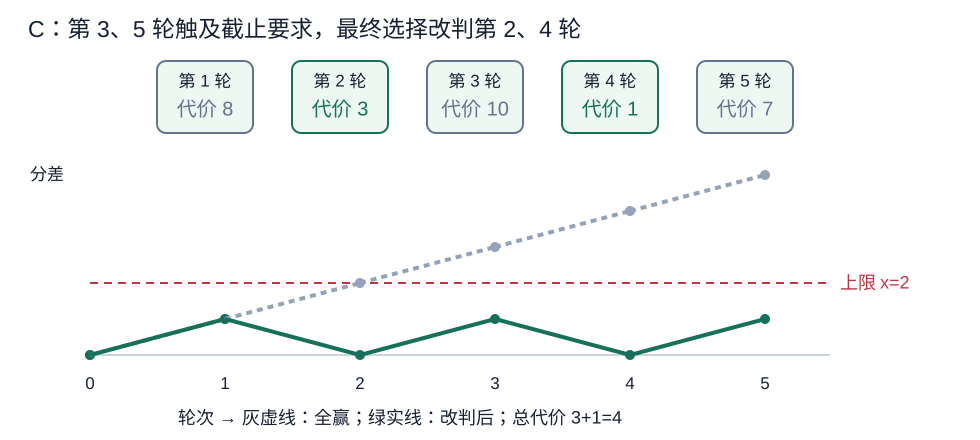
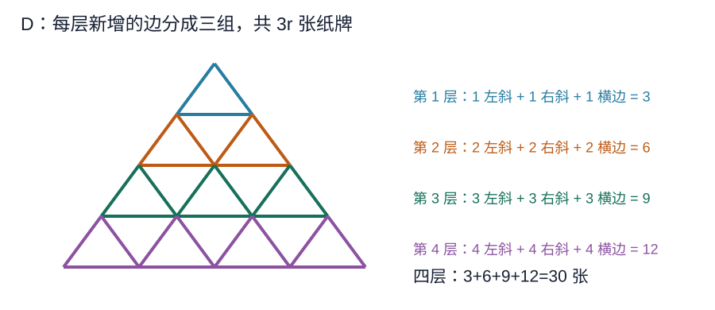
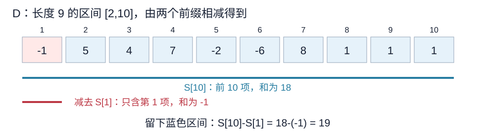
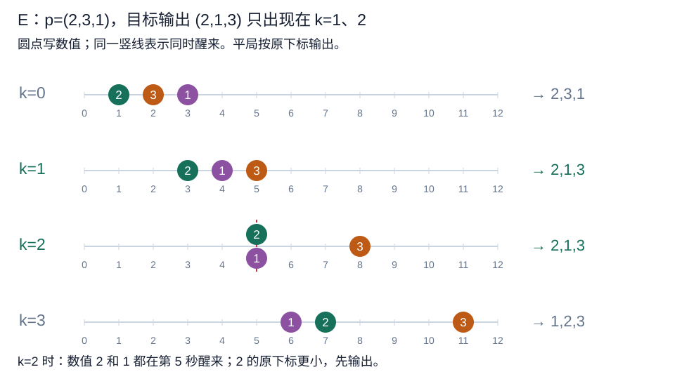
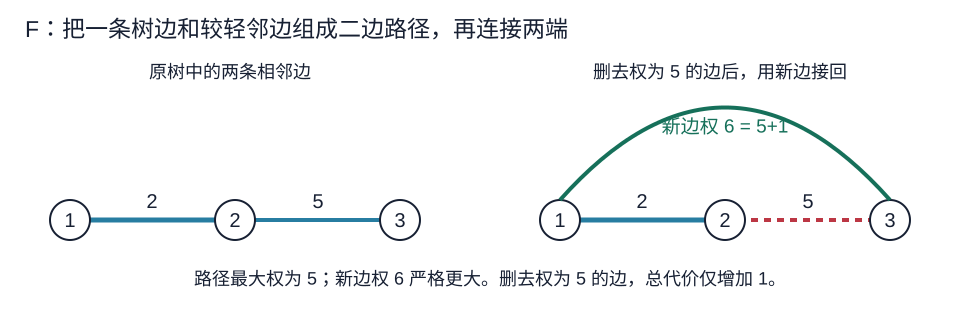
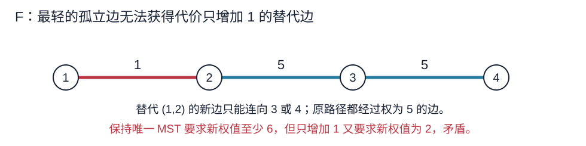
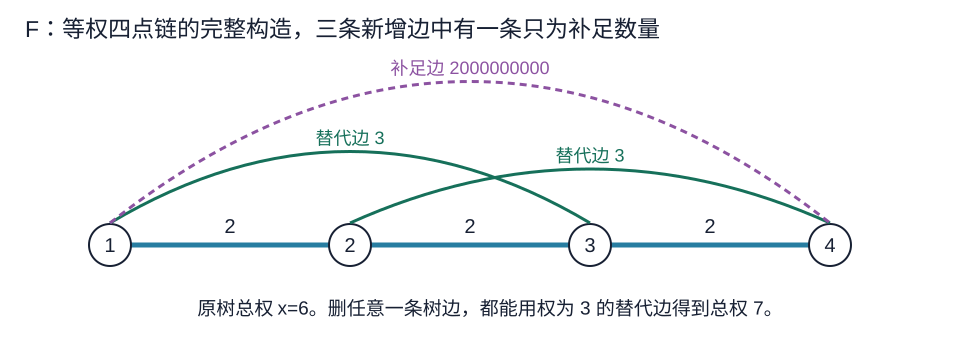

# 小白月赛 139 题解

> 比赛：[牛客小白月赛 139](https://ac.nowcoder.com/acm/contest/141882)
> 语言：C++17。收录 B–F；A 为签到题略。难度为 CF-EQ 估分，并非牛客官方评级。

[阅读默认版](139题解.md)，[阅读详细版](139详细题解.md)

## 目录

| 题号 | 题名 | 考点 | 难度 |
|---|---|---|---|
| B | 奶龙的奇妙公式 | 结论与计数 | 900 |
| C | 小芳的比赛 | 贪心[主] + 堆 | 1600 |
| D | 小苯的纸牌屋 | 枚举[主] + 前缀和 | 1400 |
| E | 小芳的睡眠排序 | 结论与计数 | 1700 |
| F | 小芳的最小生成树 | 构造[主] + 生成树 | 2200 |

## B. 奶龙的奇妙公式

### 题意

[原题链接](https://ac.nowcoder.com/acm/contest/141882/B)

给定正整数数组，计算

$$\sum_{i=1}^{n}\sum_{j=i}^{n}\left(\min(a_i,a_j)+\max(0,a_j-a_i)\right).$$

每组 $1\le n\le2\times10^5$、$1\le a_i\le10^6$；所有测试的 $n$ 之和不超过 $2\times10^5$。

### 从零讲：整数类型与乘法的计算顺序

<details>
<summary>展开基础知识</summary>

整数类型决定能表示的范围。常见竞赛环境的 $\verb@int@$ 上界为 $2^{31}-1$，约为 $2.1\times10^9$；$\verb@long long@$ 的上界至少为 $2^{63}-1$，约为 $9.22\times10^{18}$。累加很多大数、求较长区间和时，应先估算结果，再选择类型。

```cxx
int a = 100000, b = 100000;
long long value = 1LL * a * b;
```

<code>1LL</code> 是 $\verb@long long@$ 常量，使右侧从第一次乘法起就在较宽的类型中计算。只把接收变量写成 $\verb@long long@$，不能修复右侧已发生的 $\verb@int@$ 溢出。若一个乘数本身已是 $\verb@long long@$，也会先将另一个乘数提升类型。

非负整数的除法向下取整，例如 <code>7/3</code> 得到二。负整数除法向零截断，因此不能直接当作数学上的向下取整。除数不得为零。选用较宽类型不会改变循环次数，时间复杂度仍按算法本身计算。

</details>

### 思路

固定一对 $i\le j$，按大小分两种情况：

- 若 $a_j\ge a_i$，原项为 $a_i+(a_j-a_i)=a_j$。
- 若 $a_j<a_i$，原项为 $a_j+0=a_j$。

所以每一项都只贡献 $a_j$。固定右端点 $j$ 后，左端点 $i$ 有 $1,2,\ldots,j$ 共 $j$ 种选择，答案为

$$\boxed{\sum_{j=1}^{n}j\,a_j}.$$

例如 $(2,5,1)$ 的贡献依次为 $2$、$2\times5$、$3\times1$，合计十五。读入第 $j$ 个数时直接累加即可，无须保存数组。

时间复杂度 $O(n)$，额外空间 $O(1)$。答案最多为 $10^6n(n+1)/2$，需要 $\verb@long long@$。

### 参考代码

```cpp
#include <bits/stdc++.h>
using namespace std;

int main() {
    ios::sync_with_stdio(false);
    cin.tie(nullptr);
    int T;
    cin >> T;
    while (T--) {
        int n;
        cin >> n;
        long long ans = 0;
        for (int j = 1; j <= n; ++j) {
            long long a;
            cin >> a;
            // 原式中每一项都等于 a_j，它对应 j 个左端点。
            ans += j * a;
        }
        cout << ans << '\n';
    }
}
```

### 易错点

系数是从一开始的右端点 $j$；$i=j$ 的项也包含在内。乘法和答案都要在 $\verb@long long@$ 范围内计算。

## C. 小芳的比赛

### 题意

[原题链接](https://ac.nowcoder.com/acm/contest/141882/C)

原本每轮小芳获胜。改判第 $i$ 轮让小苯获胜需要代价 $c_i>0$。设两人的分差为“小芳得分减小苯得分”，要求每个前缀的分差不超过 $x$，最终分差严格大于零。求最小代价，无解输出 $-1$。

每组 $1\le x\le n\le2\times10^5$、$c_i\le10^9$；所有测试的 $n$ 之和不超过 $2\times10^5$。过程中允许小芳落后，题目没有规定分差下限。

### 从零讲：小根堆与 priority_queue

<details>
<summary>展开基础知识</summary>

优先队列用来反复取当前集合中的最小值或最大值，不要求取出后还能按插入顺序遍历。C++ 的 $\verb@priority_queue@$ 默认取最大值；下面的第三个模板参数将它改为小根堆：

```cxx
priority_queue<long long, vector<long long>, greater<long long>> h;
h.push(8);
h.push(3);
h.push(10);
long long cheapest = h.top(); // 返回 3，堆仍有三项
h.pop();                     // 删除 3，不返回数值
```

第一个参数是元素类型，第二个参数 $\verb@std::vector<long long>@$ 是底层数组，$\verb@std::greater<long long>@$ 规定较小值优先。使用 queue、vector、functional；参考程序的 $\verb@<bits/stdc++.h>@$ 是 GCC 提供的汇总头文件。

堆在完全二叉树中维护“父节点不大于孩子”。新值放到末尾后沿父节点上移；删除堆顶时将末尾放到根，再沿较小的孩子下移。树高为 $O(\log m)$，所以有 $m$ 个元素时，$\verb@push@$、<code>pop</code> 为 $O(\log m)$，<code>top</code> 为 $O(1)$，空间为 $O(m)$。底层数组整体并没有排好序。

只有非空堆才能调用 <code>top</code>、<code>pop</code>；可用 <code>empty()</code> 判断。相同的代价值可以存多次，弹出一次只删除一个元素。堆适合不断加入候选、反复取最小值，不支持直接定位并删除任意中间元素。

</details>

### 从零讲：整数类型与累加范围

<details>
<summary>展开基础知识</summary>

整数类型决定能表示的范围。常见竞赛环境的 $\verb@int@$ 上界为 $2^{31}-1$，约为 $2.1\times10^9$；$\verb@long long@$ 的上界至少为 $2^{63}-1$，约为 $9.22\times10^{18}$。累加很多大数、求较长区间和时，应先估算结果，再选择类型。

```cxx
int a = 100000, b = 100000;
long long value = 1LL * a * b;
```

<code>1LL</code> 是 $\verb@long long@$ 常量，使右侧从第一次乘法起就在较宽的类型中计算。只把接收变量写成 $\verb@long long@$，不能修复右侧已发生的 $\verb@int@$ 溢出。若一个乘数本身已是 $\verb@long long@$，也会先将另一个乘数提升类型。

非负整数的除法向下取整，例如 <code>7/3</code> 得到二。负整数除法向零截断，因此不能直接当作数学上的向下取整。除数不得为零。选用较宽类型不会改变循环次数，时间复杂度仍按算法本身计算。

</details>

### 思路

如果前 $i$ 轮改判了 $t$ 轮，小芳得 $i-t$ 分，小苯得 $t$ 分，分差就是 $i-2t$。因此扫描到第 $i$ 轮时，只要 $i-2t>x$，就必须从前 $i$ 轮中再选一轮改判。



把已扫描、尚未改判的所有代价放入小根堆。每轮先加入 $c_i$；若当前分差超限，就取出堆中最小代价，累加并让改判次数增加一。堆里可能弹出以前某轮的代价：扫描只是在规划最终改判集合，选择较早轮次会降低之后的分差，不会破坏已满足的上限。

每次只需补一轮，因为上一轮的分差已经不超过 $x$，本轮原本获胜只会使它增加一，而一次改判会使它降低二。

为什么取最便宜的正确？在某次必须补选的时刻 $i$，设之前已选集合为 $G$。任意包含 $G$ 的最优方案都还必须在前 $i$ 轮里选一个未选轮次 $h$。用堆顶 $g$ 代替它，代价不会增加：时刻 $i$ 之前的要求已由 $G$ 保证；时刻 $i$ 及之后的前缀同时包含 $g,h$，替换不改变改判总数。逐次交换，就能得到包含所有贪心选择的最优方案。

最终若改判次数为 $t$，还要检查 $n-2t>0$。贪心只在前缀强制要求时增加次数，已是满足所有前缀的最少次数；如果这样仍不能获胜，增加改判只会更差，输出 $-1$。

时间复杂度 $O(n\log n)$，额外空间 $O(n)$。总代价需要 $\verb@long long@$。

### 参考代码

```cpp
#include <bits/stdc++.h>
using namespace std;

int main() {
    ios::sync_with_stdio(false);
    cin.tie(nullptr);
    int T;
    cin >> T;
    while (T--) {
        int n, x;
        cin >> n >> x;
        priority_queue<long long, vector<long long>, greater<long long>> heap;
        long long ans = 0;
        int changed = 0;
        for (int i = 1; i <= n; ++i) {
            long long c;
            cin >> c;
            heap.push(c);
            if (i - 2 * changed > x) {
                // 当前前缀必须再改一场，选尚未改判的最小代价。
                ans += heap.top();
                heap.pop();
                ++changed;
            }
        }
        // 改判只会降低小芳的分差，最少次数仍不能赢就无解。
        cout << (n - 2 * changed > 0 ? ans : -1) << '\n';
    }
}
```

### 易错点

堆中保留过去尚未选中的轮次；一次改判使分差减少二。允许过程中分差为负，最终却必须严格为正。无解时也要读完当前组输入。

## D. 小苯的纸牌屋

### 题意

[原题链接](https://ac.nowcoder.com/acm/contest/141882/D)

选择数组中的一个非空连续区间，使用其中所有纸牌搭成题图规定的正整数层纸牌屋。每条边都要一张纸牌，不能浪费。求合法区间的最大权值和。

每组 $3\le n\le2\times10^5$、$-10^9\le a_i\le10^9$；所有测试的 $n$ 之和不超过 $2\times10^5$。

### 从零讲：vector、下标与初始极小值

<details>
<summary>展开基础知识</summary>

$\verb@std::vector<T>@$ 是连续存放同一种类型元素的动态数组，需要 vector。$\verb@std::vector<int> a(n,0);@$ 建立恰好 $n$ 个零，合法下标为 $0$ 到 $n-1$；$\verb@vector<int> pos(n+1)@$ 则可使用下标 $n$。建数组需要 $O(n)$ 时间与空间，按下标访问为 $O(1)$。

```cxx
vector<int> a(3, 0);
a[1] = 7;                  // 现在是 0,7,0
a.push_back(9);             // 尾部追加，现在有四项
int last = a.back();        // 返回最后一项 9，不删除
a.pop_back();              // 删除最后一项，不返回它
```

$\verb@size()@$ 返回当前元素数量；$\verb@push_back@$ 均摊为 $O(1)$，扩容时会搬运已有元素，所以单次可能为 $O(n)$。$\verb@pop_back@$ 为 $O(1)$，空数组不能调用 <code>back</code> 或 $\verb@pop_back@$，也不能访问 $\verb@a[0]@$。$\verb@operator[]@$ 不负责检查越界。

扩容会使原来的迭代器、指针和引用失效；需要长期引用某一元素时，要确认之后不会扩容。$\verb@size()@$ 的返回类型是无符号整数，避免空数组上写 $\verb@size()-1@$。$\verb@static_cast<int>(a.size())@$ 是显式转成整数，应先保证数量没有超过 $\verb@int@$ 的表示范围。


取所有候选的最大值时，初始答案必须不大于任何合法结果。$\verb@numeric_limits<long long>::lowest()@$ 返回该整数类型能表示的最小值，需要 limits。它比直接写零适合处理所有候选均为负数的情况。

$\verb@std::max(a,b)@$ 返回两个同类型值中较大的一个，不会自动改写参数；所以更新最大值写成 $\verb@ans=std::max(ans,candidate);@$。$\verb@int length = static_cast<int>(len);@$ 在本题已经检查 $\mathrm{len}\le n\le2\times10^5$ 后才使用，转换不会丢失数值。

</details>

### 从零讲：整数乘法与负数

<details>
<summary>展开基础知识</summary>

整数类型决定能表示的范围。常见竞赛环境的 $\verb@int@$ 上界为 $2^{31}-1$，约为 $2.1\times10^9$；$\verb@long long@$ 的上界至少为 $2^{63}-1$，约为 $9.22\times10^{18}$。累加很多大数、求较长区间和时，应先估算结果，再选择类型。

```cxx
int a = 100000, b = 100000;
long long value = 1LL * a * b;
```

<code>1LL</code> 是 $\verb@long long@$ 常量，使右侧从第一次乘法起就在较宽的类型中计算。只把接收变量写成 $\verb@long long@$，不能修复右侧已发生的 $\verb@int@$ 溢出。若一个乘数本身已是 $\verb@long long@$，也会先将另一个乘数提升类型。

非负整数的除法向下取整，例如 <code>7/3</code> 得到二。负整数除法向零截断，因此不能直接当作数学上的向下取整。除数不得为零。选用较宽类型不会改变循环次数，时间复杂度仍按算法本身计算。

</details>

### 思路

先数合法长度。图中第 $r$ 层新增 $r$ 条左斜边、$r$ 条右斜边和 $r$ 条横边，共 $3r$ 张；底部横边也要计入。



$k$ 层一共需要

$$L_k=3(1+2+\cdots+k)=\frac{3k(k+1)}2.$$

只枚举 $L_k\le n$ 的层数。合法长度依次为 $3,9,18,30,\ldots$，最多只有 $O(\sqrt n)$ 种。

固定合法长度 $L$，枚举右端点 $r=L,L+1,\ldots,n$。设 $S[r]$ 为前 $r$ 项的和，$S[0]=0$，则该区间的和为

$$S[r]-S[r-L].$$



图中 $S[10]$ 包含前十项，减去其中的第一项 $S[1]$，留下第 $2$ 到第 $10$ 项，权值和为十九。每个合法区间都有唯一的长度和右端点，所以这样恰好枚举全部候选。

时间复杂度 $O(n\sqrt n)$，额外空间 $O(n)$。由于 $n\ge3$，长度三一定存在；答案初始化为 $\verb@long long@$ 的最小值，不能初始化成零。

### 参考代码

```cpp
#include <bits/stdc++.h>
using namespace std;

int main() {
    ios::sync_with_stdio(false);
    cin.tie(nullptr);
    int T;
    cin >> T;
    while (T--) {
        int n;
        cin >> n;
        vector<long long> s(n + 1, 0);
        for (int i = 1; i <= n; ++i) {
            long long a;
            cin >> a;
            s[i] = s[i - 1] + a;
        }
        long long ans = numeric_limits<long long>::lowest();
        for (int k = 1; ; ++k) {
            long long len = 3LL * k * (k + 1) / 2;
            if (len > n) break;
            // 固定合法长度，再枚举右端点；非空区间也可能全为负。
            for (int r = static_cast<int>(len); r <= n; ++r) {
                ans = max(ans, s[r] - s[r - len]);
            }
        }
        cout << ans << '\n';
    }
}
```

### 易错点

按题图计入底部横边，最小合法长度是三；不能套用不含底边的纸牌屋公式。区间非空，答案可能为负。

## E. 小芳的睡眠排序

### 题意

[原题链接](https://ac.nowcoder.com/acm/contest/141882/E)

原排列中下标为 $i$、数值为 $p_i$ 的元素在第 $i$ 秒开始睡眠，在第 $i+kp_i$ 秒醒来。按醒来时刻输出，时刻相同则原下标较小者先输出。给出原排列 $p$ 和目标排列 $q$，求能产生 $q$ 的非负整数 $k$ 的数量，无穷多个时输出 <code>inf</code>。

每组 $1\le n\le2\times10^5$；所有测试的 $n$ 之和不超过 $2\times10^5$。

### 从零讲：vector 与逆排列的下标

<details>
<summary>展开基础知识</summary>

$\verb@std::vector<T>@$ 是连续存放同一种类型元素的动态数组，需要 vector。$\verb@std::vector<int> a(n,0);@$ 建立恰好 $n$ 个零，合法下标为 $0$ 到 $n-1$；$\verb@vector<int> pos(n+1)@$ 则可使用下标 $n$。建数组需要 $O(n)$ 时间与空间，按下标访问为 $O(1)$。

```cxx
vector<int> a(3, 0);
a[1] = 7;                  // 现在是 0,7,0
a.push_back(9);             // 尾部追加，现在有四项
int last = a.back();        // 返回最后一项 9，不删除
a.pop_back();              // 删除最后一项，不返回它
```

$\verb@size()@$ 返回当前元素数量；$\verb@push_back@$ 均摊为 $O(1)$，扩容时会搬运已有元素，所以单次可能为 $O(n)$。$\verb@pop_back@$ 为 $O(1)$，空数组不能调用 <code>back</code> 或 $\verb@pop_back@$，也不能访问 $\verb@a[0]@$。$\verb@operator[]@$ 不负责检查越界。

扩容会使原来的迭代器、指针和引用失效；需要长期引用某一元素时，要确认之后不会扩容。$\verb@size()@$ 的返回类型是无符号整数，避免空数组上写 $\verb@size()-1@$。$\verb@static_cast<int>(a.size())@$ 是显式转成整数，应先保证数量没有超过 $\verb@int@$ 的表示范围。


若数组是一到 $n$ 的排列，每个值恰好出现一次，就可以用另一个数组记录它的位置。对 $(3,1,2)$ 执行 $\verb@pos[p[i]]=i@$ 后得到 $\mathrm{pos}[3]=1$、$\mathrm{pos}[1]=2$、$\mathrm{pos}[2]=3$。建立数组需要 $O(n)$ 时间，之后由数值查原位置为 $O(1)$。有重复值时，一个数只存一个下标会覆盖旧信息，不能直接套用。

$\verb@std::min(a,b)@$、$\verb@std::max(a,b)@$ 分别返回较小、较大的值；要维护逐渐收紧的范围，可写 $\verb@low=std::max(low,new_low);@$、$\verb@high=std::min(high,new_high);@$。它们只比较两个数，均为 $O(1)$，并不会自动保证最终范围非空。

</details>

### 思路

记录每个数在原排列中的位置 $\mathrm{pos}[v]$。数值 $v$ 的醒来时刻为

$$t_v=\mathrm{pos}[v]+kv.$$

目标顺序只需逐对检查相邻元素：若每一对都按“醒来时刻、原下标”递增，整个目标序列就正确。



设相邻目标为先 $u$、后 $v$，分两种数值关系求约束。

**当 $u<v$：** 若 $\mathrm{pos}[u]<\mathrm{pos}[v]$，它本来就早入睡、睡得也更短，所有非负 $k$ 都可。否则，平局会让 $v$ 先输出，必须严格满足

$$\mathrm{pos}[u]+ku<\mathrm{pos}[v]+kv,$$

即 $k(v-u)>\mathrm{pos}[u]-\mathrm{pos}[v]$。整数下界是

$$k\ge\left\lfloor\frac{\mathrm{pos}[u]-\mathrm{pos}[v]}{v-u}\right\rfloor+1.$$

**当 $u>v$：** 若 $\mathrm{pos}[u]>\mathrm{pos}[v]$，它入睡更晚且睡得更长，永远不能先输出，直接无解。否则允许同时醒来，因为 $u$ 的原下标较小，所以

$$k(u-v)\le\mathrm{pos}[v]-\mathrm{pos}[u],\qquad
k\le\left\lfloor\frac{\mathrm{pos}[v]-\mathrm{pos}[u]}{u-v}\right\rfloor.$$

把所有下界取最大、所有上界取最小，与 $k\ge0$ 相交。图中目标 $(2,1,3)$：第一对要求 $k\le2$，第二对要求 $k\ge1$，答案为二。

有限上界至多为 $n-1$，所有下界也至多为 $n$，所以代码以 $\verb@high=n;@$ 表示尚无上界。交集为空时输出零；没有上界时输出 <code>inf</code>；否则输出 $\mathrm{high}-\mathrm{low}+1$。当 $n=1$ 没有相邻约束，自然得到 <code>inf</code>。

时间复杂度 $O(n)$，额外空间 $O(n)$，不需要真的模拟睡眠或排序。

### 参考代码

```cpp
#include <bits/stdc++.h>
using namespace std;

int main() {
    ios::sync_with_stdio(false);
    cin.tie(nullptr);
    int T;
    cin >> T;
    while (T--) {
        int n;
        cin >> n;
        vector<int> pos(n + 1), q(n);
        for (int i = 1; i <= n; ++i) {
            int v;
            cin >> v;
            pos[v] = i;
        }
        for (int i = 0; i < n; ++i) cin >> q[i];
        int low = 0, high = n;
        // 有限上界至多为 n-1，故用 n 表示尚无上界。
        for (int i = 0; i + 1 < n; ++i) {
            int u = q[i], v = q[i + 1];
            if (u < v) {
                if (pos[u] > pos[v]) {
                    // 原来较晚入睡的 u 必须严格早醒，平局会让 v 先输出。
                    low = max(low, (pos[u] - pos[v]) / (v - u) + 1);
                }
            } else {
                if (pos[u] > pos[v]) {
                    high = -1;
                } else {
                    // 原来较早入睡的 u 可以和 v 同时醒来。
                    high = min(high, (pos[v] - pos[u]) / (u - v));
                }
            }
        }
        if (low > high) cout << 0 << '\n';
        else if (high == n) cout << "inf\n";
        else cout << high - low + 1 << '\n';
    }
}
```

### 易错点

平局比较原下标；较晚入睡者要严格早醒，不能把所有条件都写成小于等于。先检查空交集，再判断 <code>inf</code>。

## F. 小芳的最小生成树

### 题意

[原题链接](https://ac.nowcoder.com/acm/contest/141882/F)

给定正边权树 $T$，恰好添加 $n-1$ 条边，使所得图无自环、无重边。要求原树是唯一的最小生成树；删除任意一条原树边后，图仍连通，且最小生成树总权恰好比原树增加一。输出构造或 <code>No</code>。

每组 $4\le n\le2\times10^5$，原边权不超过 $10^9$，新增边权不超过 $2\times10^9$；所有测试的 $n$ 之和不超过 $2\times10^5$。

### 从零讲：边的结构体、pair、set 与引用

<details>
<summary>展开基础知识</summary>

<code>struct</code> 可以把一个对象的多个字段放在一起。例如 $\verb@struct Edge { int u,v,w; };@$ 保存边的两个端点和权值；$\verb@Edge e{1,3,6};@$ 建立一条边，$\verb@e.w@$ 访问权值。

$\verb@std::pair<int,int>@$ 保存两个整数，分别通过 <code>.first</code>、<code>.second</code> 访问。为了将无向边统一表示，先把端点排成较小值在前，例如把 $(3,1)$ 统一成 $(1,3)$。两个 <code>pair</code> 的默认比较先比第一项，第一项相等再比第二项。

$\verb@std::set<T>@$ 维护不重复的、有序的元素集合，需要 set；<code>pair</code> 需要 utility。底层平衡搜索树使插入、查找的时间为 $O(\log m)$，保存 $m$ 项使用 $O(m)$ 空间。

```cxx
set<pair<int,int>> edges;
auto result = edges.insert({1, 3}); // 第一次插入
bool fresh = result.second;        // true
bool again = edges.insert({1, 3}).second; // false，没有再加一项
```

<code>insert</code> 返回一个二元组：第一项是指向集合中该值的迭代器，第二项是本次是否新插入。这里只需第二项即可完成去重，无须解引用迭代器。<code>set</code> 中元素不能直接修改；要改变键应先删除旧键再插入新键。

$\verb@const Edge &e = edges[i]@$ 给原数组元素取只读别名，避免复制。要保证引用使用期间元素仍存在且数组未扩容。本题 <code>edges</code> 一开始就固定大小，此后不追加，所以该引用有效。$\verb@for (int v : {e.u,e.v})@$ 依次取两个端点；$\verb@for (const Edge &e : added)@$ 依次只读访问已构造的边。这两种范围循环都按元素数量计算时间。

</details>

### 从零讲：vector 的大小与引用有效期

<details>
<summary>展开基础知识</summary>

$\verb@std::vector<T>@$ 是连续存放同一种类型元素的动态数组，需要 vector。$\verb@std::vector<int> a(n,0);@$ 建立恰好 $n$ 个零，合法下标为 $0$ 到 $n-1$；$\verb@vector<int> pos(n+1)@$ 则可使用下标 $n$。建数组需要 $O(n)$ 时间与空间，按下标访问为 $O(1)$。

```cxx
vector<int> a(3, 0);
a[1] = 7;                  // 现在是 0,7,0
a.push_back(9);             // 尾部追加，现在有四项
int last = a.back();        // 返回最后一项 9，不删除
a.pop_back();              // 删除最后一项，不返回它
```

$\verb@size()@$ 返回当前元素数量；$\verb@push_back@$ 均摊为 $O(1)$，扩容时会搬运已有元素，所以单次可能为 $O(n)$。$\verb@pop_back@$ 为 $O(1)$，空数组不能调用 <code>back</code> 或 $\verb@pop_back@$，也不能访问 $\verb@a[0]@$。$\verb@operator[]@$ 不负责检查越界。

扩容会使原来的迭代器、指针和引用失效；需要长期引用某一元素时，要确认之后不会扩容。$\verb@size()@$ 的返回类型是无符号整数，避免空数组上写 $\verb@size()-1@$。$\verb@static_cast<int>(a.size())@$ 是显式转成整数，应先保证数量没有超过 $\verb@int@$ 的表示范围。

</details>

### 思路

做法是：**对每条原树边，找一条与它共享端点、权值不更大的另一条树边，把这条二边路径的两端相连，新权值取当前边权加一。** 找不到这样的邻边时无解；最后去重，并用很重的非树边补足数量。

#### 为什么这样的替代边有效

树中两点间有唯一一条路径。给它们加边就会形成一个环。要保持原树是唯一最小生成树，新增边必须严格重于这条原路径上的每条边；否则用它换掉路径最大边，会得到更优或同样优的生成树。

反过来，这个条件也充分：在任何另一棵生成树中，取一条新增边，删除它形成两部分；原树中连接其两端的路径必有一条边跨越这两部分。换入这条原树边，权值严格减小。反复替换最终回到原树，所以其他生成树都更重。



设当前边权为 $w$，旁边另一条边的权值不超过 $w$。连接二边路径两端并赋权 $w+1$，既严格重于路径最大边，又能在当前树边被删后接通两部分，总权从 $x$ 变为 $x+1$。由于原树唯一最优、边权均为整数，删边后的任何生成树权值都至少是 $x+1$，所以这棵恰好最优。

#### 为什么找不到较轻邻边就无解

上面的交换过程每换掉一条新增边，总权至少减少一。如果某棵树总权只有 $x+1$，它最多含一条新增边，因此必须形如“原树删掉当前边，再加一条替代边”。替代边的权值必须为 $w+1$。



这条替代边不能与原树边重合，所以原路径至少含两条边，且经过当前被删边。路径上必有另一条与当前边相邻的树边。若所有邻边都严格重于 $w$，新增边要比路径最大边更重，整数权值就至少为 $w+2$，与 $w+1$ 矛盾。

因此，“每条边都有另一条权值不更大的邻边”是充要条件。

#### 怎样实现并恰好添加指定数量

每个顶点记录权值最小和次小的两条边的**编号**。处理边 $e$ 时，分别在两端找除自己之外的最轻边；若最轻边就是自己，就查次轻边。任一端找到权值不超过 $w_e$ 的候选即可。

连接二边路径两端不会产生原树边，否则原树中已经有三角环。用 <code>set</code> 统一保存按端点大小排序后的无向边对，过滤重复新增边。如果同一二边路径的两条边都提出同一方案，两边权值必然相等，新增权值也相同，保留一次仍能服务两条树边。



每条原树边最多提出一条方案，去重后至多 $n-1$ 条。不足时依次枚举还没出现的点对，赋权 $2\times10^9$。它严格重于所有原树边，仍满足唯一最小生成树条件；已有替代方案也仍在。

可用非树边共有 $\binom n2-(n-1)=(n-1)(n-2)/2$ 条。因为 $n\ge4$，至少有 $n-1$ 条，能够补足。虽然代码用了两层枚举，但只扫到足额就停止：被跳过的已有边对不足 $2n$，成功加入的不足 $n$，总共只检查 $O(n)$ 个点对。

时间复杂度 $O(n\log n)$，额外空间 $O(n)$。

### 参考代码

```cpp
#include <bits/stdc++.h>
using namespace std;

struct Edge {
    int u, v, w;
};

pair<int, int> key(int u, int v) {
    if (u > v) swap(u, v);
    return {u, v};
}

int main() {
    ios::sync_with_stdio(false);
    cin.tie(nullptr);
    int T;
    cin >> T;
    while (T--) {
        int n;
        cin >> n;
        vector<Edge> edges(n - 1);
        vector<int> first(n + 1, -1), second(n + 1, -1);
        set<pair<int, int>> used;
        for (int i = 0; i < n - 1; ++i) {
            Edge &e = edges[i];
            cin >> e.u >> e.v >> e.w;
            used.insert(key(e.u, e.v));
            for (int v : {e.u, e.v}) {
                // 每个顶点保存最轻和次轻的两条边的编号。
                if (first[v] == -1 || e.w < edges[first[v]].w) {
                    second[v] = first[v];
                    first[v] = i;
                } else if (second[v] == -1 || e.w < edges[second[v]].w) {
                    second[v] = i;
                }
            }
        }
        vector<Edge> added;
        bool ok = true;
        for (int i = 0; i < n - 1; ++i) {
            const Edge &e = edges[i];
            int center = e.u, end = e.v;
            int j = (first[center] == i ? second[center] : first[center]);
            if (j == -1 || edges[j].w > e.w) {
                center = e.v;
                end = e.u;
                j = (first[center] == i ? second[center] : first[center]);
            }
            if (j == -1 || edges[j].w > e.w) {
                ok = false;
                break;
            }
            int other = edges[j].u + edges[j].v - center;
            pair<int, int> p = key(end, other);
            // 距离为二的两个端点一定不是原树边；重复方案只留一次。
            if (used.insert(p).second) added.push_back({p.first, p.second, e.w + 1});
        }
        if (!ok) {
            cout << "No\n";
            continue;
        }
        // 补足 n-1 条。已有边对不足 2n，扫描到足额只需 O(n) 次候选。
        for (int u = 1; u <= n && static_cast<int>(added.size()) < n - 1; ++u) {
            for (int v = u + 1; v <= n && static_cast<int>(added.size()) < n - 1; ++v) {
                if (used.insert({u, v}).second) added.push_back({u, v, 2000000000});
            }
        }
        cout << "Yes\n";
        for (const Edge &e : added) cout << e.u << ' ' << e.v << ' ' << e.w << '\n';
    }
}
```

### 易错点

“另一条边”必须排除当前边自身，等权邻边合法。无向点对先规范顺序再去重；替代边去重后仍需补到恰好 $n-1$ 条。不能只检查全局最小权值是否重复。

## 实测记录

编译：五份参考程序及五份独立暴力均以 -O2 -std=c++17 -Wall -Wextra 编译通过，无警告。
官方样例：B–F 各一组全过；F 使用构造判定器。边界：B 3 条、C 5 条、D 5 条、E 5 条、F 5 条全过。
有界穷举：B 363、C 6015、D 3267、E 15017、F 2432 组全过；F 判定器拒绝五种损坏输出。
随机对拍：B 300 组（seed=13902）、C 1000 组（seed=13903）、D 300 组（seed=13904）、E 1000 组（seed=13905）、F 1000 组（seed=13906）全一致。
极限计时：B 0.019 s；C 0.026/0.018 s；D 0.043/0.043 s；E 0.034/0.033 s；F 0.124/0.128/0.064 s，均通过官方时限；含进程启动，每例三次取最小。
两版参考代码来自同一已验证源码；交付前另跑格式检查与逐题文档代码一致性检查。
