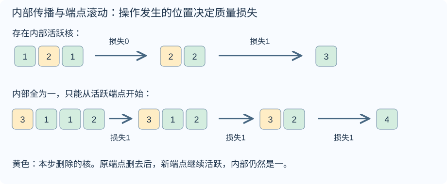
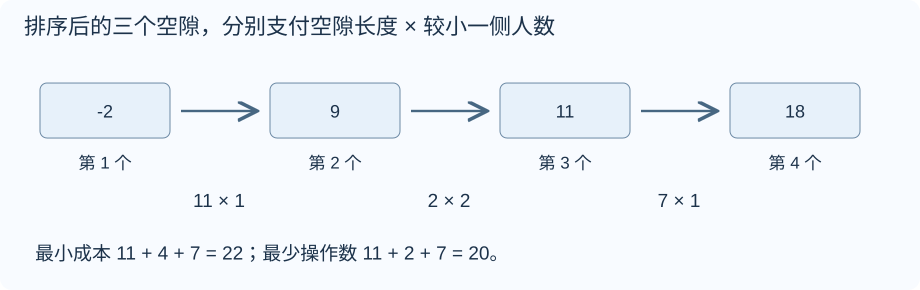
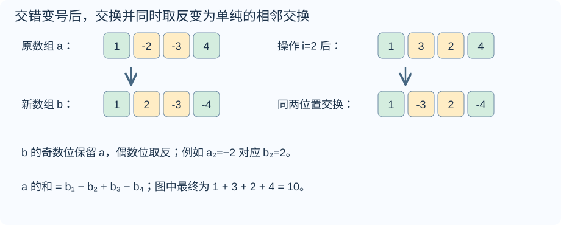
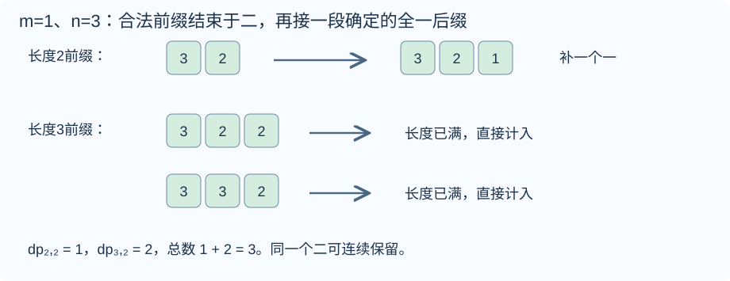
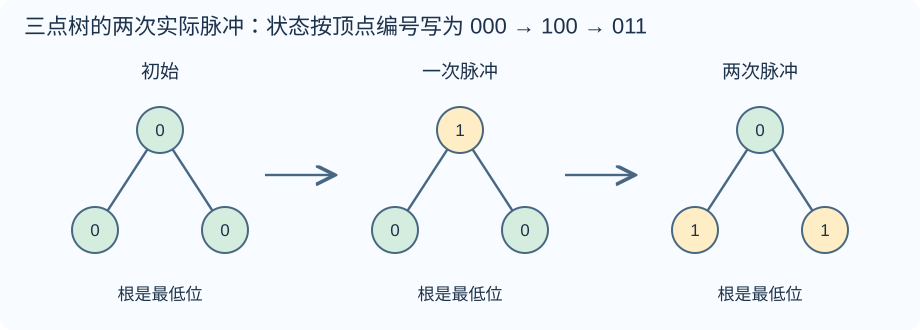
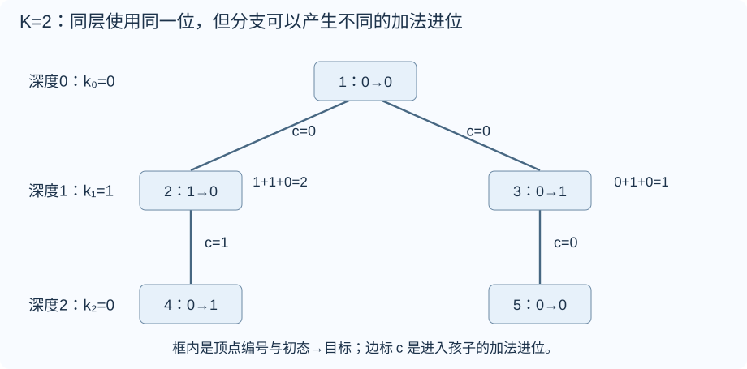

# Div.3 1131 题解

> 比赛：[Codeforces Round 1131 (Div. 3)](https://codeforces.com/contest/2278)
> 语言：C++17。默认稿收录 A–G；A 为签到题，按用户最新规则仅提供默认版，详细稿收录 B–G。官方尚未公布 rating，目录难度为算法复核估分，不是 Codeforces 官方评分。

## 目录

| 题号 | 题名 | 考点 | 难度 |
|---|---|---|---|
| B | Stakes and Shapes | 构造[主] + 贪心 | 800 |
| C | Math and Physics | 贪心 | 1100 |
| D | Lock and Unlock | 贪心[主] + 排序 | 1600 |
| E | Swap and Negate | 贪心[主] + 排序 | 1700 |
| F | Modulo and Counting | 线性 DP[主] + 前缀和 + 取模与同余 | 2100 |
| G | 0s and 1s | 位运算[主] + DFS | 2100 |


## B. Stakes and Shapes

### 题意

[原题链接](https://codeforces.com/contest/2278/problem/B)

Alice 在 $x+y+z$ 局中分别出 $x$ 次石头、$y$ 次剪刀、$z$ 次布，顺序未知。Bob 须提前确定全部手势，保证对方任意排列下，自己赢局数不少于输局数。输出任意满足条件的字符串。$0\le x,y,z\le100$，总局数为正。

### 从零讲：整数类型、整除与溢出

<details>
<summary>展开可复用的基础知识</summary>

#### 整数类型、整除与溢出

计算前先看每一步可能达到的范围。常见环境中 $\verb@int@$ 是 32 位，上界约 $2.1\times10^9$；$\verb@long long@$ 至少 64 位，常见有符号 64 位上界约 $9.22\times10^{18}$。$\verb@using ll = long long;@$ 只是为已有类型起别名。

```cxx
int a = 100000, b = 100000;
long long wrong = a * b;      // 右边先按 int 乘，可能已溢出
long long right = 1LL * a * b; // 先把运算提升到 long long
```

不能指望“接收结果的变量够大”修复此前已经溢出的计算。先提高操作数类型，再做乘法。超过 64 位时，GCC 的 $\verb@__int128@$ 可作中间量，但它不是标准 C++17 类型，也没有标准流输出重载；先证明范围，再选择工具。

整数 $\verb@/@$ 对有符号数向零截断：$\verb@7/3==2@$、$\verb@-7/3==-2@$。对非负数才等于向下取整。余数满足 $\verb@a == (a/b)*b + a%b@$，除数不能为零；要将余数归入 $[0,m-1]$（$m>0$），可用 $\verb@(a % m + m) % m@$，同时保证中间加法不溢出。

非负 $a$、正 $b$ 的向上取整可写 $\verb@a/b + (a%b != 0)@$，比 $\verb@(a+b-1)/b@$ 更容易避免加法溢出。比较平方时也应在宽类型内计算；浮点数不适合作为大整数相等的默认判断方式。

$\verb@size()@$ 返回无符号类型。空容器上写 $\verb@size()-1@$ 会绕到很大的数，逆序遍历可以先转成有符号、确认长度，或使用逆向迭代器。$\verb@abs@$ 对最小有符号数无法在同类型中表达其正值，需先约束输入差值范围。一般机器整数运算按常数时间估算，宽类型解决表示范围，不改变算法的增长阶。


</details>

### 思路

假设 Alice 会出两次石头、四次剪刀、一次布。Bob 全部出石头时，无论 Alice 怎样排列，都会有四局获胜、一局失败、两局平局，所以满足要求。

推广时，先找到 Alice 次数最多的类别。如果石头最多，Bob 全部出布；如果剪刀最多，全部出石头；如果布最多，全部出剪刀。Bob 赢的局数等于这个最大次数，输的局数则等于另外某一类的次数，因此前者一定不小于后者。

这个证明同时处理了“Bob 先决定”和“Alice 顺序未知”：因为 Bob 的每一位相同，将 Alice 的手势换到任何位置，都不会改变三类对局的数量。只需要满足不败条件，不需要额外寻找更多种手势的搭配。

代码的三个分支对应上述三种情况；$\verb@string(count, ch)@$ 创建由 $\verb@count@$ 个相同字符 $\verb@ch@$ 组成的字符串，例如 $\verb@string(3,'P')@$ 为三个布。构造和输出都需 $O(x+y+z)$ 时间，保存字符串需同样数量的空间。零频次或最大频次并列都不影响论证，因为总局数保证为正。

### 参考代码

```cpp
#include <bits/stdc++.h>
using namespace std;
int main() {
    ios::sync_with_stdio(false);
    cin.tie(nullptr);
    int t;
    cin >> t;
    while (t--) {
        int x, y, z;
        cin >> x >> y >> z;
        char move;
        // 始终克制 Alice 出现最多的手势，赢局数便不会小于输局数。
        if (x >= y && x >= z) move = 'P';
        else if (y >= z) move = 'R';
        else move = 'S';
        cout << string(x + y + z, move) << '\n';
    }
}
```

### 易错点

手势字符对应 R 石头、S 剪刀、P 布；要输出最大频次类别的克制手势。答案不唯一，不能逐字与样例比较。


## C. Math and Physics

### 题意

[原题链接](https://codeforces.com/contest/2278/problem/C)

$n$ 颗核排成一列，质量均为正整数。可把一颗质量至少二的核分成正整数 $x,y$，删除原核，并将 $x$ 加给左邻、$y$ 加给右邻；不存在的邻居所对应的质量流失。求能否达到只剩一颗的状态，及此时最大质量。$2\le n\le2\times10^5$，$1\le a_i\le1000$，总 $n$ 不超过 $2\times10^5$。

### 从零讲：vector：长度可变的连续数组

<details>
<summary>展开可复用的基础知识</summary>

#### vector：长度可变的连续数组

$\verb@vector<T>@$ 保存一串同类型的元素，适合按下标访问、扫描、排序。$\verb@T@$ 是元素类型，例如 $\verb@vector<int>@$ 保存整数，$\verb@vector<pair<int,int>>@$ 保存整数对，$\verb@vector<vector<int>>@$ 可保存每个顶点各自的邻居。需要 $\verb@<vector>@$。

```cxx
vector<int> a(3, 7);   // 三个元素，内容是 7、7、7
a.push_back(9);       // 在末尾追加，现在长度为 4
int x = a[1];         // 从 0 编号，这里得到 7
a[1] = 2;            // 改第二个元素
int n = int(a.size());
```

$\verb@vector<int> a(3)@$ 创建三个值为零的元素；$\verb@a.reserve(3)@$ 只预留容量，元素数仍为零，此时不能访问 $\verb@a[0]@$。长度 $\verb@size()@$ 与容量 $\verb@capacity()@$ 是不同概念。

下标访问为 $O(1)$，遍历为 $O(n)$。末尾追加通常为 $O(1)$；容量不足时会分配更大的连续空间并搬移元素，这次可能为 $O(n)$，一连串追加的平均成本称为摊还 $O(1)$。中间插入或删除会搬移后续元素，最坏 $O(n)$。内存是元素量的 $O(n)$，并可能预留部分尚未使用的容量。

$\verb@begin()@$ 指向首元素，$\verb@end()@$ 指向尾后位置，$\verb@sort(a.begin(),a.end())@$ 操作整个数组。$\verb@a[i]@$ 不检查越界；下标须满足 $0\le i<\mathrm{size}$。$\verb@at(i)@$ 会检查越界并抛异常。空数组不能访问 $\verb@front()@$、$\verb@back()@$；$\verb@pop_back()@$ 也要求非空。

扩容后指向旧存储的迭代器、引用和指针会失效。遍历的同时 $\verb@push_back@$，不能假定此前取得的引用仍可用。读取大数组的函数常用 $\verb@const vector<int>& a@$ 按常量引用传入，既不复制也禁止通过该引用修改；$\verb@vector<int> a@$ 按值传参则复制内容。选择副本还是引用取决于是否要保留独立数据。


</details>

### 从零讲：整数类型、整除与溢出

<details>
<summary>展开可复用的基础知识</summary>

#### 整数类型、整除与溢出

计算前先看每一步可能达到的范围。常见环境中 $\verb@int@$ 是 32 位，上界约 $2.1\times10^9$；$\verb@long long@$ 至少 64 位，常见有符号 64 位上界约 $9.22\times10^{18}$。$\verb@using ll = long long;@$ 只是为已有类型起别名。

```cxx
int a = 100000, b = 100000;
long long wrong = a * b;      // 右边先按 int 乘，可能已溢出
long long right = 1LL * a * b; // 先把运算提升到 long long
```

不能指望“接收结果的变量够大”修复此前已经溢出的计算。先提高操作数类型，再做乘法。超过 64 位时，GCC 的 $\verb@__int128@$ 可作中间量，但它不是标准 C++17 类型，也没有标准流输出重载；先证明范围，再选择工具。

整数 $\verb@/@$ 对有符号数向零截断：$\verb@7/3==2@$、$\verb@-7/3==-2@$。对非负数才等于向下取整。余数满足 $\verb@a == (a/b)*b + a%b@$，除数不能为零；要将余数归入 $[0,m-1]$（$m>0$），可用 $\verb@(a % m + m) % m@$，同时保证中间加法不溢出。

非负 $a$、正 $b$ 的向上取整可写 $\verb@a/b + (a%b != 0)@$，比 $\verb@(a+b-1)/b@$ 更容易避免加法溢出。比较平方时也应在宽类型内计算；浮点数不适合作为大整数相等的默认判断方式。

$\verb@size()@$ 返回无符号类型。空容器上写 $\verb@size()-1@$ 会绕到很大的数，逆序遍历可以先转成有符号、确认长度，或使用逆向迭代器。$\verb@abs@$ 对最小有符号数无法在同类型中表达其正值，需先约束输入差值范围。一般机器整数运算按常数时间估算，宽类型解决表示范围，不改变算法的增长阶。


</details>

### 思路

先区分操作发生的位置。内部核的两个邻居都存在，分出的两份都留在序列里；端点只有一个邻居，另一份必须流失，而且这一份至少是一。



要从多颗变成一颗，最后必然从两颗出发，再删除其中一颗。这时不存在内部位置，至少要损失一，所以 $S-1$ 是统一上界。但能否达到这个上界，取决于是否能先在内部开始。

#### 有内部活跃核

把质量至少二的核称为活跃核。删除一个内部活跃核时，给左右邻居各至少一；因为邻居原来至少一，收到后都变成活跃核。也就是说，删掉它会把继续操作的能力传给两侧。

在两侧传出的活跃核中，只要仍处于内部，就可以继续删除。保留原来的两个端点，逐步清除中间的核，整个阶段不损失质量。最终两端均收到过质量，能够操作；取一作为被删除端点，只让向外的一份为一，其余全部交给另一端，就得到 $S-1$。

图中 $[1,2,1]$ 先删中间二，得到 $[2,2]$，再删左端二、向外丢一，留下三，正好是总质量四减一。

#### 内部全为一

内部核不能作为第一步。若连端点也是一，就完全无操作，答案负一。

否则从一个活跃端点开始：丢向外的一份选一，其余 $a_i-1$ 加到旁边的一上，使新的端点质量又变成 $a_i$。操作能力只是在端点向内滚动；剩余内部核依旧为一，无法凭空出现内部活跃核。因此每一次删除都发生在端点，必损失至少一，总共删除 $n-1$ 颗，所以上界变为 $S-(n-1)$。

上述滚动过程每次恰好只丢一，能够达到这个上界。图中 $[3,1,1,2]$ 总质量七，连续三步各丢一，最终为四；也就是两端初始质量之和再减一。

程序分别记录总和、是否有活跃核、是否有内部活跃核，直接按三类输出。$n=2$ 没有内部位置，第三类同样适用。读取并保存数组为 $O(n)$ 时间和空间；题目不要求输出操作序列。

### 参考代码

```cpp
#include <bits/stdc++.h>
using namespace std;
int main() {
    ios::sync_with_stdio(false);
    cin.tie(nullptr);
    int t;
    cin >> t;
    while (t--) {
        int n;
        cin >> n;
        vector<long long> a(n);
        long long sum = 0;
        bool movable = false, inner = false;
        for (int i = 0; i < n; ++i) {
            cin >> a[i]; sum += a[i];
            if (a[i] >= 2) {
                movable = true;
                if (i > 0 && i + 1 < n) inner = true;
            }
        }
        if (!movable) cout << -1 << '\n';
        else if (inner) cout << sum - 1 << '\n';
        else cout << a.front() + a.back() - 1 << '\n';
    }
}
```

### 易错点

内部与端点必须按当前位置理解。终态采用官方样例和官方题解的“达到只剩一颗即结束”口径；原文的停止条件句未明确排除继续删除唯一核，若照此继续删除，会与样例留下质量九相矛盾。


## D. Lock and Unlock

### 题意

[原题链接](https://codeforces.com/contest/2278/problem/D)

每次锁定 $k$ 个不同位置，花费 $k$；其余未锁元素统一加一或统一减一，然后全部解锁。先最小化使所有元素相等的总花费，再在最小花费下最小化操作次数。$2\le n\le2\times10^5$，$|a_i|\le10^9$，总 $n\le2\times10^5$。

### 从零讲：vector：长度可变的连续数组

<details>
<summary>展开可复用的基础知识</summary>

#### vector：长度可变的连续数组

$\verb@vector<T>@$ 保存一串同类型的元素，适合按下标访问、扫描、排序。$\verb@T@$ 是元素类型，例如 $\verb@vector<int>@$ 保存整数，$\verb@vector<pair<int,int>>@$ 保存整数对，$\verb@vector<vector<int>>@$ 可保存每个顶点各自的邻居。需要 $\verb@<vector>@$。

```cxx
vector<int> a(3, 7);   // 三个元素，内容是 7、7、7
a.push_back(9);       // 在末尾追加，现在长度为 4
int x = a[1];         // 从 0 编号，这里得到 7
a[1] = 2;            // 改第二个元素
int n = int(a.size());
```

$\verb@vector<int> a(3)@$ 创建三个值为零的元素；$\verb@a.reserve(3)@$ 只预留容量，元素数仍为零，此时不能访问 $\verb@a[0]@$。长度 $\verb@size()@$ 与容量 $\verb@capacity()@$ 是不同概念。

下标访问为 $O(1)$，遍历为 $O(n)$。末尾追加通常为 $O(1)$；容量不足时会分配更大的连续空间并搬移元素，这次可能为 $O(n)$，一连串追加的平均成本称为摊还 $O(1)$。中间插入或删除会搬移后续元素，最坏 $O(n)$。内存是元素量的 $O(n)$，并可能预留部分尚未使用的容量。

$\verb@begin()@$ 指向首元素，$\verb@end()@$ 指向尾后位置，$\verb@sort(a.begin(),a.end())@$ 操作整个数组。$\verb@a[i]@$ 不检查越界；下标须满足 $0\le i<\mathrm{size}$。$\verb@at(i)@$ 会检查越界并抛异常。空数组不能访问 $\verb@front()@$、$\verb@back()@$；$\verb@pop_back()@$ 也要求非空。

扩容后指向旧存储的迭代器、引用和指针会失效。遍历的同时 $\verb@push_back@$，不能假定此前取得的引用仍可用。读取大数组的函数常用 $\verb@const vector<int>& a@$ 按常量引用传入，既不复制也禁止通过该引用修改；$\verb@vector<int> a@$ 按值传参则复制内容。选择副本还是引用取决于是否要保留独立数据。


</details>

### 从零讲：整数类型、整除与溢出

<details>
<summary>展开可复用的基础知识</summary>

#### 整数类型、整除与溢出

计算前先看每一步可能达到的范围。常见环境中 $\verb@int@$ 是 32 位，上界约 $2.1\times10^9$；$\verb@long long@$ 至少 64 位，常见有符号 64 位上界约 $9.22\times10^{18}$。$\verb@using ll = long long;@$ 只是为已有类型起别名。

```cxx
int a = 100000, b = 100000;
long long wrong = a * b;      // 右边先按 int 乘，可能已溢出
long long right = 1LL * a * b; // 先把运算提升到 long long
```

不能指望“接收结果的变量够大”修复此前已经溢出的计算。先提高操作数类型，再做乘法。超过 64 位时，GCC 的 $\verb@__int128@$ 可作中间量，但它不是标准 C++17 类型，也没有标准流输出重载；先证明范围，再选择工具。

整数 $\verb@/@$ 对有符号数向零截断：$\verb@7/3==2@$、$\verb@-7/3==-2@$。对非负数才等于向下取整。余数满足 $\verb@a == (a/b)*b + a%b@$，除数不能为零；要将余数归入 $[0,m-1]$（$m>0$），可用 $\verb@(a % m + m) % m@$，同时保证中间加法不溢出。

非负 $a$、正 $b$ 的向上取整可写 $\verb@a/b + (a%b != 0)@$，比 $\verb@(a+b-1)/b@$ 更容易避免加法溢出。比较平方时也应在宽类型内计算；浮点数不适合作为大整数相等的默认判断方式。

$\verb@size()@$ 返回无符号类型。空容器上写 $\verb@size()-1@$ 会绕到很大的数，逆序遍历可以先转成有符号、确认长度，或使用逆向迭代器。$\verb@abs@$ 对最小有符号数无法在同类型中表达其正值，需先约束输入差值范围。一般机器整数运算按常数时间估算，宽类型解决表示范围，不改变算法的增长阶。


</details>

### 思路

先看排序后的四个数。两个相邻数之间的空隙，可以让左边整块上移一，或者右边整块下移一；被锁住的一侧保持不动，较少的一侧作为锁定方，就能少付成本。



图中 $(-2,9,11,18)$ 的相邻差分别为十一、二、七。关闭第一个差，锁最左一人，右侧整体减一，重复十一回；中间差两侧各两人，每步成本二，重复两回；最后一个差锁最右一人，左侧整体加一，重复七回。总成本 $11\times1+2\times2+7\times1=22$，总操作数 $11+2+7=20$。

#### 为什么这样关闭空隙不会互相破坏

每次移动的是某个相邻差的一整侧，组内所有数同加或同减，内部差不变；两个组之间的目标差恰好减一。在差仍为正时，元素也不会越过相邻组。所以可以依次把每个差关闭，成本为
$$\sum_{i=1}^{n-1}(b_{i+1}-b_i)\min(i,n-i).$$

这个式子也等于 $\sum_i|b_i-c|$，其中 $c$ 是中位数：位于中位数左边的每段空隙，要被其左侧所有元素跨越；右边的空隙，要被其右侧所有元素跨越。每段空隙的跨越人数恰为两侧较小者。偶数长度时，中间两数之间任意 $c$ 都给出相同最小值，代码直接选排序数组下标 $n/2$ 的元素。

#### 更省钱的其他操作为什么不存在

对任意数组定义 $\Phi(a)=\min_c\sum_i|a_i-c|$。中位数能取得这个最小值：把中心向右移动一时，左侧元素的距离各加一，右侧各减一；当中心位于中间两侧人数平衡的位置时就无法再降低。

一次将未锁元素加一，可以改看成“锁住的元素各减一，再把整个数组加一”。整体平移不改变 $\Phi$。改变一个元素一单位，任何固定中心的距离和最多改变一，取最小值后也具有这个界；因此改变 $k$ 个锁定元素，$\Phi$ 最多减少 $k$。数组最终相等时 $\Phi=0$，总成本必不小于初始 $\Phi$。上面的关闭空隙构造达到它，所以成本最优。

#### 为什么最优成本下还能用最少次数

每次只有一个统一方向：一部分元素加一或一部分减一，其余不动。原先最小值和最大值的距离最多缩小一，所以至少需要原极差 $b_n-b_1$ 次操作。关闭空隙的构造恰好每一步都让极差缩小一，总次数就是各相邻差的和，即原极差。因此它同时达到最小成本与对应的最少次数。

实现时不必真的走这些步；排序后累计到中位数的距离，另一项直接取首尾差。即使全相等也会自然输出两个零。总时间 $O(n\log n)$、空间 $O(n)$。累计成本最大约为 $n\times2\times10^9$，需六十四位整数。

### 参考代码

```cpp
#include <bits/stdc++.h>
using namespace std;
int main() {
    ios::sync_with_stdio(false);
    cin.tie(nullptr);
    int t;
    cin >> t;
    while (t--) {
        int n;
        cin >> n;
        vector<long long> a(n);
        for (auto &v : a) cin >> v;
        sort(a.begin(), a.end());
        long long median = a[n / 2], cost = 0;
        // 中位数两侧的距离之和等于按每个相邻差付出的最小锁定成本。
        for (long long v : a) cost += (v >= median ? v - median : median - v);
        cout << cost << ' ' << a.back() - a.front() << '\n';
    }
}
```

### 易错点

题目有先后两个目标，不能只输出中位数距离和。操作方向对全部未锁元素一致，所以不能在一回中同时让两端各向内移动一。


## E. Swap and Negate

### 题意

[原题链接](https://codeforces.com/contest/2278/problem/E)

可任意多次把相邻两数同时改成 $(-a_{i+1},-a_i)$，求数组和的最大可能值。$1\le n\le2\times10^5$，$|a_i|\le10^9$，总 $n\le2\times10^5$。

### 从零讲：vector：长度可变的连续数组

<details>
<summary>展开可复用的基础知识</summary>

#### vector：长度可变的连续数组

$\verb@vector<T>@$ 保存一串同类型的元素，适合按下标访问、扫描、排序。$\verb@T@$ 是元素类型，例如 $\verb@vector<int>@$ 保存整数，$\verb@vector<pair<int,int>>@$ 保存整数对，$\verb@vector<vector<int>>@$ 可保存每个顶点各自的邻居。需要 $\verb@<vector>@$。

```cxx
vector<int> a(3, 7);   // 三个元素，内容是 7、7、7
a.push_back(9);       // 在末尾追加，现在长度为 4
int x = a[1];         // 从 0 编号，这里得到 7
a[1] = 2;            // 改第二个元素
int n = int(a.size());
```

$\verb@vector<int> a(3)@$ 创建三个值为零的元素；$\verb@a.reserve(3)@$ 只预留容量，元素数仍为零，此时不能访问 $\verb@a[0]@$。长度 $\verb@size()@$ 与容量 $\verb@capacity()@$ 是不同概念。

下标访问为 $O(1)$，遍历为 $O(n)$。末尾追加通常为 $O(1)$；容量不足时会分配更大的连续空间并搬移元素，这次可能为 $O(n)$，一连串追加的平均成本称为摊还 $O(1)$。中间插入或删除会搬移后续元素，最坏 $O(n)$。内存是元素量的 $O(n)$，并可能预留部分尚未使用的容量。

$\verb@begin()@$ 指向首元素，$\verb@end()@$ 指向尾后位置，$\verb@sort(a.begin(),a.end())@$ 操作整个数组。$\verb@a[i]@$ 不检查越界；下标须满足 $0\le i<\mathrm{size}$。$\verb@at(i)@$ 会检查越界并抛异常。空数组不能访问 $\verb@front()@$、$\verb@back()@$；$\verb@pop_back()@$ 也要求非空。

扩容后指向旧存储的迭代器、引用和指针会失效。遍历的同时 $\verb@push_back@$，不能假定此前取得的引用仍可用。读取大数组的函数常用 $\verb@const vector<int>& a@$ 按常量引用传入，既不复制也禁止通过该引用修改；$\verb@vector<int> a@$ 按值传参则复制内容。选择副本还是引用取决于是否要保留独立数据。


</details>

### 从零讲：整数类型、整除与溢出

<details>
<summary>展开可复用的基础知识</summary>

#### 整数类型、整除与溢出

计算前先看每一步可能达到的范围。常见环境中 $\verb@int@$ 是 32 位，上界约 $2.1\times10^9$；$\verb@long long@$ 至少 64 位，常见有符号 64 位上界约 $9.22\times10^{18}$。$\verb@using ll = long long;@$ 只是为已有类型起别名。

```cxx
int a = 100000, b = 100000;
long long wrong = a * b;      // 右边先按 int 乘，可能已溢出
long long right = 1LL * a * b; // 先把运算提升到 long long
```

不能指望“接收结果的变量够大”修复此前已经溢出的计算。先提高操作数类型，再做乘法。超过 64 位时，GCC 的 $\verb@__int128@$ 可作中间量，但它不是标准 C++17 类型，也没有标准流输出重载；先证明范围，再选择工具。

整数 $\verb@/@$ 对有符号数向零截断：$\verb@7/3==2@$、$\verb@-7/3==-2@$。对非负数才等于向下取整。余数满足 $\verb@a == (a/b)*b + a%b@$，除数不能为零；要将余数归入 $[0,m-1]$（$m>0$），可用 $\verb@(a % m + m) % m@$，同时保证中间加法不溢出。

非负 $a$、正 $b$ 的向上取整可写 $\verb@a/b + (a%b != 0)@$，比 $\verb@(a+b-1)/b@$ 更容易避免加法溢出。比较平方时也应在宽类型内计算；浮点数不适合作为大整数相等的默认判断方式。

$\verb@size()@$ 返回无符号类型。空容器上写 $\verb@size()-1@$ 会绕到很大的数，逆序遍历可以先转成有符号、确认长度，或使用逆向迭代器。$\verb@abs@$ 对最小有符号数无法在同类型中表达其正值，需先约束输入差值范围。一般机器整数运算按常数时间估算，宽类型解决表示范围，不改变算法的增长阶。


</details>

### 思路

原操作会交换相邻位置，又同时取反。直接追踪哪些数能变正，容易误以为可以把所有数取绝对值；例如两数 $(6,-7)$ 只能在原状态和 $(7,-6)$ 之间切换，最大和为一。

将第一、三、五等奇数位置保留，第二、四、六等偶数位置取反，得到新数组 $b$。这是一一对应的换元，知道 $b$ 就能按同样的交错变号恢复 $a$。



#### 新数组上的操作是什么

设 $b_i=(-1)^{i-1}a_i$。原操作后 $a'_i=-a_{i+1}$、$a'_{i+1}=-a_i$，因此
$$b'_i=(-1)^{i-1}(-a_{i+1})=(-1)^ia_{i+1}=b_{i+1},$$
$$b'_{i+1}=(-1)^i(-a_i)=(-1)^{i-1}a_i=b_i.$$
所以在新数组中，两项只交换，不改变它们的值。

任意排列都能由相邻交换得到：把希望出现在首位的数逐步换到首位，再对剩下位置重复。因此可以完全自由地选择 $b$ 的排列；按上面的对应关系，每一次这样的交换都能由原操作实现，不会多允许不合法的操作。

#### 哪些数应该被加，哪些应该被减

原数组和等于
$$b_1-b_2+b_3-b_4+\cdots.$$
奇数位置给正号，共 $\lceil n/2\rceil$ 个；偶数位置给负号，共 $\lfloor n/2\rfloor$ 个。若一个正号位放了小数 $u$，负号位放了更大的 $v$，原贡献为 $u-v$，交换后为 $v-u$，增加 $2(v-u)>0$。所以所有正号位都应放较大的数，负号位放较小的数。

图中的 $b=(1,2,-3,-4)$，排序后为 $(-4,-3,1,2)$。最小两项放到负号位，答案为 $4+3+1+2=10$，对应的原数组确实可以成为 $(1,3,2,4)$。

代码先在输入的偶数位置变号，再排序；随后前 $n/2$ 项减掉，其余加上。代码下标从零开始，偶数位置对应零基奇数下标。$n=1$ 时不会变号，负数也必须原样保留。总时间 $O(n\log n)$、空间 $O(n)$，总和可能达到 $2\times10^{14}$，使用 $\verb@long long@$。

### 参考代码

```cpp
#include <bits/stdc++.h>
using namespace std;
int main() {
    ios::sync_with_stdio(false);
    cin.tie(nullptr);
    int t;
    cin >> t;
    while (t--) {
        int n;
        cin >> n;
        vector<long long> b(n);
        for (int i = 0; i < n; ++i) {
            cin >> b[i];
            if (i % 2 == 1) b[i] = -b[i];
        }
        // 原操作恰好变成 b 的相邻交换，因此 b 可任意重排。
        sort(b.begin(), b.end());
        long long answer = 0;
        for (int i = 0; i < n; ++i) {
            if (i < n / 2) answer -= b[i];
            else answer += b[i];
        }
        cout << answer << '\n';
    }
}
```

### 易错点

交换和取反必须同时发生；不是先修改一项，再用已修改的值算另一项。不能把每个原数独立改成绝对值。奇偶位置要区分一基题面与零基代码下标。


## F. Modulo and Counting

### 题意

[原题链接](https://codeforces.com/contest/2278/problem/F)

计数长度为 $n$ 的非增正整数数组，满足 $a_1\le m+2$ 且相邻取模之和为 $m$。答案模 $998244353$。$2\le n\le4000$，$1\le m\le4000$，所有测试的 $n,m$ 之和分别不超过四千。

### 从零讲：vector：长度可变的连续数组

<details>
<summary>展开可复用的基础知识</summary>

#### vector：长度可变的连续数组

$\verb@vector<T>@$ 保存一串同类型的元素，适合按下标访问、扫描、排序。$\verb@T@$ 是元素类型，例如 $\verb@vector<int>@$ 保存整数，$\verb@vector<pair<int,int>>@$ 保存整数对，$\verb@vector<vector<int>>@$ 可保存每个顶点各自的邻居。需要 $\verb@<vector>@$。

```cxx
vector<int> a(3, 7);   // 三个元素，内容是 7、7、7
a.push_back(9);       // 在末尾追加，现在长度为 4
int x = a[1];         // 从 0 编号，这里得到 7
a[1] = 2;            // 改第二个元素
int n = int(a.size());
```

$\verb@vector<int> a(3)@$ 创建三个值为零的元素；$\verb@a.reserve(3)@$ 只预留容量，元素数仍为零，此时不能访问 $\verb@a[0]@$。长度 $\verb@size()@$ 与容量 $\verb@capacity()@$ 是不同概念。

下标访问为 $O(1)$，遍历为 $O(n)$。末尾追加通常为 $O(1)$；容量不足时会分配更大的连续空间并搬移元素，这次可能为 $O(n)$，一连串追加的平均成本称为摊还 $O(1)$。中间插入或删除会搬移后续元素，最坏 $O(n)$。内存是元素量的 $O(n)$，并可能预留部分尚未使用的容量。

$\verb@begin()@$ 指向首元素，$\verb@end()@$ 指向尾后位置，$\verb@sort(a.begin(),a.end())@$ 操作整个数组。$\verb@a[i]@$ 不检查越界；下标须满足 $0\le i<\mathrm{size}$。$\verb@at(i)@$ 会检查越界并抛异常。空数组不能访问 $\verb@front()@$、$\verb@back()@$；$\verb@pop_back()@$ 也要求非空。

扩容后指向旧存储的迭代器、引用和指针会失效。遍历的同时 $\verb@push_back@$，不能假定此前取得的引用仍可用。读取大数组的函数常用 $\verb@const vector<int>& a@$ 按常量引用传入，既不复制也禁止通过该引用修改；$\verb@vector<int> a@$ 按值传参则复制内容。选择副本还是引用取决于是否要保留独立数据。


</details>

### 从零讲：前缀和：一段和由两段前缀相减

<details>
<summary>展开可复用的基础知识</summary>

#### 前缀和：一段和由两段前缀相减

一串数需要反复询问连续一段的总和，逐段扫描会重复加很多相同元素。先保存从头到每个位置的累计量，就能复用这些工作。

对从一编号的数组定义 $S_0=0$，$S_i=a_1+\cdots+a_i$。例如 $a=[2,3,1,4]$，前缀为 $S=[0,2,5,6,10]$。


查询 $[2,4]$ 时，$S_4$ 包含第一个数，减去 $S_1$ 后留下 $3+1+4=8$。一般地，$S_r-S_{l-1}$ 中前 $l-1$ 项逐项抵消，只留下第 $l$ 到第 $r$ 项。

```cxx
vector<long long> s(n + 1, 0);
for (int i = 1; i <= n; ++i) s[i] = s[i - 1] + a[i];
long long sum = s[r] - s[l - 1];
```

预处理 $O(n)$ 时间和空间，每次查询 $O(1)$，比 $q$ 次逐段扫描的最坏 $O(nq)$ 更适合大量静态区间和。若使用从零编号的原数组，也可定义 $P_i$ 为前 $i$ 项之和，查询闭区间 $[l,r]$ 为 $P_{r+1}-P_l$；不要混用两套下标。

前缀可以累积满足条件的次数，把每项变成零或一；也可以保存异或，此时相同前缀通过异或抵消。最小值没有同样的可逆减法，不能直接套区间最小值。原数组改变后，后续许多前缀都受影响；频繁在线修改时可考虑树状数组或线段树。

首个空前缀零不可漏，累加类型要覆盖总和。数学上的减法可能得到负值，别让无符号类型把它变成巨大正数。


</details>

### 从零讲：整数类型、整除与溢出

<details>
<summary>展开可复用的基础知识</summary>

#### 整数类型、整除与溢出

计算前先看每一步可能达到的范围。常见环境中 $\verb@int@$ 是 32 位，上界约 $2.1\times10^9$；$\verb@long long@$ 至少 64 位，常见有符号 64 位上界约 $9.22\times10^{18}$。$\verb@using ll = long long;@$ 只是为已有类型起别名。

```cxx
int a = 100000, b = 100000;
long long wrong = a * b;      // 右边先按 int 乘，可能已溢出
long long right = 1LL * a * b; // 先把运算提升到 long long
```

不能指望“接收结果的变量够大”修复此前已经溢出的计算。先提高操作数类型，再做乘法。超过 64 位时，GCC 的 $\verb@__int128@$ 可作中间量，但它不是标准 C++17 类型，也没有标准流输出重载；先证明范围，再选择工具。

整数 $\verb@/@$ 对有符号数向零截断：$\verb@7/3==2@$、$\verb@-7/3==-2@$。对非负数才等于向下取整。余数满足 $\verb@a == (a/b)*b + a%b@$，除数不能为零；要将余数归入 $[0,m-1]$（$m>0$），可用 $\verb@(a % m + m) % m@$，同时保证中间加法不溢出。

非负 $a$、正 $b$ 的向上取整可写 $\verb@a/b + (a%b != 0)@$，比 $\verb@(a+b-1)/b@$ 更容易避免加法溢出。比较平方时也应在宽类型内计算；浮点数不适合作为大整数相等的默认判断方式。

$\verb@size()@$ 返回无符号类型。空容器上写 $\verb@size()-1@$ 会绕到很大的数，逆序遍历可以先转成有符号、确认长度，或使用逆向迭代器。$\verb@abs@$ 对最小有符号数无法在同类型中表达其正值，需先约束输入差值范围。一般机器整数运算按常数时间估算，宽类型解决表示范围，不改变算法的增长阶。


</details>

### 思路

例如 $n=3,m=1$，首项上界为三。合法数组是 $(3,2,1)$、$(3,2,2)$ 和 $(3,3,2)$。先不要直接枚举全部数组，注意到“余数和接近允许的最大值”会强迫大多数相邻商等于一。

#### 余数和与相邻差有什么关系

对一对非增正整数 $u\ge v$，令 $q=\lfloor u/v\rfloor\ge1$，则
$$u\bmod v=u-qv=(u-v)-(q-1)v.$$
相邻差 $(u-v)$ 的总和能够首尾抵消。因此对整个数组有
$$m=a_1-a_n-\underbrace{\sum_{i=1}^{n-1}(q_i-1)a_{i+1}}_{L}.$$
这里 $L$ 表示相对于相邻差总和多扣掉的量，每项都非负。又因为 $a_1\le m+2$、$a_n\ge1$，所以 $0\le L=a_1-a_n-m\le1$。

#### 两种可能如何变成同一类前缀

当 $L=0$ 时，每个商都为一，即相邻值满足 $v\le u<2v$。同时 $a_1-a_n=m$。末项只能是一或二；若为一，上一步在一到二的左闭右开范围内，也只能是一，向前递推会所有数都是一，与 $m\ge1$ 矛盾。因此这一类必须首项 $m+2$、末项二。

当 $L=1$ 时，首项只能为 $m+2$，末项只能为一。总损失中恰有一项等于一，要求较小数为一、商为二，故这一项只能来自 $2\to1$。其他步骤商均为一。进入一以后，由非增性，余下元素只能继续为一。

于是两类可以统一描述：先从 $m+2$ 经过若干步 $v\le u<2v$，走到二；然后要么数组正好结束，要么接上一段全一后缀。



#### 定义与计算前缀 DP

令 $dp_{\ell,v}$ 只数上述尚未进入一的前缀：长度为 $\ell$、首项为 $m+2$、末项为 $v\ge2$。初始只有单元素前缀 $(m+2)$，所以它的计数为一。

要接一个新的末项 $v$，旧末项 $u$ 必须在 $[v,\min(m+2,2v-1)]$。每个旧前缀接上这个固定的 $v$，得到一份新前缀；删除新末项又唯一恢复旧前缀。因此直接相加：
$$dp_{\ell+1,v}=\sum_{u=v}^{\min(m+2,2v-1)}dp_{\ell,u}.$$
这是一段连续区间。对旧行求前缀和 $P_r=\sum_{u=1}^r dp_{\ell,u}$，转移就是 $P_{\min(m+2,2v-1)}-P_{v-1}$。求和图在基础知识入口中，当前区间的两端则由非增性和商为一推导而来。

代码使用三个数组：$\verb@dp@$ 是旧行，$\verb@prefix@$ 是旧行的前缀和，$\verb@next_dp@$ 写新行。新行的所有有效位置写完后再交换，避免读取到本轮已更新的值。

#### 为什么要把所有长度的二相加

对于每个 $\ell\le n$，结束于二的前缀唯一接上 $n-\ell$ 个一；如果 $\ell=n$，就是不接一。反过来，对任何合法完整数组，找到最后一个至少为二的位置，就唯一得到这个前缀与全一后缀。因此
$$\text{answer}=\sum_{\ell=1}^{n}dp_{\ell,2}.$$
这里不是“第一次到达二”！二可以重复多次，最后一个二的位置决定接入全一后缀的地方。例子中长度二前缀 $(3,2)$ 贡献 $(3,2,1)$；长度三前缀 $(3,2,2)$、$(3,3,2)$ 各贡献自己，合计三。

每次加法取模，区间相减出现负数时加回模数。两项相加小于两倍模数，可用 $\verb@int@$；大范围乘法不在本实现中出现。总时间 $O(nm)$、额外空间 $O(m)$，无须保存二维表。

### 参考代码

```cpp
#include <bits/stdc++.h>
using namespace std;
const int MOD = 998244353;
int main() {
    ios::sync_with_stdio(false);
    cin.tie(nullptr);
    int t;
    cin >> t;
    while (t--) {
        int n, m;
        cin >> n >> m;
        int maximum = m + 2;
        vector<int> dp(maximum + 1), next_dp(maximum + 1), prefix(maximum + 1);
        dp[maximum] = 1;
        int answer = 0;
        for (int length = 1; length <= n; ++length) {
            // 长度不足 n 时，结束于 2 的前缀以全 1 后缀唯一补齐。
            answer += dp[2];
            if (answer >= MOD) answer -= MOD;
            if (length == n) break;
            prefix[0] = 0;
            for (int v = 1; v <= maximum; ++v) {
                prefix[v] = prefix[v - 1] + dp[v];
                if (prefix[v] >= MOD) prefix[v] -= MOD;
            }
            for (int v = 2; v <= maximum; ++v) {
                // 合法前驱 u 满足 v <= u < 2v。
                int hi = min(maximum, 2 * v - 1);
                next_dp[v] = prefix[hi] - prefix[v - 1];
                if (next_dp[v] < 0) next_dp[v] += MOD;
            }
            dp.swap(next_dp);
        }
        cout << answer << '\n';
    }
}
```

### 易错点

严格不等式 $u<2v$ 的上界应写成 $2v-1$。达到二后允许继续停留在二；不能只统计首次到二的前缀。每轮转移只读旧行。


## G. 0s and 1s

### 题意

[原题链接](https://codeforces.com/contest/2278/problem/G)

根为一的树，每点有初始二进制状态 $x_v$ 和目标 $y_v$。给根注入一个脉冲：零变一并停止，一变零并向所有孩子各发一脉冲。求达到全部目标的最少根脉冲数，模 $998244353$；不可达输出负一。$1\le n\le2\times10^5$，总 $n\le2\times10^5$。

### 从零讲：位运算：把非负整数看成一组二进制开关

<details>
<summary>展开可复用的基础知识</summary>

#### 位运算：把非负整数看成一组二进制开关

五写成二进制为 $0101_2$，三为 $0011_2$。同一列各代表一位：按位与 $\verb@&@$ 两边都为一才得一，按位或 $\verb@|@$ 任一为一就得一，按位异或 $\verb@^@$ 不同才为一。所以 $5\mathbin{\&}3=1$，$5\mathbin{|}3=7$，$5\mathbin{\oplus}3=6$。


$\verb@1ULL << k@$ 把一移到第 $k$ 位。对非负无符号整数，$\verb@(mask >> k) & 1ULL@$ 读该位，$\verb@mask | (1ULL<<k)@$ 置一，$\verb@mask & ~(1ULL<<k)@$ 清零，$\verb@mask ^ (1ULL<<k)@$ 翻转。最低位编号为零。

```cxx
unsigned long long mask = 5; // 第 0、2 位为一
bool has = (mask >> 2) & 1ULL; // true
mask |= 1ULL << 1;             // 变成 7
```

位移次数必须小于类型位宽，且不能为负；不要用普通 $\verb@1@$ 去移到超出 int 范围的位置。C++17 有符号负数右移和溢出的规则不适合直接套“乘除二的幂”，用明确范围的无符号数更容易保证行为。$\verb@^@$ 是异或，绝不是乘方。

逻辑与 $\verb@&&@$、逻辑或 $\verb@||@$ 将整体条件视为真假，并会短路；按位 $\verb@&@$、$\verb@|@$ 逐位计算，不会因此跳过右侧表达式。运算符优先级可能与直觉不同，写 $\verb@(mask & bit) != 0@$，别省掉关键括号。

固定机器字内的一次位运算按 $O(1)$ 估算；枚举全部 $k$ 位状态仍有 $2^k$ 种，不能因为每次运算快就忽略状态数。$\verb@x & (x-1)@$ 对正无符号数清掉最低的一位；GCC 的 $\verb@__builtin_popcountll(x)@$ 统计一的数量，注意实参位宽与具体编译器支持。


</details>

### 从零讲：vector：长度可变的连续数组

<details>
<summary>展开可复用的基础知识</summary>

#### vector：长度可变的连续数组

$\verb@vector<T>@$ 保存一串同类型的元素，适合按下标访问、扫描、排序。$\verb@T@$ 是元素类型，例如 $\verb@vector<int>@$ 保存整数，$\verb@vector<pair<int,int>>@$ 保存整数对，$\verb@vector<vector<int>>@$ 可保存每个顶点各自的邻居。需要 $\verb@<vector>@$。

```cxx
vector<int> a(3, 7);   // 三个元素，内容是 7、7、7
a.push_back(9);       // 在末尾追加，现在长度为 4
int x = a[1];         // 从 0 编号，这里得到 7
a[1] = 2;            // 改第二个元素
int n = int(a.size());
```

$\verb@vector<int> a(3)@$ 创建三个值为零的元素；$\verb@a.reserve(3)@$ 只预留容量，元素数仍为零，此时不能访问 $\verb@a[0]@$。长度 $\verb@size()@$ 与容量 $\verb@capacity()@$ 是不同概念。

下标访问为 $O(1)$，遍历为 $O(n)$。末尾追加通常为 $O(1)$；容量不足时会分配更大的连续空间并搬移元素，这次可能为 $O(n)$，一连串追加的平均成本称为摊还 $O(1)$。中间插入或删除会搬移后续元素，最坏 $O(n)$。内存是元素量的 $O(n)$，并可能预留部分尚未使用的容量。

$\verb@begin()@$ 指向首元素，$\verb@end()@$ 指向尾后位置，$\verb@sort(a.begin(),a.end())@$ 操作整个数组。$\verb@a[i]@$ 不检查越界；下标须满足 $0\le i<\mathrm{size}$。$\verb@at(i)@$ 会检查越界并抛异常。空数组不能访问 $\verb@front()@$、$\verb@back()@$；$\verb@pop_back()@$ 也要求非空。

扩容后指向旧存储的迭代器、引用和指针会失效。遍历的同时 $\verb@push_back@$，不能假定此前取得的引用仍可用。读取大数组的函数常用 $\verb@const vector<int>& a@$ 按常量引用传入，既不复制也禁止通过该引用修改；$\verb@vector<int> a@$ 按值传参则复制内容。选择副本还是引用取决于是否要保留独立数据。


</details>

### 从零讲：整数类型、整除与溢出

<details>
<summary>展开可复用的基础知识</summary>

#### 整数类型、整除与溢出

计算前先看每一步可能达到的范围。常见环境中 $\verb@int@$ 是 32 位，上界约 $2.1\times10^9$；$\verb@long long@$ 至少 64 位，常见有符号 64 位上界约 $9.22\times10^{18}$。$\verb@using ll = long long;@$ 只是为已有类型起别名。

```cxx
int a = 100000, b = 100000;
long long wrong = a * b;      // 右边先按 int 乘，可能已溢出
long long right = 1LL * a * b; // 先把运算提升到 long long
```

不能指望“接收结果的变量够大”修复此前已经溢出的计算。先提高操作数类型，再做乘法。超过 64 位时，GCC 的 $\verb@__int128@$ 可作中间量，但它不是标准 C++17 类型，也没有标准流输出重载；先证明范围，再选择工具。

整数 $\verb@/@$ 对有符号数向零截断：$\verb@7/3==2@$、$\verb@-7/3==-2@$。对非负数才等于向下取整。余数满足 $\verb@a == (a/b)*b + a%b@$，除数不能为零；要将余数归入 $[0,m-1]$（$m>0$），可用 $\verb@(a % m + m) % m@$，同时保证中间加法不溢出。

非负 $a$、正 $b$ 的向上取整可写 $\verb@a/b + (a%b != 0)@$，比 $\verb@(a+b-1)/b@$ 更容易避免加法溢出。比较平方时也应在宽类型内计算；浮点数不适合作为大整数相等的默认判断方式。

$\verb@size()@$ 返回无符号类型。空容器上写 $\verb@size()-1@$ 会绕到很大的数，逆序遍历可以先转成有符号、确认长度，或使用逆向迭代器。$\verb@abs@$ 对最小有符号数无法在同类型中表达其正值，需先约束输入差值范围。一般机器整数运算按常数时间估算，宽类型解决表示范围，不改变算法的增长阶。


</details>

### 思路

先看一棵根带两个孩子的全零树。第一次给根注入脉冲，根从零变一，孩子不变；第二次根从一变零，并给两个孩子各一脉冲，二者都变一。状态从顶点编号顺序的零零零，变成一零零，再变成零一一。



沿一条根到叶子的路径看，这正是二进制加一：遇零置一就停止，遇一置零继续向更高位进位。根对应最低位，下一层对应第二低位。分叉时，进位复制到每条子路径，但所有路径用的根脉冲总数 $K$ 相同。

#### 不把 K 存成普通整数

一条二十万点的链可能需要接近 $2^{200000}$ 次脉冲，六十四位也装不下。我们只确定 $K$ 的每一位，并单独维护输出模值。更不能先把 $K$ 对模数取余，再用这个余数判断状态，因为取余会改变二进制位。

对深度 $d$ 的点 $v$，设 $k_d$ 是 $K$ 的第 $d$ 位，$c_v$ 是沿当前根路径从低位传来的加法进位。该位做普通二进制加法：
$$s=x_v+k_d+c_v.$$
结果位为 $s\bmod2$，向下一位的进位为 $\lfloor s/2\rfloor$。三个参与量均为零或一，所以进位仍只可能为零或一。注意 $c_v$ 是加法进位，不是这个点收到的全部脉冲数量。

若从实际脉冲次数推导，同样可得到该规则：当前点收到的次数可写成 $P_v=\lfloor K/2^d\rfloor+c_v$；它向每个孩子发出 $\lfloor(x_v+P_v)/2\rfloor$ 次，拆出 $K$ 的当前位后，孩子的新进位恰为上述 $\lfloor s/2\rfloor$。

#### 每个点如何约束同一层

目标结果位必须为 $y_v$。三个二进制量求和的奇偶性等于异或，因此
$$x_v\oplus k_d\oplus c_v=y_v\quad\Longrightarrow\quad k_d=x_v\oplus y_v\oplus c_v.$$

低层的位已经确定后，当前点的进位也就确定，这条式子直接给出唯一需要的 $k_d$。但 $K$ 是全树共用的，深度相同的点必须对它的同一位提出相同要求。若一个点要求零、另一个要求一，任何更高位都不能改掉这个低位矛盾，直接无解。



图中初态为零一零零零，目标为零零一一零。根要求 $k_0=0$；第二层左点为 $1+1+0=2$，结果零并产生进位一；右点为 $0+1+0=1$，结果一且不产生进位。它们虽然位相同，传给下一层的进位可以不同。第三层两个点最终都要求 $k_2=0$，所以 $K$ 的低三位为从低到高的零、一、零，最少次数为二。

#### 可行性、最小性与实现

用栈保存“顶点、父亲、深度、进入该点的进位”，根从进位零开始。首次访问某深度时记下它要求的位，再访问同层其他点时比较；随后为所有孩子保存新进位。树没有其他环，跳过父亲即可，每点只访问一次。

每条根路径上按上述加法计算的结果位都等于目标，便说明整棵树在这个 $K$ 下确实达到目标，因而检查也充分。深度从零到最大深度之间每层至少一个点，因此相应的所有低位均被强制确定。更高位对这些结果位没有影响；把它们全置零，所得非负整数就是全部可行数中最小的。

预处理 $2^d\bmod998244353$，每确定一层位就累计一次；同层其他点只检查，不再累加。模值只用来输出，完全不参与状态判定。总时间、空间为 $O(n)$，显式栈避免长链递归溢出。

### 参考代码

```cpp
#include <bits/stdc++.h>
using namespace std;
const long long MOD = 998244353;
struct State { int node, parent, depth, carry; };
int main() {
    ios::sync_with_stdio(false);
    cin.tie(nullptr);
    int t;
    cin >> t;
    while (t--) {
        int n;
        cin >> n;
        vector<vector<int>> graph(n);
        for (int i = 1, u, v; i < n; ++i) {
            cin >> u >> v; --u; --v;
            graph[u].push_back(v); graph[v].push_back(u);
        }
        string x, y;
        cin >> x >> y;
        vector<int> bit(n, -1);
        vector<long long> power(n, 1);
        for (int i = 1; i < n; ++i) power[i] = power[i - 1] * 2 % MOD;
        vector<State> stack = {{0, -1, 0, 0}};
        bool possible = true;
        long long answer = 0;
        while (!stack.empty()) {
            State current = stack.back(); stack.pop_back();
            int u = current.node, depth = current.depth;
            int xb = x[u] - '0', yb = y[u] - '0';
            int needed = xb ^ yb ^ current.carry;
            if (bit[depth] == -1) {
                bit[depth] = needed;
                answer = (answer + needed * power[depth]) % MOD;
            } else if (bit[depth] != needed) {
                possible = false; break;
            }
            // 同一深度共用 K 的这一位，但每条根路径的进位可以不同。
            int next_carry = (xb + needed + current.carry) / 2;
            for (int v : graph[u]) if (v != current.parent)
                stack.push_back({v, u, depth + 1, next_carry});
        }
        cout << (possible ? answer : -1) << '\n';
    }
}
```

### 易错点

根是最低位。同一深度共享 K 的位，不共享路径进位。先判断可达与最小二进制位，再对答案取模；不能对脉冲次数取模后模拟。


## 实测记录

七份参考程序与七份独立基准已编译；参考程序无警告。
官方样例 7 组、边界 39 条、随机对拍 5600 组通过；B 用任意输出判定器，随机种子逐题保留。
极限计时：A 0.006 s；B 0.007 s；C 0.016/0.016 s；D 0.021 s；E 0.021 s；F 0.040/0.008 s；G 0.046/0.039 s。每例三次取最小，均通过官方时限。
默认与详细两版共用验证源码；格式、文档代码及实际渲染另行核对。
