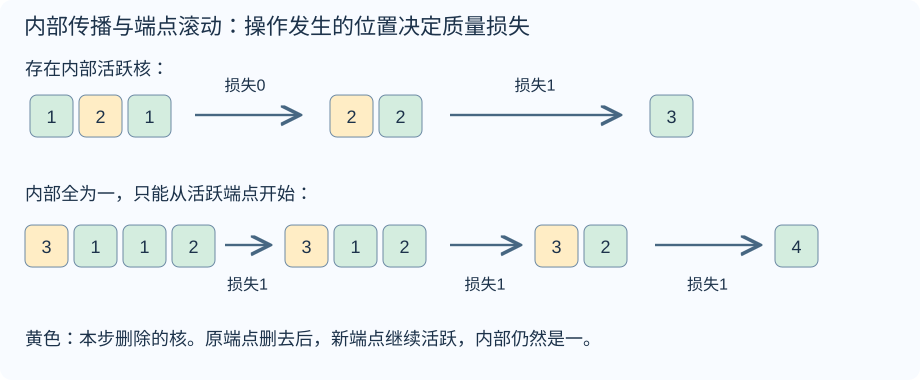
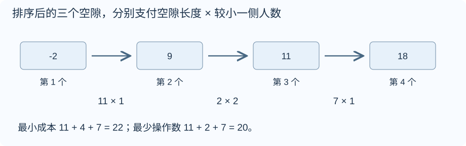
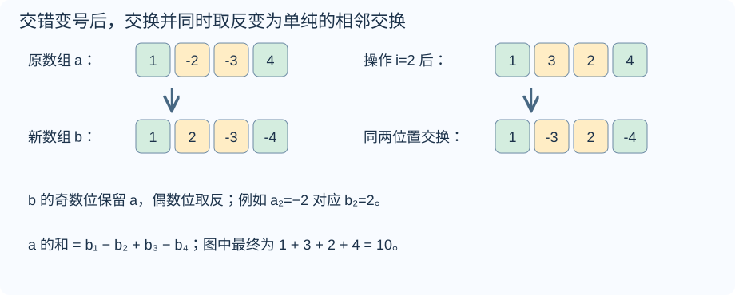
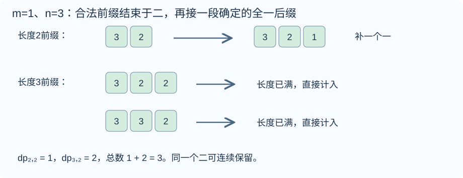
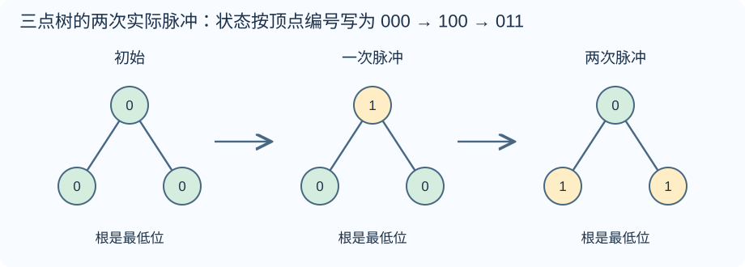
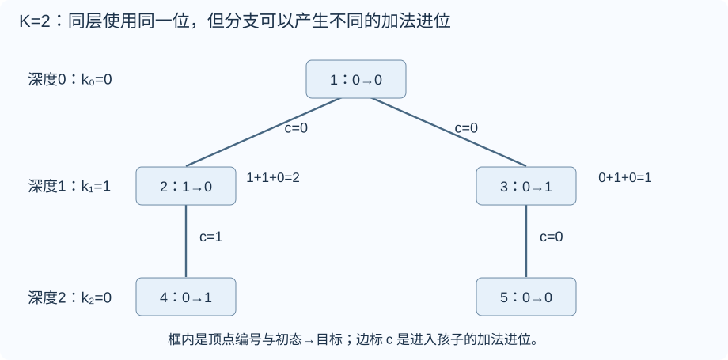

# Div.3 1131 题解

> 比赛：[Codeforces Round 1131 (Div. 3)](https://codeforces.com/contest/2278)
> 语言：C++17。默认稿收录 A–G；A 为签到题，按用户最新规则仅提供默认版，详细稿收录 B–G。官方尚未公布 rating，目录难度为算法复核估分，不是 Codeforces 官方评分。

## 目录

| 题号 | 题名 | 考点 | 难度 |
|---|---|---|---|
| A | Fraction and Six | 模拟 | 800 |
| B | Stakes and Shapes | 构造[主] + 贪心 | 800 |
| C | Math and Physics | 贪心 | 1100 |
| D | Lock and Unlock | 贪心[主] + 排序 | 1600 |
| E | Swap and Negate | 贪心[主] + 排序 | 1700 |
| F | Modulo and Counting | 线性 DP[主] + 前缀和 + 取模与同余 | 2100 |
| G | 0s and 1s | 位运算[主] + DFS | 2100 |


## A. Fraction and Six

### 题意

[原题链接](https://codeforces.com/contest/2278/problem/A)

分子字符串 $p$、分母字符串 $q$ 都由小写字母组成，每个字符表示一个相乘的变量。同字母可一对一约掉，剩余字母可以重排。判断能否让分母为空、分子恰好剩下 $\texttt{six}$。每个字符串的长度均在一到一百之间。


### 思路

只需检查：对每个字母，分子次数减去分母次数，是否恰好等于它在 $\texttt{six}$ 中的次数。

例如 $p=\texttt{sinx}$、$q=\texttt{n}$：两边各一个 $n$ 抵消，剩下 $s$、$i$、$x$ 各一个，重排即为目标。因此顺序不用模拟，但次数必须精确匹配；多一个字符或分母少约掉一个字符都会失败。

用二十六个计数槽分别保存 $a$ 到 $z$ 的次数差。遍历分子时加一，遍历分母时减一，再把目标 six 的三个字符各减一；最后所有槽都应为零。必要性来自同字母才能约分；反过来，次数关系成立就能将每个分母字符配给一个相同的分子字符，恰好留下目标，所以条件也充分。

代码中 $\verb@int count[26] = {}@$ 将二十六个计数初始化为零；$\verb@c - 'a'@$ 把小写字母映射到零到二十五，例如 $b$ 对应一。负值说明分子缺少所需字符，正值说明还有多余字符，两者都不允许。$\verb@for (char c : p)@$ 按顺序读出字符串的每个字符。

时间为 $O(n+m+26)$，计数数组使用 $O(26)$ 空间，输入字符串另用 $O(n+m)$ 空间。

### 参考代码

```cpp
#include <bits/stdc++.h>
using namespace std;
int main() {
    ios::sync_with_stdio(false);
    cin.tie(nullptr);
    int t;
    cin >> t;
    while (t--) {
        int n, m;
        string p, q;
        cin >> n >> m >> p >> q;
        int count[26] = {};
        for (char c : p) ++count[c - 'a'];
        for (char c : q) --count[c - 'a'];
        // 再扣掉目标，所有差值为零才表示分母清空、分子恰好剩 six。
        for (char c : string("six")) --count[c - 'a'];
        bool ok = true;
        for (int value : count) if (value != 0) ok = false;
        cout << (ok ? "YES" : "NO") << '\n';
    }
}
```

### 易错点

不能把字符串当作一个整体变量，也不能只比较长度差为三。约分后既不能留有分母字符，也不能让分子多出字符。


## B. Stakes and Shapes

### 题意

[原题链接](https://codeforces.com/contest/2278/problem/B)

Alice 在 $x+y+z$ 局中分别出 $x$ 次石头、$y$ 次剪刀、$z$ 次布，顺序未知。Bob 须提前确定全部手势，保证对方任意排列下，自己赢局数不少于输局数。输出任意满足条件的字符串。$0\le x,y,z\le100$，总局数为正。

### 从零讲：整数类型、整除与溢出

<details>
<summary>展开可复用的基础知识</summary>

#### 整数类型、整除与溢出

计算前先看每一步可能达到的范围。常见环境中 $\verb@int@$ 是 32 位，上界约 $2.1\times10^9$；$\verb@long long@$ 至少 64 位，常见有符号 64 位上界约 $9.22\times10^{18}$。$\verb@using ll = long long;@$ 只是为已有类型起别名。

```cxx
int a = 100000, b = 100000;
long long wrong = a * b;      // 右边先按 int 乘，可能已溢出
long long right = 1LL * a * b; // 先把运算提升到 long long
```

不能指望“接收结果的变量够大”修复此前已经溢出的计算。先提高操作数类型，再做乘法。超过 64 位时，GCC 的 $\verb@__int128@$ 可作中间量，但它不是标准 C++17 类型，也没有标准流输出重载；先证明范围，再选择工具。

整数 $\verb@/@$ 对有符号数向零截断：$\verb@7/3==2@$、$\verb@-7/3==-2@$。对非负数才等于向下取整。余数满足 $\verb@a == (a/b)*b + a%b@$，除数不能为零；要将余数归入 $[0,m-1]$（$m>0$），可用 $\verb@(a % m + m) % m@$，同时保证中间加法不溢出。

非负 $a$、正 $b$ 的向上取整可写 $\verb@a/b + (a%b != 0)@$，比 $\verb@(a+b-1)/b@$ 更容易避免加法溢出。比较平方时也应在宽类型内计算；浮点数不适合作为大整数相等的默认判断方式。

$\verb@size()@$ 返回无符号类型。空容器上写 $\verb@size()-1@$ 会绕到很大的数，逆序遍历可以先转成有符号、确认长度，或使用逆向迭代器。$\verb@abs@$ 对最小有符号数无法在同类型中表达其正值，需先约束输入差值范围。一般机器整数运算按常数时间估算，宽类型解决表示范围，不改变算法的增长阶。


</details>

### 思路

找出 Alice 出现最多的手势，Bob 每局都出克制它的手势。例如剪刀最多，就全部出石头：赢 $y$ 局、输 $z$ 局，因为 $y\ge z$，所以不会输多赢少。

Bob 每局都出同一种手势，计分只取决于三类手势各有多少次，与 Alice 的排列顺序无关。出现最多的类别并列时任选一个即可。时间与输出长度相同，为 $O(x+y+z)$；构造输出字符串的空间也为 $O(x+y+z)$。

### 参考代码

```cpp
#include <bits/stdc++.h>
using namespace std;
int main() {
    ios::sync_with_stdio(false);
    cin.tie(nullptr);
    int t;
    cin >> t;
    while (t--) {
        int x, y, z;
        cin >> x >> y >> z;
        char move;
        // 始终克制 Alice 出现最多的手势，赢局数便不会小于输局数。
        if (x >= y && x >= z) move = 'P';
        else if (y >= z) move = 'R';
        else move = 'S';
        cout << string(x + y + z, move) << '\n';
    }
}
```

### 易错点

手势字符对应 R 石头、S 剪刀、P 布；要输出最大频次类别的克制手势。答案不唯一，不能逐字与样例比较。


## C. Math and Physics

### 题意

[原题链接](https://codeforces.com/contest/2278/problem/C)

$n$ 颗核排成一列，质量均为正整数。可把一颗质量至少二的核分成正整数 $x,y$，删除原核，并将 $x$ 加给左邻、$y$ 加给右邻；不存在的邻居所对应的质量流失。求能否达到只剩一颗的状态，及此时最大质量。$2\le n\le2\times10^5$，$1\le a_i\le1000$，总 $n$ 不超过 $2\times10^5$。

### 从零讲：vector：长度可变的连续数组

<details>
<summary>展开可复用的基础知识</summary>

#### vector：长度可变的连续数组

$\verb@vector<T>@$ 保存一串同类型的元素，适合按下标访问、扫描、排序。$\verb@T@$ 是元素类型，例如 $\verb@vector<int>@$ 保存整数，$\verb@vector<pair<int,int>>@$ 保存整数对，$\verb@vector<vector<int>>@$ 可保存每个顶点各自的邻居。需要 $\verb@<vector>@$。

```cxx
vector<int> a(3, 7);   // 三个元素，内容是 7、7、7
a.push_back(9);       // 在末尾追加，现在长度为 4
int x = a[1];         // 从 0 编号，这里得到 7
a[1] = 2;            // 改第二个元素
int n = int(a.size());
```

$\verb@vector<int> a(3)@$ 创建三个值为零的元素；$\verb@a.reserve(3)@$ 只预留容量，元素数仍为零，此时不能访问 $\verb@a[0]@$。长度 $\verb@size()@$ 与容量 $\verb@capacity()@$ 是不同概念。

下标访问为 $O(1)$，遍历为 $O(n)$。末尾追加通常为 $O(1)$；容量不足时会分配更大的连续空间并搬移元素，这次可能为 $O(n)$，一连串追加的平均成本称为摊还 $O(1)$。中间插入或删除会搬移后续元素，最坏 $O(n)$。内存是元素量的 $O(n)$，并可能预留部分尚未使用的容量。

$\verb@begin()@$ 指向首元素，$\verb@end()@$ 指向尾后位置，$\verb@sort(a.begin(),a.end())@$ 操作整个数组。$\verb@a[i]@$ 不检查越界；下标须满足 $0\le i<\mathrm{size}$。$\verb@at(i)@$ 会检查越界并抛异常。空数组不能访问 $\verb@front()@$、$\verb@back()@$；$\verb@pop_back()@$ 也要求非空。

扩容后指向旧存储的迭代器、引用和指针会失效。遍历的同时 $\verb@push_back@$，不能假定此前取得的引用仍可用。读取大数组的函数常用 $\verb@const vector<int>& a@$ 按常量引用传入，既不复制也禁止通过该引用修改；$\verb@vector<int> a@$ 按值传参则复制内容。选择副本还是引用取决于是否要保留独立数据。


</details>

### 从零讲：整数类型、整除与溢出

<details>
<summary>展开可复用的基础知识</summary>

#### 整数类型、整除与溢出

计算前先看每一步可能达到的范围。常见环境中 $\verb@int@$ 是 32 位，上界约 $2.1\times10^9$；$\verb@long long@$ 至少 64 位，常见有符号 64 位上界约 $9.22\times10^{18}$。$\verb@using ll = long long;@$ 只是为已有类型起别名。

```cxx
int a = 100000, b = 100000;
long long wrong = a * b;      // 右边先按 int 乘，可能已溢出
long long right = 1LL * a * b; // 先把运算提升到 long long
```

不能指望“接收结果的变量够大”修复此前已经溢出的计算。先提高操作数类型，再做乘法。超过 64 位时，GCC 的 $\verb@__int128@$ 可作中间量，但它不是标准 C++17 类型，也没有标准流输出重载；先证明范围，再选择工具。

整数 $\verb@/@$ 对有符号数向零截断：$\verb@7/3==2@$、$\verb@-7/3==-2@$。对非负数才等于向下取整。余数满足 $\verb@a == (a/b)*b + a%b@$，除数不能为零；要将余数归入 $[0,m-1]$（$m>0$），可用 $\verb@(a % m + m) % m@$，同时保证中间加法不溢出。

非负 $a$、正 $b$ 的向上取整可写 $\verb@a/b + (a%b != 0)@$，比 $\verb@(a+b-1)/b@$ 更容易避免加法溢出。比较平方时也应在宽类型内计算；浮点数不适合作为大整数相等的默认判断方式。

$\verb@size()@$ 返回无符号类型。空容器上写 $\verb@size()-1@$ 会绕到很大的数，逆序遍历可以先转成有符号、确认长度，或使用逆向迭代器。$\verb@abs@$ 对最小有符号数无法在同类型中表达其正值，需先约束输入差值范围。一般机器整数运算按常数时间估算，宽类型解决表示范围，不改变算法的增长阶。


</details>

### 思路

设总质量为 $S$。删除内部核时质量守恒；删除端点至少损失一。到最后两颗时，两者都是端点，故最终质量至多 $S-1$。



- 全部质量为一：不能进行第一步，输出负一。
- 存在内部核质量至少二：删它后，两侧邻居都变成至少二。继续删除内部活跃核，可不流失质量地缩到两颗，再损失一合并，达到 $S-1$。
- 内部全部为一，只有端点可动：删端点后新活跃核仍是端点，内部的一不会自行变大。因此所有 $n-1$ 步都是端点操作，各损失一且可以达到，答案 $S-(n-1)=a_1+a_n-1$。

扫描一次判断类别，时间 $O(n)$、保存输入的空间 $O(n)$。

### 参考代码

```cpp
#include <bits/stdc++.h>
using namespace std;
int main() {
    ios::sync_with_stdio(false);
    cin.tie(nullptr);
    int t;
    cin >> t;
    while (t--) {
        int n;
        cin >> n;
        vector<long long> a(n);
        long long sum = 0;
        bool movable = false, inner = false;
        for (int i = 0; i < n; ++i) {
            cin >> a[i]; sum += a[i];
            if (a[i] >= 2) {
                movable = true;
                if (i > 0 && i + 1 < n) inner = true;
            }
        }
        if (!movable) cout << -1 << '\n';
        else if (inner) cout << sum - 1 << '\n';
        else cout << a.front() + a.back() - 1 << '\n';
    }
}
```

### 易错点

内部与端点必须按当前位置理解。终态采用官方样例和官方题解的“达到只剩一颗即结束”口径；原文的停止条件句未明确排除继续删除唯一核，若照此继续删除，会与样例留下质量九相矛盾。


## D. Lock and Unlock

### 题意

[原题链接](https://codeforces.com/contest/2278/problem/D)

每次锁定 $k$ 个不同位置，花费 $k$；其余未锁元素统一加一或统一减一，然后全部解锁。先最小化使所有元素相等的总花费，再在最小花费下最小化操作次数。$2\le n\le2\times10^5$，$|a_i|\le10^9$，总 $n\le2\times10^5$。

### 从零讲：vector：长度可变的连续数组

<details>
<summary>展开可复用的基础知识</summary>

#### vector：长度可变的连续数组

$\verb@vector<T>@$ 保存一串同类型的元素，适合按下标访问、扫描、排序。$\verb@T@$ 是元素类型，例如 $\verb@vector<int>@$ 保存整数，$\verb@vector<pair<int,int>>@$ 保存整数对，$\verb@vector<vector<int>>@$ 可保存每个顶点各自的邻居。需要 $\verb@<vector>@$。

```cxx
vector<int> a(3, 7);   // 三个元素，内容是 7、7、7
a.push_back(9);       // 在末尾追加，现在长度为 4
int x = a[1];         // 从 0 编号，这里得到 7
a[1] = 2;            // 改第二个元素
int n = int(a.size());
```

$\verb@vector<int> a(3)@$ 创建三个值为零的元素；$\verb@a.reserve(3)@$ 只预留容量，元素数仍为零，此时不能访问 $\verb@a[0]@$。长度 $\verb@size()@$ 与容量 $\verb@capacity()@$ 是不同概念。

下标访问为 $O(1)$，遍历为 $O(n)$。末尾追加通常为 $O(1)$；容量不足时会分配更大的连续空间并搬移元素，这次可能为 $O(n)$，一连串追加的平均成本称为摊还 $O(1)$。中间插入或删除会搬移后续元素，最坏 $O(n)$。内存是元素量的 $O(n)$，并可能预留部分尚未使用的容量。

$\verb@begin()@$ 指向首元素，$\verb@end()@$ 指向尾后位置，$\verb@sort(a.begin(),a.end())@$ 操作整个数组。$\verb@a[i]@$ 不检查越界；下标须满足 $0\le i<\mathrm{size}$。$\verb@at(i)@$ 会检查越界并抛异常。空数组不能访问 $\verb@front()@$、$\verb@back()@$；$\verb@pop_back()@$ 也要求非空。

扩容后指向旧存储的迭代器、引用和指针会失效。遍历的同时 $\verb@push_back@$，不能假定此前取得的引用仍可用。读取大数组的函数常用 $\verb@const vector<int>& a@$ 按常量引用传入，既不复制也禁止通过该引用修改；$\verb@vector<int> a@$ 按值传参则复制内容。选择副本还是引用取决于是否要保留独立数据。


</details>

### 从零讲：整数类型、整除与溢出

<details>
<summary>展开可复用的基础知识</summary>

#### 整数类型、整除与溢出

计算前先看每一步可能达到的范围。常见环境中 $\verb@int@$ 是 32 位，上界约 $2.1\times10^9$；$\verb@long long@$ 至少 64 位，常见有符号 64 位上界约 $9.22\times10^{18}$。$\verb@using ll = long long;@$ 只是为已有类型起别名。

```cxx
int a = 100000, b = 100000;
long long wrong = a * b;      // 右边先按 int 乘，可能已溢出
long long right = 1LL * a * b; // 先把运算提升到 long long
```

不能指望“接收结果的变量够大”修复此前已经溢出的计算。先提高操作数类型，再做乘法。超过 64 位时，GCC 的 $\verb@__int128@$ 可作中间量，但它不是标准 C++17 类型，也没有标准流输出重载；先证明范围，再选择工具。

整数 $\verb@/@$ 对有符号数向零截断：$\verb@7/3==2@$、$\verb@-7/3==-2@$。对非负数才等于向下取整。余数满足 $\verb@a == (a/b)*b + a%b@$，除数不能为零；要将余数归入 $[0,m-1]$（$m>0$），可用 $\verb@(a % m + m) % m@$，同时保证中间加法不溢出。

非负 $a$、正 $b$ 的向上取整可写 $\verb@a/b + (a%b != 0)@$，比 $\verb@(a+b-1)/b@$ 更容易避免加法溢出。比较平方时也应在宽类型内计算；浮点数不适合作为大整数相等的默认判断方式。

$\verb@size()@$ 返回无符号类型。空容器上写 $\verb@size()-1@$ 会绕到很大的数，逆序遍历可以先转成有符号、确认长度，或使用逆向迭代器。$\verb@abs@$ 对最小有符号数无法在同类型中表达其正值，需先约束输入差值范围。一般机器整数运算按常数时间估算，宽类型解决表示范围，不改变算法的增长阶。


</details>

### 思路

排序得 $b$。最小花费为所有元素到中位数 $c$ 的距离和，最少操作次数为原极差：
$$\text{cost}=\sum_i|b_i-c|,\qquad\text{operations}=b_n-b_1.$$



下界：整组平移不影响能否相等。一次给未锁元素加一，等价于给锁定的 $k$ 个元素减一，再整体平移；最小距离和最多减少 $k$，故总成本至少为初始中位数距离和。

达到下界：对相邻差 $g_i=b_{i+1}-b_i$，锁住较少的一侧，让另一侧靠近，一次只缩小这个差一、成本 $\min(i,n-i)$。总成本 $\sum_i g_i\min(i,n-i)$ 恰等于上述中位数距离和。总次数 $\sum_i g_i=b_n-b_1$，而任何一次操作都只能使极差最多缩小一，故次数也最优。

排序主导时间 $O(n\log n)$，空间 $O(n)$；成本和极差都使用 $\verb@long long@$。

### 参考代码

```cpp
#include <bits/stdc++.h>
using namespace std;
int main() {
    ios::sync_with_stdio(false);
    cin.tie(nullptr);
    int t;
    cin >> t;
    while (t--) {
        int n;
        cin >> n;
        vector<long long> a(n);
        for (auto &v : a) cin >> v;
        sort(a.begin(), a.end());
        long long median = a[n / 2], cost = 0;
        // 中位数两侧的距离之和等于按每个相邻差付出的最小锁定成本。
        for (long long v : a) cost += (v >= median ? v - median : median - v);
        cout << cost << ' ' << a.back() - a.front() << '\n';
    }
}
```

### 易错点

题目有先后两个目标，不能只输出中位数距离和。操作方向对全部未锁元素一致，所以不能在一回中同时让两端各向内移动一。


## E. Swap and Negate

### 题意

[原题链接](https://codeforces.com/contest/2278/problem/E)

可任意多次把相邻两数同时改成 $(-a_{i+1},-a_i)$，求数组和的最大可能值。$1\le n\le2\times10^5$，$|a_i|\le10^9$，总 $n\le2\times10^5$。

### 从零讲：vector：长度可变的连续数组

<details>
<summary>展开可复用的基础知识</summary>

#### vector：长度可变的连续数组

$\verb@vector<T>@$ 保存一串同类型的元素，适合按下标访问、扫描、排序。$\verb@T@$ 是元素类型，例如 $\verb@vector<int>@$ 保存整数，$\verb@vector<pair<int,int>>@$ 保存整数对，$\verb@vector<vector<int>>@$ 可保存每个顶点各自的邻居。需要 $\verb@<vector>@$。

```cxx
vector<int> a(3, 7);   // 三个元素，内容是 7、7、7
a.push_back(9);       // 在末尾追加，现在长度为 4
int x = a[1];         // 从 0 编号，这里得到 7
a[1] = 2;            // 改第二个元素
int n = int(a.size());
```

$\verb@vector<int> a(3)@$ 创建三个值为零的元素；$\verb@a.reserve(3)@$ 只预留容量，元素数仍为零，此时不能访问 $\verb@a[0]@$。长度 $\verb@size()@$ 与容量 $\verb@capacity()@$ 是不同概念。

下标访问为 $O(1)$，遍历为 $O(n)$。末尾追加通常为 $O(1)$；容量不足时会分配更大的连续空间并搬移元素，这次可能为 $O(n)$，一连串追加的平均成本称为摊还 $O(1)$。中间插入或删除会搬移后续元素，最坏 $O(n)$。内存是元素量的 $O(n)$，并可能预留部分尚未使用的容量。

$\verb@begin()@$ 指向首元素，$\verb@end()@$ 指向尾后位置，$\verb@sort(a.begin(),a.end())@$ 操作整个数组。$\verb@a[i]@$ 不检查越界；下标须满足 $0\le i<\mathrm{size}$。$\verb@at(i)@$ 会检查越界并抛异常。空数组不能访问 $\verb@front()@$、$\verb@back()@$；$\verb@pop_back()@$ 也要求非空。

扩容后指向旧存储的迭代器、引用和指针会失效。遍历的同时 $\verb@push_back@$，不能假定此前取得的引用仍可用。读取大数组的函数常用 $\verb@const vector<int>& a@$ 按常量引用传入，既不复制也禁止通过该引用修改；$\verb@vector<int> a@$ 按值传参则复制内容。选择副本还是引用取决于是否要保留独立数据。


</details>

### 从零讲：整数类型、整除与溢出

<details>
<summary>展开可复用的基础知识</summary>

#### 整数类型、整除与溢出

计算前先看每一步可能达到的范围。常见环境中 $\verb@int@$ 是 32 位，上界约 $2.1\times10^9$；$\verb@long long@$ 至少 64 位，常见有符号 64 位上界约 $9.22\times10^{18}$。$\verb@using ll = long long;@$ 只是为已有类型起别名。

```cxx
int a = 100000, b = 100000;
long long wrong = a * b;      // 右边先按 int 乘，可能已溢出
long long right = 1LL * a * b; // 先把运算提升到 long long
```

不能指望“接收结果的变量够大”修复此前已经溢出的计算。先提高操作数类型，再做乘法。超过 64 位时，GCC 的 $\verb@__int128@$ 可作中间量，但它不是标准 C++17 类型，也没有标准流输出重载；先证明范围，再选择工具。

整数 $\verb@/@$ 对有符号数向零截断：$\verb@7/3==2@$、$\verb@-7/3==-2@$。对非负数才等于向下取整。余数满足 $\verb@a == (a/b)*b + a%b@$，除数不能为零；要将余数归入 $[0,m-1]$（$m>0$），可用 $\verb@(a % m + m) % m@$，同时保证中间加法不溢出。

非负 $a$、正 $b$ 的向上取整可写 $\verb@a/b + (a%b != 0)@$，比 $\verb@(a+b-1)/b@$ 更容易避免加法溢出。比较平方时也应在宽类型内计算；浮点数不适合作为大整数相等的默认判断方式。

$\verb@size()@$ 返回无符号类型。空容器上写 $\verb@size()-1@$ 会绕到很大的数，逆序遍历可以先转成有符号、确认长度，或使用逆向迭代器。$\verb@abs@$ 对最小有符号数无法在同类型中表达其正值，需先约束输入差值范围。一般机器整数运算按常数时间估算，宽类型解决表示范围，不改变算法的增长阶。


</details>

### 思路

把偶数位置取反，定义 $b_i=(-1)^{i-1}a_i$。原操作在 $b$ 上恰好只交换相邻两项，因此 $b$ 可以重排成任意排列。



目标变为 $b_1-b_2+b_3-b_4+\cdots$。正号位置有 $\lceil n/2\rceil$ 个，放最大的这些数；负号位置有 $\lfloor n/2\rfloor$ 个，放最小的这些数。若某正号位的数比某负号位还小，交换会使答案增加两倍差值，故这种分配最优。

排序后，将最小的 $\lfloor n/2\rfloor$ 项减掉，其余加上。时间 $O(n\log n)$、空间 $O(n)$，答案用 $\verb@long long@$。

### 参考代码

```cpp
#include <bits/stdc++.h>
using namespace std;
int main() {
    ios::sync_with_stdio(false);
    cin.tie(nullptr);
    int t;
    cin >> t;
    while (t--) {
        int n;
        cin >> n;
        vector<long long> b(n);
        for (int i = 0; i < n; ++i) {
            cin >> b[i];
            if (i % 2 == 1) b[i] = -b[i];
        }
        // 原操作恰好变成 b 的相邻交换，因此 b 可任意重排。
        sort(b.begin(), b.end());
        long long answer = 0;
        for (int i = 0; i < n; ++i) {
            if (i < n / 2) answer -= b[i];
            else answer += b[i];
        }
        cout << answer << '\n';
    }
}
```

### 易错点

交换和取反必须同时发生；不是先修改一项，再用已修改的值算另一项。不能把每个原数独立改成绝对值。奇偶位置要区分一基题面与零基代码下标。


## F. Modulo and Counting

### 题意

[原题链接](https://codeforces.com/contest/2278/problem/F)

计数长度为 $n$ 的非增正整数数组，满足 $a_1\le m+2$ 且相邻取模之和为 $m$。答案模 $998244353$。$2\le n\le4000$，$1\le m\le4000$，所有测试的 $n,m$ 之和分别不超过四千。

### 从零讲：vector：长度可变的连续数组

<details>
<summary>展开可复用的基础知识</summary>

#### vector：长度可变的连续数组

$\verb@vector<T>@$ 保存一串同类型的元素，适合按下标访问、扫描、排序。$\verb@T@$ 是元素类型，例如 $\verb@vector<int>@$ 保存整数，$\verb@vector<pair<int,int>>@$ 保存整数对，$\verb@vector<vector<int>>@$ 可保存每个顶点各自的邻居。需要 $\verb@<vector>@$。

```cxx
vector<int> a(3, 7);   // 三个元素，内容是 7、7、7
a.push_back(9);       // 在末尾追加，现在长度为 4
int x = a[1];         // 从 0 编号，这里得到 7
a[1] = 2;            // 改第二个元素
int n = int(a.size());
```

$\verb@vector<int> a(3)@$ 创建三个值为零的元素；$\verb@a.reserve(3)@$ 只预留容量，元素数仍为零，此时不能访问 $\verb@a[0]@$。长度 $\verb@size()@$ 与容量 $\verb@capacity()@$ 是不同概念。

下标访问为 $O(1)$，遍历为 $O(n)$。末尾追加通常为 $O(1)$；容量不足时会分配更大的连续空间并搬移元素，这次可能为 $O(n)$，一连串追加的平均成本称为摊还 $O(1)$。中间插入或删除会搬移后续元素，最坏 $O(n)$。内存是元素量的 $O(n)$，并可能预留部分尚未使用的容量。

$\verb@begin()@$ 指向首元素，$\verb@end()@$ 指向尾后位置，$\verb@sort(a.begin(),a.end())@$ 操作整个数组。$\verb@a[i]@$ 不检查越界；下标须满足 $0\le i<\mathrm{size}$。$\verb@at(i)@$ 会检查越界并抛异常。空数组不能访问 $\verb@front()@$、$\verb@back()@$；$\verb@pop_back()@$ 也要求非空。

扩容后指向旧存储的迭代器、引用和指针会失效。遍历的同时 $\verb@push_back@$，不能假定此前取得的引用仍可用。读取大数组的函数常用 $\verb@const vector<int>& a@$ 按常量引用传入，既不复制也禁止通过该引用修改；$\verb@vector<int> a@$ 按值传参则复制内容。选择副本还是引用取决于是否要保留独立数据。


</details>

### 从零讲：前缀和：一段和由两段前缀相减

<details>
<summary>展开可复用的基础知识</summary>

#### 前缀和：一段和由两段前缀相减

一串数需要反复询问连续一段的总和，逐段扫描会重复加很多相同元素。先保存从头到每个位置的累计量，就能复用这些工作。

对从一编号的数组定义 $S_0=0$，$S_i=a_1+\cdots+a_i$。例如 $a=[2,3,1,4]$，前缀为 $S=[0,2,5,6,10]$。


查询 $[2,4]$ 时，$S_4$ 包含第一个数，减去 $S_1$ 后留下 $3+1+4=8$。一般地，$S_r-S_{l-1}$ 中前 $l-1$ 项逐项抵消，只留下第 $l$ 到第 $r$ 项。

```cxx
vector<long long> s(n + 1, 0);
for (int i = 1; i <= n; ++i) s[i] = s[i - 1] + a[i];
long long sum = s[r] - s[l - 1];
```

预处理 $O(n)$ 时间和空间，每次查询 $O(1)$，比 $q$ 次逐段扫描的最坏 $O(nq)$ 更适合大量静态区间和。若使用从零编号的原数组，也可定义 $P_i$ 为前 $i$ 项之和，查询闭区间 $[l,r]$ 为 $P_{r+1}-P_l$；不要混用两套下标。

前缀可以累积满足条件的次数，把每项变成零或一；也可以保存异或，此时相同前缀通过异或抵消。最小值没有同样的可逆减法，不能直接套区间最小值。原数组改变后，后续许多前缀都受影响；频繁在线修改时可考虑树状数组或线段树。

首个空前缀零不可漏，累加类型要覆盖总和。数学上的减法可能得到负值，别让无符号类型把它变成巨大正数。


</details>

### 从零讲：整数类型、整除与溢出

<details>
<summary>展开可复用的基础知识</summary>

#### 整数类型、整除与溢出

计算前先看每一步可能达到的范围。常见环境中 $\verb@int@$ 是 32 位，上界约 $2.1\times10^9$；$\verb@long long@$ 至少 64 位，常见有符号 64 位上界约 $9.22\times10^{18}$。$\verb@using ll = long long;@$ 只是为已有类型起别名。

```cxx
int a = 100000, b = 100000;
long long wrong = a * b;      // 右边先按 int 乘，可能已溢出
long long right = 1LL * a * b; // 先把运算提升到 long long
```

不能指望“接收结果的变量够大”修复此前已经溢出的计算。先提高操作数类型，再做乘法。超过 64 位时，GCC 的 $\verb@__int128@$ 可作中间量，但它不是标准 C++17 类型，也没有标准流输出重载；先证明范围，再选择工具。

整数 $\verb@/@$ 对有符号数向零截断：$\verb@7/3==2@$、$\verb@-7/3==-2@$。对非负数才等于向下取整。余数满足 $\verb@a == (a/b)*b + a%b@$，除数不能为零；要将余数归入 $[0,m-1]$（$m>0$），可用 $\verb@(a % m + m) % m@$，同时保证中间加法不溢出。

非负 $a$、正 $b$ 的向上取整可写 $\verb@a/b + (a%b != 0)@$，比 $\verb@(a+b-1)/b@$ 更容易避免加法溢出。比较平方时也应在宽类型内计算；浮点数不适合作为大整数相等的默认判断方式。

$\verb@size()@$ 返回无符号类型。空容器上写 $\verb@size()-1@$ 会绕到很大的数，逆序遍历可以先转成有符号、确认长度，或使用逆向迭代器。$\verb@abs@$ 对最小有符号数无法在同类型中表达其正值，需先约束输入差值范围。一般机器整数运算按常数时间估算，宽类型解决表示范围，不改变算法的增长阶。


</details>

### 思路

令 $q_i=\lfloor a_i/a_{i+1}\rfloor$，把相邻余数写成相邻差减去额外损失，可得
$$m=a_1-a_n-L,\qquad L=\sum_i(q_i-1)a_{i+1}\in\{0,1\}.$$
因为 $a_1\le m+2$、$a_n\ge1$，总损失至多一。由此只有两类：从 $m+2$ 走到二，且每一步 $v\le u<2v$；或者先这样走到二，再接上若干个一。末项为一、损失为零不可能，因为前一项也只能是一，向前反推会全部为一。



设 $dp_{\ell,v}$ 为长度 $\ell$、首项 $m+2$、末项 $v\ge2$ 且每步满足上述大小关系的前缀数。起点 $dp_{1,m+2}=1$，转移为
$$dp_{\ell+1,v}=\sum_{u=v}^{\min(m+2,2v-1)}dp_{\ell,u}.$$
用上一行的前缀和在 $O(1)$ 内求区间和。答案为 $\sum_{\ell=1}^n dp_{\ell,2}$：不足 $n$ 的前缀接上一组成确定的全一后缀，满长则直接结束于二，不重复也不漏。

时间 $O(nm)$、滚动数组空间 $O(m)$。

### 参考代码

```cpp
#include <bits/stdc++.h>
using namespace std;
const int MOD = 998244353;
int main() {
    ios::sync_with_stdio(false);
    cin.tie(nullptr);
    int t;
    cin >> t;
    while (t--) {
        int n, m;
        cin >> n >> m;
        int maximum = m + 2;
        vector<int> dp(maximum + 1), next_dp(maximum + 1), prefix(maximum + 1);
        dp[maximum] = 1;
        int answer = 0;
        for (int length = 1; length <= n; ++length) {
            // 长度不足 n 时，结束于 2 的前缀以全 1 后缀唯一补齐。
            answer += dp[2];
            if (answer >= MOD) answer -= MOD;
            if (length == n) break;
            prefix[0] = 0;
            for (int v = 1; v <= maximum; ++v) {
                prefix[v] = prefix[v - 1] + dp[v];
                if (prefix[v] >= MOD) prefix[v] -= MOD;
            }
            for (int v = 2; v <= maximum; ++v) {
                // 合法前驱 u 满足 v <= u < 2v。
                int hi = min(maximum, 2 * v - 1);
                next_dp[v] = prefix[hi] - prefix[v - 1];
                if (next_dp[v] < 0) next_dp[v] += MOD;
            }
            dp.swap(next_dp);
        }
        cout << answer << '\n';
    }
}
```

### 易错点

严格不等式 $u<2v$ 的上界应写成 $2v-1$。达到二后允许继续停留在二；不能只统计首次到二的前缀。每轮转移只读旧行。


## G. 0s and 1s

### 题意

[原题链接](https://codeforces.com/contest/2278/problem/G)

根为一的树，每点有初始二进制状态 $x_v$ 和目标 $y_v$。给根注入一个脉冲：零变一并停止，一变零并向所有孩子各发一脉冲。求达到全部目标的最少根脉冲数，模 $998244353$；不可达输出负一。$1\le n\le2\times10^5$，总 $n\le2\times10^5$。

### 从零讲：位运算：把非负整数看成一组二进制开关

<details>
<summary>展开可复用的基础知识</summary>

#### 位运算：把非负整数看成一组二进制开关

五写成二进制为 $0101_2$，三为 $0011_2$。同一列各代表一位：按位与 $\verb@&@$ 两边都为一才得一，按位或 $\verb@|@$ 任一为一就得一，按位异或 $\verb@^@$ 不同才为一。所以 $5\mathbin{\&}3=1$，$5\mathbin{|}3=7$，$5\mathbin{\oplus}3=6$。


$\verb@1ULL << k@$ 把一移到第 $k$ 位。对非负无符号整数，$\verb@(mask >> k) & 1ULL@$ 读该位，$\verb@mask | (1ULL<<k)@$ 置一，$\verb@mask & ~(1ULL<<k)@$ 清零，$\verb@mask ^ (1ULL<<k)@$ 翻转。最低位编号为零。

```cxx
unsigned long long mask = 5; // 第 0、2 位为一
bool has = (mask >> 2) & 1ULL; // true
mask |= 1ULL << 1;             // 变成 7
```

位移次数必须小于类型位宽，且不能为负；不要用普通 $\verb@1@$ 去移到超出 int 范围的位置。C++17 有符号负数右移和溢出的规则不适合直接套“乘除二的幂”，用明确范围的无符号数更容易保证行为。$\verb@^@$ 是异或，绝不是乘方。

逻辑与 $\verb@&&@$、逻辑或 $\verb@||@$ 将整体条件视为真假，并会短路；按位 $\verb@&@$、$\verb@|@$ 逐位计算，不会因此跳过右侧表达式。运算符优先级可能与直觉不同，写 $\verb@(mask & bit) != 0@$，别省掉关键括号。

固定机器字内的一次位运算按 $O(1)$ 估算；枚举全部 $k$ 位状态仍有 $2^k$ 种，不能因为每次运算快就忽略状态数。$\verb@x & (x-1)@$ 对正无符号数清掉最低的一位；GCC 的 $\verb@__builtin_popcountll(x)@$ 统计一的数量，注意实参位宽与具体编译器支持。


</details>

### 从零讲：vector：长度可变的连续数组

<details>
<summary>展开可复用的基础知识</summary>

#### vector：长度可变的连续数组

$\verb@vector<T>@$ 保存一串同类型的元素，适合按下标访问、扫描、排序。$\verb@T@$ 是元素类型，例如 $\verb@vector<int>@$ 保存整数，$\verb@vector<pair<int,int>>@$ 保存整数对，$\verb@vector<vector<int>>@$ 可保存每个顶点各自的邻居。需要 $\verb@<vector>@$。

```cxx
vector<int> a(3, 7);   // 三个元素，内容是 7、7、7
a.push_back(9);       // 在末尾追加，现在长度为 4
int x = a[1];         // 从 0 编号，这里得到 7
a[1] = 2;            // 改第二个元素
int n = int(a.size());
```

$\verb@vector<int> a(3)@$ 创建三个值为零的元素；$\verb@a.reserve(3)@$ 只预留容量，元素数仍为零，此时不能访问 $\verb@a[0]@$。长度 $\verb@size()@$ 与容量 $\verb@capacity()@$ 是不同概念。

下标访问为 $O(1)$，遍历为 $O(n)$。末尾追加通常为 $O(1)$；容量不足时会分配更大的连续空间并搬移元素，这次可能为 $O(n)$，一连串追加的平均成本称为摊还 $O(1)$。中间插入或删除会搬移后续元素，最坏 $O(n)$。内存是元素量的 $O(n)$，并可能预留部分尚未使用的容量。

$\verb@begin()@$ 指向首元素，$\verb@end()@$ 指向尾后位置，$\verb@sort(a.begin(),a.end())@$ 操作整个数组。$\verb@a[i]@$ 不检查越界；下标须满足 $0\le i<\mathrm{size}$。$\verb@at(i)@$ 会检查越界并抛异常。空数组不能访问 $\verb@front()@$、$\verb@back()@$；$\verb@pop_back()@$ 也要求非空。

扩容后指向旧存储的迭代器、引用和指针会失效。遍历的同时 $\verb@push_back@$，不能假定此前取得的引用仍可用。读取大数组的函数常用 $\verb@const vector<int>& a@$ 按常量引用传入，既不复制也禁止通过该引用修改；$\verb@vector<int> a@$ 按值传参则复制内容。选择副本还是引用取决于是否要保留独立数据。


</details>

### 从零讲：整数类型、整除与溢出

<details>
<summary>展开可复用的基础知识</summary>

#### 整数类型、整除与溢出

计算前先看每一步可能达到的范围。常见环境中 $\verb@int@$ 是 32 位，上界约 $2.1\times10^9$；$\verb@long long@$ 至少 64 位，常见有符号 64 位上界约 $9.22\times10^{18}$。$\verb@using ll = long long;@$ 只是为已有类型起别名。

```cxx
int a = 100000, b = 100000;
long long wrong = a * b;      // 右边先按 int 乘，可能已溢出
long long right = 1LL * a * b; // 先把运算提升到 long long
```

不能指望“接收结果的变量够大”修复此前已经溢出的计算。先提高操作数类型，再做乘法。超过 64 位时，GCC 的 $\verb@__int128@$ 可作中间量，但它不是标准 C++17 类型，也没有标准流输出重载；先证明范围，再选择工具。

整数 $\verb@/@$ 对有符号数向零截断：$\verb@7/3==2@$、$\verb@-7/3==-2@$。对非负数才等于向下取整。余数满足 $\verb@a == (a/b)*b + a%b@$，除数不能为零；要将余数归入 $[0,m-1]$（$m>0$），可用 $\verb@(a % m + m) % m@$，同时保证中间加法不溢出。

非负 $a$、正 $b$ 的向上取整可写 $\verb@a/b + (a%b != 0)@$，比 $\verb@(a+b-1)/b@$ 更容易避免加法溢出。比较平方时也应在宽类型内计算；浮点数不适合作为大整数相等的默认判断方式。

$\verb@size()@$ 返回无符号类型。空容器上写 $\verb@size()-1@$ 会绕到很大的数，逆序遍历可以先转成有符号、确认长度，或使用逆向迭代器。$\verb@abs@$ 对最小有符号数无法在同类型中表达其正值，需先约束输入差值范围。一般机器整数运算按常数时间估算，宽类型解决表示范围，不改变算法的增长阶。


</details>

### 思路

沿任意根路径，这个过程与二进制加法相同：根是最低位，遇零变一停止，遇一变零并产生进位。注入 $K$ 次，相当于给每条路径的初始二进制数加 $K$。



设深度 $d$ 对应 $K$ 的第 $d$ 位 $k_d$，当前路径进入点 $v$ 的加法进位为 $c_v$，根进位为零。目标要求
$$x_v\oplus k_d\oplus c_v=y_v,\qquad k_d=x_v\oplus y_v\oplus c_v.$$
同一深度必须共用同一位 $k_d$；要求不同则无解。给孩子的进位是 $\lfloor(x_v+k_d+c_v)/2\rfloor$，只可能为零或一。



用显式 DFS 栈逐点检查并确定每一位。每一层至少有一个点，故从最低位到最深层的位全被强制确定；更高位不影响任意节点，全部置零便得到最小 $K$。答案累计 $k_d2^d$ 的模值即可，无须保存巨大整数。

时间、空间均为 $O(n)$。

### 参考代码

```cpp
#include <bits/stdc++.h>
using namespace std;
const long long MOD = 998244353;
struct State { int node, parent, depth, carry; };
int main() {
    ios::sync_with_stdio(false);
    cin.tie(nullptr);
    int t;
    cin >> t;
    while (t--) {
        int n;
        cin >> n;
        vector<vector<int>> graph(n);
        for (int i = 1, u, v; i < n; ++i) {
            cin >> u >> v; --u; --v;
            graph[u].push_back(v); graph[v].push_back(u);
        }
        string x, y;
        cin >> x >> y;
        vector<int> bit(n, -1);
        vector<long long> power(n, 1);
        for (int i = 1; i < n; ++i) power[i] = power[i - 1] * 2 % MOD;
        vector<State> stack = {{0, -1, 0, 0}};
        bool possible = true;
        long long answer = 0;
        while (!stack.empty()) {
            State current = stack.back(); stack.pop_back();
            int u = current.node, depth = current.depth;
            int xb = x[u] - '0', yb = y[u] - '0';
            int needed = xb ^ yb ^ current.carry;
            if (bit[depth] == -1) {
                bit[depth] = needed;
                answer = (answer + needed * power[depth]) % MOD;
            } else if (bit[depth] != needed) {
                possible = false; break;
            }
            // 同一深度共用 K 的这一位，但每条根路径的进位可以不同。
            int next_carry = (xb + needed + current.carry) / 2;
            for (int v : graph[u]) if (v != current.parent)
                stack.push_back({v, u, depth + 1, next_carry});
        }
        cout << (possible ? answer : -1) << '\n';
    }
}
```

### 易错点

根是最低位。同一深度共享 K 的位，不共享路径进位。先判断可达与最小二进制位，再对答案取模；不能对脉冲次数取模后模拟。


## 实测记录

七份参考程序与七份独立基准已编译；参考程序无警告。
官方样例 7 组、边界 39 条、随机对拍 5600 组通过；B 用任意输出判定器，随机种子逐题保留。
极限计时：A 0.006 s；B 0.007 s；C 0.016/0.016 s；D 0.021 s；E 0.021 s；F 0.040/0.008 s；G 0.046/0.039 s。每例三次取最小，均通过官方时限。
默认与详细两版共用验证源码；格式、文档代码及实际渲染另行核对。
