## CF1882D Tree XOR

原题：[CF1882D](https://www.luogu.com.cn/problem/CF1882D)

### 思路

根为 r 时，一条边的异或权值要乘它远离根一侧的点数。先求根 1 的答案与子树大小，再换根：跨边 u−v 时，答案变化为 (a[u] xor a[v])·(n−2size[v])。

三点链的点值为 1、2、3，两条边权为 3 与 1。根从 1 移到 2，再移到 3，总代价依次为 7、4、5；动图中仅跨过的那条边改变乘上的点数。



### 复杂度

每组时间 O(n)，空间 O(n)。

### 参考代码

```cpp
#include <bits/stdc++.h>
using namespace std;

int main() {
    ios::sync_with_stdio(false);
    cin.tie(nullptr);

    int tests;
    cin >> tests;
    while (tests--) {
        int n;
        cin >> n;
        vector<long long> a(n), ans(n);
        for (auto &x : a)
            cin >> x;
        vector<vector<int>> g(n);
        for (int i = 1; i < n; i++) {
            int u, v;
            cin >> u >> v;
            u--;
            v--;
            g[u].push_back(v);
            g[v].push_back(u);
        }
        vector<int> parent(n, -1), size(n, 1), order = {0};
        parent[0] = 0;
        for (int i = 0; i < n; i++)
            for (int u : g[order[i]])
                if (u != parent[order[i]]) {
                    parent[u] = order[i];
                    order.push_back(u);
                }
        for (int i = n - 1; i > 0; i--) {
            int v = order[i], p = parent[v];
            size[p] += size[v];
            ans[0] += (a[v] ^ a[p]) * size[v];
        }
        for (int i = 1; i < n; i++) {
            int v = order[i], p = parent[v];
            ans[v] = ans[p] + (a[v] ^ a[p]) * (n - 2LL * size[v]);
        }
        for (long long x : ans)
            cout << x << ' ';
        cout << '\n';
    }

    return 0;
}
```

### 实现提醒

边权是端点值异或；换根差为 n−2size；使用六十四位。
