## CF877F Ann and Books

原题：[CF877F](https://www.luogu.com.cn/problem/CF877F)

### 从问题到算法

把每本数学书的问题数记为正，经济书记为负。子段 [x,y] 符合条件当且仅当 prefix[y]−prefix[x−1]=k。与异或不同，减法有方向，不能把两个前缀值当作无序配对。

在右端加入值 v，它是较晚的前缀，需要已有较早前缀等于 v−k；在左端加入值 v，它是较早的前缀，需要较晚值等于 v+k。删除时先减少自身频数，再按相同方向减去配对数，以处理 k=0。

前缀和可达十的十四次方，用 long long。把所有前缀及其加减 k 的值统一离散化，提前记录三个索引，端点移动时仅访问数组。每个原子段对应一对不同且有序的前缀下标，既不遗漏也不重复。

例如数组 [1,−1,2]，前缀为 [0,1,0,2]，k=1。向右加入 2，要找较早的 1；移走最左的 0，要删除它与较晚的 1 的配对。下标先后决定减法方向，不能按无序值对计数。



### 复杂度

时间 O((n+q)sqrt n+n log n)，空间 O(n+q)。

### 参考代码

```cpp
#include <bits/stdc++.h>
using namespace std;

int main() {
    ios::sync_with_stdio(false);
    cin.tie(nullptr);

    int n;
    long long k;
    cin >> n >> k;
    vector<int> type(n + 1);
    for (int i = 1; i <= n; i++)
        cin >> type[i];
    vector<long long> p(n + 1), values;
    for (int i = 1; i <= n; i++) {
        long long x;
        cin >> x;
        p[i] = p[i - 1] + (type[i] == 1 ? x : -x);
    }
    for (long long x : p) {
        values.push_back(x);
        values.push_back(x - k);
        values.push_back(x + k);
    }
    sort(values.begin(), values.end());
    values.erase(unique(values.begin(), values.end()), values.end());
    vector<int> id(n + 1), minus(n + 1), plus(n + 1);
    for (int i = 0; i <= n; i++) {
        id[i] = lower_bound(values.begin(), values.end(), p[i]) - values.begin();
        minus[i] = lower_bound(values.begin(), values.end(), p[i] - k) - values.begin();
        plus[i] = lower_bound(values.begin(), values.end(), p[i] + k) - values.begin();
    }
    int q;
    cin >> q;

    struct Query {
        int l, r, id;
    };
    vector<Query> queries(q);
    for (int i = 0; i < q; i++) {
        cin >> queries[i].l >> queries[i].r;
        queries[i].id = i;
    }
    int block = max(1, (int)sqrt(n));
    sort(queries.begin(), queries.end(), [&](Query a, Query b) {
        if (a.l / block != b.l / block)
            return a.l < b.l;
        return (a.l / block) & 1 ? a.r > b.r : a.r < b.r;
    });

    vector<int> freq(values.size());
    vector<long long> ans(q);
    long long current = 0;
    int l = 0, r = -1;
    auto add = [&](int i, bool left) {
        current += freq[left ? plus[i] : minus[i]];
        freq[id[i]]++;
    };
    auto remove = [&](int i, bool left) {
        freq[id[i]]--;
        current -= freq[left ? plus[i] : minus[i]];
    };
    for (auto x : queries) {
        x.l--;
        while (l > x.l)
            add(--l, true);
        while (r < x.r)
            add(++r, false);
        while (l < x.l)
            remove(l++, true);
        while (r > x.r)
            remove(r--, false);
        ans[x.id] = current;
    }
    for (long long x : ans)
        cout << x << '\n';

    return 0;
}
```

### 实现提醒

左右端配对公式不同；包含 prefix[0]；前缀和与答案均为六十四位。
