## P1259 黑白棋子的移动

原题：[P1259](https://www.luogu.com.cn/problem/P1259)

### 从问题到算法

将棋子按一开始的白区、黑区记为 o^n*^n--。先把第 n、n+1 位的 o* 移到末尾空位，再把第 2n−1、2n 位的 ** 移到新空位，可得到 o^(n−1)*^(n−1)--o*。已经完成的末尾 o* 不再移动，前面恰好缩成 n−1 的原问题。

当 n=4，依次得到：

```text
oooo****--
ooo--***o*
ooo*o**--*
o--*o**oo*
o*o*o*--o*
--o*o*o*o*
```

每步都移动两个相邻棋子到连续空位，保持两者顺序且跨过其它棋子。代码统一用交换两格来执行，并在每次操作后输出完整棋盘，包括已经处理好的后缀。

这里逐帧重放四对棋子的固定收尾，编号与代码中的 move 参数一致。空位用绿色标出，前后完整状态可以暂停核对。



### 复杂度

共有 O(n) 次移动，输出长度 O(n)，总时间 O(n²)，空间 O(n)。

### 参考代码

```cpp
#include <bits/stdc++.h>
using namespace std;

int main() {
    ios::sync_with_stdio(false);
    cin.tie(nullptr);

    int n;
    cin >> n;
    string a(n, 'o');
    a += string(n, '*');
    a += "--";
    cout << a << '\n';
    auto move = [&](int from, int to) {
        from--;
        to--;
        swap(a[from], a[to]);
        swap(a[from + 1], a[to + 1]);
        cout << a << '\n';
    };
    function<void(int)> solve = [&](int k) {
        if (k == 4) {
            move(4, 9);
            move(8, 4);
            move(2, 8);
            move(7, 2);
            move(1, 7);
            return;
        }
        move(k, 2 * k + 1);
        move(2 * k - 1, k);
        solve(k - 1);
    };
    solve(n);

    return 0;
}
```

### 实现提醒

先打印初始状态；移动一对的左右顺序不变；递归只处理前缀。
