## P13790 Border

原题：[P13790](https://www.luogu.com.cn/problem/P13790)

### 思路

长度 n−d 的 border 等价于 s[i]=s[i+d]。一次改字只会影响同余链中至多两条比较边。用正反 Z 找首末失配，再分一条失配与两条相邻失配检查，LCE 核对中间没有其它失配。

以样例 abaa 为例，比较距离为一的字符。两条失配共享 b，且它两边均为 a，因此只改这个共享位置即可得到长度三的 border。



### 复杂度

时间 O(n log n)，空间 O(n)。

### 参考代码

```cpp
#include <bits/stdc++.h>
using namespace std;

vector<int> zfunction(const string &s) {
    int n = s.size();
    vector<int> z(n);
    z[0] = n;
    for (int i = 1, l = 0, r = 0; i < n; i++) {
        if (i <= r)
            z[i] = min(r - i + 1, z[i - l]);
        while (i + z[i] < n && s[z[i]] == s[i + z[i]])
            z[i]++;
        if (i + z[i] - 1 > r) {
            l = i;
            r = i + z[i] - 1;
        }
    }
    return z;
}

struct LCE {
    int n, size;
    vector<int> rank, tree;
    LCE(const string &s) : n(s.size()), rank(n) {
        vector<int> sa(n), r(n), tmp(n), y(n), count(max(257, n + 1));
        int classes = 256;
        for (int i = 0; i < n; i++) {
            r[i] = (unsigned char)s[i] + 1;
            count[r[i]]++;
        }
        for (int i = 1; i <= classes; i++)
            count[i] += count[i - 1];
        for (int i = n - 1; i >= 0; i--)
            sa[--count[r[i]]] = i;
        for (int gap = 1; gap < n; gap *= 2) {
            int z = 0;
            for (int i = max(0, n - gap); i < n; i++)
                y[z++] = i;
            for (int v : sa)
                if (v >= gap)
                    y[z++] = v - gap;
            fill(count.begin(), count.begin() + classes + 1, 0);
            for (int v : y)
                count[r[v]]++;
            for (int i = 1; i <= classes; i++)
                count[i] += count[i - 1];
            for (int i = n - 1; i >= 0; i--)
                sa[--count[r[y[i]]]] = y[i];
            int nextClasses = 1;
            tmp[sa[0]] = 1;
            for (int i = 1; i < n; i++) {
                int a = sa[i - 1], b = sa[i];
                if (r[a] != r[b] ||
                    (a + gap < n ? r[a + gap] : 0) != (b + gap < n ? r[b + gap] : 0))
                    nextClasses++;
                tmp[b] = nextClasses;
            }
            r.swap(tmp);
            classes = nextClasses;
            if (classes == n)
                break;
        }
        for (int i = 0; i < n; i++)
            rank[sa[i]] = i;
        vector<int> height(n);
        for (int i = 0, h = 0; i < n; i++) {
            int at = rank[i];
            if (!at) {
                h = 0;
                continue;
            }
            int j = sa[at - 1];
            while (i + h < n && j + h < n && s[i + h] == s[j + h])
                h++;
            height[at] = h;
            if (h)
                h--;
        }
        size = 1;
        while (size < n)
            size *= 2;
        tree.assign(2 * size, n);
        for (int i = 0; i < n; i++)
            tree[size + i] = height[i];
        for (int i = size - 1; i; i--)
            tree[i] = min(tree[i * 2], tree[i * 2 + 1]);
    }
    int query(int a, int b) const {
        if (a == b)
            return n - a;
        int l = rank[a], r = rank[b];
        if (l > r)
            swap(l, r);
        int ans = n;
        for (l += size + 1, r += size + 1; l < r; l /= 2, r /= 2) {
            if (l & 1)
                ans = min(ans, tree[l++]);
            if (r & 1)
                ans = min(ans, tree[--r]);
        }
        return ans;
    }
};

int main() {
    ios::sync_with_stdio(false);
    cin.tie(nullptr);

    string s;
    cin >> s;
    int n = s.size();
    auto z = zfunction(s);
    string reverseS = s;
    reverse(reverseS.begin(), reverseS.end());
    auto rz = zfunction(reverseS);
    unique_ptr<LCE> lce;
    for (int d = 1; d < n; d++) {
        int length = n - d, l = z[d];
        bool ok = false;
        if (l >= length)
            ok = true;
        else {
            int r = length - 1 - rz[d];
            if (l == r)
                ok = l < d || l + 2 * d >= n;
            else if (r == l + d && s[l] == s[l + 2 * d]) {
                if (d == 1)
                    ok = true;
                else {
                    if (!lce)
                        lce = make_unique<LCE>(s);
                    ok = lce->query(l + 1, l + d + 1) >= d - 1;
                }
            }
        }
        if (ok) {
            cout << n - d << '\n';
            return 0;
        }
    }
    cout << 0 << '\n';

    return 0;
}
```

### 实现提醒

一次改字最多影响两条比较；一条失配必须有可改链端；border 必须短于原串。
