## P2846 Light Switching G

原题：[P2846](https://www.luogu.com.cn/problem/P2846)

### 从问题到算法

一段灯只有亮与灭两种状态，若原来亮了 s 盏、长度为 len，全部翻转后就亮 len−s 盏。因此不需要逐个改变叶子。

在线段树节点上记录待下传的翻转标记。整段更新直接改变亮灯数并把标记异或 1；只有继续访问孩子时，才把翻转作用到两个孩子并清除父标记。两个翻转连续发生等价于没有翻转，所以标记不能简单地设为 true。

查询完整覆盖节点时直接读取亮灯数；部分覆盖时先下传，再把左右答案相加。初始全部熄灭，节点计数和标记均为零。

动图中，整段翻转后根节点已经正确，孩子仍保留旧值；只有查询左半时才下传。再翻转左半，它的待翻转标记从 1 异或为 0，说明两次翻转抵消。



### 复杂度

每次操作 O(log n)，空间 O(n)。

### 参考代码

```cpp
#include <bits/stdc++.h>
using namespace std;

struct Tree {
    int n;
    vector<int> sum;
    vector<char> tag;
    Tree(int n) : n(n), sum(4 * n), tag(4 * n) {}
    void apply(int p, int l, int r) {
        sum[p] = r - l + 1 - sum[p];
        tag[p] ^= 1;
    }
    void push(int p, int l, int r) {
        if (tag[p] && l < r) {
            int m = (l + r) / 2;
            apply(p * 2, l, m);
            apply(p * 2 + 1, m + 1, r);
            tag[p] = 0;
        }
    }
    void change(int p, int l, int r, int a, int b) {
        if (a <= l && r <= b) {
            apply(p, l, r);
            return;
        }
        push(p, l, r);
        int m = (l + r) / 2;
        if (a <= m)
            change(p * 2, l, m, a, b);
        if (b > m)
            change(p * 2 + 1, m + 1, r, a, b);
        sum[p] = sum[p * 2] + sum[p * 2 + 1];
    }
    int query(int p, int l, int r, int a, int b) {
        if (a <= l && r <= b)
            return sum[p];
        push(p, l, r);
        int m = (l + r) / 2, ans = 0;
        if (a <= m)
            ans += query(p * 2, l, m, a, b);
        if (b > m)
            ans += query(p * 2 + 1, m + 1, r, a, b);
        return ans;
    }
};

int main() {
    ios::sync_with_stdio(false);
    cin.tie(nullptr);

    int n, m;
    cin >> n >> m;
    Tree t(n);
    while (m--) {
        int op, l, r;
        cin >> op >> l >> r;
        if (op == 0)
            t.change(1, 1, n, l, r);
        else
            cout << t.query(1, 1, n, l, r) << '\n';
    }

    return 0;
}
```

### 实现提醒

标记使用异或；下传时同步改变孩子计数；初始全灭。
