## P5426 Balancing Inversions G

原题：[P5426](https://www.luogu.com.cn/problem/P5426)

### 从问题到算法

内部相邻交换使两半逆序数之差 Δ 改变正负一；中线交换 10→01 则固定使 Δ 增加 totalOnes−n，反向取相反数。最优方案中同类字符不交叉移动，跨线同向交换即可覆盖所有净转移数。这个枚举思路可对照[出题者分析](https://usaco.org/current/data/sol_balance_gold_open19.html)。

下面推导可直接实现的下标公式。第 t 次把左侧字符 bit 移到右侧，取左侧尚未搬走的最右 bit，下标 q；同时取右侧最左的 1−bit，右半局部下标 z。必要相邻交换数增加 n−q+z。

对于 bit=1，最少搬运后的左半相当于删除右侧选出的这些一并末尾补零，右半相当于删除选出的零并前端补一。用“逆序数=一数乘(n−1)−所有一的位置和−一数的二项式”展开，得到 Δ 增量 q+z−2n+1+totalOnes；bit=0 时取相反数。

对每个净转移数，强制搬运后再用内部交换消去剩余 |Δ|，候选为累计搬运代价+|Δ|。任何额外内部操作都只能每次改变 Δ 一，因此这个补齐代价既是下界也可达到。两种 bit 分别枚举，取最小。

样例中把中线的 01 换成 10，只需一次交换便使两半逆序数相等。跨中线操作可能同时改变两侧逆序数，计算时使用推导的固定差值。



### 复杂度

时间 O(n)，空间 O(n)。

### 参考代码

```cpp
#include <bits/stdc++.h>
using namespace std;

int main() {
    ios::sync_with_stdio(false);
    cin.tie(nullptr);

    int n;
    cin >> n;
    vector<int> a(2 * n);
    int ones = 0;
    for (int &x : a) {
        cin >> x;
        ones += x;
    }
    auto inversions = [&](int l, int r) {
        long long count = 0, answer = 0;
        for (int i = l; i < r; i++)
            if (a[i])
                count++;
            else
                answer += count;
        return answer;
    };
    long long initial = inversions(0, n) - inversions(n, 2 * n), ans = llabs(initial);
    for (int bit = 0; bit < 2; bit++) {
        vector<int> left, right;
        for (int i = n - 1; i >= 0; i--)
            if (a[i] == bit)
                left.push_back(i);
        for (int i = 0; i < n; i++)
            if (a[n + i] != bit)
                right.push_back(i);
        long long delta = initial, cost = 0;
        int sign = bit ? 1 : -1;
        for (int i = 0; i < (int)min(left.size(), right.size()); i++) {
            long long q = left[i], z = right[i];
            cost += n - q + z;
            delta += sign * (q + z - 2 * n + 1 + ones);
            ans = min(ans, cost + llabs(delta));
        }
    }
    cout << ans << '\n';

    return 0;
}
```

### 实现提醒

z 使用右半局部下标；两种跨线方向均枚举；代价和逆序差用 long long。
