## P7394 History

原题：[P7394](https://www.luogu.com.cn/problem/P7394)

### 思路

回到历史状态的操作把事件连成版本树。DFS 版本树时切换灯并在退出时撤销。距离为偶数 2d 的同深度点，属于 x 的 d 级祖先子树，却不属于通往 x 的那个孩子子树。

示例树是一号点连接二、三号点。两个孩子同深度，距离二。逐帧保留事件编号，展示回到旧版本如何改变随后查询的结果。



### 复杂度

时间 O((n+m) log n)，空间 O(n+m)。

### 参考代码

```cpp
#include <bits/stdc++.h>
using namespace std;

struct HLD {
    int n;
    vector<int> parent, depth, size, heavy, head, pos, at, order;
    HLD(const vector<vector<int>> &g, int root = 0)
        : n(g.size()), parent(n, -1), depth(n), size(n, 1), heavy(n, -1), head(n), pos(n), at(n) {
        parent[root] = root;
        order = {root};
        for (int i = 0; i < (int)order.size(); i++) {
            int v = order[i];
            for (int u : g[v])
                if (parent[u] < 0) {
                    parent[u] = v;
                    depth[u] = depth[v] + 1;
                    order.push_back(u);
                }
        }
        for (int i = n - 1; i > 0; i--) {
            int v = order[i], p = parent[v];
            size[p] += size[v];
            if (heavy[p] < 0 || size[v] > size[heavy[p]])
                heavy[p] = v;
        }
        vector<pair<int, int>> st = {{root, root}};
        int timer = 0;
        while (!st.empty()) {
            auto [v, h] = st.back();
            st.pop_back();
            for (; v >= 0; v = heavy[v]) {
                head[v] = h;
                pos[v] = timer;
                at[timer++] = v;
                for (int u : g[v])
                    if (parent[u] == v && u != heavy[v])
                        st.push_back({u, u});
            }
        }
    }
    int lca(int a, int b) const {
        while (head[a] != head[b]) {
            if (depth[head[a]] < depth[head[b]])
                swap(a, b);
            a = parent[head[a]];
        }
        return depth[a] < depth[b] ? a : b;
    }
    int jump(int v, int d) const {
        while (d > depth[v] - depth[head[v]]) {
            d -= depth[v] - depth[head[v]] + 1;
            v = parent[head[v]];
        }
        return at[pos[v] - d];
    }
    int distance(int a, int b) const { return depth[a] + depth[b] - 2 * depth[lca(a, b)]; }
};

struct Fenwick {
    int n;
    vector<long long> t;
    explicit Fenwick(int n) : n(n), t(n + 1) {}
    void add(int x, long long v) {
        for (; x <= n; x += x & -x)
            t[x] += v;
    }
    long long sum(int x) const {
        long long s = 0;
        for (; x; x -= x & -x)
            s += t[x];
        return s;
    }
};

int main() {
    ios::sync_with_stdio(false);
    cin.tie(nullptr);

    int n;
    cin >> n;
    vector<vector<int>> g(n);
    for (int i = 1; i < n; i++) {
        int a, b;
        cin >> a >> b;
        a--;
        b--;
        g[a].push_back(b);
        g[b].push_back(a);
    }
    HLD tree(g);
    vector<vector<int>> positions(n);
    vector<int> rank(n);
    for (int p = 0; p < n; p++) {
        int v = tree.at[p], d = tree.depth[v];
        rank[v] = positions[d].size() + 1;
        positions[d].push_back(p);
    }
    vector<Fenwick> bits;
    bits.reserve(n);
    for (auto &v : positions)
        bits.emplace_back(v.size());
    int m;
    cin >> m;
    struct Op {
        int type = 0, x = 0, y = 0;
    };
    vector<Op> ops(m + 1);
    vector<vector<int>> versions(m + 1);
    for (int i = 1; i <= m; i++) {
        cin >> ops[i].type >> ops[i].x;
        int parent = i - 1;
        if (ops[i].type == 3)
            parent = ops[i].x;
        else {
            ops[i].x--;
            if (ops[i].type == 2)
                cin >> ops[i].y;
        }
        versions[parent].push_back(i);
    }
    vector<int> light(n), ans(m + 1);
    auto flip = [&](int v) {
        light[v] ^= 1;
        bits[tree.depth[v]].add(rank[v], light[v] ? 1 : -1);
    };
    auto count = [&](int root, int depth) {
        auto &v = positions[depth];
        int l = lower_bound(v.begin(), v.end(), tree.pos[root]) - v.begin(),
            r = lower_bound(v.begin(), v.end(), tree.pos[root] + tree.size[root]) - v.begin();
        return bits[depth].sum(r) - bits[depth].sum(l);
    };
    vector<pair<int, bool>> st = {{0, false}};
    while (!st.empty()) {
        auto [event, leave] = st.back();
        st.pop_back();
        auto op = ops[event];
        if (leave) {
            if (op.type == 1)
                flip(op.x);
            continue;
        }
        if (op.type == 1)
            flip(op.x);
        else if (op.type == 2) {
            int x = op.x, y = op.y;
            if (y % 2 == 0 && y / 2 <= tree.depth[x]) {
                int d = y / 2;
                if (!d)
                    ans[event] = light[x];
                else
                    ans[event] = count(tree.jump(x, d), tree.depth[x]) -
                                 count(tree.jump(x, d - 1), tree.depth[x]);
            }
        }
        st.push_back({event, true});
        for (int child : versions[event])
            st.push_back({child, false});
    }
    for (int i = 1; i <= m; i++)
        if (ops[i].type == 2)
            cout << ans[i] << '\n';

    return 0;
}
```

### 实现提醒

距离奇数直接零；回退指向事件后的版本；退出修改事件时必须撤销。
