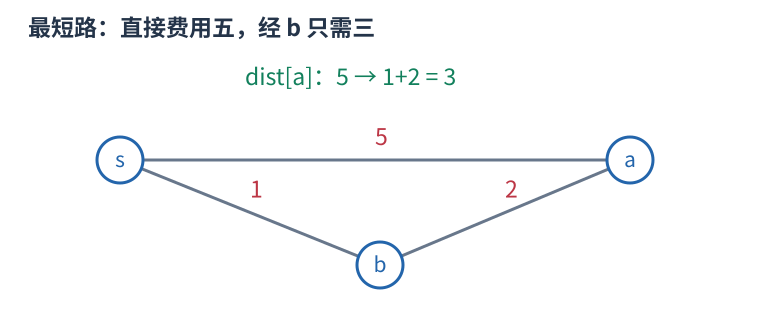
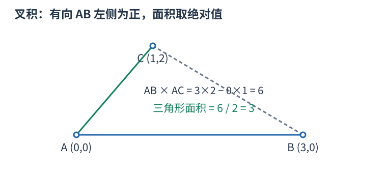
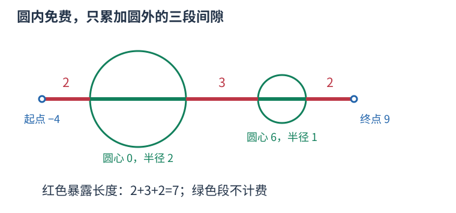

# ARC064C 把圆内的免费移动缩成一个结点 题解

## 目录

| 题号 | 题名 | 考点 | 难度 |
|---|---|---|---|
| A | Cosmic Rays | 最短路 + 计算几何 | 1800 |

## A. Cosmic Rays

> 原题：[ARC064C](https://www.luogu.com.cn/problem/AT_arc064_c)
> 解法：把圆内的免费移动缩成一个结点 · C++17

### 题意

从给定起点走到终点，速度为一。任意圆形屏障内部不会受辐射，圆外的行走时间才计入费用；圆可以相交、包含。求最小辐射时间。

<!-- reusable-foundations:start -->

### 从零讲：C++ 输入输出：把数据读进变量，把结果写到标准输出

程序运行时从标准输入接收题目给的数据，把答案送到标准输出。`cin` 和 `cout` 定义在 `<iostream>`；写 `using namespace std;` 后可以省略它们前面的 `std::`。最小完整程序是：

```cxx
#include <iostream>
using namespace std;
int main() {
    int a, b;
    cin >> a >> b;
    cout << a + b << '\n';
    return 0;
}
```

输入二十和三十，两个变量分别保存二十、三十，输出五十。`int a, b;` 声明两个整数变量；`cin >> a` 才给变量赋入输入值。多个 `>>` 从左到右读取，读取整数时会跳过空格、制表符、换行，所以两个整数可以分处两行。负号属于整数，不需要另读一个符号。

`cout <<` 后可以接数值、字符或字符串。`' '` 是一个空格字符，`'\n'` 是换行字符，`"Hello"` 是字符串。`cout << a << ' ' << b << '\n';` 输出两个以空格分开的整数并换行。评测程序只需要答案，不应加入“请输入”等提示。

读取 `char c; cin >> c;` 会跳过前导空白。要读取包含空格的一整行，用 `<string>` 中的 `string s; getline(cin, s);`。若此前用 `cin >> n` 读取过整数，换行还留在输入中，需要先处理那一个剩余换行；不能盲目把所有空格都删掉，因为字符画的行首空格和文本中的空格可能就是数据。

`fixed << setprecision(3)`（需要 `<iomanip>`）表示以小数形式保留三位小数，例如把 $2.5$ 输出成 $2.500$；不用 `fixed` 时，`setprecision` 指有效数字总数。设置会影响后续输出，使用前应确认所需精度。

竞赛中可在首次输入输出前调用 `ios::sync_with_stdio(false); cin.tie(nullptr);`，减少 C++ 流与 C 标准输入输出的同步、绑定开销。随后保持使用 `cin/cout`，不要混用另一套 `scanf/printf`。交互题还要在需要对方回应前主动刷新，例如 `cout << query << endl;`；普通题用换行字符即可。

读入长度为 $L$ 的文本、或输出 $L$ 个字符，至少需要 $O(L)$ 时间。数据类型仍要能容纳结果：把两个整数相乘时，即使保存到 `long long`，也要让乘法本身在这个类型中进行，例如先把输入声明为 `long long`。

### 从零讲：分支与循环：按条件选择，按次序重复

`if (条件) { ... } else { ... }` 根据条件的真假选择一条分支。比较运算 `==`、`!=`、`<`、`<=`、`>`、`>=` 返回真假值；`=` 是赋值，不能代替相等比较。`&&` 表示两边都成立，`||` 表示至少一边成立，`!` 把真假反转。

```cxx
int score = 85;
if (score >= 90) cout << "A";
else if (score >= 60) cout << "B";
else cout << "C"; // 这个例子输出 B
```

这条分支链只执行第一个符合条件的分支。先处理高分后，第二个条件自然只会接到低于九十分的数。几个独立的 `if` 则可能执行多次；两种结构代表不同问题。逻辑运算会短路：`i < n && a[i] == 0` 先确认下标合法，才读取那一格。

`for (初始化; 继续条件; 每轮更新)` 适合知道重复范围的情况。例如下列代码依次处理一到四，总和是十：

```cxx
int sum = 0;
for (int i = 1; i <= 4; ++i) {
    sum += i;
}
cout << sum;
```

初始化只做一次；每轮先判断条件，条件为真才执行循环体，随后执行更新。`++i` 把 $i$ 加一，`sum += i` 等价于把旧 sum 加 $i$ 再保存。应明确每个变量在循环前、循环后分别表示什么；最大值相同时是否更新，决定了保留较早还是较晚的答案。

`while (条件)` 适合“不满足目标就再做一步”：

```cxx
int x = 13, times = 0;
while (x > 1) {
    x /= 2;
    ++times;
}
// x 依次是 13、6、3、1，执行三次
```

循环开始前先检查条件，初始已满足目标时可能一次也不执行。每次执行必须推进状态，否则可能无限循环。`break` 结束最内层循环，`continue` 跳过本轮剩余部分；`for` 中的 continue 之后仍会执行每轮更新。

复杂度由实际执行次数决定。上述求和执行 $n$ 次是 $O(n)$；每次将正整数减半只执行 $O(\log n)$ 次。两层循环不能仅凭外观判定为平方：内层若总共只前进 $n$ 次，总量仍可能线性。变量应在正确作用范围初始化；多组数据的计数器若未重置，下一组会错误继承上一组结果。

### 从零讲：vector：长度可变的连续数组

`vector<T>` 保存一串同类型的元素，适合按下标访问、扫描、排序。`T` 是元素类型，例如 `vector<int>` 保存整数，`vector<pair<int,int>>` 保存整数对，`vector<vector<int>>` 可保存每个顶点各自的邻居。需要 `<vector>`。

```cxx
vector<int> a(3, 7);   // 三个元素，内容是 7、7、7
a.push_back(9);       // 在末尾追加，现在长度为 4
int x = a[1];         // 从 0 编号，这里得到 7
a[1] = 2;            // 改第二个元素
int n = int(a.size());
```

`vector<int> a(3)` 创建三个值为零的元素；`a.reserve(3)` 只预留容量，元素数仍为零，此时不能访问 `a[0]`。长度 `size()` 与容量 `capacity()` 是不同概念。

下标访问为 $O(1)$，遍历为 $O(n)$。末尾追加通常为 $O(1)$；容量不足时会分配更大的连续空间并搬移元素，这次可能为 $O(n)$，一连串追加的平均成本称为摊还 $O(1)$。中间插入或删除会搬移后续元素，最坏 $O(n)$。内存是元素量的 $O(n)$，并可能预留部分尚未使用的容量。

`begin()` 指向首元素，`end()` 指向尾后位置，`sort(a.begin(),a.end())` 操作整个数组。`a[i]` 不检查越界；下标须满足 $0\le i<\mathrm{size}$。`at(i)` 会检查越界并抛异常。空数组不能访问 `front()`、`back()`；`pop_back()` 也要求非空。

扩容后指向旧存储的迭代器、引用和指针会失效。遍历的同时 `push_back`，不能假定此前取得的引用仍可用。读取大数组的函数常用 `const vector<int>& a` 按常量引用传入，既不复制也禁止通过该引用修改；`vector<int> a` 按值传参则复制内容。选择副本还是引用取决于是否要保留独立数据。

### 从零讲：整数类型、整除与溢出

计算前先看每一步可能达到的范围。常见环境中 `int` 是 32 位，上界约 $2.1\times10^9$；`long long` 至少 64 位，常见有符号 64 位上界约 $9.22\times10^{18}$。`using ll = long long;` 只是为已有类型起别名。

```cxx
int a = 100000, b = 100000;
long long wrong = a * b;      // 右边先按 int 乘，可能已溢出
long long right = 1LL * a * b; // 先把运算提升到 long long
```

不能指望“接收结果的变量够大”修复此前已经溢出的计算。先提高操作数类型，再做乘法。超过 64 位时，GCC 的 `__int128` 可作中间量，但它不是标准 C++17 类型，也没有标准流输出重载；先证明范围，再选择工具。

整数 `/` 对有符号数向零截断：`7/3==2`、`-7/3==-2`。对非负数才等于向下取整。余数满足 `a == (a/b)*b + a%b`，除数不能为零；要将余数归入 $[0,m-1]$（$m>0$），可用 `(a % m + m) % m`，同时保证中间加法不溢出。

非负 $a$、正 $b$ 的向上取整可写 `a/b + (a%b != 0)`，比 `(a+b-1)/b` 更容易避免加法溢出。比较平方时也应在宽类型内计算；浮点数不适合作为大整数相等的默认判断方式。

`size()` 返回无符号类型。空容器上写 `size()-1` 会绕到很大的数，逆序遍历可以先转成有符号、确认长度，或使用逆向迭代器。`abs` 对最小有符号数无法在同类型中表达其正值，需先约束输入差值范围。一般机器整数运算按常数时间估算，宽类型解决表示范围，不改变算法的增长阶。

### 从零讲：具名函数：给可复用计算一个明确接口

函数把一段计算包装成“输入参数 → 返回结果”。例如判断整数是否为偶数：

```cxx
bool even(int x) {
    return x % 2 == 0;
}
int main() {
    bool a = even(8); // a 为 true
    bool b = even(7); // b 为 false
}
```

`bool` 是返回类型，`even` 是函数名，`int x` 是参数声明。调用 `even(8)` 时，实参八传入这个新调用的局部变量 $x$，执行 return 后把真假值交回调用处。定义本身不执行计算，只有调用才执行。函数应在调用处之前定义，或提前写声明。

普通数值参数按值传递，函数里修改 $x$ 不会改变调用者原变量。参数写成 `int &x` 时才引用调用者对象；必须让这个对象在调用期间有效。`const vector<int>& a` 用引用避免复制整个容器，并承诺不通过这个引用修改它。返回局部变量的值是安全的，返回局部变量的引用则在函数结束后失效。

函数名应说明它回答的问题，调用处负责传哪些数据。例如闰年判定只接收一个年份并返回真假，枚举年份范围和输出格式由调用者处理。同一判定被多次使用时，这能减少规则不一致；但函数包装不会自动降低算法复杂度，仍要把每次调用实际做的工作计入时间。

如果函数内部又调用自身，就是递归，需要明确最小情况如何直接返回、每次调用如何逼近它；递归会占用调用栈。普通辅助函数可以不使用递归，不应仅因写成函数就称作递归算法。

### 从零讲：图的表示、BFS 与 DFS

图由顶点与边组成，适合表达“哪些对象之间能一步到达”。有向边只允许一个方向；无向边需保存两个方向。邻接表 `vector<vector<int>> graph(n)` 为每个顶点保存邻居，空间 $O(n+m)$，无向边在表中出现两次。

以边 $0-1,0-2,1-3$ 为例，从零出发：


#### BFS 为什么得到最少边数

初始顶点距离为零，入先进先出的队列。弹出顶点时，将尚未到达的邻居距离设为当前距离加一，并立刻标记入队。距离为一的顶点都会先于距离为二的处理，因此第一次发现就是最少边数。

```cxx
vector<int> distance(n, -1);
queue<int> q;
distance[start] = 0; q.push(start);
while (!q.empty()) {
    int u = q.front(); q.pop();
    for (int v : graph[u]) if (distance[v] == -1) {
        distance[v] = distance[u] + 1;
        q.push(v);
    }
}
```

适用于无权或所有边代价相同的最少步数。边权不同，第一次发现未必费用最小，不能继续套这一结论。多起点 BFS 先把所有合法起点设零并入队。

#### DFS 的调用代表一整块未探索区域

DFS 标记当前点后，递归处理每个尚未访问的邻点；也可用显式栈。上例可能按 $0,1,3,2$ 的顺序深入，但顺序取决于邻居存放方式。它擅长检查连通性、处理子树和回溯，不保证最短路径。

两种遍历在每个顶点入队或调用一次、每条边检查常数次的实现下，时间均为 $O(n+m)$，额外标记和队列/栈为 $O(n)$。不要等出队才首次标记，否则同一顶点可能重复入队。图不连通时，从一个起点无法覆盖所有点；统计连通块应从每个尚未访问点再启动一次遍历。树的深递归可能用尽调用栈。

### 从零讲：最短路：从一步到达转向累计费用

路径费用是沿途边权之和。无权图的 BFS 按边数分层；边权不同时，先到达的路线不一定更便宜。最短路算法维护每个顶点目前已知的最小费用 `dist`，用已知路径尝试改善邻居，这一步叫松弛。

图有边 $s\to a$ 权五、$s\to b$ 权一、$b\to a$ 权二。直接到 $a$ 费用五，通过 $b$ 仅需三。所以不能第一次见到 $a$ 就永远固定为五。



#### 非负边权的 Dijkstra

起点距离零，其余为不可达。每次从小根堆取出当前最小的距离，若不是过期项，就松弛所有出边。非负边权保证尚未处理的更远顶点不可能绕出一条更便宜的路来推翻当前最小者。

```cxx
using State = pair<long long,int>;
priority_queue<State, vector<State>, greater<State>> heap;
dist[start] = 0; heap.push({0, start});
while (!heap.empty()) {
    auto [d, u] = heap.top(); heap.pop();
    if (d != dist[u]) continue;
    for (auto [v, weight] : graph[u]) {
        if (d + weight < dist[v]) {
            dist[v] = d + weight;
            heap.push({dist[v], v});
        }
    }
}
```

此实现可能为一个顶点保存多份堆项，更新后旧项仍在堆中，所以须检查是否过期。按实际入堆的边数，时间 $O((n+m)\log(n+m))$，空间 $O(n+m)$；常见简单图也写成 $O((n+m)\log n)$。距离和加边权要避免溢出。

若边权只为零或一，可用双端队列：零权改善放前端，一权改善放后端，称 0-1 BFS，正确实现可达 $O(n+m)$。负权图不能套非负贪心理由；Bellman-Ford 通过多轮松弛求解并检测可达负环，最坏 $O(nm)$。差分约束 $x_v\le x_u+w$ 可表示为边 $u\to v$ 权 $w$，但求解方向、超级源和负环含义要按约束目标解释。

状态不一定只是原图顶点。若后续费用还依赖钥匙、颜色或次数，应把这些信息并入状态；两条到同一顶点的路径未必能互相替代。

### 从零讲：priority_queue：随时取出最高优先级

若数据不断加入，每次只关心当前最大或最小项，无需每次排序整个数组。`priority_queue<T>` 用堆维护这一项：`top()` 查看，`push(x)` 加入，`pop()` 移除顶部但不返回值。需要 `<queue>`。

```cxx
priority_queue<int> largest;
largest.push(3); largest.push(8); largest.push(5);
int x = largest.top(); // 8，默认大根堆
largest.pop();         // 移走 8，此后顶部为 5
priority_queue<int, vector<int>, greater<int>> smallest;
```

最后一行是小根堆；对由距离和顶点编号组成的 `pair` 使用相同配置，可优先取最小距离。堆只保证顶部最优，内部并非完整有序数组，也不能高效随意查中间某个值。

堆在逻辑上是完全二叉树，高度为 $O(\log n)$，插入上浮、删除下沉最多跨越这个高度。故 `push`、`pop` 为 $O(\log n)$，`top` 为 $O(1)$，空间 $O(n)$。访问或删除顶部之前必须非空。

需要更新某项优先级时，标准 `priority_queue` 没有直接修改接口。常见方法是插入新版，取出时检查它是否仍与外部最新记录相符，丢弃过期项；这会影响队列大小和总复杂度，须按实际插入次数计算。

### 从零讲：计算几何：先画位置，再选择精确判定

点 $(x,y)$ 表示平面位置，向量 $(dx,dy)$ 表示从一个点到另一个点的位移。距离比较可用平方距离 $(x_1-x_2)^2+(y_1-y_2)^2$，避免不必要的开方；先用足够宽的类型计算差与乘积。

二维向量叉积 $u\times v=u_xv_y-u_yv_x$。令 $u=B-A$、$v=C-A$，叉积正、零、负分别表示 C 在有向直线 AB 的左侧、线上、右侧。它的绝对值是两向量组成平行四边形的面积，不是直接的三角形面积。



例如 $A=(0,0),B=(3,0),C=(1,2)$，叉积为六，三角形面积为三。交换 B、C 会改变符号但不改变绝对面积，因此“在哪侧”和“面积多大”是不同用途。

点在线段上还须位于端点围成的坐标范围内，叉积为零只说明共线。判断两线段相交，要处理端点接触、共线重叠和真交，不能只比较四个叉积的严格正负。轴平行线段可直接用固定坐标和范围包含判断，通常比通用浮点直线计算简单。

整数输入优先用精确整数判断，注意坐标差与叉积可超过 64 位。浮点比较的误差阈值要与量纲、数值规模相配，不能把固定 epsilon 视为所有题通用。排序比较器尤其不能随意加 epsilon，可能破坏传递性。

单次叉积为常数时间；枚举点对、线段对仍为 $O(n^2)$。几何图用来说明方向与相交关系，正确性还须覆盖退化情形，不能依赖示意图比例。

<!-- reusable-foundations:end -->

### 思路

将每个圆视为一个结点，起终点视为半径为零的圆。两个结点之间的费用是 max(0,圆心距-两半径和)。圆内移动免费，重叠圆之间也免费。这个完全图边权非负，做矩阵式 Dijkstra，按需计算边权即可。



圆心和半径按同一尺度绘制；利用两个屏障，最小辐射长度为七，不能把圆内路长也计入。

时间 $O(N^2)$，空间 $O(N)$。

### 参考代码

```cpp
#include <bits/stdc++.h>
using namespace std;

int main() {
    ios::sync_with_stdio(false);
    cin.tie(nullptr);
long double sx,sy,tx,ty;cin>>sx>>sy>>tx>>ty;int n;cin>>n;
vector<long double>x(n+2),y(n+2),radius(n+2);x[0]=sx;y[0]=sy;x[n+1]=tx;y[n+1]=ty;
for(int i=1;i<=n;++i)cin>>x[i]>>y[i]>>radius[i];
const long double INF=1e100L;vector<long double>dist(n+2,INF);vector<char>used(n+2);dist[0]=0;
for(int step=0;step<n+2;++step){int u=-1;for(int v=0;v<n+2;++v)if(!used[v]&&(u==-1||dist[v]<dist[u]))u=v;
    used[u]=true;for(int v=0;v<n+2;++v){
        // 重叠或包含时不存在暴露间隙。
        long double gap=max(0.0L,hypotl(x[u]-x[v],y[u]-y[v])-radius[u]-radius[v]);
        dist[v]=min(dist[v],dist[u]+gap);
    }
}cout<<fixed<<setprecision(18)<<dist[n+1]<<'\n';
    return 0;
}
```

### 易错点

圆内免费并非圆是障碍；相交和包含时费用截成零；起终点半径为零；先用浮点类型作坐标差；不要把结果四舍五入成整数。

## 实测记录

本地 C++17 编译、3 组原站样例与 97 组独立边界/小域校验通过。
正文参考程序与源码逐字核对；没有向原站提交。
