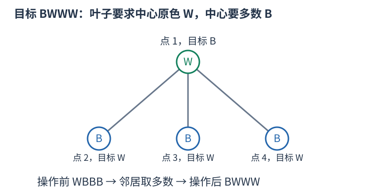

# ARC161C 自底向上传递被迫的父亲颜色 题解

## 目录

| 题号 | 题名 | 考点 | 难度 |
|---|---|---|---|
| A | Dyed by Majority (Odd Tree) | 贪心 + 构造 + DFS | 1800 |

## A. Dyed by Majority (Odd Tree)

> 原题：[ARC161C](https://www.luogu.com.cn/problem/AT_arc161_c)
> 解法：自底向上传递被迫的父亲颜色 · C++17

### 题意

树的每个点度数都是奇数，所有点同时改为邻居的多数颜色；给定改色结果，构造改色前的颜色或判断无解。

<!-- reusable-foundations:start -->

### 从零讲：C++ 输入输出：把数据读进变量，把结果写到标准输出

程序运行时从标准输入接收题目给的数据，把答案送到标准输出。`cin` 和 `cout` 定义在 `<iostream>`；写 `using namespace std;` 后可以省略它们前面的 `std::`。最小完整程序是：

```cxx
#include <iostream>
using namespace std;
int main() {
    int a, b;
    cin >> a >> b;
    cout << a + b << '\n';
    return 0;
}
```

输入二十和三十，两个变量分别保存二十、三十，输出五十。`int a, b;` 声明两个整数变量；`cin >> a` 才给变量赋入输入值。多个 `>>` 从左到右读取，读取整数时会跳过空格、制表符、换行，所以两个整数可以分处两行。负号属于整数，不需要另读一个符号。

`cout <<` 后可以接数值、字符或字符串。`' '` 是一个空格字符，`'\n'` 是换行字符，`"Hello"` 是字符串。`cout << a << ' ' << b << '\n';` 输出两个以空格分开的整数并换行。评测程序只需要答案，不应加入“请输入”等提示。

读取 `char c; cin >> c;` 会跳过前导空白。要读取包含空格的一整行，用 `<string>` 中的 `string s; getline(cin, s);`。若此前用 `cin >> n` 读取过整数，换行还留在输入中，需要先处理那一个剩余换行；不能盲目把所有空格都删掉，因为字符画的行首空格和文本中的空格可能就是数据。

`fixed << setprecision(3)`（需要 `<iomanip>`）表示以小数形式保留三位小数，例如把 $2.5$ 输出成 $2.500$；不用 `fixed` 时，`setprecision` 指有效数字总数。设置会影响后续输出，使用前应确认所需精度。

竞赛中可在首次输入输出前调用 `ios::sync_with_stdio(false); cin.tie(nullptr);`，减少 C++ 流与 C 标准输入输出的同步、绑定开销。随后保持使用 `cin/cout`，不要混用另一套 `scanf/printf`。交互题还要在需要对方回应前主动刷新，例如 `cout << query << endl;`；普通题用换行字符即可。

读入长度为 $L$ 的文本、或输出 $L$ 个字符，至少需要 $O(L)$ 时间。数据类型仍要能容纳结果：把两个整数相乘时，即使保存到 `long long`，也要让乘法本身在这个类型中进行，例如先把输入声明为 `long long`。

### 从零讲：数组：用下标定位一组状态

数组把同一类型的若干值按位置保存。`int a[5] = {};` 创建五个初始为零的整数，合法下标是零到四；`a[2] = 7;` 只修改第三格。下标表示位置，格子中保存的值是另一回事。

```cxx
int a[4] = {4, 3, 0, 5};
int sum = 0;
for (int i = 0; i < 4; ++i) sum += a[i];
// 和为十二；a[0] 是四，a[3] 是五
```

读写一个给定下标的格子是 $O(1)$。扫描全部 $n$ 格为 $O(n)$，保存 $n$ 格的空间为 $O(n)$。不能访问负下标或 $a[n]$，越界属于未定义行为，可能表现为随机数或崩溃，编译通过不代表安全。

`bool seen[34] = {};` 可以保存号码是否出现过，初始全为 false；`seen[x]=true` 表示记录出现状态。再次赋 true 不改变结果，因此适合去重、标记删除；若操作是开关翻转，则要写 `seen[x]=!seen[x]`。标记真假和记录出现次数是不同任务，后者需要整数计数数组。

若题目用一到 $n$ 编号，可以创建 $n+1$ 格并预留零号，统一按原编号访问。或者读入时改成零到 $n-1$，但必须让全部循环与公式使用同一套下标。

二维数组 `int a[5][6] = {};` 有五行六列，`a[r][c]` 表示第 $r$ 行第 $c$ 列。三维数组再加一个方向，用三个下标定位单位格子。逐格扫描的时间是各维长度的乘积，空间也按格子总数计算。

固定数组的长度需要在编译时确定，不能在标准 C++17 中写依赖输入的 `int a[n]`。输入后才确定大小时使用 `vector<int> a(n,0)`；它同样从零编号，也可以按下标访问，但仍须检查下标边界。大数组应避免放在空间有限的函数栈上，可以用动态容器或全局数组。数组里的旧状态是否应该保留，需要根据当前问题决定，多组测试不能意外继承上一组的内容。

### 从零讲：vector：长度可变的连续数组

`vector<T>` 保存一串同类型的元素，适合按下标访问、扫描、排序。`T` 是元素类型，例如 `vector<int>` 保存整数，`vector<pair<int,int>>` 保存整数对，`vector<vector<int>>` 可保存每个顶点各自的邻居。需要 `<vector>`。

```cxx
vector<int> a(3, 7);   // 三个元素，内容是 7、7、7
a.push_back(9);       // 在末尾追加，现在长度为 4
int x = a[1];         // 从 0 编号，这里得到 7
a[1] = 2;            // 改第二个元素
int n = int(a.size());
```

`vector<int> a(3)` 创建三个值为零的元素；`a.reserve(3)` 只预留容量，元素数仍为零，此时不能访问 `a[0]`。长度 `size()` 与容量 `capacity()` 是不同概念。

下标访问为 $O(1)$，遍历为 $O(n)$。末尾追加通常为 $O(1)$；容量不足时会分配更大的连续空间并搬移元素，这次可能为 $O(n)$，一连串追加的平均成本称为摊还 $O(1)$。中间插入或删除会搬移后续元素，最坏 $O(n)$。内存是元素量的 $O(n)$，并可能预留部分尚未使用的容量。

`begin()` 指向首元素，`end()` 指向尾后位置，`sort(a.begin(),a.end())` 操作整个数组。`a[i]` 不检查越界；下标须满足 $0\le i<\mathrm{size}$。`at(i)` 会检查越界并抛异常。空数组不能访问 `front()`、`back()`；`pop_back()` 也要求非空。

扩容后指向旧存储的迭代器、引用和指针会失效。遍历的同时 `push_back`，不能假定此前取得的引用仍可用。读取大数组的函数常用 `const vector<int>& a` 按常量引用传入，既不复制也禁止通过该引用修改；`vector<int> a` 按值传参则复制内容。选择副本还是引用取决于是否要保留独立数据。

### 从零讲：分支与循环：按条件选择，按次序重复

`if (条件) { ... } else { ... }` 根据条件的真假选择一条分支。比较运算 `==`、`!=`、`<`、`<=`、`>`、`>=` 返回真假值；`=` 是赋值，不能代替相等比较。`&&` 表示两边都成立，`||` 表示至少一边成立，`!` 把真假反转。

```cxx
int score = 85;
if (score >= 90) cout << "A";
else if (score >= 60) cout << "B";
else cout << "C"; // 这个例子输出 B
```

这条分支链只执行第一个符合条件的分支。先处理高分后，第二个条件自然只会接到低于九十分的数。几个独立的 `if` 则可能执行多次；两种结构代表不同问题。逻辑运算会短路：`i < n && a[i] == 0` 先确认下标合法，才读取那一格。

`for (初始化; 继续条件; 每轮更新)` 适合知道重复范围的情况。例如下列代码依次处理一到四，总和是十：

```cxx
int sum = 0;
for (int i = 1; i <= 4; ++i) {
    sum += i;
}
cout << sum;
```

初始化只做一次；每轮先判断条件，条件为真才执行循环体，随后执行更新。`++i` 把 $i$ 加一，`sum += i` 等价于把旧 sum 加 $i$ 再保存。应明确每个变量在循环前、循环后分别表示什么；最大值相同时是否更新，决定了保留较早还是较晚的答案。

`while (条件)` 适合“不满足目标就再做一步”：

```cxx
int x = 13, times = 0;
while (x > 1) {
    x /= 2;
    ++times;
}
// x 依次是 13、6、3、1，执行三次
```

循环开始前先检查条件，初始已满足目标时可能一次也不执行。每次执行必须推进状态，否则可能无限循环。`break` 结束最内层循环，`continue` 跳过本轮剩余部分；`for` 中的 continue 之后仍会执行每轮更新。

复杂度由实际执行次数决定。上述求和执行 $n$ 次是 $O(n)$；每次将正整数减半只执行 $O(\log n)$ 次。两层循环不能仅凭外观判定为平方：内层若总共只前进 $n$ 次，总量仍可能线性。变量应在正确作用范围初始化；多组数据的计数器若未重置，下一组会错误继承上一组结果。

### 从零讲：string：字符、下标与子串

`string` 保存字符序列。`string s="abca";` 的长度为四，下标从零开始，`s[0]=='a'`、`s[3]=='a'`。字符用单引号，字符串用双引号；二者类型不同。需要 `<string>`。

`cin >> s` 读到空白停止；整行含空格时使用 `getline`，并留意前一次格式化输入残留的换行。`s.size()` 是字符单元数量，不一定等于 UTF-8 中文字数；竞赛英文小写字母题通常一个字符对应一个单元。

```cxx
string s = "abca";
string middle = s.substr(1, 2); // 从下标 1 开始取 2 个字符，得到 bc
size_t pos = s.find('c');       // 得到 2；找不到是 string::npos
if (pos != string::npos) cout << s[pos];
```

`substr(start,length)` 的第二项是长度，不是右端点。普通下标访问为 $O(1)$；复制长为 $k$ 的子串需要 $O(k)$ 时间和空间，循环里反复截取可能累积成平方成本。字符串比较按第一个不同字符决定字典序，公共前缀可能需要线性比较。

常见字符转数字是 `c-'0'`，前提 `c` 在 `'0'` 到 `'9'`。修改原串可用 `for(char& c:s)`，只读使用 `char c`。`reverse(s.begin(),s.end())` 原地翻转；若还需要原串，应先复制。空串不能访问首尾，尾后位置不能当普通字符读取。

### 从零讲：树的根、子树、DFS 序与倍增

树是连通且无环的无向图，$n$ 个顶点有 $n-1$ 条边。指定一个根后，每个非根顶点有唯一父亲，其他向下邻居是孩子。子树包含自己和全部后代；换根会改变父子关系，但不改变原边。


#### 子树信息按依赖顺序计算

例如子树大小 `size[u]` 初始为一，每个孩子处理完后累加 `size[v]`。一来自节点自己，不能漏掉。树形 DP 也如此：先明确某状态允许怎样选择，再合并各孩子提供的信息；孩子独立性来自树上没有跨子树边，仍可能因总预算或选中父亲等条件产生状态关联。

换根 DP 先求一个根的状态，再沿边换根，将“来自孩子的一侧”和“来自父亲的一侧”合并。应画清只有哪条边的方向改变、哪些量不变；不能仅凭两张答案表代替依赖解释。普通遍历每条边常数次为 $O(n)$，背包式合并可能更大，按实际合并循环计算。

#### DFS 序为什么能把子树变成区间

进入节点时分配编号 `tin[u]`，完成整棵子树后记录最后编号 `tout[u]`。深度优先在返回父亲前会完整处理这棵子树，因此它的所有编号连续，恰是 $[tin[u],tout[u]]$。这允许把子树和等查询交给数组结构。若同时记录进出事件，区间定义会不同，不可混用两种序列。

#### 倍增与最近公共祖先

`up[k][u]` 存 $u$ 向上 $2^k$ 条边到达的祖先。基础 `up[0][u]=parent[u]`，递推为 `up[k][u]=up[k-1][up[k-1][u]]`，因为连续走两段 $2^{k-1}$。跳十三层可拆为八加四加一，只需对数个跳跃。

LCA 是两个节点公共祖先中最深者。先把更深的一方跳到同深度；若已经相同就是答案。否则从大到小试跳，祖先不同才两边同时上移，最后它们的父亲就是 LCA。预处理 $O(n\log n)$、每次查询 $O(\log n)$，表空间 $O(n\log n)$。根的虚拟祖先需统一定义，不能访问非法下标。

树的直径在非负无权边长等常见条件下可用两次最远点搜索求出；带负权时要重新判断。虚树则将关注节点按 DFS 序组织，补上相邻节点的 LCA 后连接祖先关系，边应携带原路径含义，不能把压缩后一条边误当原图一步。深链上的递归也须留意栈深度。

### 从零讲：构造：找到一份合法对象，并解释它为何总能生成

构造题允许输出任意满足要求的对象。先区分“只需合法”与“还要求最小、最多或字典序最小”，不要额外发明优化目标。

例如要把从一到 $2k$ 的数字配成 $k$ 对，使每对和相同，可以配 $(1,2k),(2,2k-1),\ldots,(k,k+1)$，每对都为 $2k+1$。数字不重复，因为两半各用一次；也没有漏数。这个一般描述能直接转成循环。


如果还要求最大化某项，先给任何方案都不能超越的上界，再展示构造确实达到上界；没有最优性要求时只证明合法和能完成即可。

一个完整构造应能回答：什么时候无解；输出对象是什么；每次允许的动作如何执行；后续所需的条件有没有被前面的动作破坏；数量、范围和边界是否满足。操作题还要区分目标排列和真正输出的操作序列。

验证构造不能只和另一程序逐字比较，因为合法答案可有多份。应将结果代回题目条件：检查长度、元素多重集合、限制、每步前后状态及目标。复杂度按生成和校验成本计算，输出本身有 $k$ 项就至少需要 $O(k)$ 时间。

<!-- reusable-foundations:end -->

### 思路

目标 $S[u]$ 约束的是 $u$ 的邻居原颜色，不是 $u$ 自己的原颜色。例如一个叶子只有父亲这一个邻居，因此叶子的目标色必然强制父亲的原颜色。两个叶子要求同一个父亲为不同颜色时，立刻无解。



圆内是操作前颜色，旁边是目标色；中心看三个 B，叶子各只看中心的 W。

把题目的一号点作为根，代码将全部编号减一存储。先得到父子关系和一个父亲在孩子之前的遍历顺序，再逆序处理，保证每个点的孩子都处理完。各孩子可能对 $u$ 的原颜色提出“必须为黑／白”的要求；有冲突就无解。若没有要求，$u$ 的原颜色怎样都不妨碍已处理孩子，于是选 $S[parent[u]]$，给父亲的多数判定提供最有利的一票；根没有父亲，任取一色即可。

接着检查 $u$ 自己的目标。度数为 deg 时，需要 need=(deg+1)/2 个邻居原色等于 $S[u]$。孩子中有 match 票：若 $match \ge need$，父亲任意；若 $match=need-1$，必须强制父亲原色为 $S[u]$；若 $match<need-1$，父亲最多再加一票也不够，无解。根没有父亲，所以必须直接 $match \ge need$。

为什么孩子未被强制时可以都取有利颜色？孩子的原颜色只参与它父亲及它孩子的多数判定，后者已经确认对它没有额外要求；当前只需尽量帮助父亲，不会损害别的点。对孩子真正被强制的情况则绝不擅改。逐层记录这个自由或被迫状态，便保留了所有可能解所需要的选择。全程用显式遍历顺序，避免二十万点深树递归栈溢出。

每组时间与空间均为 $O(n)$。

### 参考代码

```cpp
#include <bits/stdc++.h>
using namespace std;

int main() {
    ios::sync_with_stdio(false);
    cin.tie(nullptr);
int tests;cin>>tests;while(tests--){int n;cin>>n;vector<vector<int>>g(n);
    for(int i=1;i<n;++i){int u,v;cin>>u>>v;--u;--v;g[u].push_back(v);g[v].push_back(u);}
    string target;cin>>target;vector<int>parent(n,-1),order(1,0),color(n,-1);parent[0]=-2;
    for(int i=0;i<(int)order.size();++i){int u=order[i];for(int v:g[u])if(v!=parent[u]){parent[v]=u;order.push_back(v);}}
    bool ok=true;
    for(int at=n-1;at>=0&&ok;--at){int u=order[at],p=parent[u];
        if(color[u]<0)color[u]=p<0?0:target[p]=='B';
        int match=0;for(int v:g[u])if(parent[v]==u)match+=color[v]==(target[u]=='B');
        int need=((int)g[u].size()+1)/2;
        if(match>=need)continue;
        if(p<0||match+1<need){ok=false;break;}
        int forced=target[u]=='B';if(color[p]>=0&&color[p]!=forced){ok=false;break;}color[p]=forced;
    }
    if(!ok)cout<<"-1\n";else{for(int c:color)cout<<(c?'B':'W');cout<<'\n';}
}
    return 0;
}
```

### 易错点

约束来自邻居原色，不能把原色直接等同目标色；根没有父亲可补票。

## 实测记录

本地 C++17 编译、1 组原站样例与 57 组独立边界/小域校验通过。
正文参考程序与源码逐字核对；没有向原站提交。
