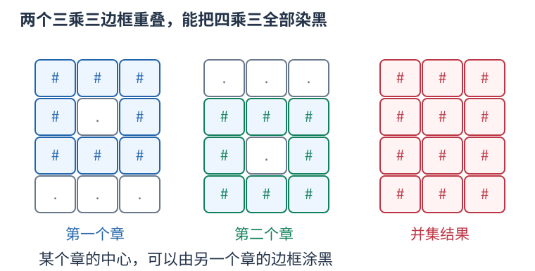

# CF1059B 把所有合法印章的边框取并集 题解

## 目录

| 题号 | 题名 | 考点 | 难度 |
|---|---|---|---|
| A | Forgery | 枚举 + 构造 | 1300 |

## A. Forgery

> 原题：[CF1059B](https://www.luogu.com.cn/problem/CF1059B)
> 解法：把所有合法印章的边框取并集 · C++17

### 题意

一次只能在完整三乘三区域的八格边框涂墨，中心不涂。判断能否从全空白得到目标图。

<!-- reusable-foundations:start -->

### 从零讲：C++ 输入输出：把数据读进变量，把结果写到标准输出

程序运行时从标准输入接收题目给的数据，把答案送到标准输出。`cin` 和 `cout` 定义在 `<iostream>`；写 `using namespace std;` 后可以省略它们前面的 `std::`。最小完整程序是：

```cxx
#include <iostream>
using namespace std;
int main() {
    int a, b;
    cin >> a >> b;
    cout << a + b << '\n';
    return 0;
}
```

输入二十和三十，两个变量分别保存二十、三十，输出五十。`int a, b;` 声明两个整数变量；`cin >> a` 才给变量赋入输入值。多个 `>>` 从左到右读取，读取整数时会跳过空格、制表符、换行，所以两个整数可以分处两行。负号属于整数，不需要另读一个符号。

`cout <<` 后可以接数值、字符或字符串。`' '` 是一个空格字符，`'\n'` 是换行字符，`"Hello"` 是字符串。`cout << a << ' ' << b << '\n';` 输出两个以空格分开的整数并换行。评测程序只需要答案，不应加入“请输入”等提示。

读取 `char c; cin >> c;` 会跳过前导空白。要读取包含空格的一整行，用 `<string>` 中的 `string s; getline(cin, s);`。若此前用 `cin >> n` 读取过整数，换行还留在输入中，需要先处理那一个剩余换行；不能盲目把所有空格都删掉，因为字符画的行首空格和文本中的空格可能就是数据。

`fixed << setprecision(3)`（需要 `<iomanip>`）表示以小数形式保留三位小数，例如把 $2.5$ 输出成 $2.500$；不用 `fixed` 时，`setprecision` 指有效数字总数。设置会影响后续输出，使用前应确认所需精度。

竞赛中可在首次输入输出前调用 `ios::sync_with_stdio(false); cin.tie(nullptr);`，减少 C++ 流与 C 标准输入输出的同步、绑定开销。随后保持使用 `cin/cout`，不要混用另一套 `scanf/printf`。交互题还要在需要对方回应前主动刷新，例如 `cout << query << endl;`；普通题用换行字符即可。

读入长度为 $L$ 的文本、或输出 $L$ 个字符，至少需要 $O(L)$ 时间。数据类型仍要能容纳结果：把两个整数相乘时，即使保存到 `long long`，也要让乘法本身在这个类型中进行，例如先把输入声明为 `long long`。

### 从零讲：分支与循环：按条件选择，按次序重复

`if (条件) { ... } else { ... }` 根据条件的真假选择一条分支。比较运算 `==`、`!=`、`<`、`<=`、`>`、`>=` 返回真假值；`=` 是赋值，不能代替相等比较。`&&` 表示两边都成立，`||` 表示至少一边成立，`!` 把真假反转。

```cxx
int score = 85;
if (score >= 90) cout << "A";
else if (score >= 60) cout << "B";
else cout << "C"; // 这个例子输出 B
```

这条分支链只执行第一个符合条件的分支。先处理高分后，第二个条件自然只会接到低于九十分的数。几个独立的 `if` 则可能执行多次；两种结构代表不同问题。逻辑运算会短路：`i < n && a[i] == 0` 先确认下标合法，才读取那一格。

`for (初始化; 继续条件; 每轮更新)` 适合知道重复范围的情况。例如下列代码依次处理一到四，总和是十：

```cxx
int sum = 0;
for (int i = 1; i <= 4; ++i) {
    sum += i;
}
cout << sum;
```

初始化只做一次；每轮先判断条件，条件为真才执行循环体，随后执行更新。`++i` 把 $i$ 加一，`sum += i` 等价于把旧 sum 加 $i$ 再保存。应明确每个变量在循环前、循环后分别表示什么；最大值相同时是否更新，决定了保留较早还是较晚的答案。

`while (条件)` 适合“不满足目标就再做一步”：

```cxx
int x = 13, times = 0;
while (x > 1) {
    x /= 2;
    ++times;
}
// x 依次是 13、6、3、1，执行三次
```

循环开始前先检查条件，初始已满足目标时可能一次也不执行。每次执行必须推进状态，否则可能无限循环。`break` 结束最内层循环，`continue` 跳过本轮剩余部分；`for` 中的 continue 之后仍会执行每轮更新。

复杂度由实际执行次数决定。上述求和执行 $n$ 次是 $O(n)$；每次将正整数减半只执行 $O(\log n)$ 次。两层循环不能仅凭外观判定为平方：内层若总共只前进 $n$ 次，总量仍可能线性。变量应在正确作用范围初始化；多组数据的计数器若未重置，下一组会错误继承上一组结果。

### 从零讲：vector：长度可变的连续数组

`vector<T>` 保存一串同类型的元素，适合按下标访问、扫描、排序。`T` 是元素类型，例如 `vector<int>` 保存整数，`vector<pair<int,int>>` 保存整数对，`vector<vector<int>>` 可保存每个顶点各自的邻居。需要 `<vector>`。

```cxx
vector<int> a(3, 7);   // 三个元素，内容是 7、7、7
a.push_back(9);       // 在末尾追加，现在长度为 4
int x = a[1];         // 从 0 编号，这里得到 7
a[1] = 2;            // 改第二个元素
int n = int(a.size());
```

`vector<int> a(3)` 创建三个值为零的元素；`a.reserve(3)` 只预留容量，元素数仍为零，此时不能访问 `a[0]`。长度 `size()` 与容量 `capacity()` 是不同概念。

下标访问为 $O(1)$，遍历为 $O(n)$。末尾追加通常为 $O(1)$；容量不足时会分配更大的连续空间并搬移元素，这次可能为 $O(n)$，一连串追加的平均成本称为摊还 $O(1)$。中间插入或删除会搬移后续元素，最坏 $O(n)$。内存是元素量的 $O(n)$，并可能预留部分尚未使用的容量。

`begin()` 指向首元素，`end()` 指向尾后位置，`sort(a.begin(),a.end())` 操作整个数组。`a[i]` 不检查越界；下标须满足 $0\le i<\mathrm{size}$。`at(i)` 会检查越界并抛异常。空数组不能访问 `front()`、`back()`；`pop_back()` 也要求非空。

扩容后指向旧存储的迭代器、引用和指针会失效。遍历的同时 `push_back`，不能假定此前取得的引用仍可用。读取大数组的函数常用 `const vector<int>& a` 按常量引用传入，既不复制也禁止通过该引用修改；`vector<int> a` 按值传参则复制内容。选择副本还是引用取决于是否要保留独立数据。

### 从零讲：整数类型、整除与溢出

计算前先看每一步可能达到的范围。常见环境中 `int` 是 32 位，上界约 $2.1\times10^9$；`long long` 至少 64 位，常见有符号 64 位上界约 $9.22\times10^{18}$。`using ll = long long;` 只是为已有类型起别名。

```cxx
int a = 100000, b = 100000;
long long wrong = a * b;      // 右边先按 int 乘，可能已溢出
long long right = 1LL * a * b; // 先把运算提升到 long long
```

不能指望“接收结果的变量够大”修复此前已经溢出的计算。先提高操作数类型，再做乘法。超过 64 位时，GCC 的 `__int128` 可作中间量，但它不是标准 C++17 类型，也没有标准流输出重载；先证明范围，再选择工具。

整数 `/` 对有符号数向零截断：`7/3==2`、`-7/3==-2`。对非负数才等于向下取整。余数满足 `a == (a/b)*b + a%b`，除数不能为零；要将余数归入 $[0,m-1]$（$m>0$），可用 `(a % m + m) % m`，同时保证中间加法不溢出。

非负 $a$、正 $b$ 的向上取整可写 `a/b + (a%b != 0)`，比 `(a+b-1)/b` 更容易避免加法溢出。比较平方时也应在宽类型内计算；浮点数不适合作为大整数相等的默认判断方式。

`size()` 返回无符号类型。空容器上写 `size()-1` 会绕到很大的数，逆序遍历可以先转成有符号、确认长度，或使用逆向迭代器。`abs` 对最小有符号数无法在同类型中表达其正值，需先约束输入差值范围。一般机器整数运算按常数时间估算，宽类型解决表示范围，不改变算法的增长阶。

### 从零讲：string：字符、下标与子串

`string` 保存字符序列。`string s="abca";` 的长度为四，下标从零开始，`s[0]=='a'`、`s[3]=='a'`。字符用单引号，字符串用双引号；二者类型不同。需要 `<string>`。

`cin >> s` 读到空白停止；整行含空格时使用 `getline`，并留意前一次格式化输入残留的换行。`s.size()` 是字符单元数量，不一定等于 UTF-8 中文字数；竞赛英文小写字母题通常一个字符对应一个单元。

```cxx
string s = "abca";
string middle = s.substr(1, 2); // 从下标 1 开始取 2 个字符，得到 bc
size_t pos = s.find('c');       // 得到 2；找不到是 string::npos
if (pos != string::npos) cout << s[pos];
```

`substr(start,length)` 的第二项是长度，不是右端点。普通下标访问为 $O(1)$；复制长为 $k$ 的子串需要 $O(k)$ 时间和空间，循环里反复截取可能累积成平方成本。字符串比较按第一个不同字符决定字典序，公共前缀可能需要线性比较。

常见字符转数字是 `c-'0'`，前提 `c` 在 `'0'` 到 `'9'`。修改原串可用 `for(char& c:s)`，只读使用 `char c`。`reverse(s.begin(),s.end())` 原地翻转；若还需要原串，应先复制。空串不能访问首尾，尾后位置不能当普通字符读取。

### 从零讲：枚举与模拟：让代码和允许的动作一一对应

枚举是系统地检查所有候选；模拟是按题目规则推进状态。先写清一个候选是什么、有哪些动作、执行后哪些量改变，再决定循环边界。

例如从集合 $\{1,2,3\}$ 中选两个不同数：有序选择可枚举 $(i,j)$ 且 $i\ne j$，共六项；如果只关心无序的一对，就规定 $i<j$，得到 $(1,2)$、$(1,3)$、$(2,3)$，避免重复计数。同一个双循环，边界表达的是不同对象。

```cxx
for (int i = 0; i < n; ++i)
    for (int j = i + 1; j < n; ++j) {
        // 每一对不同位置恰好出现一次
    }
```

模拟例如计数器初始为零，依次读动作“加二、减一、加二”，状态为 $0\to2\to1\to3$。每一步都只读取该时刻允许的信息；若规则要求同时更新多个量，应先用旧状态算全部新量，不能让后一个更新误读前一个新值。

时间要数实际候选数和每个候选的工作。双循环可能是 $O(n^2)$，枚举长度为 $k$ 的二进制选择是 $O(2^k)$；候选少但每次又扫描全数组，也要乘上扫描成本。空间取决于是否需要保存历史。

全枚举的优势是思路直接，容易作为独立校验程序。剪枝必须证明被略去的分支不可能合法或更优，不能只因一个小例子没遇到答案就删候选。若直接枚举超时，先找重复工作、对称性、可维护的量或单调边界，再选择优化方法。

### 从零讲：构造：找到一份合法对象，并解释它为何总能生成

构造题允许输出任意满足要求的对象。先区分“只需合法”与“还要求最小、最多或字典序最小”，不要额外发明优化目标。

例如要把从一到 $2k$ 的数字配成 $k$ 对，使每对和相同，可以配 $(1,2k),(2,2k-1),\ldots,(k,k+1)$，每对都为 $2k+1$。数字不重复，因为两半各用一次；也没有漏数。这个一般描述能直接转成循环。


如果还要求最大化某项，先给任何方案都不能超越的上界，再展示构造确实达到上界；没有最优性要求时只证明合法和能完成即可。

一个完整构造应能回答：什么时候无解；输出对象是什么；每次允许的动作如何执行；后续所需的条件有没有被前面的动作破坏；数量、范围和边界是否满足。操作题还要区分目标排列和真正输出的操作序列。

验证构造不能只和另一程序逐字比较，因为合法答案可有多份。应将结果代回题目条件：检查长度、元素多重集合、限制、每步前后状态及目标。复杂度按生成和校验成本计算，输出本身有 $k$ 项就至少需要 $O(k)$ 时间。

<!-- reusable-foundations:end -->

### 思路

枚举每个合法中心，若它周围八格在目标中全为 #，就可以盖这个章，把八格记入新图。最后新图与目标完全相同则 YES，否则 NO。盖合法章只增加目标本来要黑的格，章之间可以重叠，所以把所有合法章都盖上不会造成冲突。



三幅图是同一张四行三列棋盘上的两次单独盖章及最终并集，中心不涂不代表目标中心必须为空。

时间、空间均为 $O(nm)$。

### 参考代码

```cpp
#include <bits/stdc++.h>
using namespace std;

int main() {
    ios::sync_with_stdio(false);
    cin.tie(nullptr);
int n,m;cin>>n>>m;vector<string>target(n),painted(n,string(m,'.'));for(auto &row:target)cin>>row;
for(int r=1;r+1<n;++r)for(int c=1;c+1<m;++c){bool allowed=true;
    for(int dx=-1;dx<=1;++dx)for(int dy=-1;dy<=1;++dy)if((dx||dy)&&target[r+dx][c+dy]!='#')allowed=false;
    if(!allowed)continue;
    // 中心不涂，也不要求它在目标图中必须为空。
    for(int dx=-1;dx<=1;++dx)for(int dy=-1;dy<=1;++dy)if(dx||dy)painted[r+dx][c+dy]='#';
}
cout<<(painted==target?"YES":"NO")<<'\n';
    return 0;
}
```

### 易错点

中心不参与边框检查；盖章必须完整在网格内；合法章可以全部盖，不必寻找互不重叠的一组。

## 实测记录

本地 C++17 编译、4 组原站样例与 772 组独立边界/小域校验通过。
正文参考程序与源码逐字核对；没有向原站提交。
