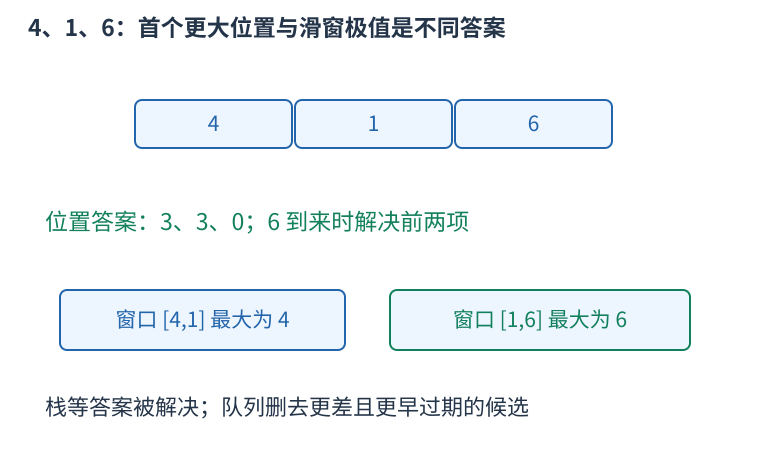
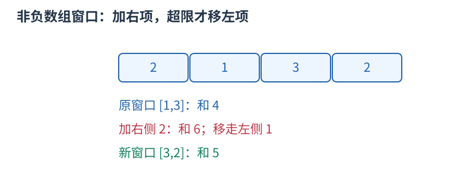
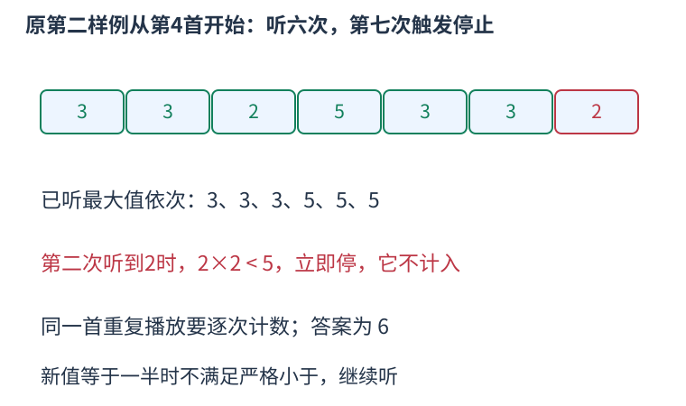

# CF1237D 三份循环数组上双指针延伸，用最大队列判断第一首坏歌 题解

## 目录

| 题号 | 题名 | 考点 | 难度 |
|---|---|---|---|
| A | Balanced Playlist | 队列 + 双指针 | 2000 |

## A. Balanced Playlist

> 原题：[CF1237D](https://www.luogu.com.cn/problem/CF1237D)
> 解法：三份循环数组上双指针延伸，用最大队列判断第一首坏歌 · C++17

### 题意

循环播放，从每个起点求停歌前听完的曲目次数；新歌严格小于已听最大值的一半就立刻停止，触发曲目不计入。

<!-- reusable-foundations:start -->

### 从零讲：C++ 输入输出：把数据读进变量，把结果写到标准输出

程序运行时从标准输入接收题目给的数据，把答案送到标准输出。`cin` 和 `cout` 定义在 `<iostream>`；写 `using namespace std;` 后可以省略它们前面的 `std::`。最小完整程序是：

```cxx
#include <iostream>
using namespace std;
int main() {
    int a, b;
    cin >> a >> b;
    cout << a + b << '\n';
    return 0;
}
```

输入二十和三十，两个变量分别保存二十、三十，输出五十。`int a, b;` 声明两个整数变量；`cin >> a` 才给变量赋入输入值。多个 `>>` 从左到右读取，读取整数时会跳过空格、制表符、换行，所以两个整数可以分处两行。负号属于整数，不需要另读一个符号。

`cout <<` 后可以接数值、字符或字符串。`' '` 是一个空格字符，`'\n'` 是换行字符，`"Hello"` 是字符串。`cout << a << ' ' << b << '\n';` 输出两个以空格分开的整数并换行。评测程序只需要答案，不应加入“请输入”等提示。

读取 `char c; cin >> c;` 会跳过前导空白。要读取包含空格的一整行，用 `<string>` 中的 `string s; getline(cin, s);`。若此前用 `cin >> n` 读取过整数，换行还留在输入中，需要先处理那一个剩余换行；不能盲目把所有空格都删掉，因为字符画的行首空格和文本中的空格可能就是数据。

`fixed << setprecision(3)`（需要 `<iomanip>`）表示以小数形式保留三位小数，例如把 $2.5$ 输出成 $2.500$；不用 `fixed` 时，`setprecision` 指有效数字总数。设置会影响后续输出，使用前应确认所需精度。

竞赛中可在首次输入输出前调用 `ios::sync_with_stdio(false); cin.tie(nullptr);`，减少 C++ 流与 C 标准输入输出的同步、绑定开销。随后保持使用 `cin/cout`，不要混用另一套 `scanf/printf`。交互题还要在需要对方回应前主动刷新，例如 `cout << query << endl;`；普通题用换行字符即可。

读入长度为 $L$ 的文本、或输出 $L$ 个字符，至少需要 $O(L)$ 时间。数据类型仍要能容纳结果：把两个整数相乘时，即使保存到 `long long`，也要让乘法本身在这个类型中进行，例如先把输入声明为 `long long`。

### 从零讲：分支与循环：按条件选择，按次序重复

`if (条件) { ... } else { ... }` 根据条件的真假选择一条分支。比较运算 `==`、`!=`、`<`、`<=`、`>`、`>=` 返回真假值；`=` 是赋值，不能代替相等比较。`&&` 表示两边都成立，`||` 表示至少一边成立，`!` 把真假反转。

```cxx
int score = 85;
if (score >= 90) cout << "A";
else if (score >= 60) cout << "B";
else cout << "C"; // 这个例子输出 B
```

这条分支链只执行第一个符合条件的分支。先处理高分后，第二个条件自然只会接到低于九十分的数。几个独立的 `if` 则可能执行多次；两种结构代表不同问题。逻辑运算会短路：`i < n && a[i] == 0` 先确认下标合法，才读取那一格。

`for (初始化; 继续条件; 每轮更新)` 适合知道重复范围的情况。例如下列代码依次处理一到四，总和是十：

```cxx
int sum = 0;
for (int i = 1; i <= 4; ++i) {
    sum += i;
}
cout << sum;
```

初始化只做一次；每轮先判断条件，条件为真才执行循环体，随后执行更新。`++i` 把 $i$ 加一，`sum += i` 等价于把旧 sum 加 $i$ 再保存。应明确每个变量在循环前、循环后分别表示什么；最大值相同时是否更新，决定了保留较早还是较晚的答案。

`while (条件)` 适合“不满足目标就再做一步”：

```cxx
int x = 13, times = 0;
while (x > 1) {
    x /= 2;
    ++times;
}
// x 依次是 13、6、3、1，执行三次
```

循环开始前先检查条件，初始已满足目标时可能一次也不执行。每次执行必须推进状态，否则可能无限循环。`break` 结束最内层循环，`continue` 跳过本轮剩余部分；`for` 中的 continue 之后仍会执行每轮更新。

复杂度由实际执行次数决定。上述求和执行 $n$ 次是 $O(n)$；每次将正整数减半只执行 $O(\log n)$ 次。两层循环不能仅凭外观判定为平方：内层若总共只前进 $n$ 次，总量仍可能线性。变量应在正确作用范围初始化；多组数据的计数器若未重置，下一组会错误继承上一组结果。

### 从零讲：vector：长度可变的连续数组

`vector<T>` 保存一串同类型的元素，适合按下标访问、扫描、排序。`T` 是元素类型，例如 `vector<int>` 保存整数，`vector<pair<int,int>>` 保存整数对，`vector<vector<int>>` 可保存每个顶点各自的邻居。需要 `<vector>`。

```cxx
vector<int> a(3, 7);   // 三个元素，内容是 7、7、7
a.push_back(9);       // 在末尾追加，现在长度为 4
int x = a[1];         // 从 0 编号，这里得到 7
a[1] = 2;            // 改第二个元素
int n = int(a.size());
```

`vector<int> a(3)` 创建三个值为零的元素；`a.reserve(3)` 只预留容量，元素数仍为零，此时不能访问 `a[0]`。长度 `size()` 与容量 `capacity()` 是不同概念。

下标访问为 $O(1)$，遍历为 $O(n)$。末尾追加通常为 $O(1)$；容量不足时会分配更大的连续空间并搬移元素，这次可能为 $O(n)$，一连串追加的平均成本称为摊还 $O(1)$。中间插入或删除会搬移后续元素，最坏 $O(n)$。内存是元素量的 $O(n)$，并可能预留部分尚未使用的容量。

`begin()` 指向首元素，`end()` 指向尾后位置，`sort(a.begin(),a.end())` 操作整个数组。`a[i]` 不检查越界；下标须满足 $0\le i<\mathrm{size}$。`at(i)` 会检查越界并抛异常。空数组不能访问 `front()`、`back()`；`pop_back()` 也要求非空。

扩容后指向旧存储的迭代器、引用和指针会失效。遍历的同时 `push_back`，不能假定此前取得的引用仍可用。读取大数组的函数常用 `const vector<int>& a` 按常量引用传入，既不复制也禁止通过该引用修改；`vector<int> a` 按值传参则复制内容。选择副本还是引用取决于是否要保留独立数据。

### 从零讲：整数类型、整除与溢出

计算前先看每一步可能达到的范围。常见环境中 `int` 是 32 位，上界约 $2.1\times10^9$；`long long` 至少 64 位，常见有符号 64 位上界约 $9.22\times10^{18}$。`using ll = long long;` 只是为已有类型起别名。

```cxx
int a = 100000, b = 100000;
long long wrong = a * b;      // 右边先按 int 乘，可能已溢出
long long right = 1LL * a * b; // 先把运算提升到 long long
```

不能指望“接收结果的变量够大”修复此前已经溢出的计算。先提高操作数类型，再做乘法。超过 64 位时，GCC 的 `__int128` 可作中间量，但它不是标准 C++17 类型，也没有标准流输出重载；先证明范围，再选择工具。

整数 `/` 对有符号数向零截断：`7/3==2`、`-7/3==-2`。对非负数才等于向下取整。余数满足 `a == (a/b)*b + a%b`，除数不能为零；要将余数归入 $[0,m-1]$（$m>0$），可用 `(a % m + m) % m`，同时保证中间加法不溢出。

非负 $a$、正 $b$ 的向上取整可写 `a/b + (a%b != 0)`，比 `(a+b-1)/b` 更容易避免加法溢出。比较平方时也应在宽类型内计算；浮点数不适合作为大整数相等的默认判断方式。

`size()` 返回无符号类型。空容器上写 `size()-1` 会绕到很大的数，逆序遍历可以先转成有符号、确认长度，或使用逆向迭代器。`abs` 对最小有符号数无法在同类型中表达其正值，需先约束输入差值范围。一般机器整数运算按常数时间估算，宽类型解决表示范围，不改变算法的增长阶。

### 从零讲：具名函数：给可复用计算一个明确接口

函数把一段计算包装成“输入参数 → 返回结果”。例如判断整数是否为偶数：

```cxx
bool even(int x) {
    return x % 2 == 0;
}
int main() {
    bool a = even(8); // a 为 true
    bool b = even(7); // b 为 false
}
```

`bool` 是返回类型，`even` 是函数名，`int x` 是参数声明。调用 `even(8)` 时，实参八传入这个新调用的局部变量 $x$，执行 return 后把真假值交回调用处。定义本身不执行计算，只有调用才执行。函数应在调用处之前定义，或提前写声明。

普通数值参数按值传递，函数里修改 $x$ 不会改变调用者原变量。参数写成 `int &x` 时才引用调用者对象；必须让这个对象在调用期间有效。`const vector<int>& a` 用引用避免复制整个容器，并承诺不通过这个引用修改它。返回局部变量的值是安全的，返回局部变量的引用则在函数结束后失效。

函数名应说明它回答的问题，调用处负责传哪些数据。例如闰年判定只接收一个年份并返回真假，枚举年份范围和输出格式由调用者处理。同一判定被多次使用时，这能减少规则不一致；但函数包装不会自动降低算法复杂度，仍要把每次调用实际做的工作计入时间。

如果函数内部又调用自身，就是递归，需要明确最小情况如何直接返回、每次调用如何逼近它；递归会占用调用栈。普通辅助函数可以不使用递归，不应仅因写成函数就称作递归算法。

### 从零讲：单调结构的完整例子：首个更大位置与滑窗最大值

单调结构能够删候选，是因为已经证明被删者对未来不再有用，或它的答案此刻已经确定。单纯把数据排成单调顺序，并不能自动保证算法正确。



先看右侧第一个严格更大元素。栈保存尚未找到答案的下标，新下标$i$到来时，若它的值严格大于栈顶值，栈顶的答案就是$i$：之前已经扫描过的右侧元素都没能解决它，$i$自然是第一个。反复解决栈顶，再放入$i$。

严格大于时，只有旧值小于新值才弹出，相等不能回答询问。存下标而不只存数值，可以区分重复项、计算距离和输出位置。以下结果用一开始的下标，零表示没有答案。

再看长为$k$的窗口最大值。双端队列保存候选下标，队首最大。新值不小于一个队尾旧值，而且更晚过期，因此在旧值的全部剩余有效时间里都不劣于它，可以永久弹掉旧值。查询前还要从队首移走已经离开窗口的下标。

```cxx
#include <bits/stdc++.h>
using namespace std;
vector<int> nextGreater(const vector<long long>&a){
    vector<int>stack,answer(a.size());
    for(int i=0;i<int(a.size());++i){
        while(!stack.empty()&&a[stack.back()]<a[i]){
            answer[stack.back()]=i+1;
            stack.pop_back();
        }
        stack.push_back(i);
    }
    return answer;
}
vector<long long> slidingMaximum(const vector<long long>&a,int k){
    deque<int>queue;
    vector<long long>answer;
    for(int i=0;i<int(a.size());++i){
        while(!queue.empty()&&queue.front()<=i-k) queue.pop_front();
        while(!queue.empty()&&a[queue.back()]<=a[i]) queue.pop_back();
        queue.push_back(i);
        if(i>=k-1) answer.push_back(a[queue.front()]);
    }
    return answer;
}
int main(){
    vector<long long>a={4,1,6};
    auto next=nextGreater(a);
    auto maximum=slidingMaximum(a,2);
    for(int i=0;i<int(next.size());++i) cout<<(i?" ":"")<<next[i];
    cout<<'\n';
    for(int i=0;i<int(maximum.size());++i) cout<<(i?" ":"")<<maximum[i];
    cout<<'\n';
}
```

输出第一行三、三、零，表示四和一的首个更大位置都是第三项；不是输出更大的数值六。第二行四、六，对应窗口四一与一六的最大值。调用滑窗函数时要求一不大于$k$且$k$不大于数组长度。

vector用push_back、back、pop_back从末尾操作，适合栈；deque还能用front、pop_front从前端移走过期项。每次访问首尾之前都要先确认非空。循环中的while可能一次删很多项，但每个下标总共只加入、弹出一次，整体时间仍是线性的。

两段代码的等号处理不同有具体原因：第一个要求严格更大，相等不能解决；第二个只求最大值，同值新项更晚到期，旧项可删除。题目如果改成严格后缀纪录、重复次数统计或不同区间范围，需要重新判断等号和过期条件，不能机械套同一符号。

首个更大位置函数需要线性栈与结果数组；滑窗队列最多保存$k$个有效候选，结果向量仍可能是线性长度。若只需逐项输出滑窗结果，可以不保存结果向量。

### 从零讲：双指针与连续窗口：边界为什么能只向前走

当一段区间的合法性随边界移动有可证明的单调变化，可用两个边界维护连续窗口，避免为每个左端点重新扫描右边。

例如数组元素均非负，求和不超过五的最长子段。对 $[2,1,3,2]$，右端依次扩展；加三后总和六，移走左端二后为四；再加二后为六，再移走一后仍为五，窗口成为 $[3,2]$。每次扩展右端，只向右移动左端直到重新合法。



```cxx
int left = 0, best = 0;
long long sum = 0;
for (int right = 0; right < n; ++right) {
    sum += a[right];
    while (left <= right && sum > limit) sum -= a[left++];
    best = max(best, right - left + 1);
}
```

虽然有嵌套循环，左右端各至多移动 $n$ 次，合计为 $O(n)$；维护窗口和用 $O(1)$ 额外空间。证明要数指针总移动次数，不能只看循环嵌套层数。

非负条件使扩展不会降低和，缩短不会增大和。若含负数，当前超限的窗口未来可能因加入负数重新合法，过早丢掉左端可能漏解，需要别的方法。窗口里的最大值也不能像和一样直接相减，要配单调队列等维护结构。

另一类相向双指针在有序数组两端出发，例如找两数和：和太小才移动左边，太大移动右边，依据有序性排除候选。排序会影响原下标和连续性，不能为了套双指针擅自改变题目对象。

### 从零讲：queue、deque 与 stack：处理顺序也是规则

`queue` 是先进先出：先进入的先处理，适合按层扩展；`stack` 是后进先出：最后放入的先处理，适合嵌套配对与回退；`deque` 支持两端加入删除，适合滑动窗口和 0-1 BFS。它们不能按方便程度随意互换，处理顺序会影响算法成立的理由。

```cxx
queue<int> q;
q.push(3); q.push(5);
int first = q.front(); // 3
q.pop();              // 删除 3，pop 不返回元素
stack<int> st;
st.push(3); st.push(5);
int last = st.top();   // 5
st.pop();
```

`deque` 的接口是 `push_back`、`push_front`、`pop_back`、`pop_front`、`front`、`back`。在常用默认底层容器下，这些端点操作为常数时间；保存 $n$ 项需要 $O(n)$ 空间。`stack` 和 `queue` 是限制了接口的适配器，也可选择其它底层容器。

任何 `front`、`back`、`top` 或弹出操作前都须保证非空；先读元素再弹出。遍历图时，容器只规定“谁先处理”，仍需另存访问标记；若不限制同一个状态反复入队，有限图也可能无限重复处理。

### 从零讲：迭代器、begin/end 与左闭右开范围

迭代器表示容器中的一个位置。`*it` 读取它指向的元素，`++it` 向后移动，`it == c.end()` 判断是否已经到尾后。把末尾之后的位置作为边界，使空范围、整个容器和一段子区间都能用同一形式表示。

```cxx
vector<int> a{4, 7, 9};
for (auto it = a.begin(); it != a.end(); ++it) {
    cout << *it << ' ';   // 输出 4 7 9
}
```

`[first,last)` 包含 `first`，排除 `last`。`[begin,begin)` 是空范围，`[begin,end)` 包含所有元素。不能读取 `*end()`；找不到时返回 `end()` 是合法结果，必须先判断再读取。

数组和 `vector` 的迭代器支持随机访问：`begin()+k` 跳到下标 $k$，`it-begin()` 得到下标，均为 $O(1)$。例如指向下标二的位置之前有零、一两个元素，故减起点也能表示前面有几个数。相减只对同一容器中可相减的迭代器有效。

`list`、`set`、`map` 的迭代器通常只能逐步移动，不支持 `it-begin()`。`distance(begin,it)` 可以计算距离，但在这些容器上需要走过中间位置，时间为 $O(k)$；不能因为写了一个函数就认为它是常数时间。

容器修改后，旧位置可能失效：`vector` 扩容会使旧位置失效，删除元素会影响该处及其后位置。需要跨修改保存“第几个”时可保存下标，再按新数据重新取得迭代器，同时核对下标是否仍然合法。

<!-- reusable-foundations:end -->

### 思路




比较是严格小于一半，没有四舍五入。使用二乘新值小于历史最大值判断，避免浮点。等于一半仍可继续；历史最大值只来自已经听过的曲目，触发曲目不计入答案。

若全局最大值不大于全局最小值的两倍，任何新歌都不会低到触发，所有起点答案为负一。否则从任一起点出发，一圈内会遇到全局最大，接下来一圈内必遇到足够小的全局最小，最迟在两圈内停止。

把数组复制三份，为全部$n$个起点提供足够右侧空间。维护当前已听的半开区间左端至right之前，以及该区间最大值的单调队列。

若队列为空，第一首总可听；否则只有二乘$a[right]$至少队首最大值，才把这首加入。加入时从队尾移走不大于它的旧候选，再把right前进。循环停下时right是第一首坏歌，已听数量就是right减left。

换到下一个起点时，删掉队首可能对应的旧left。旧有效前缀删去最左项后仍有效，因为每首歌之前的最大值只会降低，不会让已经通过的二倍比较变坏。因此right无需后退，可以从旧坏歌继续尝试。

这说明双指针的单调性来自“缩小历史集合只会降低最大值”，不只是数组复制了三份。队列用绝对下标判断离开区间，同一原曲子在不同圈出现是不同次数，不能按原编号去重。

全局极值与二倍计算使用long long。每个复制位置只加入、弹出一次，整体线性；三份数组并不意味着要对每个起点单独扫三$n$项。

时间 $O(n)$，空间 $O(n)$。

### 参考代码

```cpp
#include <bits/stdc++.h>
using namespace std;

int main() {
    ios::sync_with_stdio(false);
    cin.tie(nullptr);
int n;cin>>n;vector<long long>a(3*n);for(int i=0;i<n;++i){cin>>a[i];a[i+n]=a[i+2*n]=a[i];}
long long low=*min_element(a.begin(),a.begin()+n),high=*max_element(a.begin(),a.begin()+n);
if(2*low>=high){for(int i=0;i<n;++i) cout<<(i?" ":"")<<-1;cout<<'\n';return 0;}
deque<int>queue;int right=0;
for(int left=0;left<n;++left){
    while(right<3*n&&(queue.empty()||2*a[right]>=a[queue.front()])){while(!queue.empty()&&a[queue.back()]<=a[right]) queue.pop_back();queue.push_back(right);++right;}
    cout<<(left?" ":"")<<right-left;if(!queue.empty()&&queue.front()==left) queue.pop_front();
}
cout<<'\n';
    return 0;
}
```

### 易错点

严格小于一半才停；等于继续；触发歌不计；历史最大只含已经听者；同一歌重复播放逐次计；永不停止先判；左移后右指针不退；绝对下标处理过期。

## 实测记录

本地 C++17 编译、3 组原站样例与 184 组独立边界/小域校验通过。
正文参考程序与源码逐字核对；没有向原站提交。
