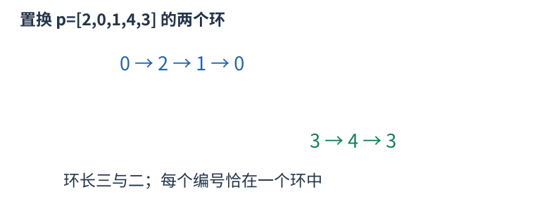

# CF1967A 先抬高最低频数，再增加不同的额外类型 题解

## 目录

| 题号 | 题名 | 考点 | 难度 |
|---|---|---|---|
| A | Permutation Counting | 二分答案 + 组合计数 + 贪心 | 1400 |

## A. Permutation Counting

> 原题：[CF1967A](https://www.luogu.com.cn/problem/CF1967A)
> 解法：先抬高最低频数，再增加不同的额外类型 · C++17

### 题意

可购买 $k$ 张任意类型卡片，重新排列全部卡片，最大化长度为 $n$ 且恰含每种类型一次的连续窗口数量。

<!-- reusable-foundations:start -->

### 从零讲：C++ 输入输出：把数据读进变量，把结果写到标准输出

程序运行时从标准输入接收题目给的数据，把答案送到标准输出。`cin` 和 `cout` 定义在 `<iostream>`；写 `using namespace std;` 后可以省略它们前面的 `std::`。最小完整程序是：

```cxx
#include <iostream>
using namespace std;
int main() {
    int a, b;
    cin >> a >> b;
    cout << a + b << '\n';
    return 0;
}
```

输入二十和三十，两个变量分别保存二十、三十，输出五十。`int a, b;` 声明两个整数变量；`cin >> a` 才给变量赋入输入值。多个 `>>` 从左到右读取，读取整数时会跳过空格、制表符、换行，所以两个整数可以分处两行。负号属于整数，不需要另读一个符号。

`cout <<` 后可以接数值、字符或字符串。`' '` 是一个空格字符，`'\n'` 是换行字符，`"Hello"` 是字符串。`cout << a << ' ' << b << '\n';` 输出两个以空格分开的整数并换行。评测程序只需要答案，不应加入“请输入”等提示。

读取 `char c; cin >> c;` 会跳过前导空白。要读取包含空格的一整行，用 `<string>` 中的 `string s; getline(cin, s);`。若此前用 `cin >> n` 读取过整数，换行还留在输入中，需要先处理那一个剩余换行；不能盲目把所有空格都删掉，因为字符画的行首空格和文本中的空格可能就是数据。

`fixed << setprecision(3)`（需要 `<iomanip>`）表示以小数形式保留三位小数，例如把 $2.5$ 输出成 $2.500$；不用 `fixed` 时，`setprecision` 指有效数字总数。设置会影响后续输出，使用前应确认所需精度。

竞赛中可在首次输入输出前调用 `ios::sync_with_stdio(false); cin.tie(nullptr);`，减少 C++ 流与 C 标准输入输出的同步、绑定开销。随后保持使用 `cin/cout`，不要混用另一套 `scanf/printf`。交互题还要在需要对方回应前主动刷新，例如 `cout << query << endl;`；普通题用换行字符即可。

读入长度为 $L$ 的文本、或输出 $L$ 个字符，至少需要 $O(L)$ 时间。数据类型仍要能容纳结果：把两个整数相乘时，即使保存到 `long long`，也要让乘法本身在这个类型中进行，例如先把输入声明为 `long long`。

### 从零讲：分支与循环：按条件选择，按次序重复

`if (条件) { ... } else { ... }` 根据条件的真假选择一条分支。比较运算 `==`、`!=`、`<`、`<=`、`>`、`>=` 返回真假值；`=` 是赋值，不能代替相等比较。`&&` 表示两边都成立，`||` 表示至少一边成立，`!` 把真假反转。

```cxx
int score = 85;
if (score >= 90) cout << "A";
else if (score >= 60) cout << "B";
else cout << "C"; // 这个例子输出 B
```

这条分支链只执行第一个符合条件的分支。先处理高分后，第二个条件自然只会接到低于九十分的数。几个独立的 `if` 则可能执行多次；两种结构代表不同问题。逻辑运算会短路：`i < n && a[i] == 0` 先确认下标合法，才读取那一格。

`for (初始化; 继续条件; 每轮更新)` 适合知道重复范围的情况。例如下列代码依次处理一到四，总和是十：

```cxx
int sum = 0;
for (int i = 1; i <= 4; ++i) {
    sum += i;
}
cout << sum;
```

初始化只做一次；每轮先判断条件，条件为真才执行循环体，随后执行更新。`++i` 把 $i$ 加一，`sum += i` 等价于把旧 sum 加 $i$ 再保存。应明确每个变量在循环前、循环后分别表示什么；最大值相同时是否更新，决定了保留较早还是较晚的答案。

`while (条件)` 适合“不满足目标就再做一步”：

```cxx
int x = 13, times = 0;
while (x > 1) {
    x /= 2;
    ++times;
}
// x 依次是 13、6、3、1，执行三次
```

循环开始前先检查条件，初始已满足目标时可能一次也不执行。每次执行必须推进状态，否则可能无限循环。`break` 结束最内层循环，`continue` 跳过本轮剩余部分；`for` 中的 continue 之后仍会执行每轮更新。

复杂度由实际执行次数决定。上述求和执行 $n$ 次是 $O(n)$；每次将正整数减半只执行 $O(\log n)$ 次。两层循环不能仅凭外观判定为平方：内层若总共只前进 $n$ 次，总量仍可能线性。变量应在正确作用范围初始化；多组数据的计数器若未重置，下一组会错误继承上一组结果。

### 从零讲：vector：长度可变的连续数组

`vector<T>` 保存一串同类型的元素，适合按下标访问、扫描、排序。`T` 是元素类型，例如 `vector<int>` 保存整数，`vector<pair<int,int>>` 保存整数对，`vector<vector<int>>` 可保存每个顶点各自的邻居。需要 `<vector>`。

```cxx
vector<int> a(3, 7);   // 三个元素，内容是 7、7、7
a.push_back(9);       // 在末尾追加，现在长度为 4
int x = a[1];         // 从 0 编号，这里得到 7
a[1] = 2;            // 改第二个元素
int n = int(a.size());
```

`vector<int> a(3)` 创建三个值为零的元素；`a.reserve(3)` 只预留容量，元素数仍为零，此时不能访问 `a[0]`。长度 `size()` 与容量 `capacity()` 是不同概念。

下标访问为 $O(1)$，遍历为 $O(n)$。末尾追加通常为 $O(1)$；容量不足时会分配更大的连续空间并搬移元素，这次可能为 $O(n)$，一连串追加的平均成本称为摊还 $O(1)$。中间插入或删除会搬移后续元素，最坏 $O(n)$。内存是元素量的 $O(n)$，并可能预留部分尚未使用的容量。

`begin()` 指向首元素，`end()` 指向尾后位置，`sort(a.begin(),a.end())` 操作整个数组。`a[i]` 不检查越界；下标须满足 $0\le i<\mathrm{size}$。`at(i)` 会检查越界并抛异常。空数组不能访问 `front()`、`back()`；`pop_back()` 也要求非空。

扩容后指向旧存储的迭代器、引用和指针会失效。遍历的同时 `push_back`，不能假定此前取得的引用仍可用。读取大数组的函数常用 `const vector<int>& a` 按常量引用传入，既不复制也禁止通过该引用修改；`vector<int> a` 按值传参则复制内容。选择副本还是引用取决于是否要保留独立数据。

### 从零讲：整数类型、整除与溢出

计算前先看每一步可能达到的范围。常见环境中 `int` 是 32 位，上界约 $2.1\times10^9$；`long long` 至少 64 位，常见有符号 64 位上界约 $9.22\times10^{18}$。`using ll = long long;` 只是为已有类型起别名。

```cxx
int a = 100000, b = 100000;
long long wrong = a * b;      // 右边先按 int 乘，可能已溢出
long long right = 1LL * a * b; // 先把运算提升到 long long
```

不能指望“接收结果的变量够大”修复此前已经溢出的计算。先提高操作数类型，再做乘法。超过 64 位时，GCC 的 `__int128` 可作中间量，但它不是标准 C++17 类型，也没有标准流输出重载；先证明范围，再选择工具。

整数 `/` 对有符号数向零截断：`7/3==2`、`-7/3==-2`。对非负数才等于向下取整。余数满足 `a == (a/b)*b + a%b`，除数不能为零；要将余数归入 $[0,m-1]$（$m>0$），可用 `(a % m + m) % m`，同时保证中间加法不溢出。

非负 $a$、正 $b$ 的向上取整可写 `a/b + (a%b != 0)`，比 `(a+b-1)/b` 更容易避免加法溢出。比较平方时也应在宽类型内计算；浮点数不适合作为大整数相等的默认判断方式。

`size()` 返回无符号类型。空容器上写 `size()-1` 会绕到很大的数，逆序遍历可以先转成有符号、确认长度，或使用逆向迭代器。`abs` 对最小有符号数无法在同类型中表达其正值，需先约束输入差值范围。一般机器整数运算按常数时间估算，宽类型解决表示范围，不改变算法的增长阶。

### 从零讲：二分答案：在单调的可行性分界处找最优值

当直接求最小答案困难，但给定候选值后可以检查是否可行，可以把优化问题转成判定。前提是可行性只有一道分界，而不是来回变化。

例如要容纳总量十三，每个容器最多装 $c$，只有三个容器。判定为 $\lceil13/c\rceil\le3$。容量三、四不可行，容量五、六及更大都可行，因为增大容量不会让已有装法失效。


要找最小可行值，可维护闭区间内仍可能的答案：

```cxx
int left = 1, right = 13; // 已知答案在此范围，right 可行
while (left < right) {
    int mid = left + (right - left) / 2;
    if (check(mid)) right = mid;
    else left = mid + 1;
}
int answer = left;
```

中点可行时，最优答案可能就是中点或更小，因此保留它；中点不可行时，所有更小值都不行，排除到中点为止。候选范围每轮缩半。若一次检查为 $T$，总时间为 $O(T\log R)$，$R$ 是初始候选数；额外空间来自检查函数和常数个边界。

开始前分别证明单调性、上下界和确有解。若上界也不可行，不能把二分最后停下的位置当作合法答案。求最大可行值时分界方向和取中点方式要配合修改。判定中的除法、乘法也可能溢出；非负向上整除可以写 `a/b+(a%b!=0)`。

二分不负责证明 `check` 正确，也不能降低一次检查本身的复杂度。与有序数组上的边界函数相比，这里的“数组”是候选答案的概念序列，不必真正生成所有候选。

### 从零讲：计数：先确定一个方案包含哪些选择

加法用于互斥类别，乘法用于逐步选择，除法用于消除确切的重复。公式每一项都应能对应一个实际对象，不能只凭“看起来有几个位置”相乘。

三个人中选两人且指定先后：第一人三种选择，第二人只能从剩下两人中选，得到六种。若只选一个无序小组，AB 和 BA 表示同组，每组恰数两次，除以二得到三组。


一般地，$n$ 个不同对象选 $k$ 个且排序有 $n(n-1)\cdots(n-k+1)$ 种；不区分内部顺序，恰有 $k!$ 个排列表示同一子集，所以

$$\binom nk=\frac{n!}{k!(n-k)!}.$$

这个除法成立依赖“每个最终对象被数同样多次”。若含相同元素、对称或禁用条件，重复倍数可能改变，要重新证明。比如组的内部无序和组之间无序是两种不同的对称性，不应混成一句“除去重复”。

互相独立不是乘法原则唯一的表述；逐步计数只需每种前序选择都有相同数量的后续选择。若后续数量随前序变化，就应分别计算后求和。

在模数下计算组合数时，普通整数除法不能直接替代分母逆元。若用阶乘和逆阶乘，须满足逆元存在等前提。答案可能指数增长，先确定取模或大整数方式；数值范围也决定预处理是否可行。

### 从零讲：贪心：先证明当前选择不会丢掉最优解

贪心每一步确定一个局部选择，不再撤回。它能省去搜索，但必须解释为什么始终存在一个最优方案也做这个选择。

例如选择最多个互不重叠的活动（这里允许后一活动起点等于前一活动终点）。每次选结束最早的活动：若最优方案的首项结束更晚，把它换成最早结束者，后续原本能接的活动仍能接，数量不变。这就是交换论证；换完首项，剩余问题仍为同类问题。


实现时按结束时间升序排序，维护上一次选中活动的结束时刻，依次选合法项。排序 $O(n\log n)$，扫描 $O(n)$，保存活动为 $O(n)$。若题目不允许端点相接，判断须从大于等于改成严格大于。

“选最长”“选价值最高”“选最靠左”都是不同策略。没有交换、支配关系或不变量的依据，不能只凭排序键直觉宣布正确。比如有容量和价值的物品选择，眼前价值最高者可能挡住两个总价值更高的小物品。

写题解时说明被替换的是哪一项、替换后什么约束仍满足、目标为何不变差，并说明余下状态为何允许重复同样论证。若选择还影响未保存的条件，就可能需要更丰富的状态或动态规划。

### 从零讲：置换环：沿“去哪里”把编号分组

置换把 $0$ 到 $n-1$ 每个编号恰好映射到一个不同编号。画边 $i\to p_i$，每个顶点入度、出度都为一，沿边最终回到起点，整个图分解成互不相交的环。

例如 $p=[2,0,1,4,3]$，有环 $0\to2\to1\to0$ 和 $3\to4\to3$，长度分别为三、二。



```cxx
vector<bool> seen(n, false);
for (int start = 0; start < n; ++start) if (!seen[start]) {
    int u = start, length = 0;
    do { seen[u] = true; ++length; u = p[u]; } while (!seen[u]);
    // length 是这个环的长度
}
```

每个编号访问一次，时间 $O(n)$、标记空间 $O(n)$。同一个环上执行 $k$ 次置换，等价于沿环前进 `k % length` 步，可以处理远超数组长度的重复次数。

固定点是长度一的环，不能漏掉。若数组存在重复值或映射到范围外，它不一定是置换；普通函数图可能有树枝进入环，不能用“每点都在环上”来证明。通过交换恢复排列时，长度为 L 的环最少需 L-1 次任意两点交换，前提是允许任意交换；限制相邻或颜色时要重新分析合法操作。

<!-- reusable-foundations:end -->

### 思路

若每种类型各有 $h$ 张，把同一个排列连续重复 $h$ 遍，就有 $hn-n+1$ 个合法窗口：相邻窗口移出与移入的类型相同。若另有 $z$ 种类型各多一张，把这 $z$ 种排在周期排列的开头，再在末尾接它们的一份前缀，还能增加 $z$ 个合法窗口。

![初始数量 [3,2,2]，再买一张二。每条线覆盖的三格恰含一、二、三，不是在数不相邻的选法。](assets/core7/CF1967A.svg)

初始数量 [3,2,2]，再买一张二。每条线覆盖的三格恰含一、二、三，不是在数不相邻的选法。

这个构造已经最优。固定各类型数量，设最低频数为 $h$，有 r0 种类型恰好 $h$ 张。选这些最低频类型中“第一张出现得最早”的类型 X。含 X 第一张的合法窗口还必须覆盖其它 $r0-1$ 种最低频类型的第一张，它们都在 X 第一张右边，至少跨 $r0-1$ 个位置，所以这样的窗口至多 $n-r0+1$ 个。X 其余 $h-1$ 张每张至多属于 $n$ 个窗口，而每个合法窗口恰有一张 X，因此总数至多 $hn-r0+1=(h-1)n+1+z$，其中 $z=n-r0$。

因此优先让最低频数尽量大：最低频数为 $h-1$ 的任何方案分数至多 $(h-1)n$，而最低频数 $h$ 即使没有额外卡也能得 $(h-1)n+1$，严格更好。补齐到 $h$ 的代价是 $\sum \max(0, h-a[i])$，随 $h$ 单调增加，可二分最大可行 $h$，范围从原最小频数到原最小频数加 $k$。

补齐后，原本 $a[i]>h$ 的类型已经有额外卡；剩余每枚钱应让一个恰好 $h$ 张的类型再多一张。因为 $h$ 已最大，剩钱必不足以把全部最低频类型都提升，否则还能补到 $h+1$，所以新增类型数正好是剩钱 $r$。代入构造与上界即得公式。多余卡可以放在构造块之外，不会减少块内已有窗口。计数、代价和乘积全部用 long long。

时间 $O(n\log(k+2))$、空间 $O(n)$。

### 参考代码

```cpp
#include <bits/stdc++.h>
using namespace std;

int main() {
    ios::sync_with_stdio(false);
    cin.tie(nullptr);
int tests;cin>>tests;while(tests--){int n;long long k;cin>>n>>k;vector<long long>a(n);long long minimum=LLONG_MAX;
    for(auto &x:a){cin>>x;minimum=min(minimum,x);}long long lo=minimum,hi=minimum+k;
    while(lo<hi){long long mid=lo+(hi-lo+1)/2,cost=0;for(long long x:a){if(x<mid)cost+=mid-x;if(cost>k)break;}
        if(cost<=k)lo=mid;else hi=mid-1;
    }
    // 先抬满最低频数，余钱再给不同的最低频类型。
    long long used=0,extra=0;for(long long x:a){if(x<lo)used+=lo-x;else if(x>lo)++extra;}
    cout<<(lo-1)*n+1+extra+(k-used)<<'\n';
}
    return 0;
}
```

### 易错点

最大化的是滑动窗口数；先最大化最低频数，再把余钱分给不同的最低频类型。

## 实测记录

本地 C++17 编译、1 组原站样例与 2 组独立边界/小域校验通过。
正文参考程序与源码逐字核对；没有向原站提交。
