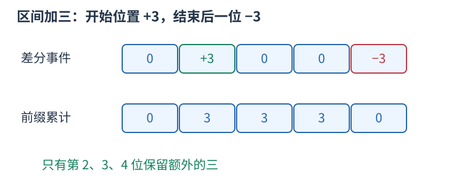
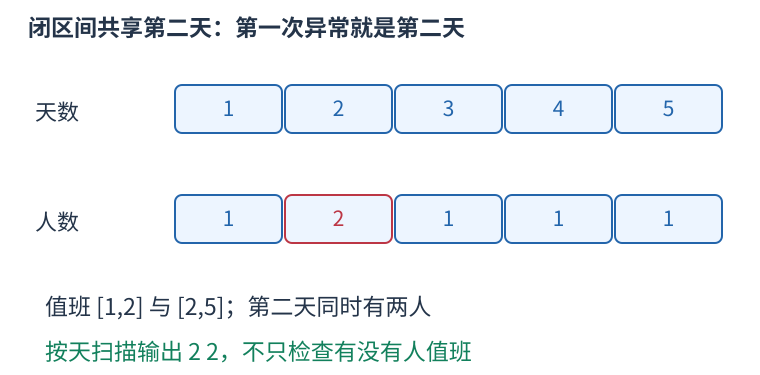

# CF44C 区间差分还原每天人数，顺序找第一次异常 题解

## 目录

| 题号 | 题名 | 考点 | 难度 |
|---|---|---|---|
| A | Holidays | 差分 + 前缀和 | 1300 |

## A. Holidays

> 原题：[CF44C](https://www.luogu.com.cn/problem/CF44C)
> 解法：区间差分还原每天人数，顺序找第一次异常 · C++17

### 题意

每人负责一个闭区间，要求每天恰好浇水一次；输出最早不符合的天数与当天实际次数，全部正常则输出OK。

<!-- reusable-foundations:start -->

### 从零讲：C++ 输入输出：把数据读进变量，把结果写到标准输出

程序运行时从标准输入接收题目给的数据，把答案送到标准输出。`cin` 和 `cout` 定义在 `<iostream>`；写 `using namespace std;` 后可以省略它们前面的 `std::`。最小完整程序是：

```cxx
#include <iostream>
using namespace std;
int main() {
    int a, b;
    cin >> a >> b;
    cout << a + b << '\n';
    return 0;
}
```

输入二十和三十，两个变量分别保存二十、三十，输出五十。`int a, b;` 声明两个整数变量；`cin >> a` 才给变量赋入输入值。多个 `>>` 从左到右读取，读取整数时会跳过空格、制表符、换行，所以两个整数可以分处两行。负号属于整数，不需要另读一个符号。

`cout <<` 后可以接数值、字符或字符串。`' '` 是一个空格字符，`'\n'` 是换行字符，`"Hello"` 是字符串。`cout << a << ' ' << b << '\n';` 输出两个以空格分开的整数并换行。评测程序只需要答案，不应加入“请输入”等提示。

读取 `char c; cin >> c;` 会跳过前导空白。要读取包含空格的一整行，用 `<string>` 中的 `string s; getline(cin, s);`。若此前用 `cin >> n` 读取过整数，换行还留在输入中，需要先处理那一个剩余换行；不能盲目把所有空格都删掉，因为字符画的行首空格和文本中的空格可能就是数据。

`fixed << setprecision(3)`（需要 `<iomanip>`）表示以小数形式保留三位小数，例如把 $2.5$ 输出成 $2.500$；不用 `fixed` 时，`setprecision` 指有效数字总数。设置会影响后续输出，使用前应确认所需精度。

竞赛中可在首次输入输出前调用 `ios::sync_with_stdio(false); cin.tie(nullptr);`，减少 C++ 流与 C 标准输入输出的同步、绑定开销。随后保持使用 `cin/cout`，不要混用另一套 `scanf/printf`。交互题还要在需要对方回应前主动刷新，例如 `cout << query << endl;`；普通题用换行字符即可。

读入长度为 $L$ 的文本、或输出 $L$ 个字符，至少需要 $O(L)$ 时间。数据类型仍要能容纳结果：把两个整数相乘时，即使保存到 `long long`，也要让乘法本身在这个类型中进行，例如先把输入声明为 `long long`。

### 从零讲：分支与循环：按条件选择，按次序重复

`if (条件) { ... } else { ... }` 根据条件的真假选择一条分支。比较运算 `==`、`!=`、`<`、`<=`、`>`、`>=` 返回真假值；`=` 是赋值，不能代替相等比较。`&&` 表示两边都成立，`||` 表示至少一边成立，`!` 把真假反转。

```cxx
int score = 85;
if (score >= 90) cout << "A";
else if (score >= 60) cout << "B";
else cout << "C"; // 这个例子输出 B
```

这条分支链只执行第一个符合条件的分支。先处理高分后，第二个条件自然只会接到低于九十分的数。几个独立的 `if` 则可能执行多次；两种结构代表不同问题。逻辑运算会短路：`i < n && a[i] == 0` 先确认下标合法，才读取那一格。

`for (初始化; 继续条件; 每轮更新)` 适合知道重复范围的情况。例如下列代码依次处理一到四，总和是十：

```cxx
int sum = 0;
for (int i = 1; i <= 4; ++i) {
    sum += i;
}
cout << sum;
```

初始化只做一次；每轮先判断条件，条件为真才执行循环体，随后执行更新。`++i` 把 $i$ 加一，`sum += i` 等价于把旧 sum 加 $i$ 再保存。应明确每个变量在循环前、循环后分别表示什么；最大值相同时是否更新，决定了保留较早还是较晚的答案。

`while (条件)` 适合“不满足目标就再做一步”：

```cxx
int x = 13, times = 0;
while (x > 1) {
    x /= 2;
    ++times;
}
// x 依次是 13、6、3、1，执行三次
```

循环开始前先检查条件，初始已满足目标时可能一次也不执行。每次执行必须推进状态，否则可能无限循环。`break` 结束最内层循环，`continue` 跳过本轮剩余部分；`for` 中的 continue 之后仍会执行每轮更新。

复杂度由实际执行次数决定。上述求和执行 $n$ 次是 $O(n)$；每次将正整数减半只执行 $O(\log n)$ 次。两层循环不能仅凭外观判定为平方：内层若总共只前进 $n$ 次，总量仍可能线性。变量应在正确作用范围初始化；多组数据的计数器若未重置，下一组会错误继承上一组结果。

### 从零讲：vector：长度可变的连续数组

`vector<T>` 保存一串同类型的元素，适合按下标访问、扫描、排序。`T` 是元素类型，例如 `vector<int>` 保存整数，`vector<pair<int,int>>` 保存整数对，`vector<vector<int>>` 可保存每个顶点各自的邻居。需要 `<vector>`。

```cxx
vector<int> a(3, 7);   // 三个元素，内容是 7、7、7
a.push_back(9);       // 在末尾追加，现在长度为 4
int x = a[1];         // 从 0 编号，这里得到 7
a[1] = 2;            // 改第二个元素
int n = int(a.size());
```

`vector<int> a(3)` 创建三个值为零的元素；`a.reserve(3)` 只预留容量，元素数仍为零，此时不能访问 `a[0]`。长度 `size()` 与容量 `capacity()` 是不同概念。

下标访问为 $O(1)$，遍历为 $O(n)$。末尾追加通常为 $O(1)$；容量不足时会分配更大的连续空间并搬移元素，这次可能为 $O(n)$，一连串追加的平均成本称为摊还 $O(1)$。中间插入或删除会搬移后续元素，最坏 $O(n)$。内存是元素量的 $O(n)$，并可能预留部分尚未使用的容量。

`begin()` 指向首元素，`end()` 指向尾后位置，`sort(a.begin(),a.end())` 操作整个数组。`a[i]` 不检查越界；下标须满足 $0\le i<\mathrm{size}$。`at(i)` 会检查越界并抛异常。空数组不能访问 `front()`、`back()`；`pop_back()` 也要求非空。

扩容后指向旧存储的迭代器、引用和指针会失效。遍历的同时 `push_back`，不能假定此前取得的引用仍可用。读取大数组的函数常用 `const vector<int>& a` 按常量引用传入，既不复制也禁止通过该引用修改；`vector<int> a` 按值传参则复制内容。选择副本还是引用取决于是否要保留独立数据。

### 从零讲：整数类型、整除与溢出

计算前先看每一步可能达到的范围。常见环境中 `int` 是 32 位，上界约 $2.1\times10^9$；`long long` 至少 64 位，常见有符号 64 位上界约 $9.22\times10^{18}$。`using ll = long long;` 只是为已有类型起别名。

```cxx
int a = 100000, b = 100000;
long long wrong = a * b;      // 右边先按 int 乘，可能已溢出
long long right = 1LL * a * b; // 先把运算提升到 long long
```

不能指望“接收结果的变量够大”修复此前已经溢出的计算。先提高操作数类型，再做乘法。超过 64 位时，GCC 的 `__int128` 可作中间量，但它不是标准 C++17 类型，也没有标准流输出重载；先证明范围，再选择工具。

整数 `/` 对有符号数向零截断：`7/3==2`、`-7/3==-2`。对非负数才等于向下取整。余数满足 `a == (a/b)*b + a%b`，除数不能为零；要将余数归入 $[0,m-1]$（$m>0$），可用 `(a % m + m) % m`，同时保证中间加法不溢出。

非负 $a$、正 $b$ 的向上取整可写 `a/b + (a%b != 0)`，比 `(a+b-1)/b` 更容易避免加法溢出。比较平方时也应在宽类型内计算；浮点数不适合作为大整数相等的默认判断方式。

`size()` 返回无符号类型。空容器上写 `size()-1` 会绕到很大的数，逆序遍历可以先转成有符号、确认长度，或使用逆向迭代器。`abs` 对最小有符号数无法在同类型中表达其正值，需先约束输入差值范围。一般机器整数运算按常数时间估算，宽类型解决表示范围，不改变算法的增长阶。

### 从零讲：具名函数：给可复用计算一个明确接口

函数把一段计算包装成“输入参数 → 返回结果”。例如判断整数是否为偶数：

```cxx
bool even(int x) {
    return x % 2 == 0;
}
int main() {
    bool a = even(8); // a 为 true
    bool b = even(7); // b 为 false
}
```

`bool` 是返回类型，`even` 是函数名，`int x` 是参数声明。调用 `even(8)` 时，实参八传入这个新调用的局部变量 $x$，执行 return 后把真假值交回调用处。定义本身不执行计算，只有调用才执行。函数应在调用处之前定义，或提前写声明。

普通数值参数按值传递，函数里修改 $x$ 不会改变调用者原变量。参数写成 `int &x` 时才引用调用者对象；必须让这个对象在调用期间有效。`const vector<int>& a` 用引用避免复制整个容器，并承诺不通过这个引用修改它。返回局部变量的值是安全的，返回局部变量的引用则在函数结束后失效。

函数名应说明它回答的问题，调用处负责传哪些数据。例如闰年判定只接收一个年份并返回真假，枚举年份范围和输出格式由调用者处理。同一判定被多次使用时，这能减少规则不一致；但函数包装不会自动降低算法复杂度，仍要把每次调用实际做的工作计入时间。

如果函数内部又调用自身，就是递归，需要明确最小情况如何直接返回、每次调用如何逼近它；递归会占用调用栈。普通辅助函数可以不使用递归，不应仅因写成函数就称作递归算法。

### 从零讲：差分：把区间的变化写在两个边界

很多次操作都给一整段加同一个数，最后才需要所有位置的结果。逐项修改会重复扫描；差分只记录“从哪里开始多这一份、从哪里停止”。

定义 $D_1=a_1$，$D_i=a_i-a_{i-1}$。从左累计 $D$ 就能恢复 $a$。给闭区间 $[l,r]$ 加 $v$，仅需 $D_l$ 加 $v$、$D_{r+1}$ 减 $v$：第 $l$ 位开始，前缀多出 $v$；到第 $r+1$ 位，额外的一份被抵消。



例如五个零上给 $[2,4]$ 加三，差分事件为 $[0,3,0,0,-3]$，累计得到 $[0,3,3,3,0]$。两个标记不表示只修改了两个原元素。

```cxx
vector<long long> d(n + 2, 0);
d[l] += v;
d[r + 1] -= v;
long long current = 0;
for (int i = 1; i <= n; ++i) {
    current += d[i];
    // current 是该位置受到的总增量
}
```

$q$ 次区间加与最后恢复共 $O(n+q)$，空间 $O(n)$。如果初始数组非零，可先构造它的差分，或在恢复增量后加回原值。右边界要标在后一位，数组须留出 `n+1`；闭区间和半开区间的停止位置不能混用。

差分适合离线集中恢复。若每次操作后立刻查询任意位置，仅存差分并不能自动做到常数时间，需要动态前缀数据结构。坐标非常大但事件少时，应排序事件或离散化，不能按最大坐标盲目分配数组。

### 从零讲：前缀和：一段和由两段前缀相减

一串数需要反复询问连续一段的总和，逐段扫描会重复加很多相同元素。先保存从头到每个位置的累计量，就能复用这些工作。

对从一编号的数组定义 $S_0=0$，$S_i=a_1+\cdots+a_i$。例如 $a=[2,3,1,4]$，前缀为 $S=[0,2,5,6,10]$。


查询 $[2,4]$ 时，$S_4$ 包含第一个数，减去 $S_1$ 后留下 $3+1+4=8$。一般地，$S_r-S_{l-1}$ 中前 $l-1$ 项逐项抵消，只留下第 $l$ 到第 $r$ 项。

```cxx
vector<long long> s(n + 1, 0);
for (int i = 1; i <= n; ++i) s[i] = s[i - 1] + a[i];
long long sum = s[r] - s[l - 1];
```

预处理 $O(n)$ 时间和空间，每次查询 $O(1)$，比 $q$ 次逐段扫描的最坏 $O(nq)$ 更适合大量静态区间和。若使用从零编号的原数组，也可定义 $P_i$ 为前 $i$ 项之和，查询闭区间 $[l,r]$ 为 $P_{r+1}-P_l$；不要混用两套下标。

前缀可以累积满足条件的次数，把每项变成零或一；也可以保存异或，此时相同前缀通过异或抵消。最小值没有同样的可逆减法，不能直接套区间最小值。原数组改变后，后续许多前缀都受影响；频繁在线修改时可考虑树状数组或线段树。

首个空前缀零不可漏，累加类型要覆盖总和。数学上的减法可能得到负值，别让无符号类型把它变成巨大正数。

<!-- reusable-foundations:end -->

### 思路




一天的答案等于有多少个值班闭区间包含这一天。要求是恰好一次，既不能遗漏，也不能重复。

把一整段加一记录成两个事件：在左端$l$开始增加一名值班人，在$r$的后一天撤销这次增加。于是$difference[l]$加一，difference[r加一]减一；人数数组多开两格，允许最后一天之后的撤销事件。

从第一天向后维护count，先加当前天差分，再检查count是否为一。这样当前天的左端事件已生效，而当天结束的值班还没撤销，符合闭区间。

发现异常后立即输出天数和count并结束，保证返回最早者。第二个原样例同时存在重复和漏浇，仍应返回第二天的重复，不是优先报告人数为零。

输入虽按值班顺序排列，可能出现相邻区间共用同一天。无需依赖这个顺序或猜测相邻关系，差分直接统计所有贡献。全部天数恰好为一后，才输出大写OK。

时间 $O(n+m)$，空间 $O(n)$。

### 参考代码

```cpp
#include <bits/stdc++.h>
using namespace std;

int main() {
    ios::sync_with_stdio(false);
    cin.tie(nullptr);
int n,m;cin>>n>>m;vector<int>difference(n+2);
for(int i=0,l,r;i<m;++i){cin>>l>>r;++difference[l];--difference[r+1];}
int count=0;for(int day=1;day<=n;++day){count+=difference[day];if(count!=1){cout<<day<<' '<<count<<'\n';return 0;}}
cout<<"OK\n";
    return 0;
}
```

### 易错点

要求恰好一次；两个区间共享端点会重复；$r$的后一天撤销；先累加再判断；按天数找最早异常；无异常输出大写OK。

## 实测记录

本地 C++17 编译、3 组原站样例与 182 组独立边界/小域校验通过。
正文参考程序与源码逐字核对；没有向原站提交。
