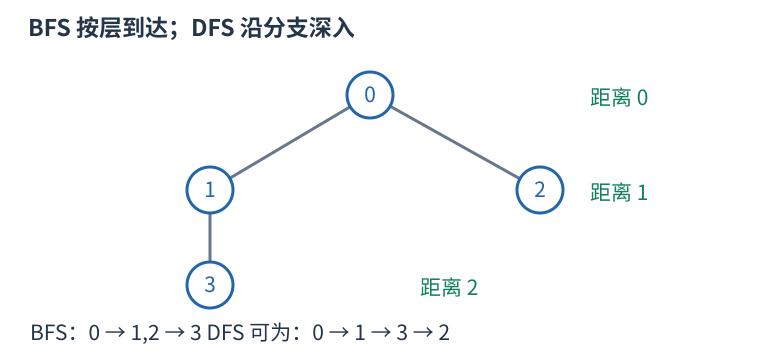
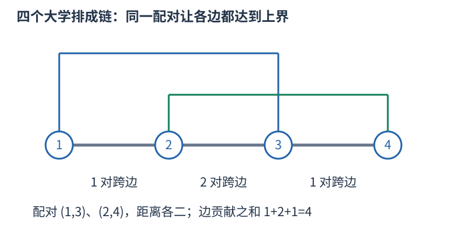

# CF700B 按每条边两侧的大学数累计最大跨边配对数 题解

## 目录

| 题号 | 题名 | 考点 | 难度 |
|---|---|---|---|
| A | Connecting Universities | 图论 + 贪心 + 结论与计数 | 1800 |

## A. Connecting Universities

> 原题：[CF700B](https://www.luogu.com.cn/problem/CF700B)
> 解法：按每条边两侧的大学数累计最大跨边配对数 · C++17

### 题意

树上有二倍 $k$ 所大学，把它们两两配对，每所恰用一次，最大化各对树上距离之和。每条边长度一。

<!-- reusable-foundations:start -->

### 从零讲：C++ 输入输出：把数据读进变量，把结果写到标准输出

程序运行时从标准输入接收题目给的数据，把答案送到标准输出。`cin` 和 `cout` 定义在 `<iostream>`；写 `using namespace std;` 后可以省略它们前面的 `std::`。最小完整程序是：

```cxx
#include <iostream>
using namespace std;
int main() {
    int a, b;
    cin >> a >> b;
    cout << a + b << '\n';
    return 0;
}
```

输入二十和三十，两个变量分别保存二十、三十，输出五十。`int a, b;` 声明两个整数变量；`cin >> a` 才给变量赋入输入值。多个 `>>` 从左到右读取，读取整数时会跳过空格、制表符、换行，所以两个整数可以分处两行。负号属于整数，不需要另读一个符号。

`cout <<` 后可以接数值、字符或字符串。`' '` 是一个空格字符，`'\n'` 是换行字符，`"Hello"` 是字符串。`cout << a << ' ' << b << '\n';` 输出两个以空格分开的整数并换行。评测程序只需要答案，不应加入“请输入”等提示。

读取 `char c; cin >> c;` 会跳过前导空白。要读取包含空格的一整行，用 `<string>` 中的 `string s; getline(cin, s);`。若此前用 `cin >> n` 读取过整数，换行还留在输入中，需要先处理那一个剩余换行；不能盲目把所有空格都删掉，因为字符画的行首空格和文本中的空格可能就是数据。

`fixed << setprecision(3)`（需要 `<iomanip>`）表示以小数形式保留三位小数，例如把 $2.5$ 输出成 $2.500$；不用 `fixed` 时，`setprecision` 指有效数字总数。设置会影响后续输出，使用前应确认所需精度。

竞赛中可在首次输入输出前调用 `ios::sync_with_stdio(false); cin.tie(nullptr);`，减少 C++ 流与 C 标准输入输出的同步、绑定开销。随后保持使用 `cin/cout`，不要混用另一套 `scanf/printf`。交互题还要在需要对方回应前主动刷新，例如 `cout << query << endl;`；普通题用换行字符即可。

读入长度为 $L$ 的文本、或输出 $L$ 个字符，至少需要 $O(L)$ 时间。数据类型仍要能容纳结果：把两个整数相乘时，即使保存到 `long long`，也要让乘法本身在这个类型中进行，例如先把输入声明为 `long long`。

### 从零讲：分支与循环：按条件选择，按次序重复

`if (条件) { ... } else { ... }` 根据条件的真假选择一条分支。比较运算 `==`、`!=`、`<`、`<=`、`>`、`>=` 返回真假值；`=` 是赋值，不能代替相等比较。`&&` 表示两边都成立，`||` 表示至少一边成立，`!` 把真假反转。

```cxx
int score = 85;
if (score >= 90) cout << "A";
else if (score >= 60) cout << "B";
else cout << "C"; // 这个例子输出 B
```

这条分支链只执行第一个符合条件的分支。先处理高分后，第二个条件自然只会接到低于九十分的数。几个独立的 `if` 则可能执行多次；两种结构代表不同问题。逻辑运算会短路：`i < n && a[i] == 0` 先确认下标合法，才读取那一格。

`for (初始化; 继续条件; 每轮更新)` 适合知道重复范围的情况。例如下列代码依次处理一到四，总和是十：

```cxx
int sum = 0;
for (int i = 1; i <= 4; ++i) {
    sum += i;
}
cout << sum;
```

初始化只做一次；每轮先判断条件，条件为真才执行循环体，随后执行更新。`++i` 把 $i$ 加一，`sum += i` 等价于把旧 sum 加 $i$ 再保存。应明确每个变量在循环前、循环后分别表示什么；最大值相同时是否更新，决定了保留较早还是较晚的答案。

`while (条件)` 适合“不满足目标就再做一步”：

```cxx
int x = 13, times = 0;
while (x > 1) {
    x /= 2;
    ++times;
}
// x 依次是 13、6、3、1，执行三次
```

循环开始前先检查条件，初始已满足目标时可能一次也不执行。每次执行必须推进状态，否则可能无限循环。`break` 结束最内层循环，`continue` 跳过本轮剩余部分；`for` 中的 continue 之后仍会执行每轮更新。

复杂度由实际执行次数决定。上述求和执行 $n$ 次是 $O(n)$；每次将正整数减半只执行 $O(\log n)$ 次。两层循环不能仅凭外观判定为平方：内层若总共只前进 $n$ 次，总量仍可能线性。变量应在正确作用范围初始化；多组数据的计数器若未重置，下一组会错误继承上一组结果。

### 从零讲：vector：长度可变的连续数组

`vector<T>` 保存一串同类型的元素，适合按下标访问、扫描、排序。`T` 是元素类型，例如 `vector<int>` 保存整数，`vector<pair<int,int>>` 保存整数对，`vector<vector<int>>` 可保存每个顶点各自的邻居。需要 `<vector>`。

```cxx
vector<int> a(3, 7);   // 三个元素，内容是 7、7、7
a.push_back(9);       // 在末尾追加，现在长度为 4
int x = a[1];         // 从 0 编号，这里得到 7
a[1] = 2;            // 改第二个元素
int n = int(a.size());
```

`vector<int> a(3)` 创建三个值为零的元素；`a.reserve(3)` 只预留容量，元素数仍为零，此时不能访问 `a[0]`。长度 `size()` 与容量 `capacity()` 是不同概念。

下标访问为 $O(1)$，遍历为 $O(n)$。末尾追加通常为 $O(1)$；容量不足时会分配更大的连续空间并搬移元素，这次可能为 $O(n)$，一连串追加的平均成本称为摊还 $O(1)$。中间插入或删除会搬移后续元素，最坏 $O(n)$。内存是元素量的 $O(n)$，并可能预留部分尚未使用的容量。

`begin()` 指向首元素，`end()` 指向尾后位置，`sort(a.begin(),a.end())` 操作整个数组。`a[i]` 不检查越界；下标须满足 $0\le i<\mathrm{size}$。`at(i)` 会检查越界并抛异常。空数组不能访问 `front()`、`back()`；`pop_back()` 也要求非空。

扩容后指向旧存储的迭代器、引用和指针会失效。遍历的同时 `push_back`，不能假定此前取得的引用仍可用。读取大数组的函数常用 `const vector<int>& a` 按常量引用传入，既不复制也禁止通过该引用修改；`vector<int> a` 按值传参则复制内容。选择副本还是引用取决于是否要保留独立数据。

### 从零讲：整数类型、整除与溢出

计算前先看每一步可能达到的范围。常见环境中 `int` 是 32 位，上界约 $2.1\times10^9$；`long long` 至少 64 位，常见有符号 64 位上界约 $9.22\times10^{18}$。`using ll = long long;` 只是为已有类型起别名。

```cxx
int a = 100000, b = 100000;
long long wrong = a * b;      // 右边先按 int 乘，可能已溢出
long long right = 1LL * a * b; // 先把运算提升到 long long
```

不能指望“接收结果的变量够大”修复此前已经溢出的计算。先提高操作数类型，再做乘法。超过 64 位时，GCC 的 `__int128` 可作中间量，但它不是标准 C++17 类型，也没有标准流输出重载；先证明范围，再选择工具。

整数 `/` 对有符号数向零截断：`7/3==2`、`-7/3==-2`。对非负数才等于向下取整。余数满足 `a == (a/b)*b + a%b`，除数不能为零；要将余数归入 $[0,m-1]$（$m>0$），可用 `(a % m + m) % m`，同时保证中间加法不溢出。

非负 $a$、正 $b$ 的向上取整可写 `a/b + (a%b != 0)`，比 `(a+b-1)/b` 更容易避免加法溢出。比较平方时也应在宽类型内计算；浮点数不适合作为大整数相等的默认判断方式。

`size()` 返回无符号类型。空容器上写 `size()-1` 会绕到很大的数，逆序遍历可以先转成有符号、确认长度，或使用逆向迭代器。`abs` 对最小有符号数无法在同类型中表达其正值，需先约束输入差值范围。一般机器整数运算按常数时间估算，宽类型解决表示范围，不改变算法的增长阶。

### 从零讲：图的表示、BFS 与 DFS

图由顶点与边组成，适合表达“哪些对象之间能一步到达”。有向边只允许一个方向；无向边需保存两个方向。邻接表 `vector<vector<int>> graph(n)` 为每个顶点保存邻居，空间 $O(n+m)$，无向边在表中出现两次。

以边 $0-1,0-2,1-3$ 为例，从零出发：



#### BFS 为什么得到最少边数

初始顶点距离为零，入先进先出的队列。弹出顶点时，将尚未到达的邻居距离设为当前距离加一，并立刻标记入队。距离为一的顶点都会先于距离为二的处理，因此第一次发现就是最少边数。

```cxx
vector<int> distance(n, -1);
queue<int> q;
distance[start] = 0; q.push(start);
while (!q.empty()) {
    int u = q.front(); q.pop();
    for (int v : graph[u]) if (distance[v] == -1) {
        distance[v] = distance[u] + 1;
        q.push(v);
    }
}
```

适用于无权或所有边代价相同的最少步数。边权不同，第一次发现未必费用最小，不能继续套这一结论。多起点 BFS 先把所有合法起点设零并入队。

#### DFS 的调用代表一整块未探索区域

DFS 标记当前点后，递归处理每个尚未访问的邻点；也可用显式栈。上例可能按 $0,1,3,2$ 的顺序深入，但顺序取决于邻居存放方式。它擅长检查连通性、处理子树和回溯，不保证最短路径。

两种遍历在每个顶点入队或调用一次、每条边检查常数次的实现下，时间均为 $O(n+m)$，额外标记和队列/栈为 $O(n)$。不要等出队才首次标记，否则同一顶点可能重复入队。图不连通时，从一个起点无法覆盖所有点；统计连通块应从每个尚未访问点再启动一次遍历。树的深递归可能用尽调用栈。

### 从零讲：树的根、子树、DFS 序与倍增

树是连通且无环的无向图，$n$ 个顶点有 $n-1$ 条边。指定一个根后，每个非根顶点有唯一父亲，其他向下邻居是孩子。子树包含自己和全部后代；换根会改变父子关系，但不改变原边。


#### 子树信息按依赖顺序计算

例如子树大小 `size[u]` 初始为一，每个孩子处理完后累加 `size[v]`。一来自节点自己，不能漏掉。树形 DP 也如此：先明确某状态允许怎样选择，再合并各孩子提供的信息；孩子独立性来自树上没有跨子树边，仍可能因总预算或选中父亲等条件产生状态关联。

换根 DP 先求一个根的状态，再沿边换根，将“来自孩子的一侧”和“来自父亲的一侧”合并。应画清只有哪条边的方向改变、哪些量不变；不能仅凭两张答案表代替依赖解释。普通遍历每条边常数次为 $O(n)$，背包式合并可能更大，按实际合并循环计算。

#### DFS 序为什么能把子树变成区间

进入节点时分配编号 `tin[u]`，完成整棵子树后记录最后编号 `tout[u]`。深度优先在返回父亲前会完整处理这棵子树，因此它的所有编号连续，恰是 $[tin[u],tout[u]]$。这允许把子树和等查询交给数组结构。若同时记录进出事件，区间定义会不同，不可混用两种序列。

#### 倍增与最近公共祖先

`up[k][u]` 存 $u$ 向上 $2^k$ 条边到达的祖先。基础 `up[0][u]=parent[u]`，递推为 `up[k][u]=up[k-1][up[k-1][u]]`，因为连续走两段 $2^{k-1}$。跳十三层可拆为八加四加一，只需对数个跳跃。

LCA 是两个节点公共祖先中最深者。先把更深的一方跳到同深度；若已经相同就是答案。否则从大到小试跳，祖先不同才两边同时上移，最后它们的父亲就是 LCA。预处理 $O(n\log n)$、每次查询 $O(\log n)$，表空间 $O(n\log n)$。根的虚拟祖先需统一定义，不能访问非法下标。

树的直径在非负无权边长等常见条件下可用两次最远点搜索求出；带负权时要重新判断。虚树则将关注节点按 DFS 序组织，补上相邻节点的 LCA 后连接祖先关系，边应携带原路径含义，不能把压缩后一条边误当原图一步。深链上的递归也须留意栈深度。

### 从零讲：pair、tuple 与结构化绑定

有些数据天然需要成组：一个区间有两个端点，一个队列状态有坐标和距离。`pair<A,B>` 保存两项，用 `.first`、`.second` 读取；`tuple<A,B,C>` 可保存更多项，用 `get<0>(t)` 等读取。分别需要 `<utility>`、`<tuple>`。

C++17 的结构化绑定能为一组分量起局部名字：

```cxx
pair<int,int> point{3, 5};
auto [x, y] = point;      // 复制出两个分量
x = 9;                  // point.first 仍为 3
auto& [u, v] = point;    // 绑定原对象的分量
u = 7;                  // point.first 变为 7
```

`for (auto [l,r] : segments)` 每轮读取一对值；`for (const auto& [l,r] : segments)` 以只读引用读取，避免复制；需要修改原记录时才用 `auto&`。引用必须在原对象还存在且位置未失效时使用。

`pair` 和 `tuple` 的默认比较是字典序：从第一项起，第一个不同的分量决定顺序。`priority_queue<pair<int,int>>` 因而先比较第一项，再以第二项破同分，不能误认为只看第一项。这类语法只让记录组织和访问更清楚，拆分本身的成本取决于分量是否需要复制。

### 从零讲：贪心：先证明当前选择不会丢掉最优解

贪心每一步确定一个局部选择，不再撤回。它能省去搜索，但必须解释为什么始终存在一个最优方案也做这个选择。

例如选择最多个互不重叠的活动（这里允许后一活动起点等于前一活动终点）。每次选结束最早的活动：若最优方案的首项结束更晚，把它换成最早结束者，后续原本能接的活动仍能接，数量不变。这就是交换论证；换完首项，剩余问题仍为同类问题。


实现时按结束时间升序排序，维护上一次选中活动的结束时刻，依次选合法项。排序 $O(n\log n)$，扫描 $O(n)$，保存活动为 $O(n)$。若题目不允许端点相接，判断须从大于等于改成严格大于。

“选最长”“选价值最高”“选最靠左”都是不同策略。没有交换、支配关系或不变量的依据，不能只凭排序键直觉宣布正确。比如有容量和价值的物品选择，眼前价值最高者可能挡住两个总价值更高的小物品。

写题解时说明被替换的是哪一项、替换后什么约束仍满足、目标为何不变差，并说明余下状态为何允许重复同样论证。若选择还影响未保存的条件，就可能需要更丰富的状态或动态规划。

### 从零讲：计数：先确定一个方案包含哪些选择

加法用于互斥类别，乘法用于逐步选择，除法用于消除确切的重复。公式每一项都应能对应一个实际对象，不能只凭“看起来有几个位置”相乘。

三个人中选两人且指定先后：第一人三种选择，第二人只能从剩下两人中选，得到六种。若只选一个无序小组，AB 和 BA 表示同组，每组恰数两次，除以二得到三组。


一般地，$n$ 个不同对象选 $k$ 个且排序有 $n(n-1)\cdots(n-k+1)$ 种；不区分内部顺序，恰有 $k!$ 个排列表示同一子集，所以

$$\binom nk=\frac{n!}{k!(n-k)!}.$$

这个除法成立依赖“每个最终对象被数同样多次”。若含相同元素、对称或禁用条件，重复倍数可能改变，要重新证明。比如组的内部无序和组之间无序是两种不同的对称性，不应混成一句“除去重复”。

互相独立不是乘法原则唯一的表述；逐步计数只需每种前序选择都有相同数量的后续选择。若后续数量随前序变化，就应分别计算后求和。

在模数下计算组合数时，普通整数除法不能直接替代分母逆元。若用阶乘和逆阶乘，须满足逆元存在等前提。答案可能指数增长，先确定取模或大整数方式；数值范围也决定预处理是否可行。

<!-- reusable-foundations:end -->

### 思路

先固定一条边。大学的一对端点若位于不同侧，它们的唯一路径经过这条边一次；位于同侧就不会经过。因此总距离等于每条边被多少对路径经过的次数之和。



灰线是原树边，蓝绿折线只是标出配对的端点；每条实际路径仍沿原链走，不能把折线长度当距离。

边两侧有 $c$ 与 $2k-c$ 所大学，每条跨边配对消耗两侧各一个端点，所以跨边数不可能超过较少的一侧，即 $\min(c, 2k-c)$。但只写出各边上界还不够，需要证明这些上界能同时取到。

把大学按一趟 DFS 中出现的顺序编号零到 $2k-1$，放在一个圆环上，编号 $i$ 与 $i+k$ 配对，其中 $i$ 从零到 $k-1$。DFS 中每棵子树的大学构成一个连续区间；圆环上它的补集同样是连续弧。对任意一条边，大学较少的一侧对应长度不超过 $k$ 的连续弧，里面不可能同时含相隔 $k$ 位的一对端点。因此这一侧每所大学都与外侧配对，恰有 $\min(c, 2k-c)$ 对跨边。

同一份“相隔 $k$ 位”配对满足所有子树边的论证，因此各边上界之和确实可达到，而不只是松的上界。程序只需输出最大值，无须实际构造配对，也就不必真的保存这趟大学 DFS 序。

实现用任意根的一份父先子后遍历顺序，逆序把每个子节点的大学数加到父亲。根没有父边，不累加根的贡献。$n$ 可达二十万，显式遍历避免递归深链溢栈，答案使用 long long。

时间、空间均为 $O(n)$。

### 参考代码

```cpp
#include <bits/stdc++.h>
using namespace std;

int main() {
    ios::sync_with_stdio(false);
    cin.tie(nullptr);
int n,k;cin>>n>>k;vector<int>count(n+1);for(int i=0;i<2*k;++i){int u;cin>>u;count[u]=1;}
vector<vector<int>>graph(n+1);for(int i=1;i<n;++i){int u,v;cin>>u>>v;graph[u].push_back(v);graph[v].push_back(u);}
vector<int>parent(n+1),order={1};for(size_t at=0;at<order.size();++at){int u=order[at];for(int v:graph[u])if(v!=parent[u]){parent[v]=u;order.push_back(v);}}
long long answer=0;
for(int at=n-1;at>0;--at){int u=order[at];
    // 每条父边的贡献是两侧大学数的较小者。
    answer+=min(count[u],2*k-count[u]);count[parent[u]]+=count[u];
}
cout<<answer<<'\n';
    return 0;
}
```

### 易错点

统计大学数而非节点数；距离总和按边计贡献；需说明上界对所有边能同时达到；根不算父边。

## 实测记录

本地 C++17 编译、2 组原站样例与 96 组独立边界/小域校验通过。
正文参考程序与源码逐字核对；没有向原站提交。
