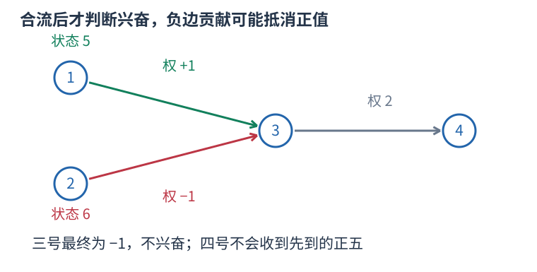

# P1038 等待全部前驱处理完，只有正状态沿出边传递 题解

## 目录

| 题号 | 题名 | 考点 | 难度 |
|---|---|---|---|
| A | 神经网络 | 拓扑排序 + 高精度 | 1800 |

## A. 神经网络

> 原题：[P1038](https://www.luogu.com.cn/problem/P1038)
> 解法：等待全部前驱处理完，只有正状态沿出边传递 · C++17

### 题意

分层有向神经网络中，输入层使用给定状态，其余结点汇总兴奋前驱的加权信号再减自身阈值。仅输出状态为正的输出层结点，按编号升序；没有则输出 NULL。

<!-- reusable-foundations:start -->

### 从零讲：C++ 输入输出：把数据读进变量，把结果写到标准输出

程序运行时从标准输入接收题目给的数据，把答案送到标准输出。`cin` 和 `cout` 定义在 `<iostream>`；写 `using namespace std;` 后可以省略它们前面的 `std::`。最小完整程序是：

```cxx
#include <iostream>
using namespace std;
int main() {
    int a, b;
    cin >> a >> b;
    cout << a + b << '\n';
    return 0;
}
```

输入二十和三十，两个变量分别保存二十、三十，输出五十。`int a, b;` 声明两个整数变量；`cin >> a` 才给变量赋入输入值。多个 `>>` 从左到右读取，读取整数时会跳过空格、制表符、换行，所以两个整数可以分处两行。负号属于整数，不需要另读一个符号。

`cout <<` 后可以接数值、字符或字符串。`' '` 是一个空格字符，`'\n'` 是换行字符，`"Hello"` 是字符串。`cout << a << ' ' << b << '\n';` 输出两个以空格分开的整数并换行。评测程序只需要答案，不应加入“请输入”等提示。

读取 `char c; cin >> c;` 会跳过前导空白。要读取包含空格的一整行，用 `<string>` 中的 `string s; getline(cin, s);`。若此前用 `cin >> n` 读取过整数，换行还留在输入中，需要先处理那一个剩余换行；不能盲目把所有空格都删掉，因为字符画的行首空格和文本中的空格可能就是数据。

`fixed << setprecision(3)`（需要 `<iomanip>`）表示以小数形式保留三位小数，例如把 $2.5$ 输出成 $2.500$；不用 `fixed` 时，`setprecision` 指有效数字总数。设置会影响后续输出，使用前应确认所需精度。

竞赛中可在首次输入输出前调用 `ios::sync_with_stdio(false); cin.tie(nullptr);`，减少 C++ 流与 C 标准输入输出的同步、绑定开销。随后保持使用 `cin/cout`，不要混用另一套 `scanf/printf`。交互题还要在需要对方回应前主动刷新，例如 `cout << query << endl;`；普通题用换行字符即可。

读入长度为 $L$ 的文本、或输出 $L$ 个字符，至少需要 $O(L)$ 时间。数据类型仍要能容纳结果：把两个整数相乘时，即使保存到 `long long`，也要让乘法本身在这个类型中进行，例如先把输入声明为 `long long`。

### 从零讲：分支与循环：按条件选择，按次序重复

`if (条件) { ... } else { ... }` 根据条件的真假选择一条分支。比较运算 `==`、`!=`、`<`、`<=`、`>`、`>=` 返回真假值；`=` 是赋值，不能代替相等比较。`&&` 表示两边都成立，`||` 表示至少一边成立，`!` 把真假反转。

```cxx
int score = 85;
if (score >= 90) cout << "A";
else if (score >= 60) cout << "B";
else cout << "C"; // 这个例子输出 B
```

这条分支链只执行第一个符合条件的分支。先处理高分后，第二个条件自然只会接到低于九十分的数。几个独立的 `if` 则可能执行多次；两种结构代表不同问题。逻辑运算会短路：`i < n && a[i] == 0` 先确认下标合法，才读取那一格。

`for (初始化; 继续条件; 每轮更新)` 适合知道重复范围的情况。例如下列代码依次处理一到四，总和是十：

```cxx
int sum = 0;
for (int i = 1; i <= 4; ++i) {
    sum += i;
}
cout << sum;
```

初始化只做一次；每轮先判断条件，条件为真才执行循环体，随后执行更新。`++i` 把 $i$ 加一，`sum += i` 等价于把旧 sum 加 $i$ 再保存。应明确每个变量在循环前、循环后分别表示什么；最大值相同时是否更新，决定了保留较早还是较晚的答案。

`while (条件)` 适合“不满足目标就再做一步”：

```cxx
int x = 13, times = 0;
while (x > 1) {
    x /= 2;
    ++times;
}
// x 依次是 13、6、3、1，执行三次
```

循环开始前先检查条件，初始已满足目标时可能一次也不执行。每次执行必须推进状态，否则可能无限循环。`break` 结束最内层循环，`continue` 跳过本轮剩余部分；`for` 中的 continue 之后仍会执行每轮更新。

复杂度由实际执行次数决定。上述求和执行 $n$ 次是 $O(n)$；每次将正整数减半只执行 $O(\log n)$ 次。两层循环不能仅凭外观判定为平方：内层若总共只前进 $n$ 次，总量仍可能线性。变量应在正确作用范围初始化；多组数据的计数器若未重置，下一组会错误继承上一组结果。

### 从零讲：vector：长度可变的连续数组

`vector<T>` 保存一串同类型的元素，适合按下标访问、扫描、排序。`T` 是元素类型，例如 `vector<int>` 保存整数，`vector<pair<int,int>>` 保存整数对，`vector<vector<int>>` 可保存每个顶点各自的邻居。需要 `<vector>`。

```cxx
vector<int> a(3, 7);   // 三个元素，内容是 7、7、7
a.push_back(9);       // 在末尾追加，现在长度为 4
int x = a[1];         // 从 0 编号，这里得到 7
a[1] = 2;            // 改第二个元素
int n = int(a.size());
```

`vector<int> a(3)` 创建三个值为零的元素；`a.reserve(3)` 只预留容量，元素数仍为零，此时不能访问 `a[0]`。长度 `size()` 与容量 `capacity()` 是不同概念。

下标访问为 $O(1)$，遍历为 $O(n)$。末尾追加通常为 $O(1)$；容量不足时会分配更大的连续空间并搬移元素，这次可能为 $O(n)$，一连串追加的平均成本称为摊还 $O(1)$。中间插入或删除会搬移后续元素，最坏 $O(n)$。内存是元素量的 $O(n)$，并可能预留部分尚未使用的容量。

`begin()` 指向首元素，`end()` 指向尾后位置，`sort(a.begin(),a.end())` 操作整个数组。`a[i]` 不检查越界；下标须满足 $0\le i<\mathrm{size}$。`at(i)` 会检查越界并抛异常。空数组不能访问 `front()`、`back()`；`pop_back()` 也要求非空。

扩容后指向旧存储的迭代器、引用和指针会失效。遍历的同时 `push_back`，不能假定此前取得的引用仍可用。读取大数组的函数常用 `const vector<int>& a` 按常量引用传入，既不复制也禁止通过该引用修改；`vector<int> a` 按值传参则复制内容。选择副本还是引用取决于是否要保留独立数据。

### 从零讲：整数类型、整除与溢出

计算前先看每一步可能达到的范围。常见环境中 `int` 是 32 位，上界约 $2.1\times10^9$；`long long` 至少 64 位，常见有符号 64 位上界约 $9.22\times10^{18}$。`using ll = long long;` 只是为已有类型起别名。

```cxx
int a = 100000, b = 100000;
long long wrong = a * b;      // 右边先按 int 乘，可能已溢出
long long right = 1LL * a * b; // 先把运算提升到 long long
```

不能指望“接收结果的变量够大”修复此前已经溢出的计算。先提高操作数类型，再做乘法。超过 64 位时，GCC 的 `__int128` 可作中间量，但它不是标准 C++17 类型，也没有标准流输出重载；先证明范围，再选择工具。

整数 `/` 对有符号数向零截断：`7/3==2`、`-7/3==-2`。对非负数才等于向下取整。余数满足 `a == (a/b)*b + a%b`，除数不能为零；要将余数归入 $[0,m-1]$（$m>0$），可用 `(a % m + m) % m`，同时保证中间加法不溢出。

非负 $a$、正 $b$ 的向上取整可写 `a/b + (a%b != 0)`，比 `(a+b-1)/b` 更容易避免加法溢出。比较平方时也应在宽类型内计算；浮点数不适合作为大整数相等的默认判断方式。

`size()` 返回无符号类型。空容器上写 `size()-1` 会绕到很大的数，逆序遍历可以先转成有符号、确认长度，或使用逆向迭代器。`abs` 对最小有符号数无法在同类型中表达其正值，需先约束输入差值范围。一般机器整数运算按常数时间估算，宽类型解决表示范围，不改变算法的增长阶。

### 从零讲：具名函数：给可复用计算一个明确接口

函数把一段计算包装成“输入参数 → 返回结果”。例如判断整数是否为偶数：

```cxx
bool even(int x) {
    return x % 2 == 0;
}
int main() {
    bool a = even(8); // a 为 true
    bool b = even(7); // b 为 false
}
```

`bool` 是返回类型，`even` 是函数名，`int x` 是参数声明。调用 `even(8)` 时，实参八传入这个新调用的局部变量 $x$，执行 return 后把真假值交回调用处。定义本身不执行计算，只有调用才执行。函数应在调用处之前定义，或提前写声明。

普通数值参数按值传递，函数里修改 $x$ 不会改变调用者原变量。参数写成 `int &x` 时才引用调用者对象；必须让这个对象在调用期间有效。`const vector<int>& a` 用引用避免复制整个容器，并承诺不通过这个引用修改它。返回局部变量的值是安全的，返回局部变量的引用则在函数结束后失效。

函数名应说明它回答的问题，调用处负责传哪些数据。例如闰年判定只接收一个年份并返回真假，枚举年份范围和输出格式由调用者处理。同一判定被多次使用时，这能减少规则不一致；但函数包装不会自动降低算法复杂度，仍要把每次调用实际做的工作计入时间。

如果函数内部又调用自身，就是递归，需要明确最小情况如何直接返回、每次调用如何逼近它；递归会占用调用栈。普通辅助函数可以不使用递归，不应仅因写成函数就称作递归算法。

### 从零讲：图的表示、BFS 与 DFS

图由顶点与边组成，适合表达“哪些对象之间能一步到达”。有向边只允许一个方向；无向边需保存两个方向。邻接表 `vector<vector<int>> graph(n)` 为每个顶点保存邻居，空间 $O(n+m)$，无向边在表中出现两次。

以边 $0-1,0-2,1-3$ 为例，从零出发：


#### BFS 为什么得到最少边数

初始顶点距离为零，入先进先出的队列。弹出顶点时，将尚未到达的邻居距离设为当前距离加一，并立刻标记入队。距离为一的顶点都会先于距离为二的处理，因此第一次发现就是最少边数。

```cxx
vector<int> distance(n, -1);
queue<int> q;
distance[start] = 0; q.push(start);
while (!q.empty()) {
    int u = q.front(); q.pop();
    for (int v : graph[u]) if (distance[v] == -1) {
        distance[v] = distance[u] + 1;
        q.push(v);
    }
}
```

适用于无权或所有边代价相同的最少步数。边权不同，第一次发现未必费用最小，不能继续套这一结论。多起点 BFS 先把所有合法起点设零并入队。

#### DFS 的调用代表一整块未探索区域

DFS 标记当前点后，递归处理每个尚未访问的邻点；也可用显式栈。上例可能按 $0,1,3,2$ 的顺序深入，但顺序取决于邻居存放方式。它擅长检查连通性、处理子树和回溯，不保证最短路径。

两种遍历在每个顶点入队或调用一次、每条边检查常数次的实现下，时间均为 $O(n+m)$，额外标记和队列/栈为 $O(n)$。不要等出队才首次标记，否则同一顶点可能重复入队。图不连通时，从一个起点无法覆盖所有点；统计连通块应从每个尚未访问点再启动一次遍历。树的深递归可能用尽调用栈。

### 从零讲：queue、deque 与 stack：处理顺序也是规则

`queue` 是先进先出：先进入的先处理，适合按层扩展；`stack` 是后进先出：最后放入的先处理，适合嵌套配对与回退；`deque` 支持两端加入删除，适合滑动窗口和 0-1 BFS。它们不能按方便程度随意互换，处理顺序会影响算法成立的理由。

```cxx
queue<int> q;
q.push(3); q.push(5);
int first = q.front(); // 3
q.pop();              // 删除 3，pop 不返回元素
stack<int> st;
st.push(3); st.push(5);
int last = st.top();   // 5
st.pop();
```

`deque` 的接口是 `push_back`、`push_front`、`pop_back`、`pop_front`、`front`、`back`。在常用默认底层容器下，这些端点操作为常数时间；保存 $n$ 项需要 $O(n)$ 空间。`stack` 和 `queue` 是限制了接口的适配器，也可选择其它底层容器。

任何 `front`、`back`、`top` 或弹出操作前都须保证非空；先读元素再弹出。遍历图时，容器只规定“谁先处理”，仍需另存访问标记；若不限制同一个状态反复入队，有限图也可能无限重复处理。

### 从零讲：拓扑排序与生成树：两类不同的图结构

有向依赖图里，一项任务必须等全部前置完成才能执行。拓扑序要求每条边 $u\to v$ 中 $u$ 都出现在 $v$ 之前，只有有向无环图才存在这样的完整顺序。

Kahn 算法统计入度，把所有入度零的点加入队列；每取出一点，就删除它的出边并减少邻点入度，某点变成零时再入队。例如依赖 $A\to C,B\to C$，A、B 可任意先后，但 C 必须等两者都处理完。

初始化与扫描时间 $O(n+m)$、空间 $O(n+m)$。最后处理不足 $n$ 个点表示仍存在环，不能把剩余点随便接到输出后面。拓扑序可能不唯一；若题目要求字典序最小，每次应从当前入度零者中取最小，可换小根堆，复杂度相应增加。

生成树讨论的是无向连通图：选 $n-1$ 条边连接所有顶点且不成环。最小生成树再要求总权最小，不是从一个源点到各点的最短路径树。

Kruskal 将边按权从小到大处理，用并查集判断两端是否已经连通；不连通才选并合并。依据是连接当前分量的一条最轻合法边总能放入某棵最优树。排序 $O(m\log m)$，并查集操作近似线性，空间 $O(n+m)$。若最终没选到 $n-1$ 条边，原图不连通，只得到森林。

拓扑排序维护依赖先后，生成树维护无环连通结构，二者不能因为名字里都有“序”或“树”而混淆。先画出边方向、权值和目标，再选择方法。

### 从零讲：高精度整数：用数组保存十进制位

当整数超过 long long 的范围，可以把每一位分别保存在数组中。低位在前便于进位：整数 507 写成 [7,0,5]，数组下标 $i$ 表示十的 $i$ 次方那一位。数组本身不是一个机器整数，必须逐位实现算术。

#### 乘一个小整数

从个位开始计算“本位乘数加上一位的进位”。结果对十取余留下本位，整除十得到下一位的进位。原数组处理完后，进位可能还有多位，需要继续拆开。

```cxx
vector<int> digits{7, 0, 5};
int multiplier = 12, carry = 0;
for (int &digit : digits) {
    int value = digit * multiplier + carry;
    digit = value % 10;
    carry = value / 10;
}
while (carry > 0) {
    digits.push_back(carry % 10);
    carry /= 10;
}
// 结果为 [4,8,0,6]，逆序读取就是 6084。
```

D 位数乘机器范围内的小整数，时间 $O(D)$，结果空间 $O(D+\log multiplier)$。中间量也必须放得下；例如乘数可到十的九次方时，上面的 int 就不够，应改用 long long。不要在范围 for 内 push_back，扩容可能使正在使用的引用失效；追加新位放在原有位循环之后。

#### 两个大整数相乘

第 $i$ 位与第 $j$ 位相乘，贡献到第 $i+j$ 位，因为十的 $i$ 次方乘十的 $j$ 次方等于十的 $i+j$ 次方。先把所有对应贡献相加，再从低位到高位统一进位。例如 $12 \times 13$：个位贡献 $2 \times 3=6$；十位贡献 $1 \times 3+2 \times 1=5$；百位贡献 $1 \times 1=1$，得到 156。

长度分别为 N、M 时，普通竖式乘法做 NM 次位乘，时间 $O(NM)$、空间 $O(N+M)$。乘积最多 N+M 位。输出前去掉最高处的多余零，但零本身保留一个零；内部零不能删除。只保留低 K 位等价于对十的 K 次方取模，高位不会进位回低位，因此可以舍弃所有下标至少 K 的贡献。

### 从零讲：string：字符、下标与子串

`string` 保存字符序列。`string s="abca";` 的长度为四，下标从零开始，`s[0]=='a'`、`s[3]=='a'`。字符用单引号，字符串用双引号；二者类型不同。需要 `<string>`。

`cin >> s` 读到空白停止；整行含空格时使用 `getline`，并留意前一次格式化输入残留的换行。`s.size()` 是字符单元数量，不一定等于 UTF-8 中文字数；竞赛英文小写字母题通常一个字符对应一个单元。

```cxx
string s = "abca";
string middle = s.substr(1, 2); // 从下标 1 开始取 2 个字符，得到 bc
size_t pos = s.find('c');       // 得到 2；找不到是 string::npos
if (pos != string::npos) cout << s[pos];
```

`substr(start,length)` 的第二项是长度，不是右端点。普通下标访问为 $O(1)$；复制长为 $k$ 的子串需要 $O(k)$ 时间和空间，循环里反复截取可能累积成平方成本。字符串比较按第一个不同字符决定字典序，公共前缀可能需要线性比较。

常见字符转数字是 `c-'0'`，前提 `c` 在 `'0'` 到 `'9'`。修改原串可用 `for(char& c:s)`，只读使用 `char c`。`reverse(s.begin(),s.end())` 原地翻转；若还需要原串，应先复制。空串不能访问首尾，尾后位置不能当普通字符读取。

### 从零讲：字符串修改、数字转换与字符判断

处理文本时先区分三种对象：字符如 `'7'`、字符序列如 `"275"`、整数如 `275`。它们的表示和运算规则不同。字符减 `'0'` 只适用于单个十进制数字；多位数字可以用 `stoi` 或 `stoll` 转换。

```cxx
string s = "275";
int x = stoi(s);               // 得到整数二百七十五
long long y = stoll("10000000000");
string equation = s + "+125=" + to_string(x + 125);
// equation 为 275+125=400
```

`stoi` 返回 int，`stoll` 返回 long long；`to_string` 把整数转为十进制字符串，也会保留负号。转换读取十进制数字需要合法输入并且结果在返回类型范围内；非法或越界的转换会抛异常。题目保证格式正确时可以直接使用，处理不可信文本时应检查错误与是否完整消费了输入。转换长度为 L 的整数文本需要 $O(L)$ 时间。

`isdigit` 与 `tolower` 定义在 `<cctype>`。`isdigit(c)` 判断一个字符是不是数字，`tolower(c)` 把可转换的大写字母转成小写，其它字符保持不变。向这类函数传入普通 char 前，应先转成 unsigned char，避免负的 char 值超出接口允许范围：

```cxx
char c = 'A';
c = static_cast<char>(tolower(static_cast<unsigned char>(c))); // a
bool digit = isdigit(static_cast<unsigned char>('7'));         // true
```

下面的操作直接修改字符串；它们改变的是字符位置，不能把旧下标当成某个字符永远不变的身份：

```cxx
string text = "bcd";
text.insert(1, "XX"); // 在旧下标一之前插入，得到 bXXcd
text += "e";          // 追加，得到 bXXcde
text.pop_back();      // 删除末尾 e，恢复 bXXcd
char last = text.back(); // d，前提是非空
size_t where = text.find_first_of("./%"); // 没有这些字符，返回 npos
size_t first = string("00070").find_first_not_of('0'); // 三，从零编号
```

`find` 查找整个子串，`find_first_of` 查找给定字符集合中的任意一个，`find_first_not_of` 查找首个不在指定集合中的字符。这些函数返回位置或 `string::npos`，不是直接返回真假。合法的零号位置不能误判为“没有找到”；输出找不到时应显式处理 npos，不能依赖把无符号大数转换成负数。

`insert` 要移动插入点后面的字符，长度为 L 的串中插入 $k$ 个字符通常需要 $O(L+k)$ 时间，并可能重新分配存储，旧指针、引用和迭代器可能失效。删除末尾和读取 back 为常数操作，但都要求字符串非空。子串查找的最坏复杂度可能与文本长度和模式长度的乘积相关，不能一律写成常数或对数。

### 从零讲：结构体：把一个对象的相关数据保存在一起

结构体给一组不同类型的字段起一个整体类型名。例如一个学生有姓名和三科分数：

```cxx
struct Student {
    string name;
    int chinese, math, english;
};
Student a{"Lin", 90, 95, 92};
cout << a.name << ' ' << a.math; // Lin 95
```

`Student` 是新类型，$a$ 是这个类型的对象，点号选择对象中的某个字段。创建 `vector<Student> students(n)` 就能保存 $n$ 个学生，`students[i].math` 表示第 $i$ 个学生的数学分。这样一名学生的数据随对象一起移动，不会在排序时只移动姓名而忘记移动分数。

字段必须在使用前初始化或读入。`Student a{};` 会让字符串为空、整数为零；不加初始化的局部整数成员不能假定为零。字段名的访问本身为常数时间，但复制对象的成本取决于成员：复制很长的字符串会复制它的内容。只读取现有对象时可用 `const Student&` 避免复制。

结构体不会自动规定大小顺序。排序若要按分数降序、并列按姓名升序，需要另外提供满足严格弱序的比较函数。枚举输入已排序对象时，则可以直接沿用题目保证的顺序。先明确要比较的是对象的哪些字段，再决定是否需要排序。

<!-- reusable-foundations:end -->

### 思路

读完所有边，用入度识别输入层：它们保留给定状态，不减阈值；其余点初值减去阈值。按拓扑顺序处理，只有状态为正才将状态乘边权加给后继，但无论是否兴奋，都消除其依赖。边权可到十的九次方，长链可能超出固定整数，参考代码用有符号十进制高精度做加法及乘小整数。



本图所有非输入层阈值为零，三号同时接收正五与负六后才确定状态。

拓扑遍历 $O(n+p)$。设所有中间值最多 D 个十进制位，所用加法、减法与乘小整数均为 $O(D)$，计算时间 $O((n+p)D)$，空间 $O(n+p+nD)$。

### 参考代码

```cpp
#include <bits/stdc++.h>
using namespace std;
struct Number{
    string digits="0";bool negative=false;
    Number()=default;
    Number(string s){if(!s.empty()&&(s[0]=='-'||s[0]=='+')){negative=s[0]=='-';s.erase(s.begin());}
        size_t first=s.find_first_not_of('0');digits=first==string::npos?"0":s.substr(first);if(digits=="0")negative=false;}
};
int absolute_compare(const string &a,const string &b){if(a.size()!=b.size())return a.size()<b.size()?-1:1;return a==b?0:(a<b?-1:1);}
string absolute_add(const string &a,const string &b){string s;int i=int(a.size())-1,j=int(b.size())-1,carry=0;
    while(i>=0||j>=0||carry){int value=carry;if(i>=0)value+=a[i--]-'0';if(j>=0)value+=b[j--]-'0';s.push_back(char('0'+value%10));carry=value/10;}
    reverse(s.begin(),s.end());return s;}
// 前提：a 的绝对值不小于 b。
string absolute_subtract(const string &a,const string &b){string s;int j=int(b.size())-1,borrow=0;
    for(int i=int(a.size())-1;i>=0;--i){int value=a[i]-'0'-borrow-(j>=0?b[j--]-'0':0);borrow=value<0;if(borrow)value+=10;s.push_back(char('0'+value));}
    while(s.size()>1&&s.back()=='0')s.pop_back();reverse(s.begin(),s.end());return s;}
Number plus_number(Number a,Number b){Number result;if(a.negative==b.negative){result.digits=absolute_add(a.digits,b.digits);result.negative=a.negative;}
    else{if(absolute_compare(a.digits,b.digits)<0)swap(a,b);result.digits=absolute_subtract(a.digits,b.digits);result.negative=a.negative;}
    if(result.digits=="0")result.negative=false;return result;}
Number times_small(Number a,long long multiplier){Number result;if(!multiplier||a.digits=="0")return result;
    result.negative=a.negative^(multiplier<0);if(multiplier<0)multiplier=-multiplier;long long carry=0;string s;
    for(int i=int(a.digits.size())-1;i>=0;--i){long long value=(a.digits[i]-'0')*multiplier+carry;s.push_back(char('0'+value%10));carry=value/10;}
    while(carry){s.push_back(char('0'+carry%10));carry/=10;}reverse(s.begin(),s.end());result.digits=s;return result;}
int main() {
    ios::sync_with_stdio(false);
    cin.tie(nullptr);
int n,m;cin>>n>>m;vector<Number>state(n+1),threshold(n+1);for(int u=1;u<=n;++u){string c,t;cin>>c>>t;state[u]=Number(c);threshold[u]=Number(t);}
vector<vector<pair<int,long long>>>graph(n+1);vector<int>indegree(n+1);
for(int i=0;i<m;++i){int u,v;long long w;cin>>u>>v>>w;graph[u].push_back({v,w});++indegree[v];}
queue<int>ready;for(int u=1;u<=n;++u)if(!indegree[u])ready.push(u);else{threshold[u].negative=!threshold[u].negative;state[u]=plus_number(state[u],threshold[u]);}
while(!ready.empty()){int u=ready.front();ready.pop();for(auto [v,w]:graph[u]){
    if(!state[u].negative&&state[u].digits!="0")state[v]=plus_number(state[v],times_small(state[u],w));
    if(--indegree[v]==0)ready.push(v);
}}
bool any=false;for(int u=1;u<=n;++u)if(graph[u].empty()&&!state[u].negative&&state[u].digits!="0"){cout<<u<<' '<<state[u].digits<<'\n';any=true;}if(!any)cout<<"NULL\n";
    return 0;
}
```

### 易错点

输入层不减阈值；负权允许；不兴奋也要消入度；等待全部前驱；只输出正状态汇点；固定整数不保证容纳连续乘积。

## 实测记录

本地 C++17 编译、1 组原站样例与 153 组独立边界/小域校验通过。
正文参考程序与源码逐字核对；没有向原站提交。
