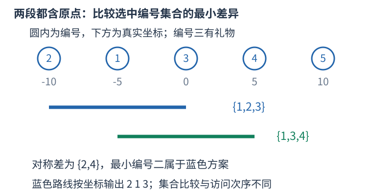

# P10445 扫描两种时间预算，用最小对称差编号比较方案 题解

## 目录

| 题号 | 题名 | 考点 | 难度 |
|---|---|---|---|
| A | 签到 | 双指针 + 排序 + 线段树 | 1800 |

## A. 签到

> 原题：[P10445](https://www.luogu.com.cn/problem/P10445)
> 解法：扫描两种时间预算，用最小对称差编号比较方案 · C++17

### 题意

数轴上从原点出发签到后返回，访问礼物点可多用五个时间单位；先最多签到，再最小化所选编号集合的字典序，输出实际访问顺序。

<!-- reusable-foundations:start -->

### 从零讲：C++ 输入输出：把数据读进变量，把结果写到标准输出

程序运行时从标准输入接收题目给的数据，把答案送到标准输出。`cin` 和 `cout` 定义在 `<iostream>`；写 `using namespace std;` 后可以省略它们前面的 `std::`。最小完整程序是：

```cxx
#include <iostream>
using namespace std;
int main() {
    int a, b;
    cin >> a >> b;
    cout << a + b << '\n';
    return 0;
}
```

输入二十和三十，两个变量分别保存二十、三十，输出五十。`int a, b;` 声明两个整数变量；`cin >> a` 才给变量赋入输入值。多个 `>>` 从左到右读取，读取整数时会跳过空格、制表符、换行，所以两个整数可以分处两行。负号属于整数，不需要另读一个符号。

`cout <<` 后可以接数值、字符或字符串。`' '` 是一个空格字符，`'\n'` 是换行字符，`"Hello"` 是字符串。`cout << a << ' ' << b << '\n';` 输出两个以空格分开的整数并换行。评测程序只需要答案，不应加入“请输入”等提示。

读取 `char c; cin >> c;` 会跳过前导空白。要读取包含空格的一整行，用 `<string>` 中的 `string s; getline(cin, s);`。若此前用 `cin >> n` 读取过整数，换行还留在输入中，需要先处理那一个剩余换行；不能盲目把所有空格都删掉，因为字符画的行首空格和文本中的空格可能就是数据。

`fixed << setprecision(3)`（需要 `<iomanip>`）表示以小数形式保留三位小数，例如把 $2.5$ 输出成 $2.500$；不用 `fixed` 时，`setprecision` 指有效数字总数。设置会影响后续输出，使用前应确认所需精度。

竞赛中可在首次输入输出前调用 `ios::sync_with_stdio(false); cin.tie(nullptr);`，减少 C++ 流与 C 标准输入输出的同步、绑定开销。随后保持使用 `cin/cout`，不要混用另一套 `scanf/printf`。交互题还要在需要对方回应前主动刷新，例如 `cout << query << endl;`；普通题用换行字符即可。

读入长度为 $L$ 的文本、或输出 $L$ 个字符，至少需要 $O(L)$ 时间。数据类型仍要能容纳结果：把两个整数相乘时，即使保存到 `long long`，也要让乘法本身在这个类型中进行，例如先把输入声明为 `long long`。

### 从零讲：分支与循环：按条件选择，按次序重复

`if (条件) { ... } else { ... }` 根据条件的真假选择一条分支。比较运算 `==`、`!=`、`<`、`<=`、`>`、`>=` 返回真假值；`=` 是赋值，不能代替相等比较。`&&` 表示两边都成立，`||` 表示至少一边成立，`!` 把真假反转。

```cxx
int score = 85;
if (score >= 90) cout << "A";
else if (score >= 60) cout << "B";
else cout << "C"; // 这个例子输出 B
```

这条分支链只执行第一个符合条件的分支。先处理高分后，第二个条件自然只会接到低于九十分的数。几个独立的 `if` 则可能执行多次；两种结构代表不同问题。逻辑运算会短路：`i < n && a[i] == 0` 先确认下标合法，才读取那一格。

`for (初始化; 继续条件; 每轮更新)` 适合知道重复范围的情况。例如下列代码依次处理一到四，总和是十：

```cxx
int sum = 0;
for (int i = 1; i <= 4; ++i) {
    sum += i;
}
cout << sum;
```

初始化只做一次；每轮先判断条件，条件为真才执行循环体，随后执行更新。`++i` 把 $i$ 加一，`sum += i` 等价于把旧 sum 加 $i$ 再保存。应明确每个变量在循环前、循环后分别表示什么；最大值相同时是否更新，决定了保留较早还是较晚的答案。

`while (条件)` 适合“不满足目标就再做一步”：

```cxx
int x = 13, times = 0;
while (x > 1) {
    x /= 2;
    ++times;
}
// x 依次是 13、6、3、1，执行三次
```

循环开始前先检查条件，初始已满足目标时可能一次也不执行。每次执行必须推进状态，否则可能无限循环。`break` 结束最内层循环，`continue` 跳过本轮剩余部分；`for` 中的 continue 之后仍会执行每轮更新。

复杂度由实际执行次数决定。上述求和执行 $n$ 次是 $O(n)$；每次将正整数减半只执行 $O(\log n)$ 次。两层循环不能仅凭外观判定为平方：内层若总共只前进 $n$ 次，总量仍可能线性。变量应在正确作用范围初始化；多组数据的计数器若未重置，下一组会错误继承上一组结果。

### 从零讲：vector：长度可变的连续数组

`vector<T>` 保存一串同类型的元素，适合按下标访问、扫描、排序。`T` 是元素类型，例如 `vector<int>` 保存整数，`vector<pair<int,int>>` 保存整数对，`vector<vector<int>>` 可保存每个顶点各自的邻居。需要 `<vector>`。

```cxx
vector<int> a(3, 7);   // 三个元素，内容是 7、7、7
a.push_back(9);       // 在末尾追加，现在长度为 4
int x = a[1];         // 从 0 编号，这里得到 7
a[1] = 2;            // 改第二个元素
int n = int(a.size());
```

`vector<int> a(3)` 创建三个值为零的元素；`a.reserve(3)` 只预留容量，元素数仍为零，此时不能访问 `a[0]`。长度 `size()` 与容量 `capacity()` 是不同概念。

下标访问为 $O(1)$，遍历为 $O(n)$。末尾追加通常为 $O(1)$；容量不足时会分配更大的连续空间并搬移元素，这次可能为 $O(n)$，一连串追加的平均成本称为摊还 $O(1)$。中间插入或删除会搬移后续元素，最坏 $O(n)$。内存是元素量的 $O(n)$，并可能预留部分尚未使用的容量。

`begin()` 指向首元素，`end()` 指向尾后位置，`sort(a.begin(),a.end())` 操作整个数组。`a[i]` 不检查越界；下标须满足 $0\le i<\mathrm{size}$。`at(i)` 会检查越界并抛异常。空数组不能访问 `front()`、`back()`；`pop_back()` 也要求非空。

扩容后指向旧存储的迭代器、引用和指针会失效。遍历的同时 `push_back`，不能假定此前取得的引用仍可用。读取大数组的函数常用 `const vector<int>& a` 按常量引用传入，既不复制也禁止通过该引用修改；`vector<int> a` 按值传参则复制内容。选择副本还是引用取决于是否要保留独立数据。

### 从零讲：整数类型、整除与溢出

计算前先看每一步可能达到的范围。常见环境中 `int` 是 32 位，上界约 $2.1\times10^9$；`long long` 至少 64 位，常见有符号 64 位上界约 $9.22\times10^{18}$。`using ll = long long;` 只是为已有类型起别名。

```cxx
int a = 100000, b = 100000;
long long wrong = a * b;      // 右边先按 int 乘，可能已溢出
long long right = 1LL * a * b; // 先把运算提升到 long long
```

不能指望“接收结果的变量够大”修复此前已经溢出的计算。先提高操作数类型，再做乘法。超过 64 位时，GCC 的 `__int128` 可作中间量，但它不是标准 C++17 类型，也没有标准流输出重载；先证明范围，再选择工具。

整数 `/` 对有符号数向零截断：`7/3==2`、`-7/3==-2`。对非负数才等于向下取整。余数满足 `a == (a/b)*b + a%b`，除数不能为零；要将余数归入 $[0,m-1]$（$m>0$），可用 `(a % m + m) % m`，同时保证中间加法不溢出。

非负 $a$、正 $b$ 的向上取整可写 `a/b + (a%b != 0)`，比 `(a+b-1)/b` 更容易避免加法溢出。比较平方时也应在宽类型内计算；浮点数不适合作为大整数相等的默认判断方式。

`size()` 返回无符号类型。空容器上写 `size()-1` 会绕到很大的数，逆序遍历可以先转成有符号、确认长度，或使用逆向迭代器。`abs` 对最小有符号数无法在同类型中表达其正值，需先约束输入差值范围。一般机器整数运算按常数时间估算，宽类型解决表示范围，不改变算法的增长阶。

### 从零讲：sort 与比较器：先建立统一的顺序

排序把原来任意排列的数据，按照可比较的键整理成有序序列，便于查边界、比较相邻项和按顺序处理。头文件 `<algorithm>`；普通数组和 `vector` 可用 `sort(first,last)`，范围为左闭右开。

```cxx
vector<int> a{5, 2, 5, 1};
sort(a.begin(), a.end());     // 变成 1、2、5、5，重复值仍保留
sort(a.begin(), a.end(), greater<int>());  // 降序
```

`sort` 时间 $O(n\log n)$，不是每次比较都扫描整个数组。C++ 标准规定复杂度要求，不规定必须使用某一固定内部排序实现，不能统一称它为快速排序。

对 `pair`，默认先比较 `first`，相同再比较 `second`，都是升序。自定义比较器 `cmp(a,b)` 返回真表示“$a$ 必须排在 $b$ 前面”。例如按分数降序、同分按编号升序：

```cxx
sort(students.begin(), students.end(), [](const auto& a, const auto& b) {
    if (a.score != b.score) return a.score > b.score;
    return a.id < b.id;
});
```

规则必须自洽：元素不能排在自己前面，不能出现 $a$ 在 $b$ 前、$b$ 在 $c$ 前、$c$ 又在 $a$ 前的循环。`<=` 会让相同元素也必须互相在前，因此不是合法的严格比较器。排序过程中也不能改变比较依据。

排序会改变原位置；若编号或两项的配对有意义，应将完整记录一起排序或另存查询副本，不能把两个相关字段各自排序后继续当作原配对。普通 `sort` 不保证同键元素保持输入先后；确需稳定顺序时用 `stable_sort` 或将原编号纳入比较键。排序只建立顺序，不能代替贪心策略的正确性证明。

### 从零讲：迭代器、begin/end 与左闭右开范围

迭代器表示容器中的一个位置。`*it` 读取它指向的元素，`++it` 向后移动，`it == c.end()` 判断是否已经到尾后。把末尾之后的位置作为边界，使空范围、整个容器和一段子区间都能用同一形式表示。

```cxx
vector<int> a{4, 7, 9};
for (auto it = a.begin(); it != a.end(); ++it) {
    cout << *it << ' ';   // 输出 4 7 9
}
```

`[first,last)` 包含 `first`，排除 `last`。`[begin,begin)` 是空范围，`[begin,end)` 包含所有元素。不能读取 `*end()`；找不到时返回 `end()` 是合法结果，必须先判断再读取。

数组和 `vector` 的迭代器支持随机访问：`begin()+k` 跳到下标 $k$，`it-begin()` 得到下标，均为 $O(1)$。例如指向下标二的位置之前有零、一两个元素，故减起点也能表示前面有几个数。相减只对同一容器中可相减的迭代器有效。

`list`、`set`、`map` 的迭代器通常只能逐步移动，不支持 `it-begin()`。`distance(begin,it)` 可以计算距离，但在这些容器上需要走过中间位置，时间为 $O(k)$；不能因为写了一个函数就认为它是常数时间。

容器修改后，旧位置可能失效：`vector` 扩容会使旧位置失效，删除元素会影响该处及其后位置。需要跨修改保存“第几个”时可保存下标，再按新数据重新取得迭代器，同时核对下标是否仍然合法。

### 从零讲：结构体：把一个对象的相关数据保存在一起

结构体给一组不同类型的字段起一个整体类型名。例如一个学生有姓名和三科分数：

```cxx
struct Student {
    string name;
    int chinese, math, english;
};
Student a{"Lin", 90, 95, 92};
cout << a.name << ' ' << a.math; // Lin 95
```

`Student` 是新类型，$a$ 是这个类型的对象，点号选择对象中的某个字段。创建 `vector<Student> students(n)` 就能保存 $n$ 个学生，`students[i].math` 表示第 $i$ 个学生的数学分。这样一名学生的数据随对象一起移动，不会在排序时只移动姓名而忘记移动分数。

字段必须在使用前初始化或读入。`Student a{};` 会让字符串为空、整数为零；不加初始化的局部整数成员不能假定为零。字段名的访问本身为常数时间，但复制对象的成本取决于成员：复制很长的字符串会复制它的内容。只读取现有对象时可用 `const Student&` 避免复制。

结构体不会自动规定大小顺序。排序若要按分数降序、并列按姓名升序，需要另外提供满足严格弱序的比较函数。枚举输入已排序对象时，则可以直接沿用题目保证的顺序。先明确要比较的是对象的哪些字段，再决定是否需要排序。

### 从零讲：具名函数：给可复用计算一个明确接口

函数把一段计算包装成“输入参数 → 返回结果”。例如判断整数是否为偶数：

```cxx
bool even(int x) {
    return x % 2 == 0;
}
int main() {
    bool a = even(8); // a 为 true
    bool b = even(7); // b 为 false
}
```

`bool` 是返回类型，`even` 是函数名，`int x` 是参数声明。调用 `even(8)` 时，实参八传入这个新调用的局部变量 $x$，执行 return 后把真假值交回调用处。定义本身不执行计算，只有调用才执行。函数应在调用处之前定义，或提前写声明。

普通数值参数按值传递，函数里修改 $x$ 不会改变调用者原变量。参数写成 `int &x` 时才引用调用者对象；必须让这个对象在调用期间有效。`const vector<int>& a` 用引用避免复制整个容器，并承诺不通过这个引用修改它。返回局部变量的值是安全的，返回局部变量的引用则在函数结束后失效。

函数名应说明它回答的问题，调用处负责传哪些数据。例如闰年判定只接收一个年份并返回真假，枚举年份范围和输出格式由调用者处理。同一判定被多次使用时，这能减少规则不一致；但函数包装不会自动降低算法复杂度，仍要把每次调用实际做的工作计入时间。

如果函数内部又调用自身，就是递归，需要明确最小情况如何直接返回、每次调用如何逼近它；递归会占用调用栈。普通辅助函数可以不使用递归，不应仅因写成函数就称作递归算法。

### 从零讲：离散化、扫描线与连续区间

坐标可达十亿但只出现少量位置时，如果问题只依赖相对顺序，就可以把不同坐标排序去重，映射为连续排名。例如 $[100,5,100,20]$ 的不同坐标为 $[5,20,100]$，排名为 $[2,0,2,1]$。

```cxx
vector<int> values = a;
sort(values.begin(), values.end());
values.erase(unique(values.begin(), values.end()), values.end());
int rank = int(lower_bound(values.begin(), values.end(), x) - values.begin());
```

`unique` 把不同值移到前面，返回新的逻辑末尾；`erase` 才真正缩短长度。映射保留相等性与大小关系，不保留距离：五到二十距离十五，排名却只差一。几何长度、空隙数量或相邻整数关系须保留原值或带权间隙，不能直接用排名差。

扫描线将左右端点等事件按坐标排序，沿轴移动时只处理变化，避免扫描所有空坐标。例如闭区间在位置 $x$ 查询覆盖次数，应先加入左端等于 $x$ 的区间，查询时还保留右端等于 $x$ 的区间，之后才移除它们。相同坐标的事件先后取决于闭开边界，不能统一按任意事件编号排序。

连续段指满足某条件的一串相邻位置。相邻位置是原数组下标相差一，还是不同整数值相差一，要先明确；去重排序后相邻两个值未必是连续整数。扫描一段时常维护段首和段尾，变化处结算，最后一段也须处理。

排序预处理 $O(n\log n)$，映射每次二分 $O(\log n)$，扫描事件 $O(n)$ 加维护结构成本，空间通常 $O(n)$。若本来就有两个排序端点数组，纯计数查询可能不需另建离散坐标数组。

### 从零讲：双指针与连续窗口：边界为什么能只向前走

当一段区间的合法性随边界移动有可证明的单调变化，可用两个边界维护连续窗口，避免为每个左端点重新扫描右边。

例如数组元素均非负，求和不超过五的最长子段。对 $[2,1,3,2]$，右端依次扩展；加三后总和六，移走左端二后为四；再加二后为六，再移走一后仍为五，窗口成为 $[3,2]$。每次扩展右端，只向右移动左端直到重新合法。


```cxx
int left = 0, best = 0;
long long sum = 0;
for (int right = 0; right < n; ++right) {
    sum += a[right];
    while (left <= right && sum > limit) sum -= a[left++];
    best = max(best, right - left + 1);
}
```

虽然有嵌套循环，左右端各至多移动 $n$ 次，合计为 $O(n)$；维护窗口和用 $O(1)$ 额外空间。证明要数指针总移动次数，不能只看循环嵌套层数。

非负条件使扩展不会降低和，缩短不会增大和。若含负数，当前超限的窗口未来可能因加入负数重新合法，过早丢掉左端可能漏解，需要别的方法。窗口里的最大值也不能像和一样直接相减，要配单调队列等维护结构。

另一类相向双指针在有序数组两端出发，例如找两数和：和太小才移动左边，太大移动右边，依据有序性排除候选。排序会影响原下标和连续性，不能为了套双指针擅自改变题目对象。

### 从零讲：线段树：把区间问题分成可合并的两半

需要动态修改并查询区间的和、最小值或最大值时，可以递归将数组一分为二。一个节点代表一段范围，叶子代表单个元素，父节点保存两个孩子答案的合并。


例如 $[2,3,1,4]$，叶子是各项，左半和五、右半和五，根为十。修改第三项后，只需改叶子及其到根的祖先；其他范围完全未变。查询 $[2,3]$ 时取覆盖这两项的节点，跳过完全无交的节点，合并各部分。

树高 $O(\log n)$。单点修改沿一条根到叶路径，区间查询在每层只需处理边界附近的少量分支，均为 $O(\log n)$；建树 $O(n)$，空间 $O(n)$，数组式常预留约四倍大小。

```cxx
// 假设当前结点范围为 [left,right]，查询为 [ql,qr]
if (ql <= left && right <= qr) return tree[node];
int mid = left + (right - left) / 2;
long long answer = 0; // 求和的合并单位；求最小值应换成 +INF
if (ql <= mid) answer += query(node*2, left, mid, ql, qr);
if (qr > mid) answer += query(node*2+1, mid+1, right, ql, qr);
return answer;
```

求和、求最小和最大各有自己的合并与无交单位，不能混用。维护的信息要足以从孩子合并；例如最大连续子段和需要额外的区间和、最大前缀及后缀，单存一个最大值不够。

区间修改可用懒标记：整段更新时先改当前节点答案，记录尚未作用到孩子的操作；下次进入孩子前下传。区间加对区间和的变化是“增量乘长度”，赋值与加法的标记组合顺序不同。只有更新能够从所存摘要直接计算、且标记能正确复合时才能这样优化，不能对任意操作机械加一个 lazy 数组。

### 从零讲：位运算：把非负整数看成一组二进制开关

五写成二进制为 $0101_2$，三为 $0011_2$。同一列各代表一位：按位与 `&` 两边都为一才得一，按位或 `|` 任一为一就得一，按位异或 `^` 不同才为一。所以 $5\mathbin{\&}3=1$，$5\mathbin{|}3=7$，$5\mathbin{\oplus}3=6$。


`1ULL << k` 把一移到第 $k$ 位。对非负无符号整数，`(mask >> k) & 1ULL` 读该位，`mask | (1ULL<<k)` 置一，`mask & ~(1ULL<<k)` 清零，`mask ^ (1ULL<<k)` 翻转。最低位编号为零。

```cxx
unsigned long long mask = 5; // 第 0、2 位为一
bool has = (mask >> 2) & 1ULL; // true
mask |= 1ULL << 1;             // 变成 7
```

位移次数必须小于类型位宽，且不能为负；不要用普通 `1` 去移到超出 int 范围的位置。C++17 有符号负数右移和溢出的规则不适合直接套“乘除二的幂”，用明确范围的无符号数更容易保证行为。`^` 是异或，绝不是乘方。

逻辑与 `&&`、逻辑或 `||` 将整体条件视为真假，并会短路；按位 `&`、`|` 逐位计算，不会因此跳过右侧表达式。运算符优先级可能与直觉不同，写 `(mask & bit) != 0`，别省掉关键括号。

固定机器字内的一次位运算按 $O(1)$ 估算；枚举全部 $k$ 位状态仍有 $2^k$ 种，不能因为每次运算快就忽略状态数。`x & (x-1)` 对正无符号数清掉最低的一位；GCC 的 `__builtin_popcountll(x)` 统计一的数量，注意实参位宽与具体编译器支持。

<!-- reusable-foundations:end -->

### 思路

样例二按坐标排序后，编号依次是 [2,1,3,4,5]，坐标 $[-10, -5, 0, 5, 10]$。礼物在编号三，预算可为二十。选区间 $[-10, 0]$ 得集合 {1,2,3}，选 $[-5, 5]$ 得 {1,3,4}，都签到三个；最小不同编号是二，属于前者，所以应选前者。



两条线都是宽十的实际坐标区间，往返各需二十；选中集合交集 {1,3} 抵消，只比较两侧剩余编号。

从原点出发访问最左 $L \le 0$ 与最右 $R \ge 0$，再返回，至少走过 [L,R] 两次，最短时间为 $2(R-L)$，按 0→L→R→0 正好达到。两端之间所有站点都可以零额外代价签到，故最优集合一定包含整个区间中的站点，同坐标的多个编号也全选。

加入一个不计站点数的原点虚拟点并排序。扫描右端，左端在宽度超预算的一半时右移，得到此右端下最靠左、包含站点最多的合法窗口。只考虑包含虚拟原点的窗口。第一遍用 $floor(m/2)$，第二遍用 $floor((m+5)/2)$ 且额外要求礼物编号在窗口中。这样覆盖未拿礼物及拿到礼物两种情况；题目允许在时刻 $m$ 之后才拿到礼物，只需最终在 $m+5$ 前返回，不能额外限制拿礼物的时刻。

难点在同数量的编号集合比较，而非行动序列比较。两集合共同编号对字典序没有影响，最小的对称差编号决定结果：谁含它，谁的升序编号序列更小。两个坐标窗口各自减去另一窗口，都至多剩左右两段，故只需查询这些差段中的最小原编号，无须真正生成并排序两份大集合。

用迭代线段树维护坐标数组上每段的最小编号。空区间返回无穷，虚拟原点也记无穷，不参与集合比较。查询闭区间时，把两端移到叶子；左端为右孩子、右端为左孩子时取其边缘节点，再向上合并，每层只取常数块，总 $O(\log n)$。每个同数量候选最多四次查询。

最终按选中窗口的坐标升序输出编号，跳过虚拟点，即实现 0→L→R→0 的最短路线。输出行的先后是访问顺序，不要求编号升序；被优化的是这些编号组成的集合。总路长与坐标差都用 long long，给定范围内最大往返长度四乘十的十八次方仍安全。

排序及比较总时间 $O(n\log n)$、空间 $O(n)$。

### 参考代码

```cpp
#include <bits/stdc++.h>
using namespace std;
struct Location{long long x;int id;};
bool by_position(const Location&a,const Location&b){return a.x!=b.x?a.x<b.x:a.id<b.id;}
struct RangeMin{
    int base=1;vector<int>tree;
    RangeMin(const vector<Location>&points,int original){
        while(base<(int)points.size())base*=2;tree.assign(2*base,INT_MAX);
        for(int i=0;i<(int)points.size();++i)if(points[i].id<=original)tree[base+i]=points[i].id;
        for(int i=base-1;i>0;--i)tree[i]=min(tree[2*i],tree[2*i+1]);
    }
    int query(int l,int r)const{
        if(l>r)return INT_MAX;int answer=INT_MAX;l+=base;r+=base;
        while(l<=r){if(l&1)answer=min(answer,tree[l++]);if(!(r&1))answer=min(answer,tree[r--]);l/=2;r/=2;}
        return answer;
    }
};
bool lex_better(int l,int r,int old_l,int old_r,const RangeMin&minimum){
    int added=min(minimum.query(l,min(r,old_l-1)),minimum.query(max(l,old_r+1),r));
    int removed=min(minimum.query(old_l,min(old_r,l-1)),minimum.query(max(old_l,r+1),old_r));
    return added<removed;
}
int main() {
    ios::sync_with_stdio(false);
    cin.tie(nullptr);
int n,p;long long budget;cin>>n>>budget>>p;vector<Location>points;points.reserve(n+1);
for(int id=1;id<=n;++id){long long x;cin>>x;points.push_back({x,id});}points.push_back({0,n+1});sort(points.begin(),points.end(),by_position);
int origin=0,gift=0;for(int i=0;i<=n;++i){if(points[i].id==n+1)origin=i;if(points[i].id==p)gift=i;}
RangeMin minimum(points,n);int best_left=origin,best_right=origin,best_count=0;
for(int pass=0;pass<2;++pass){long long width=(budget+(pass?5:0))/2;int left=0;
    for(int right=0;right<=n;++right){while(points[right].x-points[left].x>width)++left;
        if(!(left<=origin&&origin<=right))continue;
        if(pass&&!(left<=gift&&gift<=right))continue;
        int count=right-left; // 窗口内含一个不计数的虚拟原点
        if(count>best_count||(count==best_count&&lex_better(left,right,best_left,best_right,minimum))){best_count=count;best_left=left;best_right=right;}
    }
}
cout<<best_count<<'\n';bool first=true;
for(int i=best_left;i<=best_right;++i)if(points[i].id<=n){if(!first)cout<<' ';first=false;cout<<points[i].id;}cout<<'\n';
    return 0;
}
```

### 易错点

比较编号集合，输出实际路线；同坐标站点全部计数；礼物可以晚于原期限才取得。

## 实测记录

本地 C++17 编译、2 组原站样例与 162 组独立边界/小域校验通过。
正文参考程序与源码逐字核对；没有向原站提交。
