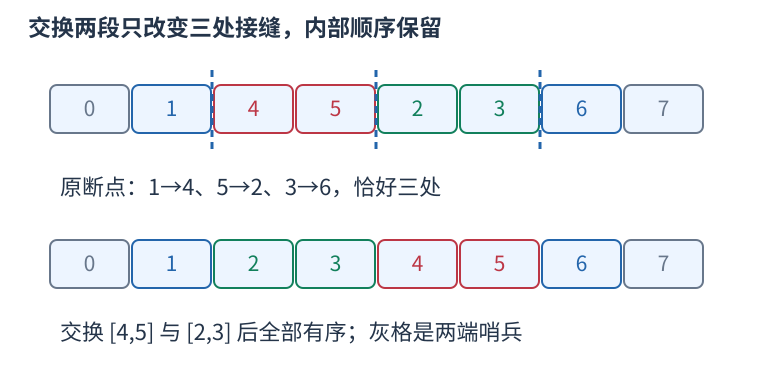

# P10488 迭代加深搜索，用最多修复三个断点作下界 题解

## 目录

| 题号 | 题名 | 考点 | 难度 |
|---|---|---|---|
| A | Booksort | DFS + 递归 | 1800 |

## A. Booksort

> 原题：[P10488](https://www.luogu.com.cn/problem/P10488)
> 解法：迭代加深搜索，用最多修复三个断点作下界 · C++17

### 题意

一次可抽走连续一段书，再插入其它位置。求把一到 $n$ 的排列排好所需最少次数；答案至少五时统一输出 5 or more，$n$ 至多十五。

<!-- reusable-foundations:start -->

### 从零讲：C++ 输入输出：把数据读进变量，把结果写到标准输出

程序运行时从标准输入接收题目给的数据，把答案送到标准输出。`cin` 和 `cout` 定义在 `<iostream>`；写 `using namespace std;` 后可以省略它们前面的 `std::`。最小完整程序是：

```cxx
#include <iostream>
using namespace std;
int main() {
    int a, b;
    cin >> a >> b;
    cout << a + b << '\n';
    return 0;
}
```

输入二十和三十，两个变量分别保存二十、三十，输出五十。`int a, b;` 声明两个整数变量；`cin >> a` 才给变量赋入输入值。多个 `>>` 从左到右读取，读取整数时会跳过空格、制表符、换行，所以两个整数可以分处两行。负号属于整数，不需要另读一个符号。

`cout <<` 后可以接数值、字符或字符串。`' '` 是一个空格字符，`'\n'` 是换行字符，`"Hello"` 是字符串。`cout << a << ' ' << b << '\n';` 输出两个以空格分开的整数并换行。评测程序只需要答案，不应加入“请输入”等提示。

读取 `char c; cin >> c;` 会跳过前导空白。要读取包含空格的一整行，用 `<string>` 中的 `string s; getline(cin, s);`。若此前用 `cin >> n` 读取过整数，换行还留在输入中，需要先处理那一个剩余换行；不能盲目把所有空格都删掉，因为字符画的行首空格和文本中的空格可能就是数据。

`fixed << setprecision(3)`（需要 `<iomanip>`）表示以小数形式保留三位小数，例如把 $2.5$ 输出成 $2.500$；不用 `fixed` 时，`setprecision` 指有效数字总数。设置会影响后续输出，使用前应确认所需精度。

竞赛中可在首次输入输出前调用 `ios::sync_with_stdio(false); cin.tie(nullptr);`，减少 C++ 流与 C 标准输入输出的同步、绑定开销。随后保持使用 `cin/cout`，不要混用另一套 `scanf/printf`。交互题还要在需要对方回应前主动刷新，例如 `cout << query << endl;`；普通题用换行字符即可。

读入长度为 $L$ 的文本、或输出 $L$ 个字符，至少需要 $O(L)$ 时间。数据类型仍要能容纳结果：把两个整数相乘时，即使保存到 `long long`，也要让乘法本身在这个类型中进行，例如先把输入声明为 `long long`。

### 从零讲：分支与循环：按条件选择，按次序重复

`if (条件) { ... } else { ... }` 根据条件的真假选择一条分支。比较运算 `==`、`!=`、`<`、`<=`、`>`、`>=` 返回真假值；`=` 是赋值，不能代替相等比较。`&&` 表示两边都成立，`||` 表示至少一边成立，`!` 把真假反转。

```cxx
int score = 85;
if (score >= 90) cout << "A";
else if (score >= 60) cout << "B";
else cout << "C"; // 这个例子输出 B
```

这条分支链只执行第一个符合条件的分支。先处理高分后，第二个条件自然只会接到低于九十分的数。几个独立的 `if` 则可能执行多次；两种结构代表不同问题。逻辑运算会短路：`i < n && a[i] == 0` 先确认下标合法，才读取那一格。

`for (初始化; 继续条件; 每轮更新)` 适合知道重复范围的情况。例如下列代码依次处理一到四，总和是十：

```cxx
int sum = 0;
for (int i = 1; i <= 4; ++i) {
    sum += i;
}
cout << sum;
```

初始化只做一次；每轮先判断条件，条件为真才执行循环体，随后执行更新。`++i` 把 $i$ 加一，`sum += i` 等价于把旧 sum 加 $i$ 再保存。应明确每个变量在循环前、循环后分别表示什么；最大值相同时是否更新，决定了保留较早还是较晚的答案。

`while (条件)` 适合“不满足目标就再做一步”：

```cxx
int x = 13, times = 0;
while (x > 1) {
    x /= 2;
    ++times;
}
// x 依次是 13、6、3、1，执行三次
```

循环开始前先检查条件，初始已满足目标时可能一次也不执行。每次执行必须推进状态，否则可能无限循环。`break` 结束最内层循环，`continue` 跳过本轮剩余部分；`for` 中的 continue 之后仍会执行每轮更新。

复杂度由实际执行次数决定。上述求和执行 $n$ 次是 $O(n)$；每次将正整数减半只执行 $O(\log n)$ 次。两层循环不能仅凭外观判定为平方：内层若总共只前进 $n$ 次，总量仍可能线性。变量应在正确作用范围初始化；多组数据的计数器若未重置，下一组会错误继承上一组结果。

### 从零讲：vector：长度可变的连续数组

`vector<T>` 保存一串同类型的元素，适合按下标访问、扫描、排序。`T` 是元素类型，例如 `vector<int>` 保存整数，`vector<pair<int,int>>` 保存整数对，`vector<vector<int>>` 可保存每个顶点各自的邻居。需要 `<vector>`。

```cxx
vector<int> a(3, 7);   // 三个元素，内容是 7、7、7
a.push_back(9);       // 在末尾追加，现在长度为 4
int x = a[1];         // 从 0 编号，这里得到 7
a[1] = 2;            // 改第二个元素
int n = int(a.size());
```

`vector<int> a(3)` 创建三个值为零的元素；`a.reserve(3)` 只预留容量，元素数仍为零，此时不能访问 `a[0]`。长度 `size()` 与容量 `capacity()` 是不同概念。

下标访问为 $O(1)$，遍历为 $O(n)$。末尾追加通常为 $O(1)$；容量不足时会分配更大的连续空间并搬移元素，这次可能为 $O(n)$，一连串追加的平均成本称为摊还 $O(1)$。中间插入或删除会搬移后续元素，最坏 $O(n)$。内存是元素量的 $O(n)$，并可能预留部分尚未使用的容量。

`begin()` 指向首元素，`end()` 指向尾后位置，`sort(a.begin(),a.end())` 操作整个数组。`a[i]` 不检查越界；下标须满足 $0\le i<\mathrm{size}$。`at(i)` 会检查越界并抛异常。空数组不能访问 `front()`、`back()`；`pop_back()` 也要求非空。

扩容后指向旧存储的迭代器、引用和指针会失效。遍历的同时 `push_back`，不能假定此前取得的引用仍可用。读取大数组的函数常用 `const vector<int>& a` 按常量引用传入，既不复制也禁止通过该引用修改；`vector<int> a` 按值传参则复制内容。选择副本还是引用取决于是否要保留独立数据。

### 从零讲：整数类型、整除与溢出

计算前先看每一步可能达到的范围。常见环境中 `int` 是 32 位，上界约 $2.1\times10^9$；`long long` 至少 64 位，常见有符号 64 位上界约 $9.22\times10^{18}$。`using ll = long long;` 只是为已有类型起别名。

```cxx
int a = 100000, b = 100000;
long long wrong = a * b;      // 右边先按 int 乘，可能已溢出
long long right = 1LL * a * b; // 先把运算提升到 long long
```

不能指望“接收结果的变量够大”修复此前已经溢出的计算。先提高操作数类型，再做乘法。超过 64 位时，GCC 的 `__int128` 可作中间量，但它不是标准 C++17 类型，也没有标准流输出重载；先证明范围，再选择工具。

整数 `/` 对有符号数向零截断：`7/3==2`、`-7/3==-2`。对非负数才等于向下取整。余数满足 `a == (a/b)*b + a%b`，除数不能为零；要将余数归入 $[0,m-1]$（$m>0$），可用 `(a % m + m) % m`，同时保证中间加法不溢出。

非负 $a$、正 $b$ 的向上取整可写 `a/b + (a%b != 0)`，比 `(a+b-1)/b` 更容易避免加法溢出。比较平方时也应在宽类型内计算；浮点数不适合作为大整数相等的默认判断方式。

`size()` 返回无符号类型。空容器上写 `size()-1` 会绕到很大的数，逆序遍历可以先转成有符号、确认长度，或使用逆向迭代器。`abs` 对最小有符号数无法在同类型中表达其正值，需先约束输入差值范围。一般机器整数运算按常数时间估算，宽类型解决表示范围，不改变算法的增长阶。

### 从零讲：递归：把一个任务交给更小的同类任务

递归函数在执行时再次调用自己。要先明确每次调用代表什么、什么时候不再递归、每次为何更接近终点。例如求阶乘：$f(0)=1$，$f(n)=n f(n-1)$；求五的阶乘会先请求四的阶乘，直到零，再逐层返回乘积。

```cxx
long long factorial(int n) {
    if (n == 0) return 1;
    return n * factorial(n - 1);
}
```

`factorial(3)` 的调用链是 $3\to2\to1\to0$，返回链依次为 $1,1,2,6$。每层保留自己的参数和等待执行的后续操作，因此递归不是所有层共享同一个局部变量。

树上遍历时，一次调用可以代表“处理以 $u$ 为根的子树”。先处理子节点再汇总是后序；先给自己信息再向下传是先序。无向图中需要访问标记，树上至少排除父节点，否则会沿同一条边来回递归。

时间要看所有调用做了多少工作，不能只看代码短。每个树节点访问一次、每条边检查常数次为 $O(n+m)$；反复求相同子问题可能指数增长。可以用记忆化保存结果，但缓存键必须包含影响结果的全部参数。

递归深度为 $h$ 时，调用栈通常用 $O(h)$ 空间。链状树可能深到 $n$，有栈溢出风险，可用显式栈模拟。回溯还须在返回前撤销对共享状态的本层修改；局部变量自然消失，外部数组的修改不会自动恢复。C++17 lambda 的递归另见 lambda 课中的显式 self 参数写法。

### 从零讲：具名函数：给可复用计算一个明确接口

函数把一段计算包装成“输入参数 → 返回结果”。例如判断整数是否为偶数：

```cxx
bool even(int x) {
    return x % 2 == 0;
}
int main() {
    bool a = even(8); // a 为 true
    bool b = even(7); // b 为 false
}
```

`bool` 是返回类型，`even` 是函数名，`int x` 是参数声明。调用 `even(8)` 时，实参八传入这个新调用的局部变量 $x$，执行 return 后把真假值交回调用处。定义本身不执行计算，只有调用才执行。函数应在调用处之前定义，或提前写声明。

普通数值参数按值传递，函数里修改 $x$ 不会改变调用者原变量。参数写成 `int &x` 时才引用调用者对象；必须让这个对象在调用期间有效。`const vector<int>& a` 用引用避免复制整个容器，并承诺不通过这个引用修改它。返回局部变量的值是安全的，返回局部变量的引用则在函数结束后失效。

函数名应说明它回答的问题，调用处负责传哪些数据。例如闰年判定只接收一个年份并返回真假，枚举年份范围和输出格式由调用者处理。同一判定被多次使用时，这能减少规则不一致；但函数包装不会自动降低算法复杂度，仍要把每次调用实际做的工作计入时间。

如果函数内部又调用自身，就是递归，需要明确最小情况如何直接返回、每次调用如何逼近它；递归会占用调用栈。普通辅助函数可以不使用递归，不应仅因写成函数就称作递归算法。

### 从零讲：枚举与模拟：让代码和允许的动作一一对应

枚举是系统地检查所有候选；模拟是按题目规则推进状态。先写清一个候选是什么、有哪些动作、执行后哪些量改变，再决定循环边界。

例如从集合 $\{1,2,3\}$ 中选两个不同数：有序选择可枚举 $(i,j)$ 且 $i\ne j$，共六项；如果只关心无序的一对，就规定 $i<j$，得到 $(1,2)$、$(1,3)$、$(2,3)$，避免重复计数。同一个双循环，边界表达的是不同对象。

```cxx
for (int i = 0; i < n; ++i)
    for (int j = i + 1; j < n; ++j) {
        // 每一对不同位置恰好出现一次
    }
```

模拟例如计数器初始为零，依次读动作“加二、减一、加二”，状态为 $0\to2\to1\to3$。每一步都只读取该时刻允许的信息；若规则要求同时更新多个量，应先用旧状态算全部新量，不能让后一个更新误读前一个新值。

时间要数实际候选数和每个候选的工作。双循环可能是 $O(n^2)$，枚举长度为 $k$ 的二进制选择是 $O(2^k)$；候选少但每次又扫描全数组，也要乘上扫描成本。空间取决于是否需要保存历史。

全枚举的优势是思路直接，容易作为独立校验程序。剪枝必须证明被略去的分支不可能合法或更优，不能只因一个小例子没遇到答案就删候选。若直接枚举超时，先找重复工作、对称性、可维护的量或单调边界，再选择优化方法。

### 从零讲：置换环：沿“去哪里”把编号分组

置换把 $0$ 到 $n-1$ 每个编号恰好映射到一个不同编号。画边 $i\to p_i$，每个顶点入度、出度都为一，沿边最终回到起点，整个图分解成互不相交的环。

例如 $p=[2,0,1,4,3]$，有环 $0\to2\to1\to0$ 和 $3\to4\to3$，长度分别为三、二。


```cxx
vector<bool> seen(n, false);
for (int start = 0; start < n; ++start) if (!seen[start]) {
    int u = start, length = 0;
    do { seen[u] = true; ++length; u = p[u]; } while (!seen[u]);
    // length 是这个环的长度
}
```

每个编号访问一次，时间 $O(n)$、标记空间 $O(n)$。同一个环上执行 $k$ 次置换，等价于沿环前进 `k % length` 步，可以处理远超数组长度的重复次数。

固定点是长度一的环，不能漏掉。若数组存在重复值或映射到范围外，它不一定是置换；普通函数图可能有树枝进入环，不能用“每点都在环上”来证明。通过交换恢复排列时，长度为 L 的环最少需 L-1 次任意两点交换，前提是允许任意交换；限制相邻或颜色时要重新分析合法操作。

### 从零讲：迭代器、begin/end 与左闭右开范围

迭代器表示容器中的一个位置。`*it` 读取它指向的元素，`++it` 向后移动，`it == c.end()` 判断是否已经到尾后。把末尾之后的位置作为边界，使空范围、整个容器和一段子区间都能用同一形式表示。

```cxx
vector<int> a{4, 7, 9};
for (auto it = a.begin(); it != a.end(); ++it) {
    cout << *it << ' ';   // 输出 4 7 9
}
```

`[first,last)` 包含 `first`，排除 `last`。`[begin,begin)` 是空范围，`[begin,end)` 包含所有元素。不能读取 `*end()`；找不到时返回 `end()` 是合法结果，必须先判断再读取。

数组和 `vector` 的迭代器支持随机访问：`begin()+k` 跳到下标 $k$，`it-begin()` 得到下标，均为 $O(1)$。例如指向下标二的位置之前有零、一两个元素，故减起点也能表示前面有几个数。相减只对同一容器中可相减的迭代器有效。

`list`、`set`、`map` 的迭代器通常只能逐步移动，不支持 `it-begin()`。`distance(begin,it)` 可以计算距离，但在这些容器上需要走过中间位置，时间为 $O(k)$；不能因为写了一个函数就认为它是常数时间。

容器修改后，旧位置可能失效：`vector` 扩容会使旧位置失效，删除元素会影响该处及其后位置。需要跨修改保存“第几个”时可保存下标，再按新数据重新取得迭代器，同时核对下标是否仍然合法。

### 从零讲：vector 的区间插入与内容复制

当一个新数组需要由几个已有片段拼成，可以用 `insert` 的区间形式。它复制的是源区间里的元素，不会把源数组中的元素拿走。

接口 `destination.insert(position,first,last)` 把左闭右开源区间 [first,last) 的元素，按原顺序插入到目标 position 之前。position 必须是目标数组的有效迭代器，可以为 end；first、last 则来自同一个源范围，且不能倒置。以下使用两个不同容器，避免把目标自身的失效迭代器当作插入来源：

```cxx
vector<int> source = {1, 2, 3, 4, 5};
vector<int> result = {9};
auto first_added = result.insert(result.end(), source.begin()+1, source.begin()+4);
// result 变成 9、2、3、4；source 仍是 1、2、3、4、5。
int first_value = *first_added;
vector<int> snapshot = result;
snapshot[0] = 0; // 副本有独立的元素，不会改变 result[0]。
result = source; // 赋值替换整个内容，不是在末尾追加。
```

返回值指向第一个插入元素；若源区间为空，则返回对应插入位置。上例 first_value 为二。在目标中间插入会把后面的元素向后搬，插入 $k$ 项、后面原有 $t$ 项时，成本为 $O(k+t)$；末尾插入仍需复制 $k$ 项。若扩容，还要搬移旧存储的内容。

扩容会使目标全部旧迭代器、引用、指针失效；即使未扩容，插入位置及之后的旧迭代器也会失效。不要先保存目标 end，再多次插入时反复用它，应在每次调用时重新取得 end。源数组独立且没有修改时，源迭代器仍有效。

`vector<int> snapshot = result` 创建独立副本；`result = source` 将已有数组内容替换为源内容，复制成本与源长度成正比。改副本不会改原数组。若只保存引用，则引用仍指向原对象，语义不同。复制可用于搜索分支备份，是否合适要结合数组大小与分支数量判断。

<!-- reusable-foundations:end -->

### 思路

依次限定零、一、二、三、四次操作搜索。给排列前后补零与 $n+1$，统计相邻值没有恰增一的断点数 bad。一次抽段重插等价于交换相邻两块，最多修复三个边界，所以至少还需 ceil(bad/3) 次。已用次数加下界超过本轮限制时剪枝；首个找到解的限制就是最少次数。



格中的零与七只用于判断边界，实际书是中间六项；虚线标出本次操作真正改变的三条相邻关系。

每状态分支数 $B=\binom{n+1}{3}$，最多搜索四层，宽松时间上界 $O(nB^4)$；递归各层保存排列，空间 $O(n)$，因深度上限固定四。

### 参考代码

```cpp
#include <bits/stdc++.h>
using namespace std;
int n;vector<int>books;
int breaks(){int count=0,previous=0;for(int x:books){if(x!=previous+1)++count;previous=x;}if(previous!=n)++count;return count;}
bool search(int depth,int limit){
    int bad=breaks();if(bad==0)return true;
    if(depth+(bad+2)/3>limit)return false; // 一次操作至多修复三个接缝。
    vector<int>original=books;
    for(int left=0;left<n;++left)for(int middle=left+1;middle<n;++middle)for(int right=middle+1;right<=n;++right){
        vector<int>next;next.reserve(n);
        next.insert(next.end(),original.begin(),original.begin()+left);
        next.insert(next.end(),original.begin()+middle,original.begin()+right);
        next.insert(next.end(),original.begin()+left,original.begin()+middle);
        next.insert(next.end(),original.begin()+right,original.end());
        books=next;
        if(search(depth+1,limit))return true;
        books=original;
    }
    return false;
}
int main() {
    ios::sync_with_stdio(false);
    cin.tie(nullptr);
int tests;cin>>tests;while(tests--){cin>>n;books.resize(n);for(int &x:books)cin>>x;bool solved=false;
    for(int limit=0;limit<5;++limit)if(search(0,limit)){cout<<limit<<'\n';solved=true;break;}
    if(!solved)cout<<"5 or more\n";
}
    return 0;
}
```

### 易错点

断点包含两端哨兵；下界向上取整；枚举相邻两段交换涵盖抽段重插；每分支恢复原排列。

## 实测记录

本地 C++17 编译、1 组原站样例与 99 组独立边界/小域校验通过。
正文参考程序与源码逐字核对；没有向原站提交。
