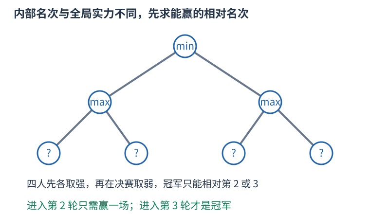

# P10767 求每棵签表子树的冠军相对名次区间，再合并同轮位置 题解

## 目录

| 题号 | 题名 | 考点 | 难度 |
|---|---|---|---|
| A | 在相思树下 II | 树形 DP | 2100 |

## A. 在相思树下 II

> 原题：[P10767](https://www.luogu.com.cn/problem/P10767)
> 解法：求每棵签表子树的冠军相对名次区间，再合并同轮位置 · C++17

### 题意

满淘汰赛每场指定取强者或弱者，参赛者位置可任意安排；逐问某实力$a$是否存在安排能进入第$b$轮，冠军视作进入$n$加一轮。

<!-- reusable-foundations:start -->

### 从零讲：C++ 输入输出：把数据读进变量，把结果写到标准输出

程序运行时从标准输入接收题目给的数据，把答案送到标准输出。`cin` 和 `cout` 定义在 `<iostream>`；写 `using namespace std;` 后可以省略它们前面的 `std::`。最小完整程序是：

```cxx
#include <iostream>
using namespace std;
int main() {
    int a, b;
    cin >> a >> b;
    cout << a + b << '\n';
    return 0;
}
```

输入二十和三十，两个变量分别保存二十、三十，输出五十。`int a, b;` 声明两个整数变量；`cin >> a` 才给变量赋入输入值。多个 `>>` 从左到右读取，读取整数时会跳过空格、制表符、换行，所以两个整数可以分处两行。负号属于整数，不需要另读一个符号。

`cout <<` 后可以接数值、字符或字符串。`' '` 是一个空格字符，`'\n'` 是换行字符，`"Hello"` 是字符串。`cout << a << ' ' << b << '\n';` 输出两个以空格分开的整数并换行。评测程序只需要答案，不应加入“请输入”等提示。

读取 `char c; cin >> c;` 会跳过前导空白。要读取包含空格的一整行，用 `<string>` 中的 `string s; getline(cin, s);`。若此前用 `cin >> n` 读取过整数，换行还留在输入中，需要先处理那一个剩余换行；不能盲目把所有空格都删掉，因为字符画的行首空格和文本中的空格可能就是数据。

`fixed << setprecision(3)`（需要 `<iomanip>`）表示以小数形式保留三位小数，例如把 $2.5$ 输出成 $2.500$；不用 `fixed` 时，`setprecision` 指有效数字总数。设置会影响后续输出，使用前应确认所需精度。

竞赛中可在首次输入输出前调用 `ios::sync_with_stdio(false); cin.tie(nullptr);`，减少 C++ 流与 C 标准输入输出的同步、绑定开销。随后保持使用 `cin/cout`，不要混用另一套 `scanf/printf`。交互题还要在需要对方回应前主动刷新，例如 `cout << query << endl;`；普通题用换行字符即可。

读入长度为 $L$ 的文本、或输出 $L$ 个字符，至少需要 $O(L)$ 时间。数据类型仍要能容纳结果：把两个整数相乘时，即使保存到 `long long`，也要让乘法本身在这个类型中进行，例如先把输入声明为 `long long`。

### 从零讲：分支与循环：按条件选择，按次序重复

`if (条件) { ... } else { ... }` 根据条件的真假选择一条分支。比较运算 `==`、`!=`、`<`、`<=`、`>`、`>=` 返回真假值；`=` 是赋值，不能代替相等比较。`&&` 表示两边都成立，`||` 表示至少一边成立，`!` 把真假反转。

```cxx
int score = 85;
if (score >= 90) cout << "A";
else if (score >= 60) cout << "B";
else cout << "C"; // 这个例子输出 B
```

这条分支链只执行第一个符合条件的分支。先处理高分后，第二个条件自然只会接到低于九十分的数。几个独立的 `if` 则可能执行多次；两种结构代表不同问题。逻辑运算会短路：`i < n && a[i] == 0` 先确认下标合法，才读取那一格。

`for (初始化; 继续条件; 每轮更新)` 适合知道重复范围的情况。例如下列代码依次处理一到四，总和是十：

```cxx
int sum = 0;
for (int i = 1; i <= 4; ++i) {
    sum += i;
}
cout << sum;
```

初始化只做一次；每轮先判断条件，条件为真才执行循环体，随后执行更新。`++i` 把 $i$ 加一，`sum += i` 等价于把旧 sum 加 $i$ 再保存。应明确每个变量在循环前、循环后分别表示什么；最大值相同时是否更新，决定了保留较早还是较晚的答案。

`while (条件)` 适合“不满足目标就再做一步”：

```cxx
int x = 13, times = 0;
while (x > 1) {
    x /= 2;
    ++times;
}
// x 依次是 13、6、3、1，执行三次
```

循环开始前先检查条件，初始已满足目标时可能一次也不执行。每次执行必须推进状态，否则可能无限循环。`break` 结束最内层循环，`continue` 跳过本轮剩余部分；`for` 中的 continue 之后仍会执行每轮更新。

复杂度由实际执行次数决定。上述求和执行 $n$ 次是 $O(n)$；每次将正整数减半只执行 $O(\log n)$ 次。两层循环不能仅凭外观判定为平方：内层若总共只前进 $n$ 次，总量仍可能线性。变量应在正确作用范围初始化；多组数据的计数器若未重置，下一组会错误继承上一组结果。

### 从零讲：vector：长度可变的连续数组

`vector<T>` 保存一串同类型的元素，适合按下标访问、扫描、排序。`T` 是元素类型，例如 `vector<int>` 保存整数，`vector<pair<int,int>>` 保存整数对，`vector<vector<int>>` 可保存每个顶点各自的邻居。需要 `<vector>`。

```cxx
vector<int> a(3, 7);   // 三个元素，内容是 7、7、7
a.push_back(9);       // 在末尾追加，现在长度为 4
int x = a[1];         // 从 0 编号，这里得到 7
a[1] = 2;            // 改第二个元素
int n = int(a.size());
```

`vector<int> a(3)` 创建三个值为零的元素；`a.reserve(3)` 只预留容量，元素数仍为零，此时不能访问 `a[0]`。长度 `size()` 与容量 `capacity()` 是不同概念。

下标访问为 $O(1)$，遍历为 $O(n)$。末尾追加通常为 $O(1)$；容量不足时会分配更大的连续空间并搬移元素，这次可能为 $O(n)$，一连串追加的平均成本称为摊还 $O(1)$。中间插入或删除会搬移后续元素，最坏 $O(n)$。内存是元素量的 $O(n)$，并可能预留部分尚未使用的容量。

`begin()` 指向首元素，`end()` 指向尾后位置，`sort(a.begin(),a.end())` 操作整个数组。`a[i]` 不检查越界；下标须满足 $0\le i<\mathrm{size}$。`at(i)` 会检查越界并抛异常。空数组不能访问 `front()`、`back()`；`pop_back()` 也要求非空。

扩容后指向旧存储的迭代器、引用和指针会失效。遍历的同时 `push_back`，不能假定此前取得的引用仍可用。读取大数组的函数常用 `const vector<int>& a` 按常量引用传入，既不复制也禁止通过该引用修改；`vector<int> a` 按值传参则复制内容。选择副本还是引用取决于是否要保留独立数据。

### 从零讲：整数类型、整除与溢出

计算前先看每一步可能达到的范围。常见环境中 `int` 是 32 位，上界约 $2.1\times10^9$；`long long` 至少 64 位，常见有符号 64 位上界约 $9.22\times10^{18}$。`using ll = long long;` 只是为已有类型起别名。

```cxx
int a = 100000, b = 100000;
long long wrong = a * b;      // 右边先按 int 乘，可能已溢出
long long right = 1LL * a * b; // 先把运算提升到 long long
```

不能指望“接收结果的变量够大”修复此前已经溢出的计算。先提高操作数类型，再做乘法。超过 64 位时，GCC 的 `__int128` 可作中间量，但它不是标准 C++17 类型，也没有标准流输出重载；先证明范围，再选择工具。

整数 `/` 对有符号数向零截断：`7/3==2`、`-7/3==-2`。对非负数才等于向下取整。余数满足 `a == (a/b)*b + a%b`，除数不能为零；要将余数归入 $[0,m-1]$（$m>0$），可用 `(a % m + m) % m`，同时保证中间加法不溢出。

非负 $a$、正 $b$ 的向上取整可写 `a/b + (a%b != 0)`，比 `(a+b-1)/b` 更容易避免加法溢出。比较平方时也应在宽类型内计算；浮点数不适合作为大整数相等的默认判断方式。

`size()` 返回无符号类型。空容器上写 `size()-1` 会绕到很大的数，逆序遍历可以先转成有符号、确认长度，或使用逆向迭代器。`abs` 对最小有符号数无法在同类型中表达其正值，需先约束输入差值范围。一般机器整数运算按常数时间估算，宽类型解决表示范围，不改变算法的增长阶。

### 从零讲：具名函数：给可复用计算一个明确接口

函数把一段计算包装成“输入参数 → 返回结果”。例如判断整数是否为偶数：

```cxx
bool even(int x) {
    return x % 2 == 0;
}
int main() {
    bool a = even(8); // a 为 true
    bool b = even(7); // b 为 false
}
```

`bool` 是返回类型，`even` 是函数名，`int x` 是参数声明。调用 `even(8)` 时，实参八传入这个新调用的局部变量 $x$，执行 return 后把真假值交回调用处。定义本身不执行计算，只有调用才执行。函数应在调用处之前定义，或提前写声明。

普通数值参数按值传递，函数里修改 $x$ 不会改变调用者原变量。参数写成 `int &x` 时才引用调用者对象；必须让这个对象在调用期间有效。`const vector<int>& a` 用引用避免复制整个容器，并承诺不通过这个引用修改它。返回局部变量的值是安全的，返回局部变量的引用则在函数结束后失效。

函数名应说明它回答的问题，调用处负责传哪些数据。例如闰年判定只接收一个年份并返回真假，枚举年份范围和输出格式由调用者处理。同一判定被多次使用时，这能减少规则不一致；但函数包装不会自动降低算法复杂度，仍要把每次调用实际做的工作计入时间。

如果函数内部又调用自身，就是递归，需要明确最小情况如何直接返回、每次调用如何逼近它；递归会占用调用栈。普通辅助函数可以不使用递归，不应仅因写成函数就称作递归算法。

### 从零讲：树的根、子树、DFS 序与倍增

树是连通且无环的无向图，$n$ 个顶点有 $n-1$ 条边。指定一个根后，每个非根顶点有唯一父亲，其他向下邻居是孩子。子树包含自己和全部后代；换根会改变父子关系，但不改变原边。


#### 子树信息按依赖顺序计算

例如子树大小 `size[u]` 初始为一，每个孩子处理完后累加 `size[v]`。一来自节点自己，不能漏掉。树形 DP 也如此：先明确某状态允许怎样选择，再合并各孩子提供的信息；孩子独立性来自树上没有跨子树边，仍可能因总预算或选中父亲等条件产生状态关联。

换根 DP 先求一个根的状态，再沿边换根，将“来自孩子的一侧”和“来自父亲的一侧”合并。应画清只有哪条边的方向改变、哪些量不变；不能仅凭两张答案表代替依赖解释。普通遍历每条边常数次为 $O(n)$，背包式合并可能更大，按实际合并循环计算。

#### DFS 序为什么能把子树变成区间

进入节点时分配编号 `tin[u]`，完成整棵子树后记录最后编号 `tout[u]`。深度优先在返回父亲前会完整处理这棵子树，因此它的所有编号连续，恰是 $[tin[u],tout[u]]$。这允许把子树和等查询交给数组结构。若同时记录进出事件，区间定义会不同，不可混用两种序列。

#### 倍增与最近公共祖先

`up[k][u]` 存 $u$ 向上 $2^k$ 条边到达的祖先。基础 `up[0][u]=parent[u]`，递推为 `up[k][u]=up[k-1][up[k-1][u]]`，因为连续走两段 $2^{k-1}$。跳十三层可拆为八加四加一，只需对数个跳跃。

LCA 是两个节点公共祖先中最深者。先把更深的一方跳到同深度；若已经相同就是答案。否则从大到小试跳，祖先不同才两边同时上移，最后它们的父亲就是 LCA。预处理 $O(n\log n)$、每次查询 $O(\log n)$，表空间 $O(n\log n)$。根的虚拟祖先需统一定义，不能访问非法下标。

树的直径在非负无权边长等常见条件下可用两次最远点搜索求出；带负权时要重新判断。虚树则将关注节点按 DFS 序组织，补上相邻节点的 LCA 后连接祖先关系，边应携带原路径含义，不能把压缩后一条边误当原图一步。深链上的递归也须留意栈深度。

### 从零讲：动态规划：保存明确子问题的答案

若多个决策会反复遇到相同的剩余问题，可以为每个不同问题保存一次答案。状态不是“当前操作到了哪儿”的模糊描述，而是一个有完整条件、能独立提问的问题。

例如台阶一次走一或二级，求到达第 $i$ 级的方式数。令 $f_i$ 为恰好到第 $i$ 级的方案数。最后一步只有两类：从 $i-1$ 走一级，或从 $i-2$ 走两级，类别互斥且覆盖所有方案，所以 $f_i=f_{i-1}+f_{i-2}$。


起点 $f_0=1$ 表示原地不走的一种空方案，$f_1=1$。于是 $f_2=2,f_3=3,f_4=5$。从小到大计算，因为当前格依赖的格都已经完成。`f[0]=0` 会把“空方案”错误删掉。

```cxx
vector<long long> f(n + 1, 0);
f[0] = 1;
for (int i = 1; i <= n; ++i) {
    f[i] = f[i - 1];
    if (i >= 2) f[i] += f[i - 2];
}
```

另一个问题若问最小费用，就应对候选取 `min`；问最大收益取 `max`；问数量才在不重不漏的分类下相加。不能只把加号替换掉，初值也要随状态含义重新决定。不可达状态应与合法的零答案区别。

时间通常为状态数乘每个状态枚举的转移数，本例 $O(n)$；保存整表用 $O(n)$。只依赖最近两格时可滚动到 $O(1)$ 空间，但要先保存仍需读取的旧值。若下标不够决定后续可选动作，就缺少状态维度，不能把不同问题混在同一格。

检查一份 DP 时依次核对：状态的问题、基础答案、最后一步分类、依赖计算顺序、最终读哪一格。记忆化搜索使用同样的子问题，只是按递归需要计算；它也需要终止条件并避免状态依赖成环。

<!-- reusable-foundations:end -->

### 思路




不同询问只问各自是否存在一种安排，可以采用不同的选手分布。实力编号越大越强；进入第二轮表示先赢一场，进入$n$加一轮才表示夺冠，轮数不能直接当已经获胜次数。

先看某棵含M个选手的签表，忽略全局编号，只按内部实力从小到大排第一至第M。记冠军最小可能名次lo、最大可能名次hi。可能名次之间没有缺口：全体排列可通过交换相邻实力值相互到达，而这种交换让冠军名次至多变化一，所以从最小走到最大会经过每个中间名次。

叶子只有一人，lo与hi都为一。若根比赛取较强者，两侧都要能产生不超过最终冠军的赢家，最小可行名次为lo_L+lo_R；最大名次则让某侧取自己的最高赢家，并把另一侧人数全部放到它下面，取两种位置的较大值。

若根取较弱者，最小名次可取两侧lo的较小者；最大名次为hi_L+hi_R-1。也可通过把所有实力大小反转、同时交换$\max$与$\min$规则，从前一组公式对称得到这一组。

回到全局N个选手，想让实力$a$在某个M人子树里获胜，至少要能提供lo-1个比它弱的对手，以及M-hi个比它强的对手。可行相对名次是连续区间，因此两个数量条件也充分，等价于

$$lo\le a\le N-M+hi.$$

查询进入第$b$轮，对应赢下高度$h=b-1$的某棵子树。若不是整棵签表，M不超过N的一半，每个位置的可行区间都包含M至N-M+1这一段，彼此有交集；所以它们的并集只需保存最小左端与最大右端。整棵签表只有一个位置，也无需额外合并。

输入从冠军赛开始、按层给规则，正好对应二叉堆编号。自底向上求完lo、hi后，按高度汇总两个边界；第一轮尚未比赛，所有实力都可进入。之后每问只需一次区间判断。

N为参赛人数，时间 $O(N+m)$，空间 $O(N)$。

### 参考代码

```cpp
#include <bits/stdc++.h>
using namespace std;

int main() {
    ios::sync_with_stdio(false);
    cin.tie(nullptr);
int n,queries;cin>>n>>queries;int total=1<<n;
vector<int>rule(total);for(int u=1;u<total;++u) cin>>rule[u];
vector<int>low(2*total,1),high(2*total,1),size(2*total,1);
for(int u=total-1;u>=1;--u){
    int l=2*u,r=l+1;size[u]=size[l]+size[r];
    if(rule[u]==1){low[u]=low[l]+low[r];high[u]=max(high[l]+size[r],high[r]+size[l]);}
    else{low[u]=min(low[l],low[r]);high[u]=high[l]+high[r]-1;}
}
vector<int>leftBound(n+1,1),rightBound(n+1,total);
for(int height=1;height<=n;++height){
    leftBound[height]=total;rightBound[height]=0;
    for(int u=total>>height;u<(total>>(height-1));++u){
        leftBound[height]=min(leftBound[height],low[u]);
        rightBound[height]=max(rightBound[height],total-size[u]+high[u]);
    }
}
while(queries--){int a,b;cin>>a>>b;int height=b-1;cout<<(leftBound[height]<=a&&a<=rightBound[height]?"Yes":"No")<<'\n';}
    return 0;
}
```

### 易错点

全局实力与子树相对名次不同；进入$b$轮只赢$b$减一场；输入规则从根往下；同高度区间合并须有重叠理由；询问独立；首轮全部可行。

## 实测记录

本地 C++17 编译、1 组原站样例与 141 组独立边界/小域校验通过。
正文参考程序与源码逐字核对；没有向原站提交。
