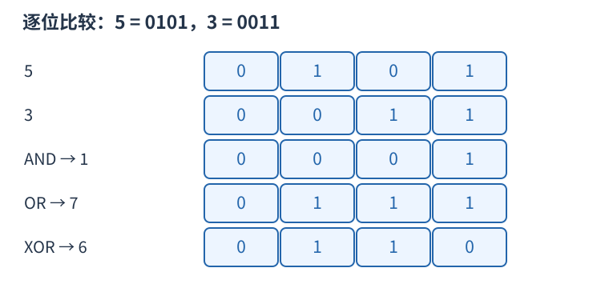
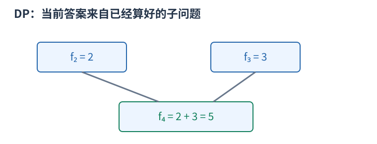
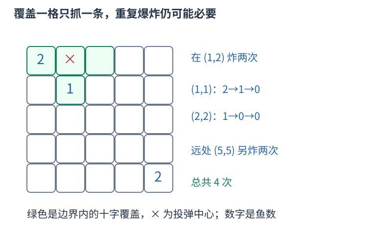

# P10865 每个鱼格用两位记录剩余条数，一次爆炸各减一 题解

## 目录

| 题号 | 题名 | 考点 | 难度 |
|---|---|---|---|
| A | Genshin Impact Startup Forbidden III | 状压 DP + 位运算 | 1800 |

## A. Genshin Impact Startup Forbidden III

> 原题：[P10865](https://www.luogu.com.cn/problem/P10865)
> 解法：每个鱼格用两位记录剩余条数，一次爆炸各减一 · C++17

### 题意

在网格投十字形炸弹，每个覆盖鱼格抓走一条鱼；每格一至三条，求抓光全部鱼的最少炸弹数，位置可以重复使用。

<!-- reusable-foundations:start -->

### 从零讲：C++ 输入输出：把数据读进变量，把结果写到标准输出

程序运行时从标准输入接收题目给的数据，把答案送到标准输出。`cin` 和 `cout` 定义在 `<iostream>`；写 `using namespace std;` 后可以省略它们前面的 `std::`。最小完整程序是：

```cxx
#include <iostream>
using namespace std;
int main() {
    int a, b;
    cin >> a >> b;
    cout << a + b << '\n';
    return 0;
}
```

输入二十和三十，两个变量分别保存二十、三十，输出五十。`int a, b;` 声明两个整数变量；`cin >> a` 才给变量赋入输入值。多个 `>>` 从左到右读取，读取整数时会跳过空格、制表符、换行，所以两个整数可以分处两行。负号属于整数，不需要另读一个符号。

`cout <<` 后可以接数值、字符或字符串。`' '` 是一个空格字符，`'\n'` 是换行字符，`"Hello"` 是字符串。`cout << a << ' ' << b << '\n';` 输出两个以空格分开的整数并换行。评测程序只需要答案，不应加入“请输入”等提示。

读取 `char c; cin >> c;` 会跳过前导空白。要读取包含空格的一整行，用 `<string>` 中的 `string s; getline(cin, s);`。若此前用 `cin >> n` 读取过整数，换行还留在输入中，需要先处理那一个剩余换行；不能盲目把所有空格都删掉，因为字符画的行首空格和文本中的空格可能就是数据。

`fixed << setprecision(3)`（需要 `<iomanip>`）表示以小数形式保留三位小数，例如把 $2.5$ 输出成 $2.500$；不用 `fixed` 时，`setprecision` 指有效数字总数。设置会影响后续输出，使用前应确认所需精度。

竞赛中可在首次输入输出前调用 `ios::sync_with_stdio(false); cin.tie(nullptr);`，减少 C++ 流与 C 标准输入输出的同步、绑定开销。随后保持使用 `cin/cout`，不要混用另一套 `scanf/printf`。交互题还要在需要对方回应前主动刷新，例如 `cout << query << endl;`；普通题用换行字符即可。

读入长度为 $L$ 的文本、或输出 $L$ 个字符，至少需要 $O(L)$ 时间。数据类型仍要能容纳结果：把两个整数相乘时，即使保存到 `long long`，也要让乘法本身在这个类型中进行，例如先把输入声明为 `long long`。

### 从零讲：分支与循环：按条件选择，按次序重复

`if (条件) { ... } else { ... }` 根据条件的真假选择一条分支。比较运算 `==`、`!=`、`<`、`<=`、`>`、`>=` 返回真假值；`=` 是赋值，不能代替相等比较。`&&` 表示两边都成立，`||` 表示至少一边成立，`!` 把真假反转。

```cxx
int score = 85;
if (score >= 90) cout << "A";
else if (score >= 60) cout << "B";
else cout << "C"; // 这个例子输出 B
```

这条分支链只执行第一个符合条件的分支。先处理高分后，第二个条件自然只会接到低于九十分的数。几个独立的 `if` 则可能执行多次；两种结构代表不同问题。逻辑运算会短路：`i < n && a[i] == 0` 先确认下标合法，才读取那一格。

`for (初始化; 继续条件; 每轮更新)` 适合知道重复范围的情况。例如下列代码依次处理一到四，总和是十：

```cxx
int sum = 0;
for (int i = 1; i <= 4; ++i) {
    sum += i;
}
cout << sum;
```

初始化只做一次；每轮先判断条件，条件为真才执行循环体，随后执行更新。`++i` 把 $i$ 加一，`sum += i` 等价于把旧 sum 加 $i$ 再保存。应明确每个变量在循环前、循环后分别表示什么；最大值相同时是否更新，决定了保留较早还是较晚的答案。

`while (条件)` 适合“不满足目标就再做一步”：

```cxx
int x = 13, times = 0;
while (x > 1) {
    x /= 2;
    ++times;
}
// x 依次是 13、6、3、1，执行三次
```

循环开始前先检查条件，初始已满足目标时可能一次也不执行。每次执行必须推进状态，否则可能无限循环。`break` 结束最内层循环，`continue` 跳过本轮剩余部分；`for` 中的 continue 之后仍会执行每轮更新。

复杂度由实际执行次数决定。上述求和执行 $n$ 次是 $O(n)$；每次将正整数减半只执行 $O(\log n)$ 次。两层循环不能仅凭外观判定为平方：内层若总共只前进 $n$ 次，总量仍可能线性。变量应在正确作用范围初始化；多组数据的计数器若未重置，下一组会错误继承上一组结果。

### 从零讲：vector：长度可变的连续数组

`vector<T>` 保存一串同类型的元素，适合按下标访问、扫描、排序。`T` 是元素类型，例如 `vector<int>` 保存整数，`vector<pair<int,int>>` 保存整数对，`vector<vector<int>>` 可保存每个顶点各自的邻居。需要 `<vector>`。

```cxx
vector<int> a(3, 7);   // 三个元素，内容是 7、7、7
a.push_back(9);       // 在末尾追加，现在长度为 4
int x = a[1];         // 从 0 编号，这里得到 7
a[1] = 2;            // 改第二个元素
int n = int(a.size());
```

`vector<int> a(3)` 创建三个值为零的元素；`a.reserve(3)` 只预留容量，元素数仍为零，此时不能访问 `a[0]`。长度 `size()` 与容量 `capacity()` 是不同概念。

下标访问为 $O(1)$，遍历为 $O(n)$。末尾追加通常为 $O(1)$；容量不足时会分配更大的连续空间并搬移元素，这次可能为 $O(n)$，一连串追加的平均成本称为摊还 $O(1)$。中间插入或删除会搬移后续元素，最坏 $O(n)$。内存是元素量的 $O(n)$，并可能预留部分尚未使用的容量。

`begin()` 指向首元素，`end()` 指向尾后位置，`sort(a.begin(),a.end())` 操作整个数组。`a[i]` 不检查越界；下标须满足 $0\le i<\mathrm{size}$。`at(i)` 会检查越界并抛异常。空数组不能访问 `front()`、`back()`；`pop_back()` 也要求非空。

扩容后指向旧存储的迭代器、引用和指针会失效。遍历的同时 `push_back`，不能假定此前取得的引用仍可用。读取大数组的函数常用 `const vector<int>& a` 按常量引用传入，既不复制也禁止通过该引用修改；`vector<int> a` 按值传参则复制内容。选择副本还是引用取决于是否要保留独立数据。

### 从零讲：整数类型、整除与溢出

计算前先看每一步可能达到的范围。常见环境中 `int` 是 32 位，上界约 $2.1\times10^9$；`long long` 至少 64 位，常见有符号 64 位上界约 $9.22\times10^{18}$。`using ll = long long;` 只是为已有类型起别名。

```cxx
int a = 100000, b = 100000;
long long wrong = a * b;      // 右边先按 int 乘，可能已溢出
long long right = 1LL * a * b; // 先把运算提升到 long long
```

不能指望“接收结果的变量够大”修复此前已经溢出的计算。先提高操作数类型，再做乘法。超过 64 位时，GCC 的 `__int128` 可作中间量，但它不是标准 C++17 类型，也没有标准流输出重载；先证明范围，再选择工具。

整数 `/` 对有符号数向零截断：`7/3==2`、`-7/3==-2`。对非负数才等于向下取整。余数满足 `a == (a/b)*b + a%b`，除数不能为零；要将余数归入 $[0,m-1]$（$m>0$），可用 `(a % m + m) % m`，同时保证中间加法不溢出。

非负 $a$、正 $b$ 的向上取整可写 `a/b + (a%b != 0)`，比 `(a+b-1)/b` 更容易避免加法溢出。比较平方时也应在宽类型内计算；浮点数不适合作为大整数相等的默认判断方式。

`size()` 返回无符号类型。空容器上写 `size()-1` 会绕到很大的数，逆序遍历可以先转成有符号、确认长度，或使用逆向迭代器。`abs` 对最小有符号数无法在同类型中表达其正值，需先约束输入差值范围。一般机器整数运算按常数时间估算，宽类型解决表示范围，不改变算法的增长阶。

### 从零讲：具名函数：给可复用计算一个明确接口

函数把一段计算包装成“输入参数 → 返回结果”。例如判断整数是否为偶数：

```cxx
bool even(int x) {
    return x % 2 == 0;
}
int main() {
    bool a = even(8); // a 为 true
    bool b = even(7); // b 为 false
}
```

`bool` 是返回类型，`even` 是函数名，`int x` 是参数声明。调用 `even(8)` 时，实参八传入这个新调用的局部变量 $x$，执行 return 后把真假值交回调用处。定义本身不执行计算，只有调用才执行。函数应在调用处之前定义，或提前写声明。

普通数值参数按值传递，函数里修改 $x$ 不会改变调用者原变量。参数写成 `int &x` 时才引用调用者对象；必须让这个对象在调用期间有效。`const vector<int>& a` 用引用避免复制整个容器，并承诺不通过这个引用修改它。返回局部变量的值是安全的，返回局部变量的引用则在函数结束后失效。

函数名应说明它回答的问题，调用处负责传哪些数据。例如闰年判定只接收一个年份并返回真假，枚举年份范围和输出格式由调用者处理。同一判定被多次使用时，这能减少规则不一致；但函数包装不会自动降低算法复杂度，仍要把每次调用实际做的工作计入时间。

如果函数内部又调用自身，就是递归，需要明确最小情况如何直接返回、每次调用如何逼近它；递归会占用调用栈。普通辅助函数可以不使用递归，不应仅因写成函数就称作递归算法。

### 从零讲：位运算：把非负整数看成一组二进制开关

五写成二进制为 $0101_2$，三为 $0011_2$。同一列各代表一位：按位与 `&` 两边都为一才得一，按位或 `|` 任一为一就得一，按位异或 `^` 不同才为一。所以 $5\mathbin{\&}3=1$，$5\mathbin{|}3=7$，$5\mathbin{\oplus}3=6$。



`1ULL << k` 把一移到第 $k$ 位。对非负无符号整数，`(mask >> k) & 1ULL` 读该位，`mask | (1ULL<<k)` 置一，`mask & ~(1ULL<<k)` 清零，`mask ^ (1ULL<<k)` 翻转。最低位编号为零。

```cxx
unsigned long long mask = 5; // 第 0、2 位为一
bool has = (mask >> 2) & 1ULL; // true
mask |= 1ULL << 1;             // 变成 7
```

位移次数必须小于类型位宽，且不能为负；不要用普通 `1` 去移到超出 int 范围的位置。C++17 有符号负数右移和溢出的规则不适合直接套“乘除二的幂”，用明确范围的无符号数更容易保证行为。`^` 是异或，绝不是乘方。

逻辑与 `&&`、逻辑或 `||` 将整体条件视为真假，并会短路；按位 `&`、`|` 逐位计算，不会因此跳过右侧表达式。运算符优先级可能与直觉不同，写 `(mask & bit) != 0`，别省掉关键括号。

固定机器字内的一次位运算按 $O(1)$ 估算；枚举全部 $k$ 位状态仍有 $2^k$ 种，不能因为每次运算快就忽略状态数。`x & (x-1)` 对正无符号数清掉最低的一位；GCC 的 `__builtin_popcountll(x)` 统计一的数量，注意实参位宽与具体编译器支持。

### 从零讲：动态规划：保存明确子问题的答案

若多个决策会反复遇到相同的剩余问题，可以为每个不同问题保存一次答案。状态不是“当前操作到了哪儿”的模糊描述，而是一个有完整条件、能独立提问的问题。

例如台阶一次走一或二级，求到达第 $i$ 级的方式数。令 $f_i$ 为恰好到第 $i$ 级的方案数。最后一步只有两类：从 $i-1$ 走一级，或从 $i-2$ 走两级，类别互斥且覆盖所有方案，所以 $f_i=f_{i-1}+f_{i-2}$。



起点 $f_0=1$ 表示原地不走的一种空方案，$f_1=1$。于是 $f_2=2,f_3=3,f_4=5$。从小到大计算，因为当前格依赖的格都已经完成。`f[0]=0` 会把“空方案”错误删掉。

```cxx
vector<long long> f(n + 1, 0);
f[0] = 1;
for (int i = 1; i <= n; ++i) {
    f[i] = f[i - 1];
    if (i >= 2) f[i] += f[i - 2];
}
```

另一个问题若问最小费用，就应对候选取 `min`；问最大收益取 `max`；问数量才在不重不漏的分类下相加。不能只把加号替换掉，初值也要随状态含义重新决定。不可达状态应与合法的零答案区别。

时间通常为状态数乘每个状态枚举的转移数，本例 $O(n)$；保存整表用 $O(n)$。只依赖最近两格时可滚动到 $O(1)$ 空间，但要先保存仍需读取的旧值。若下标不够决定后续可选动作，就缺少状态维度，不能把不同问题混在同一格。

检查一份 DP 时依次核对：状态的问题、基础答案、最后一步分类、依赖计算顺序、最终读哪一格。记忆化搜索使用同样的子问题，只是按递归需要计算；它也需要终止条件并避免状态依赖成环。

### 从零讲：状态压缩与记忆化：把集合也作为状态的一部分

对象数量很少、每个只区分选或没选时，可用二进制位表示集合。第 $k$ 位为一代表第 $k$ 项在集合里，三项的全部集合为掩码零到七。

例如掩码五的二进制是 $101_2$，表示选第零、第二项。`mask | (1<<k)` 加入 $k$，`(mask>>k)&1` 判断是否已经选，状态数量为 $2^n$，不是 $n$。

一个常见状态 `dp[mask][last]` 表示恰好访问 mask 中的顶点、最后停在 last 的最小费用。只存 mask 不足以确定下一条边的代价，因为不同终点的后续选择不同。起点状态为零，其余为不可达；尝试加入尚未选的 next，更新对应新集合和终点。

状态数 $O(n2^n)$，每个枚举 $n$ 个下一步时为 $O(n^2 2^n)$，表空间 $O(n2^n)$。$n$ 稍增，指数即成为瓶颈；位运算为常数不意味着整体线性。位移不能越过整型位宽。

记忆化按“需要某状态才计算”的方式保存结果。不能用零兼作“尚未计算”，因为零可能是合法最优值或方案数；单独保存访问状态。缓存键要包含每个影响未来的条件，若函数还读取会变化的外部数组，旧缓存可能不再对应同一个问题。

数位 DP 将数字按位构造，状态常有位置、是否仍受上界限制、是否已开始、问题所需的余数或计数。前导零是否算有效数字需按题意定义，带 tight 的状态不能随意跨不同上界复用。区间 DP 则按区间长度增加，保证读取的子区间已完成；两类 DP 的具体状态仍须从目标推导，不能只换数组名字。

### 从零讲：set、multiset 与有序邻居

`set<T>` 保留互不相同的元素并按比较器排序，适合动态判断存在、查前驱后继；`multiset<T>` 允许重复值。插入、按键查找和成员二分通常为 $O(\log n)$，空间为 $O(n)$。`unordered_set` 是哈希集合，平均查询快，但没有大小顺序。

```cxx
set<int> s{2, 5, 9};
auto it = s.lower_bound(6); // 指向 9，第一个 >=6 的数
if (it != s.end()) cout << *it;
if (it != s.begin()) cout << *prev(it); // 前驱是 5
```

`lower_bound` 等于 `end()` 表示没有更大的候选；它仍可能有前驱。等于 `begin()` 表示没有前驱，不能再向前移动。空集合尤其要先检查。

`multiset` 中 `erase(value)` 删除所有等于该值的项；只删一个应先 `find`，确认找到后 `erase(it)`。`set` 会自动去重，若多个相同记录必须各算一次，就不能直接把它们塞进普通集合后拿集合长度作答案。

关联容器的迭代器不支持相减。查询边界位置快，不等于“边界前有几个元素”也能快；对 `set` 调 `distance(begin,it)` 可能走过线性多个节点。大量秩查询可考虑离散化加树状数组或支持秩的数据结构。

### 从零讲：pair、tuple 与结构化绑定

有些数据天然需要成组：一个区间有两个端点，一个队列状态有坐标和距离。`pair<A,B>` 保存两项，用 `.first`、`.second` 读取；`tuple<A,B,C>` 可保存更多项，用 `get<0>(t)` 等读取。分别需要 `<utility>`、`<tuple>`。

C++17 的结构化绑定能为一组分量起局部名字：

```cxx
pair<int,int> point{3, 5};
auto [x, y] = point;      // 复制出两个分量
x = 9;                  // point.first 仍为 3
auto& [u, v] = point;    // 绑定原对象的分量
u = 7;                  // point.first 变为 7
```

`for (auto [l,r] : segments)` 每轮读取一对值；`for (const auto& [l,r] : segments)` 以只读引用读取，避免复制；需要修改原记录时才用 `auto&`。引用必须在原对象还存在且位置未失效时使用。

`pair` 和 `tuple` 的默认比较是字典序：从第一项起，第一个不同的分量决定顺序。`priority_queue<pair<int,int>>` 因而先比较第一项，再以第二项破同分，不能误认为只看第一项。这类语法只让记录组织和访问更清楚，拆分本身的成本取决于分量是否需要复制。

### 从零讲：离散化、扫描线与连续区间

坐标可达十亿但只出现少量位置时，如果问题只依赖相对顺序，就可以把不同坐标排序去重，映射为连续排名。例如 $[100,5,100,20]$ 的不同坐标为 $[5,20,100]$，排名为 $[2,0,2,1]$。

```cxx
vector<int> values = a;
sort(values.begin(), values.end());
values.erase(unique(values.begin(), values.end()), values.end());
int rank = int(lower_bound(values.begin(), values.end(), x) - values.begin());
```

`unique` 把不同值移到前面，返回新的逻辑末尾；`erase` 才真正缩短长度。映射保留相等性与大小关系，不保留距离：五到二十距离十五，排名却只差一。几何长度、空隙数量或相邻整数关系须保留原值或带权间隙，不能直接用排名差。

扫描线将左右端点等事件按坐标排序，沿轴移动时只处理变化，避免扫描所有空坐标。例如闭区间在位置 $x$ 查询覆盖次数，应先加入左端等于 $x$ 的区间，查询时还保留右端等于 $x$ 的区间，之后才移除它们。相同坐标的事件先后取决于闭开边界，不能统一按任意事件编号排序。

连续段指满足某条件的一串相邻位置。相邻位置是原数组下标相差一，还是不同整数值相差一，要先明确；去重排序后相邻两个值未必是连续整数。扫描一段时常维护段首和段尾，变化处结算，最后一段也须处理。

排序预处理 $O(n\log n)$，映射每次二分 $O(\log n)$，扫描事件 $O(n)$ 加维护结构成本，空间通常 $O(n)$。若本来就有两个排序端点数组，纯计数查询可能不需另建离散坐标数组。

<!-- reusable-foundations:end -->

### 思路




原样例在一一格有两条鱼，所以覆盖它的一次爆炸只能抓一条，还要再炸；不能把“覆盖一个格子”误当“一次清空这格”。同一个中心可以多次投弹，每次对各覆盖格分别抓走至多一条。

一次爆炸覆盖中心和上下左右四格。若它碰不到任何鱼，投下必无帮助；否则中心一定是某个鱼格自身或它的四邻格。因此至多枚举五倍鱼格数个中心，合并相同覆盖集合即可。边界外的中心即使允许，也至多覆盖边界的单个鱼格，不优于直接炸这个鱼格，所以只枚举网格内中心足够。

对第$i$个鱼格用两位保存剩余数，合法值为零一二三。整个状态S是这些四进制位拼成的整数。S减掉某个非零四进制位上的一，只会令这格鱼数减一，不会向另一格借位。

怎样一次取出所有非零位？每格的低二进制位，或上它的高位右移一位，便表示这格是否非零；再用lowBits仅保留每格的低位。于是nonzero在每个有鱼格的低位为一。与炸弹覆盖的低位掩码cover相交，得到这次实际扣减量dec。

若dec为零，这颗炸弹没有抓鱼，跳过；否则下个状态为S减dec，数值严格小于S。令$f$[零]为零，从小到大枚举剩余状态，比较一加$f$[下个状态]。

即使完整编码表里有些状态的鱼数大于输入，该状态也不会由真实起点减鱼到达，不会影响所问答案。表最多四的十次方个状态，每次炸弹用常数次位运算完成同时扣减。

候选中心至多5k个，时间 $O(k^2+k4^k)$，空间 $O(4^k+k)$。

### 参考代码

```cpp
#include <bits/stdc++.h>
using namespace std;

int main() {
    ios::sync_with_stdio(false);
    cin.tie(nullptr);
int n,m,k;cin>>n>>m>>k;vector<int>x(k),y(k),fish(k);for(int i=0;i<k;++i) cin>>x[i]>>y[i]>>fish[i];
set<pair<int,int>>centers;int dx[5]={0,1,-1,0,0},dy[5]={0,0,0,1,-1};
for(int i=0;i<k;++i) for(int d=0;d<5;++d){int a=x[i]+dx[d],b=y[i]+dy[d];if(a>=1&&a<=n&&b>=1&&b<=m) centers.insert({a,b});}
set<int>unique;for(auto center:centers){int cover=0;for(int i=0;i<k;++i) if(abs(x[i]-center.first)+abs(y[i]-center.second)<=1) cover|=1<<(2*i);unique.insert(cover);}
vector<int>actions;for(int cover:unique) actions.push_back(cover);int lowBits=0,full=0;
for(int i=0;i<k;++i){lowBits|=1<<(2*i);full|=fish[i]<<(2*i);}
vector<int>dp(full+1,1000000000);dp[0]=0;
for(int state=1;state<=full;++state){
    int nonzero=(state|(state>>1))&lowBits;
    for(int cover:actions){int decrement=nonzero&cover;if(decrement) dp[state]=min(dp[state],1+dp[state-decrement]);}
}
cout<<dp[full]<<'\n';
    return 0;
}
```

### 易错点

一次每个覆盖格只抓一条；同中心可重复炸；每格两位而非一位；只扣非零位，避免借位；网格边界；无效炸弹跳过。

## 实测记录

本地 C++17 编译、1 组原站样例与 253 组独立边界/小域校验通过。
正文参考程序与源码逐字核对；没有向原站提交。
