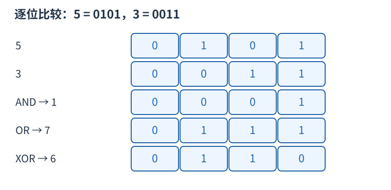

# P11036 用最低一位因子构造公倍数 题解

## 目录

| 题号 | 题名 | 考点 | 难度 |
|---|---|---|---|
| A | GCD 与 LCM 问题 | 构造 + 最大公约数 + 位运算 | 1800 |

## A. GCD 与 LCM 问题

> 原题：[P11036](https://www.luogu.com.cn/problem/P11036)
> 解法：用最低一位因子构造公倍数 · C++17

### 题意

给定 $a$，构造受上界限制的正整数 $b, c, d$，使 $a+b+c+d$ 等于 $\gcd(a, b)$ 加 $lcm(c, d)$。

<!-- reusable-foundations:start -->

### 从零讲：C++ 输入输出：把数据读进变量，把结果写到标准输出

程序运行时从标准输入接收题目给的数据，把答案送到标准输出。`cin` 和 `cout` 定义在 `<iostream>`；写 `using namespace std;` 后可以省略它们前面的 `std::`。最小完整程序是：

```cxx
#include <iostream>
using namespace std;
int main() {
    int a, b;
    cin >> a >> b;
    cout << a + b << '\n';
    return 0;
}
```

输入二十和三十，两个变量分别保存二十、三十，输出五十。`int a, b;` 声明两个整数变量；`cin >> a` 才给变量赋入输入值。多个 `>>` 从左到右读取，读取整数时会跳过空格、制表符、换行，所以两个整数可以分处两行。负号属于整数，不需要另读一个符号。

`cout <<` 后可以接数值、字符或字符串。`' '` 是一个空格字符，`'\n'` 是换行字符，`"Hello"` 是字符串。`cout << a << ' ' << b << '\n';` 输出两个以空格分开的整数并换行。评测程序只需要答案，不应加入“请输入”等提示。

读取 `char c; cin >> c;` 会跳过前导空白。要读取包含空格的一整行，用 `<string>` 中的 `string s; getline(cin, s);`。若此前用 `cin >> n` 读取过整数，换行还留在输入中，需要先处理那一个剩余换行；不能盲目把所有空格都删掉，因为字符画的行首空格和文本中的空格可能就是数据。

`fixed << setprecision(3)`（需要 `<iomanip>`）表示以小数形式保留三位小数，例如把 $2.5$ 输出成 $2.500$；不用 `fixed` 时，`setprecision` 指有效数字总数。设置会影响后续输出，使用前应确认所需精度。

竞赛中可在首次输入输出前调用 `ios::sync_with_stdio(false); cin.tie(nullptr);`，减少 C++ 流与 C 标准输入输出的同步、绑定开销。随后保持使用 `cin/cout`，不要混用另一套 `scanf/printf`。交互题还要在需要对方回应前主动刷新，例如 `cout << query << endl;`；普通题用换行字符即可。

读入长度为 $L$ 的文本、或输出 $L$ 个字符，至少需要 $O(L)$ 时间。数据类型仍要能容纳结果：把两个整数相乘时，即使保存到 `long long`，也要让乘法本身在这个类型中进行，例如先把输入声明为 `long long`。

### 从零讲：整数、实数与单位换算

C++ 的数值类型决定了运算规则。`int` 适合常见的较小整数；`long long` 至少有 64 位，适合较大的整数与乘积；`double` 保存近似实数，适合面积、比值等需要小数的量，不能把它当作任意精度的十进制数。

```cxx
long long money = 10 * 10 + 3; // 十元三角，统一为一百零三角
long long count = money / 19; // 买得起五支，每支十九角
long long rest = money % 19;  // 还剩八角
double average = 5.0 / 2;     // 得到 2.5
```

正整数除法 `/` 丢掉余数；`%` 给出余数。因此非负整数总量 $x$ 按每组 $d>0$ 拆分时，$x=qd+r$，其中 $q=x/d$、$r=x\bmod d$ 且 $0\le r<d$。例如一百二十五分钟是两小时五分钟。负数除法向零截断，负数的余数规则不能直接套用上述非负分组直觉。

如果需要装下全部物品，最后不足一整组也需要一组，非负总量可以用 `x / d + (x % d != 0)` 向上取整。这样避免 `x+d-1` 在接近类型上限时溢出。实数除法至少让一个操作数是实数；五和二做整数除法，结果已经是整数二，事后再赋给 `double` 也不会恢复小数。

优先统一单位再计算。元和角统一成角，时和分统一成分，升和立方厘米按 $1$ 升等于 $1000$ 立方厘米换算。整数单位既减少分支，也能避开无必要的浮点误差。

赋值给大类型不会挽救已发生的小类型溢出：`long long z = a*b;` 中若两边都是 `int`，先做 `int` 乘法。可把输入声明为 `long long`，或用 `1LL*a*b` 让乘法在大类型中进行。除法要等需要合并的分子完整计算后再做，逐项取整可能丢掉余数。

`sqrt(x)` 在 `<cmath>` 中求非负实数的平方根；`ceil(x)` 返回不小于实数 `x` 的最小整数值，但返回类型仍是浮点类型。浮点计算只保留近似值，输出小数时按题目精度要求格式化；可以用整数精确表示的比较和整除问题应尽量直接用整数。

`abs(x)` 返回数值的绝对值，例如 abs(-5) 为五，适合比较分差和距离；最小负整数的正值可能无法放回同一有符号类型，不能假定任何输入都可安全取绝对值。`min(a,b)`、`max(a,b)` 选两者较小、较大的值，比较类型应一致；`min({a,b,c})` 用初始化列表比较三项。两个数比较只需常数时间，列表比较需要线性扫描列表内的元素，不能把长度会变化的列表比较都当作常数操作。

### 从零讲：整除、最大公约数与质因数

正整数 $d$ 整除 $n$，表示 $n$ 能分成整数个大小为 $d$ 的组，即 `n % d == 0`。公约数同时整除两个数，其中最大者为最大公约数。欧几里得算法使用 $\gcd(a,b)=\gcd(b,a\bmod b)$，因为共同整除两者的数也恰好整除余数。

例如 $\gcd(18,12)=\gcd(12,6)=\gcd(6,0)=6$。每两轮较大参数至少缩半，故为 $O(\log\max(a,b))$。C++17 `<numeric>` 提供 `gcd`；最小公倍数可按 `a/gcd(a,b)*b` 计算以减少中间量，但最终乘积仍须检查范围。

质数是大于一、只有一和自身两个正因数的整数，一不是质数。合数一定有不超过平方根的质因数：若一对因数都超过平方根，乘积会大于原数。因此试除只需检查到平方根。

```cxx
vector<pair<long long,int>> factor(long long n) {
    vector<pair<long long,int>> result;
    for (long long p = 2; p <= n / p; ++p) {
        if (n % p != 0) continue;
        int exponent = 0;
        while (n % p == 0) { n /= p; ++exponent; }
        result.push_back({p, exponent});
    }
    if (n > 1) result.push_back({n, 1});
    return result;
}
```

正整数六十拆成 $2^2\times3\times5$。每个因子的指数可从零选到其最大次数，所以因数数量为 $(2+1)(1+1)(1+1)=12$。剩余大于一的部分必须作为一个质因数保留。条件 `p<=n/p` 避免为检查平方而溢出。

试除最坏约 $O(\sqrt n)$。要处理从一到 $N$ 的大量质数问题，可用筛法：埃氏筛从每个质数的平方起标记倍数，时间 $O(N\log\log N)$、空间 $O(N)$。线性筛额外维护最小质因子，使每个合数只由规定的一次生成；不能把任意双循环标倍数都称为线性筛。

### 从零讲：位运算：把非负整数看成一组二进制开关

五写成二进制为 $0101_2$，三为 $0011_2$。同一列各代表一位：按位与 `&` 两边都为一才得一，按位或 `|` 任一为一就得一，按位异或 `^` 不同才为一。所以 $5\mathbin{\&}3=1$，$5\mathbin{|}3=7$，$5\mathbin{\oplus}3=6$。



`1ULL << k` 把一移到第 $k$ 位。对非负无符号整数，`(mask >> k) & 1ULL` 读该位，`mask | (1ULL<<k)` 置一，`mask & ~(1ULL<<k)` 清零，`mask ^ (1ULL<<k)` 翻转。最低位编号为零。

```cxx
unsigned long long mask = 5; // 第 0、2 位为一
bool has = (mask >> 2) & 1ULL; // true
mask |= 1ULL << 1;             // 变成 7
```

位移次数必须小于类型位宽，且不能为负；不要用普通 `1` 去移到超出 int 范围的位置。C++17 有符号负数右移和溢出的规则不适合直接套“乘除二的幂”，用明确范围的无符号数更容易保证行为。`^` 是异或，绝不是乘方。

逻辑与 `&&`、逻辑或 `||` 将整体条件视为真假，并会短路；按位 `&`、`|` 逐位计算，不会因此跳过右侧表达式。运算符优先级可能与直觉不同，写 `(mask & bit) != 0`，别省掉关键括号。

固定机器字内的一次位运算按 $O(1)$ 估算；枚举全部 $k$ 位状态仍有 $2^k$ 种，不能因为每次运算快就忽略状态数。`x & (x-1)` 对正无符号数清掉最低的一位；GCC 的 `__builtin_popcountll(x)` 统计一的数量，注意实参位宽与具体编译器支持。

### 从零讲：整数类型、整除与溢出

计算前先看每一步可能达到的范围。常见环境中 `int` 是 32 位，上界约 $2.1\times10^9$；`long long` 至少 64 位，常见有符号 64 位上界约 $9.22\times10^{18}$。`using ll = long long;` 只是为已有类型起别名。

```cxx
int a = 100000, b = 100000;
long long wrong = a * b;      // 右边先按 int 乘，可能已溢出
long long right = 1LL * a * b; // 先把运算提升到 long long
```

不能指望“接收结果的变量够大”修复此前已经溢出的计算。先提高操作数类型，再做乘法。超过 64 位时，GCC 的 `__int128` 可作中间量，但它不是标准 C++17 类型，也没有标准流输出重载；先证明范围，再选择工具。

整数 `/` 对有符号数向零截断：`7/3==2`、`-7/3==-2`。对非负数才等于向下取整。余数满足 `a == (a/b)*b + a%b`，除数不能为零；要将余数归入 $[0,m-1]$（$m>0$），可用 `(a % m + m) % m`，同时保证中间加法不溢出。

非负 $a$、正 $b$ 的向上取整可写 `a/b + (a%b != 0)`，比 `(a+b-1)/b` 更容易避免加法溢出。比较平方时也应在宽类型内计算；浮点数不适合作为大整数相等的默认判断方式。

`size()` 返回无符号类型。空容器上写 `size()-1` 会绕到很大的数，逆序遍历可以先转成有符号、确认长度，或使用逆向迭代器。`abs` 对最小有符号数无法在同类型中表达其正值，需先约束输入差值范围。一般机器整数运算按常数时间估算，宽类型解决表示范围，不改变算法的增长阶。

### 从零讲：构造：找到一份合法对象，并解释它为何总能生成

构造题允许输出任意满足要求的对象。先区分“只需合法”与“还要求最小、最多或字典序最小”，不要额外发明优化目标。

例如要把从一到 $2k$ 的数字配成 $k$ 对，使每对和相同，可以配 $(1,2k),(2,2k-1),\ldots,(k,k+1)$，每对都为 $2k+1$。数字不重复，因为两半各用一次；也没有漏数。这个一般描述能直接转成循环。


如果还要求最大化某项，先给任何方案都不能超越的上界，再展示构造确实达到上界；没有最优性要求时只证明合法和能完成即可。

一个完整构造应能回答：什么时候无解；输出对象是什么；每次允许的动作如何执行；后续所需的条件有没有被前面的动作破坏；数量、范围和边界是否满足。操作题还要区分目标排列和真正输出的操作序列。

验证构造不能只和另一程序逐字比较，因为合法答案可有多份。应将结果代回题目条件：检查长度、元素多重集合、限制、每步前后状态及目标。复杂度按生成和校验成本计算，输出本身有 $k$ 项就至少需要 $O(k)$ 时间。

<!-- reusable-foundations:end -->

### 思路

令 $p$ 为 $a$ 的最大二次幂因子，取 $b=a$、$c=2p$、$d=a+2p$。此时 $\gcd(c, d)=p$，所以 $lcm(c, d)=2d$，直接代入即可验证等式。

每组时间与额外空间均为 $O(1)$，总时间 $O(t)$。

### 参考代码

```cpp
#include <bits/stdc++.h>
using namespace std;

int main() {
    ios::sync_with_stdio(false);
    cin.tie(nullptr);
int t;cin>>t;while(t--){long long a;cin>>a;long long p=a&(-a);cout<<a<<' '<<2*p<<' '<<a+2*p<<'\n';}
    return 0;
}
```

### 易错点

最低二次幂因子不是最大二次幂上界；构造必须同时核对等式和每项上界。

## 实测记录

本地 C++17 编译、1 组原站样例与 1 组独立边界/小域校验通过。
正文参考程序与源码逐字核对；没有向原站提交。
