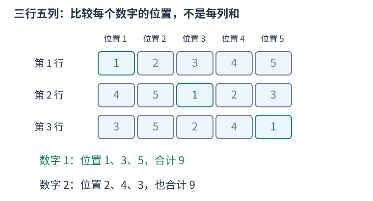

# P12676 成对互补与三行奇数底座 题解

## 目录

| 题号 | 题名 | 考点 | 难度 |
|---|---|---|---|
| A | 相等排列（equal） | 构造 + 组合计数 | 1800 |

## A. 相等排列（equal）

> 原题：[P12676](https://www.luogu.com.cn/problem/P12676)
> 解法：成对互补与三行奇数底座 · C++17

### 题意

构造 $n$ 个一到 $m$ 的排列，使每个数在各行的位置之和都相同；输出排列内容而不是位置数组。

<!-- reusable-foundations:start -->

### 从零讲：C++ 输入输出：把数据读进变量，把结果写到标准输出

程序运行时从标准输入接收题目给的数据，把答案送到标准输出。`cin` 和 `cout` 定义在 `<iostream>`；写 `using namespace std;` 后可以省略它们前面的 `std::`。最小完整程序是：

```cxx
#include <iostream>
using namespace std;
int main() {
    int a, b;
    cin >> a >> b;
    cout << a + b << '\n';
    return 0;
}
```

输入二十和三十，两个变量分别保存二十、三十，输出五十。`int a, b;` 声明两个整数变量；`cin >> a` 才给变量赋入输入值。多个 `>>` 从左到右读取，读取整数时会跳过空格、制表符、换行，所以两个整数可以分处两行。负号属于整数，不需要另读一个符号。

`cout <<` 后可以接数值、字符或字符串。`' '` 是一个空格字符，`'\n'` 是换行字符，`"Hello"` 是字符串。`cout << a << ' ' << b << '\n';` 输出两个以空格分开的整数并换行。评测程序只需要答案，不应加入“请输入”等提示。

读取 `char c; cin >> c;` 会跳过前导空白。要读取包含空格的一整行，用 `<string>` 中的 `string s; getline(cin, s);`。若此前用 `cin >> n` 读取过整数，换行还留在输入中，需要先处理那一个剩余换行；不能盲目把所有空格都删掉，因为字符画的行首空格和文本中的空格可能就是数据。

`fixed << setprecision(3)`（需要 `<iomanip>`）表示以小数形式保留三位小数，例如把 $2.5$ 输出成 $2.500$；不用 `fixed` 时，`setprecision` 指有效数字总数。设置会影响后续输出，使用前应确认所需精度。

竞赛中可在首次输入输出前调用 `ios::sync_with_stdio(false); cin.tie(nullptr);`，减少 C++ 流与 C 标准输入输出的同步、绑定开销。随后保持使用 `cin/cout`，不要混用另一套 `scanf/printf`。交互题还要在需要对方回应前主动刷新，例如 `cout << query << endl;`；普通题用换行字符即可。

读入长度为 $L$ 的文本、或输出 $L$ 个字符，至少需要 $O(L)$ 时间。数据类型仍要能容纳结果：把两个整数相乘时，即使保存到 `long long`，也要让乘法本身在这个类型中进行，例如先把输入声明为 `long long`。

### 从零讲：数组：用下标定位一组状态

数组把同一类型的若干值按位置保存。`int a[5] = {};` 创建五个初始为零的整数，合法下标是零到四；`a[2] = 7;` 只修改第三格。下标表示位置，格子中保存的值是另一回事。

```cxx
int a[4] = {4, 3, 0, 5};
int sum = 0;
for (int i = 0; i < 4; ++i) sum += a[i];
// 和为十二；a[0] 是四，a[3] 是五
```

读写一个给定下标的格子是 $O(1)$。扫描全部 $n$ 格为 $O(n)$，保存 $n$ 格的空间为 $O(n)$。不能访问负下标或 $a[n]$，越界属于未定义行为，可能表现为随机数或崩溃，编译通过不代表安全。

`bool seen[34] = {};` 可以保存号码是否出现过，初始全为 false；`seen[x]=true` 表示记录出现状态。再次赋 true 不改变结果，因此适合去重、标记删除；若操作是开关翻转，则要写 `seen[x]=!seen[x]`。标记真假和记录出现次数是不同任务，后者需要整数计数数组。

若题目用一到 $n$ 编号，可以创建 $n+1$ 格并预留零号，统一按原编号访问。或者读入时改成零到 $n-1$，但必须让全部循环与公式使用同一套下标。

二维数组 `int a[5][6] = {};` 有五行六列，`a[r][c]` 表示第 $r$ 行第 $c$ 列。三维数组再加一个方向，用三个下标定位单位格子。逐格扫描的时间是各维长度的乘积，空间也按格子总数计算。

固定数组的长度需要在编译时确定，不能在标准 C++17 中写依赖输入的 `int a[n]`。输入后才确定大小时使用 `vector<int> a(n,0)`；它同样从零编号，也可以按下标访问，但仍须检查下标边界。大数组应避免放在空间有限的函数栈上，可以用动态容器或全局数组。数组里的旧状态是否应该保留，需要根据当前问题决定，多组测试不能意外继承上一组的内容。

### 从零讲：vector：长度可变的连续数组

`vector<T>` 保存一串同类型的元素，适合按下标访问、扫描、排序。`T` 是元素类型，例如 `vector<int>` 保存整数，`vector<pair<int,int>>` 保存整数对，`vector<vector<int>>` 可保存每个顶点各自的邻居。需要 `<vector>`。

```cxx
vector<int> a(3, 7);   // 三个元素，内容是 7、7、7
a.push_back(9);       // 在末尾追加，现在长度为 4
int x = a[1];         // 从 0 编号，这里得到 7
a[1] = 2;            // 改第二个元素
int n = int(a.size());
```

`vector<int> a(3)` 创建三个值为零的元素；`a.reserve(3)` 只预留容量，元素数仍为零，此时不能访问 `a[0]`。长度 `size()` 与容量 `capacity()` 是不同概念。

下标访问为 $O(1)$，遍历为 $O(n)$。末尾追加通常为 $O(1)$；容量不足时会分配更大的连续空间并搬移元素，这次可能为 $O(n)$，一连串追加的平均成本称为摊还 $O(1)$。中间插入或删除会搬移后续元素，最坏 $O(n)$。内存是元素量的 $O(n)$，并可能预留部分尚未使用的容量。

`begin()` 指向首元素，`end()` 指向尾后位置，`sort(a.begin(),a.end())` 操作整个数组。`a[i]` 不检查越界；下标须满足 $0\le i<\mathrm{size}$。`at(i)` 会检查越界并抛异常。空数组不能访问 `front()`、`back()`；`pop_back()` 也要求非空。

扩容后指向旧存储的迭代器、引用和指针会失效。遍历的同时 `push_back`，不能假定此前取得的引用仍可用。读取大数组的函数常用 `const vector<int>& a` 按常量引用传入，既不复制也禁止通过该引用修改；`vector<int> a` 按值传参则复制内容。选择副本还是引用取决于是否要保留独立数据。

### 从零讲：分支与循环：按条件选择，按次序重复

`if (条件) { ... } else { ... }` 根据条件的真假选择一条分支。比较运算 `==`、`!=`、`<`、`<=`、`>`、`>=` 返回真假值；`=` 是赋值，不能代替相等比较。`&&` 表示两边都成立，`||` 表示至少一边成立，`!` 把真假反转。

```cxx
int score = 85;
if (score >= 90) cout << "A";
else if (score >= 60) cout << "B";
else cout << "C"; // 这个例子输出 B
```

这条分支链只执行第一个符合条件的分支。先处理高分后，第二个条件自然只会接到低于九十分的数。几个独立的 `if` 则可能执行多次；两种结构代表不同问题。逻辑运算会短路：`i < n && a[i] == 0` 先确认下标合法，才读取那一格。

`for (初始化; 继续条件; 每轮更新)` 适合知道重复范围的情况。例如下列代码依次处理一到四，总和是十：

```cxx
int sum = 0;
for (int i = 1; i <= 4; ++i) {
    sum += i;
}
cout << sum;
```

初始化只做一次；每轮先判断条件，条件为真才执行循环体，随后执行更新。`++i` 把 $i$ 加一，`sum += i` 等价于把旧 sum 加 $i$ 再保存。应明确每个变量在循环前、循环后分别表示什么；最大值相同时是否更新，决定了保留较早还是较晚的答案。

`while (条件)` 适合“不满足目标就再做一步”：

```cxx
int x = 13, times = 0;
while (x > 1) {
    x /= 2;
    ++times;
}
// x 依次是 13、6、3、1，执行三次
```

循环开始前先检查条件，初始已满足目标时可能一次也不执行。每次执行必须推进状态，否则可能无限循环。`break` 结束最内层循环，`continue` 跳过本轮剩余部分；`for` 中的 continue 之后仍会执行每轮更新。

复杂度由实际执行次数决定。上述求和执行 $n$ 次是 $O(n)$；每次将正整数减半只执行 $O(\log n)$ 次。两层循环不能仅凭外观判定为平方：内层若总共只前进 $n$ 次，总量仍可能线性。变量应在正确作用范围初始化；多组数据的计数器若未重置，下一组会错误继承上一组结果。

### 从零讲：具名函数：给可复用计算一个明确接口

函数把一段计算包装成“输入参数 → 返回结果”。例如判断整数是否为偶数：

```cxx
bool even(int x) {
    return x % 2 == 0;
}
int main() {
    bool a = even(8); // a 为 true
    bool b = even(7); // b 为 false
}
```

`bool` 是返回类型，`even` 是函数名，`int x` 是参数声明。调用 `even(8)` 时，实参八传入这个新调用的局部变量 $x$，执行 return 后把真假值交回调用处。定义本身不执行计算，只有调用才执行。函数应在调用处之前定义，或提前写声明。

普通数值参数按值传递，函数里修改 $x$ 不会改变调用者原变量。参数写成 `int &x` 时才引用调用者对象；必须让这个对象在调用期间有效。`const vector<int>& a` 用引用避免复制整个容器，并承诺不通过这个引用修改它。返回局部变量的值是安全的，返回局部变量的引用则在函数结束后失效。

函数名应说明它回答的问题，调用处负责传哪些数据。例如闰年判定只接收一个年份并返回真假，枚举年份范围和输出格式由调用者处理。同一判定被多次使用时，这能减少规则不一致；但函数包装不会自动降低算法复杂度，仍要把每次调用实际做的工作计入时间。

如果函数内部又调用自身，就是递归，需要明确最小情况如何直接返回、每次调用如何逼近它；递归会占用调用栈。普通辅助函数可以不使用递归，不应仅因写成函数就称作递归算法。

### 从零讲：计数：先确定一个方案包含哪些选择

加法用于互斥类别，乘法用于逐步选择，除法用于消除确切的重复。公式每一项都应能对应一个实际对象，不能只凭“看起来有几个位置”相乘。

三个人中选两人且指定先后：第一人三种选择，第二人只能从剩下两人中选，得到六种。若只选一个无序小组，AB 和 BA 表示同组，每组恰数两次，除以二得到三组。


一般地，$n$ 个不同对象选 $k$ 个且排序有 $n(n-1)\cdots(n-k+1)$ 种；不区分内部顺序，恰有 $k!$ 个排列表示同一子集，所以

$$\binom nk=\frac{n!}{k!(n-k)!}.$$

这个除法成立依赖“每个最终对象被数同样多次”。若含相同元素、对称或禁用条件，重复倍数可能改变，要重新证明。比如组的内部无序和组之间无序是两种不同的对称性，不应混成一句“除去重复”。

互相独立不是乘法原则唯一的表述；逐步计数只需每种前序选择都有相同数量的后续选择。若后续数量随前序变化，就应分别计算后求和。

在模数下计算组合数时，普通整数除法不能直接替代分母逆元。若用阶乘和逆阶乘，须满足逆元存在等前提。答案可能指数增长，先确定取模或大整数方式；数值范围也决定预处理是否可行。

### 从零讲：构造：找到一份合法对象，并解释它为何总能生成

构造题允许输出任意满足要求的对象。先区分“只需合法”与“还要求最小、最多或字典序最小”，不要额外发明优化目标。

例如要把从一到 $2k$ 的数字配成 $k$ 对，使每对和相同，可以配 $(1,2k),(2,2k-1),\ldots,(k,k+1)$，每对都为 $2k+1$。数字不重复，因为两半各用一次；也没有漏数。这个一般描述能直接转成循环。


如果还要求最大化某项，先给任何方案都不能超越的上界，再展示构造确实达到上界；没有最优性要求时只证明合法和能完成即可。

一个完整构造应能回答：什么时候无解；输出对象是什么；每次允许的动作如何执行；后续所需的条件有没有被前面的动作破坏；数量、范围和边界是否满足。操作题还要区分目标排列和真正输出的操作序列。

验证构造不能只和另一程序逐字比较，因为合法答案可有多份。应将结果代回题目条件：检查长度、元素多重集合、限制、每步前后状态及目标。复杂度按生成和校验成本计算，输出本身有 $k$ 项就至少需要 $O(k)$ 时间。

<!-- reusable-foundations:end -->

### 思路

偶数行用升序、降序成对互补。奇数行若 $m$ 偶数无解；$m$ 奇数且至少三行时先构造三行位置和恒定的底座，余下继续成对添加。$m=1$ 单独输出，$n=1$ 且 $m>1$ 无解。



绿色标出三个一；它们分属不同行，所在列号才是需要累加的位置。

有解时含输出时间 $O(nm)$、额外空间 $O(m)$；无解判定为 $O(1)$。

### 参考代码

```cpp
#include <bits/stdc++.h>
using namespace std;
void print_row(const vector<int>&a){for(int i=0;i<(int)a.size();++i)cout<<a[i]<<(i+1==(int)a.size()?'\n':' ');}
int main() {
    ios::sync_with_stdio(false);
    cin.tie(nullptr);
int tests;cin>>tests;while(tests--){int n,m;cin>>n>>m;
    if(m==1){for(int i=0;i<n;++i)cout<<"1\n";continue;}
    if(n==1||(n%2==1&&m%2==0)){cout<<"-1\n";continue;}
    int start=0;
    if(n%2){int k=m/2;vector<int>p(m),q(m),r(m);
        for(int v=0;v<m;++v){int x=v,y=(v+k)%m,z=3*k-x-y;p[x]=q[y]=r[z]=v+1;}
        print_row(p);print_row(q);print_row(r);start=3;
    }
    for(int row=start;row<n;++row){for(int i=1;i<=m;++i)cout<<((row-start)%2==0?i:m+1-i)<<(i==m?'\n':' ');}
}
    return 0;
}
```

### 易错点

指定的是每个数字的位置，输出前要倒填成排列；$n=1$ 与 $m=1$ 分别处理。

## 实测记录

本地 C++17 编译、1 组原站样例与 104 组独立边界/小域校验通过。
正文参考程序与源码逐字核对；没有向原站提交。
