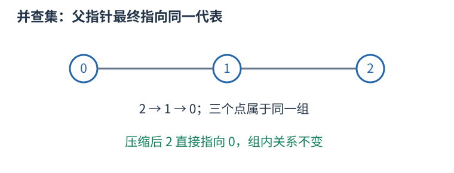
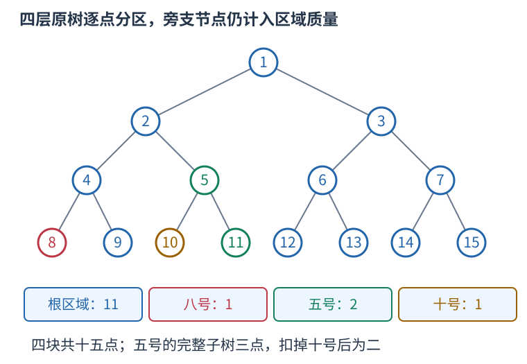

# P13308 只保留操作点，压缩子树区域后倒序恢复删边 题解

## 目录

| 题号 | 题名 | 考点 | 难度 |
|---|---|---|---|
| A | 故障 | 并查集 + 图论 | 1800 |

## A. 故障

> 原题：[P13308](https://www.luogu.com.cn/problem/P13308)
> 解法：只保留操作点，压缩子树区域后倒序恢复删边 · C++17

### 题意

最多六十层的满二叉树按堆式编号，操作可删掉节点与父亲的边，重复删除或删根无效果；查询所在连通块大小，最后输出全部查询答案的异或。

<!-- reusable-foundations:start -->

### 从零讲：C++ 输入输出：把数据读进变量，把结果写到标准输出

程序运行时从标准输入接收题目给的数据，把答案送到标准输出。`cin` 和 `cout` 定义在 `<iostream>`；写 `using namespace std;` 后可以省略它们前面的 `std::`。最小完整程序是：

```cxx
#include <iostream>
using namespace std;
int main() {
    int a, b;
    cin >> a >> b;
    cout << a + b << '\n';
    return 0;
}
```

输入二十和三十，两个变量分别保存二十、三十，输出五十。`int a, b;` 声明两个整数变量；`cin >> a` 才给变量赋入输入值。多个 `>>` 从左到右读取，读取整数时会跳过空格、制表符、换行，所以两个整数可以分处两行。负号属于整数，不需要另读一个符号。

`cout <<` 后可以接数值、字符或字符串。`' '` 是一个空格字符，`'\n'` 是换行字符，`"Hello"` 是字符串。`cout << a << ' ' << b << '\n';` 输出两个以空格分开的整数并换行。评测程序只需要答案，不应加入“请输入”等提示。

读取 `char c; cin >> c;` 会跳过前导空白。要读取包含空格的一整行，用 `<string>` 中的 `string s; getline(cin, s);`。若此前用 `cin >> n` 读取过整数，换行还留在输入中，需要先处理那一个剩余换行；不能盲目把所有空格都删掉，因为字符画的行首空格和文本中的空格可能就是数据。

`fixed << setprecision(3)`（需要 `<iomanip>`）表示以小数形式保留三位小数，例如把 $2.5$ 输出成 $2.500$；不用 `fixed` 时，`setprecision` 指有效数字总数。设置会影响后续输出，使用前应确认所需精度。

竞赛中可在首次输入输出前调用 `ios::sync_with_stdio(false); cin.tie(nullptr);`，减少 C++ 流与 C 标准输入输出的同步、绑定开销。随后保持使用 `cin/cout`，不要混用另一套 `scanf/printf`。交互题还要在需要对方回应前主动刷新，例如 `cout << query << endl;`；普通题用换行字符即可。

读入长度为 $L$ 的文本、或输出 $L$ 个字符，至少需要 $O(L)$ 时间。数据类型仍要能容纳结果：把两个整数相乘时，即使保存到 `long long`，也要让乘法本身在这个类型中进行，例如先把输入声明为 `long long`。

### 从零讲：分支与循环：按条件选择，按次序重复

`if (条件) { ... } else { ... }` 根据条件的真假选择一条分支。比较运算 `==`、`!=`、`<`、`<=`、`>`、`>=` 返回真假值；`=` 是赋值，不能代替相等比较。`&&` 表示两边都成立，`||` 表示至少一边成立，`!` 把真假反转。

```cxx
int score = 85;
if (score >= 90) cout << "A";
else if (score >= 60) cout << "B";
else cout << "C"; // 这个例子输出 B
```

这条分支链只执行第一个符合条件的分支。先处理高分后，第二个条件自然只会接到低于九十分的数。几个独立的 `if` 则可能执行多次；两种结构代表不同问题。逻辑运算会短路：`i < n && a[i] == 0` 先确认下标合法，才读取那一格。

`for (初始化; 继续条件; 每轮更新)` 适合知道重复范围的情况。例如下列代码依次处理一到四，总和是十：

```cxx
int sum = 0;
for (int i = 1; i <= 4; ++i) {
    sum += i;
}
cout << sum;
```

初始化只做一次；每轮先判断条件，条件为真才执行循环体，随后执行更新。`++i` 把 $i$ 加一，`sum += i` 等价于把旧 sum 加 $i$ 再保存。应明确每个变量在循环前、循环后分别表示什么；最大值相同时是否更新，决定了保留较早还是较晚的答案。

`while (条件)` 适合“不满足目标就再做一步”：

```cxx
int x = 13, times = 0;
while (x > 1) {
    x /= 2;
    ++times;
}
// x 依次是 13、6、3、1，执行三次
```

循环开始前先检查条件，初始已满足目标时可能一次也不执行。每次执行必须推进状态，否则可能无限循环。`break` 结束最内层循环，`continue` 跳过本轮剩余部分；`for` 中的 continue 之后仍会执行每轮更新。

复杂度由实际执行次数决定。上述求和执行 $n$ 次是 $O(n)$；每次将正整数减半只执行 $O(\log n)$ 次。两层循环不能仅凭外观判定为平方：内层若总共只前进 $n$ 次，总量仍可能线性。变量应在正确作用范围初始化；多组数据的计数器若未重置，下一组会错误继承上一组结果。

### 从零讲：vector：长度可变的连续数组

`vector<T>` 保存一串同类型的元素，适合按下标访问、扫描、排序。`T` 是元素类型，例如 `vector<int>` 保存整数，`vector<pair<int,int>>` 保存整数对，`vector<vector<int>>` 可保存每个顶点各自的邻居。需要 `<vector>`。

```cxx
vector<int> a(3, 7);   // 三个元素，内容是 7、7、7
a.push_back(9);       // 在末尾追加，现在长度为 4
int x = a[1];         // 从 0 编号，这里得到 7
a[1] = 2;            // 改第二个元素
int n = int(a.size());
```

`vector<int> a(3)` 创建三个值为零的元素；`a.reserve(3)` 只预留容量，元素数仍为零，此时不能访问 `a[0]`。长度 `size()` 与容量 `capacity()` 是不同概念。

下标访问为 $O(1)$，遍历为 $O(n)$。末尾追加通常为 $O(1)$；容量不足时会分配更大的连续空间并搬移元素，这次可能为 $O(n)$，一连串追加的平均成本称为摊还 $O(1)$。中间插入或删除会搬移后续元素，最坏 $O(n)$。内存是元素量的 $O(n)$，并可能预留部分尚未使用的容量。

`begin()` 指向首元素，`end()` 指向尾后位置，`sort(a.begin(),a.end())` 操作整个数组。`a[i]` 不检查越界；下标须满足 $0\le i<\mathrm{size}$。`at(i)` 会检查越界并抛异常。空数组不能访问 `front()`、`back()`；`pop_back()` 也要求非空。

扩容后指向旧存储的迭代器、引用和指针会失效。遍历的同时 `push_back`，不能假定此前取得的引用仍可用。读取大数组的函数常用 `const vector<int>& a` 按常量引用传入，既不复制也禁止通过该引用修改；`vector<int> a` 按值传参则复制内容。选择副本还是引用取决于是否要保留独立数据。

### 从零讲：整数类型、整除与溢出

计算前先看每一步可能达到的范围。常见环境中 `int` 是 32 位，上界约 $2.1\times10^9$；`long long` 至少 64 位，常见有符号 64 位上界约 $9.22\times10^{18}$。`using ll = long long;` 只是为已有类型起别名。

```cxx
int a = 100000, b = 100000;
long long wrong = a * b;      // 右边先按 int 乘，可能已溢出
long long right = 1LL * a * b; // 先把运算提升到 long long
```

不能指望“接收结果的变量够大”修复此前已经溢出的计算。先提高操作数类型，再做乘法。超过 64 位时，GCC 的 `__int128` 可作中间量，但它不是标准 C++17 类型，也没有标准流输出重载；先证明范围，再选择工具。

整数 `/` 对有符号数向零截断：`7/3==2`、`-7/3==-2`。对非负数才等于向下取整。余数满足 `a == (a/b)*b + a%b`，除数不能为零；要将余数归入 $[0,m-1]$（$m>0$），可用 `(a % m + m) % m`，同时保证中间加法不溢出。

非负 $a$、正 $b$ 的向上取整可写 `a/b + (a%b != 0)`，比 `(a+b-1)/b` 更容易避免加法溢出。比较平方时也应在宽类型内计算；浮点数不适合作为大整数相等的默认判断方式。

`size()` 返回无符号类型。空容器上写 `size()-1` 会绕到很大的数，逆序遍历可以先转成有符号、确认长度，或使用逆向迭代器。`abs` 对最小有符号数无法在同类型中表达其正值，需先约束输入差值范围。一般机器整数运算按常数时间估算，宽类型解决表示范围，不改变算法的增长阶。

### 从零讲：具名函数：给可复用计算一个明确接口

函数把一段计算包装成“输入参数 → 返回结果”。例如判断整数是否为偶数：

```cxx
bool even(int x) {
    return x % 2 == 0;
}
int main() {
    bool a = even(8); // a 为 true
    bool b = even(7); // b 为 false
}
```

`bool` 是返回类型，`even` 是函数名，`int x` 是参数声明。调用 `even(8)` 时，实参八传入这个新调用的局部变量 $x$，执行 return 后把真假值交回调用处。定义本身不执行计算，只有调用才执行。函数应在调用处之前定义，或提前写声明。

普通数值参数按值传递，函数里修改 $x$ 不会改变调用者原变量。参数写成 `int &x` 时才引用调用者对象；必须让这个对象在调用期间有效。`const vector<int>& a` 用引用避免复制整个容器，并承诺不通过这个引用修改它。返回局部变量的值是安全的，返回局部变量的引用则在函数结束后失效。

函数名应说明它回答的问题，调用处负责传哪些数据。例如闰年判定只接收一个年份并返回真假，枚举年份范围和输出格式由调用者处理。同一判定被多次使用时，这能减少规则不一致；但函数包装不会自动降低算法复杂度，仍要把每次调用实际做的工作计入时间。

如果函数内部又调用自身，就是递归，需要明确最小情况如何直接返回、每次调用如何逼近它；递归会占用调用栈。普通辅助函数可以不使用递归，不应仅因写成函数就称作递归算法。

### 从零讲：并查集：维护哪些对象已属于同一组

从每个元素独立成组开始，反复合并两组、判断两项是否连通。并查集用父指针形成若干棵树，每棵树的根代表一组；根的编号只是代表，不一定是最小编号或有特殊题意。



```cxx
struct DSU {
    vector<int> parent, size;
    DSU(int n): parent(n), size(n, 1) {
        iota(parent.begin(), parent.end(), 0);
    }
    int find(int x) {
        return parent[x] == x ? x : parent[x] = find(parent[x]);
    }
    bool merge(int a, int b) {
        a = find(a); b = find(b);
        if (a == b) return false;
        if (size[a] < size[b]) swap(a, b);
        parent[b] = a; size[a] += size[b];
        return true;
    }
};
```

合并 $0,1$ 再合并 $1,2$ 后，三者的 `find` 相同，即使零和二没有直接边。这表示路径连通，不表示两项相邻。路径压缩将访问链上的父亲直接改为根；按大小合并把小树挂到大树，避免人为形成长链。

初始化 $O(n)$，两种优化一起使用时，一连串操作的摊还成本为 $O(\alpha(n))$ 每次，常见规模近似常数；不能说每一次都严格 $O(1)$。数组空间 $O(n)$。

普通并查集擅长增加连通关系，不直接支持删边和拆组。回滚版本通常不用路径压缩，并保存每次合并改变的值；带权版本还需维护到父亲的关系，不能只合并普通 parent。分组大小等统计应读根上的记录。

### 从零讲：树的根、子树、DFS 序与倍增

树是连通且无环的无向图，$n$ 个顶点有 $n-1$ 条边。指定一个根后，每个非根顶点有唯一父亲，其他向下邻居是孩子。子树包含自己和全部后代；换根会改变父子关系，但不改变原边。


#### 子树信息按依赖顺序计算

例如子树大小 `size[u]` 初始为一，每个孩子处理完后累加 `size[v]`。一来自节点自己，不能漏掉。树形 DP 也如此：先明确某状态允许怎样选择，再合并各孩子提供的信息；孩子独立性来自树上没有跨子树边，仍可能因总预算或选中父亲等条件产生状态关联。

换根 DP 先求一个根的状态，再沿边换根，将“来自孩子的一侧”和“来自父亲的一侧”合并。应画清只有哪条边的方向改变、哪些量不变；不能仅凭两张答案表代替依赖解释。普通遍历每条边常数次为 $O(n)$，背包式合并可能更大，按实际合并循环计算。

#### DFS 序为什么能把子树变成区间

进入节点时分配编号 `tin[u]`，完成整棵子树后记录最后编号 `tout[u]`。深度优先在返回父亲前会完整处理这棵子树，因此它的所有编号连续，恰是 $[tin[u],tout[u]]$。这允许把子树和等查询交给数组结构。若同时记录进出事件，区间定义会不同，不可混用两种序列。

#### 倍增与最近公共祖先

`up[k][u]` 存 $u$ 向上 $2^k$ 条边到达的祖先。基础 `up[0][u]=parent[u]`，递推为 `up[k][u]=up[k-1][up[k-1][u]]`，因为连续走两段 $2^{k-1}$。跳十三层可拆为八加四加一，只需对数个跳跃。

LCA 是两个节点公共祖先中最深者。先把更深的一方跳到同深度；若已经相同就是答案。否则从大到小试跳，祖先不同才两边同时上移，最后它们的父亲就是 LCA。预处理 $O(n\log n)$、每次查询 $O(\log n)$，表空间 $O(n\log n)$。根的虚拟祖先需统一定义，不能访问非法下标。

树的直径在非负无权边长等常见条件下可用两次最远点搜索求出；带负权时要重新判断。虚树则将关注节点按 DFS 序组织，补上相邻节点的 LCA 后连接祖先关系，边应携带原路径含义，不能把压缩后一条边误当原图一步。深链上的递归也须留意栈深度。

### 从零讲：操作点分区：完整子树扣掉子区域，压缩后仍维护真实点数

一棵巨大有根树中，只有少量节点会被查询，且删除操作只删这些节点连向父亲的边。没有被操作的整片区域可以合在一起，但权值必须保留真实节点数，不能只数压缩后剩几个点。

#### 把树分成互不相交的连通区域

收集全部操作节点并加入根。每个非根收集点的压缩父亲，是它最近的另一个收集祖先。对收集点 $u$，用 $u$ 的完整子树扣掉每个压缩孩子的完整子树，剩余部分就是 $u$ 的区域。


图中收集点为一、五、八、十。根区域有十一点，八号区域一、五号区域二、十号区域一，合计十五。五号完整子树有三点，但其中十号已单独划走，所以五号区域不能仍记三。

每个原节点归入其最深收集祖先的区域，因此不会重叠或遗漏。区域内一个留下节点到区域根的祖先路径也留下，故区域连通。所有可能删除的边都位于区域之间，区域内部没有会被删除的边，所以可收缩成一个带大小的点。

#### 用先序区间找压缩父亲

有根树中，完整子树的先序位置连续。若子树根位置为 begin，大小为 count，它覆盖半开区间 [begin,begin+count)。收集点按 begin 排序，栈中保留尚未结束的嵌套区间。处理新点时，先弹出已经结束的区间，剩余栈顶就是最近收集祖先，再把新点压栈。

以下例子已经给出四层满二叉树中上述点的先序位置与完整子树大小。按先序的顺序是一、八、五、十，并非原编号升序。

```cxx
vector<unsigned long long> begin={1,4,6,7};
vector<unsigned long long> full={15,1,3,1},mass=full;
vector<int> parent(4,-1),stack={0};
for(int i=1;i<4;++i) {
    while(begin[i]>=begin[stack.back()]+full[stack.back()])stack.pop_back();
    parent[i]=stack.back();
    mass[parent[i]]-=full[i];
    stack.push_back(i);
}
for(auto value:mass)cout<<value<<' '; // 11 1 2 1
```

减去的是压缩孩子的完整子树大小，不能减它已经扣掉后代的区域大小，否则孙区域会被错误留在祖先区域里。每个孩子只从自己的压缩父亲减一次，其子树中的后代统一由这次扣除涵盖。

这个收缩只关心连通性和点数。没有单独保留的分叉祖先仍在某个连通区域内，不需要为本任务另行补入 LCA；若要保留任意两点路径距离或虚树路径结构，必须重新证明该压缩是否足够。

#### 离线删边改成倒序加边

先建立所有删除完成后的森林，再倒序恢复边。并查集根保存的是各区域 mass 之和，按大小合并的 size 则统计压缩节点数，两者用途不同。查询操作点所在根的 mass，就得到原树的真实连通块大小。

重复删除同一边时，先统计总次数，逆序减到零才恢复；删根忽略。已恢复一条边之后，才会进入这条边在正序中尚未被删的时段。区域构建排序 $O(k\log k)$，栈操作 $O(k)$，存储 $O(k)$，其中 $k$ 为不同收集点数；完整树规模不进入数组长度。

### 从零讲：无符号六十四位整数与模二的六十四次方

`<cstdint>` 的 `uint64_t` 是恰好六十四位的无符号整数类型，取值范围从零到 $2^{64}-1$。这类精确宽度别名在平台具有相应整数类型时提供；本项目使用的 GNU C++17 目标平台支持它。与 `long long` 的常见有符号范围相比，它不保存负数，最高位也参与表示非负数值。

#### 加法回绕是语言规则

无符号整数的加、减、乘会按其位数对应的二次幂取模。最大值加一得到零，零减一得到最大值。六十四位无符号数因此正好进行模 $2^{64}$ 运算，前提是操作本身在这个类型中发生。

```cxx
#include <cstdint>
#include <limits>
using namespace std;
int main() {
    uint64_t top = numeric_limits<uint64_t>::max();
    uint64_t zero = top + uint64_t(1);
    uint64_t wrapped = uint64_t(0) - uint64_t(1);
    uint64_t product = uint64_t(1000000000) * uint64_t(1000000000);
    // zero 为零，wrapped 等于 top，product 为 10^18。
}
```

不能先用 int 相乘，再存到 `uint64_t`：右侧可能早已按 int 溢出。有符号溢出也不能代替这条回绕规则；C++ 对有符号溢出没有规定应得到模值。需要的是模 $2^{64}$ 时，让两边操作数及累计量都使用对应的无符号类型，而不是等到最后再转换。

#### 模值不能用来比较真实大小

回绕保留的是余数，不再保留原数的大小关系。最大值加一的数学结果比最大值大，但保存的余数零却小于它。因此最小费用、大小排序和贪心判断应先根据不会回绕的真实量完成，最后仅对累加的答案使用模运算。

不要写 `1ULL << 64` 生成模数：移位数量必须小于左操作数的位宽，移六十四位不合法。也不需要显式写出无法用 `uint64_t` 保存的 $2^{64}$；让无符号算术自然取模即可。一般只计算机器宽度的运算，单次时间与空间均为 $O(1)$。

### 从零讲：结构体：把一个对象的相关数据保存在一起

结构体给一组不同类型的字段起一个整体类型名。例如一个学生有姓名和三科分数：

```cxx
struct Student {
    string name;
    int chinese, math, english;
};
Student a{"Lin", 90, 95, 92};
cout << a.name << ' ' << a.math; // Lin 95
```

`Student` 是新类型，$a$ 是这个类型的对象，点号选择对象中的某个字段。创建 `vector<Student> students(n)` 就能保存 $n$ 个学生，`students[i].math` 表示第 $i$ 个学生的数学分。这样一名学生的数据随对象一起移动，不会在排序时只移动姓名而忘记移动分数。

字段必须在使用前初始化或读入。`Student a{};` 会让字符串为空、整数为零；不加初始化的局部整数成员不能假定为零。字段名的访问本身为常数时间，但复制对象的成本取决于成员：复制很长的字符串会复制它的内容。只读取现有对象时可用 `const Student&` 避免复制。

结构体不会自动规定大小顺序。排序若要按分数降序、并列按姓名升序，需要另外提供满足严格弱序的比较函数。枚举输入已排序对象时，则可以直接沿用题目保证的顺序。先明确要比较的是对象的哪些字段，再决定是否需要排序。

### 从零讲：sort 与比较器：先建立统一的顺序

排序把原来任意排列的数据，按照可比较的键整理成有序序列，便于查边界、比较相邻项和按顺序处理。头文件 `<algorithm>`；普通数组和 `vector` 可用 `sort(first,last)`，范围为左闭右开。

```cxx
vector<int> a{5, 2, 5, 1};
sort(a.begin(), a.end());     // 变成 1、2、5、5，重复值仍保留
sort(a.begin(), a.end(), greater<int>());  // 降序
```

`sort` 时间 $O(n\log n)$，不是每次比较都扫描整个数组。C++ 标准规定复杂度要求，不规定必须使用某一固定内部排序实现，不能统一称它为快速排序。

对 `pair`，默认先比较 `first`，相同再比较 `second`，都是升序。自定义比较器 `cmp(a,b)` 返回真表示“$a$ 必须排在 $b$ 前面”。例如按分数降序、同分按编号升序：

```cxx
sort(students.begin(), students.end(), [](const auto& a, const auto& b) {
    if (a.score != b.score) return a.score > b.score;
    return a.id < b.id;
});
```

规则必须自洽：元素不能排在自己前面，不能出现 $a$ 在 $b$ 前、$b$ 在 $c$ 前、$c$ 又在 $a$ 前的循环。`<=` 会让相同元素也必须互相在前，因此不是合法的严格比较器。排序过程中也不能改变比较依据。

排序会改变原位置；若编号或两项的配对有意义，应将完整记录一起排序或另存查询副本，不能把两个相关字段各自排序后继续当作原配对。普通 `sort` 不保证同键元素保持输入先后；确需稳定顺序时用 `stable_sort` 或将原编号纳入比较键。排序只建立顺序，不能代替贪心策略的正确性证明。

### 从零讲：lower_bound 与 upper_bound：从位置到数量

#### 什么时候使用

有一批可以比较大小的数据，需要反复问“小于某数的有几个”“某个值出现几次”“第一个达到要求的元素在哪”。先排序，再查边界，能避免每次从头扫描。这里先讨论从小到大的 `vector<int>`，头文件为 `<algorithm>` 和 `<vector>`，适用于 C++17。

#### 先弄清返回的是什么

`a.begin()` 指向第一个元素，`a.end()` 指向末元素之后的空位置。`[a.begin(), a.end())` 包含左端、不包含右端。迭代器可以理解为指向容器中某个位置的标记；它不是元素的值，也不是数量。

设有序数组为 $[1,2,2,2,5,8]$，下标从零开始，查询 $x=2$：


- `lower_bound(a.begin(), a.end(), x)` 返回第一个**大于等于** `x` 的位置，这里是下标一。
- `upper_bound(a.begin(), a.end(), x)` 返回第一个**严格大于** `x` 的位置，这里是下标四。

把名字与等号绑定记忆：`lower_bound` 是相等区间的左边界，`upper_bound` 是相等区间的右边界；没有相等元素时两条边界重合。两个函数均不保证命中 `x`。

```cxx
vector<int> a{1, 2, 2, 2, 5, 8};
int x = 2;
auto lo = lower_bound(a.begin(), a.end(), x);
auto hi = upper_bound(a.begin(), a.end(), x);
int less = int(lo - a.begin());          // 1 个元素 < 2
int lessEqual = int(hi - a.begin());     // 4 个元素 <= 2
int equal = int(hi - lo);                // 3 个元素 == 2
```

#### 为什么“位置减 begin”可以计数

`lo` 之前恰有下标 $0$ 到 $0$ 的一个元素。一般地，第一个大于等于 $x$ 的位置如果是 $k$，它前面的下标为 $0,1,\ldots,k-1$，恰有 $k$ 个；有序性保证这 $k$ 个全部严格小于 $x$，之后没有漏下的小数。对 `vector`，`lo-a.begin()` 就是跨过的格子数 $k$。

同理，`hi` 之前全部不大于 $x$，所以它的下标就是不大于 $x$ 的数量。令数组长度为 $n$，便有：

| 要统计的元素 | C++ 表达式 | 本例结果 |
|---|---|---|
| 小于 $x$ | `lo - a.begin()` | $1$ |
| 不大于 $x$ | `hi - a.begin()` | $4$ |
| 大于等于 $x$ | `a.end() - lo` | $5$ |
| 大于 $x$ | `a.end() - hi` | $2$ |
| 等于 $x$ | `hi - lo` | $3$ |

因此，函数本身找的是分界位置，计数来自分界两边的长度。查询闭区间 $[L,R]$ 中的数量（保证 $L\le R$），用 `upper_bound(..., R)-lower_bound(..., L)`；这也避免了写 `L-1` 时可能发生的整数下溢。

#### 底层怎样二分

下面返回下标，展示 `lower_bound` 的核心逻辑，不依赖库函数：

```cxx
int first_ge(const vector<int>& a, int x) {
    int left = 0, right = int(a.size());
    // 答案在位置 [left, right] 内；待判断元素在 [left, right)。
    while (left < right) {
        int mid = left + (right - left) / 2;
        if (a[mid] < x) left = mid + 1;
        else right = mid;
    }
    return left;  // 可以等于 a.size()，表示没有符合条件的元素
}
```

若中点小于 $x$，它左侧都小于 $x$，连同中点一起排除；否则答案不会在中点右侧，把右边界移到中点，保留中点本身作为可能答案。每次排除约一半候选，区间长度从 $n$ 变成约 $n/2,n/4,\ldots$，经过约 $\log_2 n$ 次就剩一个边界，所以时间为 $O(\log n)$，额外空间为 $O(1)$。

实现 `upper_bound` 时，把 `a[mid] < x` 改为 `a[mid] <= x`：遇到相等也继续向右，才能越过全部重复值。比如六个数查二，`lower_bound` 的左边界、右边界和中点三个下标依次为 $(0,6,3)$、$(0,3,1)$、$(0,1,0)$，最终返回一；`upper_bound` 依次为 $(0,6,3)$、$(4,6,5)$、$(4,5,4)$，最终返回四。

#### 使用条件和边界

第一次排序花 $O(n\log n)$，之后 $q$ 次查询共花 $O(q\log n)$。每次查询前都重新排序，会丢掉复用有序数组的优势。若还需要原来的配对、编号或顺序，应另存原数据，再排序供查询的副本。

查零时两条边界都在 `begin()`；查十时都在 `end()`；查三时都指向五。空数组也会返回 `end()`，计数自然为零。**可以拿 `end()` 计算长度，不能解引用它。** 查是否存在应写 `it != a.end() && *it == x`。

一般前提是比较条件能把范围分成两段；完整升序是最易保证的方式。普通乱序数组不能直接套用。降序或自定义排序必须使用匹配的比较器，不能沿用上表的自然大小解释。

`vector`、数组的随机访问迭代器支持常数时间跳到中点和相减，所以总时间为 $O(\log n)$。`list` 或 `set` 的迭代器不支持相减，通用二分虽然比较次数是对数，迭代器移动却可能达到线性；在 `set`、`map` 上优先用成员函数 `s.lower_bound(x)`、`s.upper_bound(x)`，它们沿树查找为 $O(\log n)$。成员函数得到的迭代器到 `begin()` 的距离仍未必能快速计算。

规范核对：[C++ 工作草案：二分边界算法](https://eel.is/c++draft/alg.binary.search)。本文只使用 C++17 已有接口。

### 从零讲：迭代器、begin/end 与左闭右开范围

迭代器表示容器中的一个位置。`*it` 读取它指向的元素，`++it` 向后移动，`it == c.end()` 判断是否已经到尾后。把末尾之后的位置作为边界，使空范围、整个容器和一段子区间都能用同一形式表示。

```cxx
vector<int> a{4, 7, 9};
for (auto it = a.begin(); it != a.end(); ++it) {
    cout << *it << ' ';   // 输出 4 7 9
}
```

`[first,last)` 包含 `first`，排除 `last`。`[begin,begin)` 是空范围，`[begin,end)` 包含所有元素。不能读取 `*end()`；找不到时返回 `end()` 是合法结果，必须先判断再读取。

数组和 `vector` 的迭代器支持随机访问：`begin()+k` 跳到下标 $k$，`it-begin()` 得到下标，均为 $O(1)$。例如指向下标二的位置之前有零、一两个元素，故减起点也能表示前面有几个数。相减只对同一容器中可相减的迭代器有效。

`list`、`set`、`map` 的迭代器通常只能逐步移动，不支持 `it-begin()`。`distance(begin,it)` 可以计算距离，但在这些容器上需要走过中间位置，时间为 $O(k)$；不能因为写了一个函数就认为它是常数时间。

容器修改后，旧位置可能失效：`vector` 扩容会使旧位置失效，删除元素会影响该处及其后位置。需要跨修改保存“第几个”时可保存下标，再按新数据重新取得迭代器，同时核对下标是否仍然合法。

### 从零讲：lambda：完整例子、捕获规则与局部变量的生命周期

#### 它解决什么问题

一段操作在当前函数里需要调用多次，或者某个算法需要你提供“怎样比较”的规则，可以把这段操作写成 lambda。lambda 表达式产生一个可以像函数一样调用的对象；“匿名”指它没有普通函数声明中的函数名，仍可以用变量保存并命名。

```cxx
auto add = [](int a, int b) -> int {
    return a + b;
};
int answer = add(2, 3);  // 调用后得到 5；定义本身不会执行函数体
```

读法是：用 `auto` 保存对象；`[](){}` 中的方括号部分是捕获列表；圆括号是每次调用传入的参数；`-> int` 指定返回类型；花括号里写执行过程；定义后的分号结束赋值。返回类型能够推导时可省略，所以也常见 `auto add = [](int a,int b) { return a+b; };`。


#### 参数和捕获有什么区别

参数每次调用都由调用者提供；捕获让函数体使用定义位置附近的局部变量，调用时不用重复传它。例如阈值来自当前环境，待判断的值每次变化：

```cxx
int threshold = 10;
auto enough = [threshold](int value) {
    return value >= threshold;
};
bool a = enough(12);  // true，value 是本次传入的 12
```

这里 `threshold` 是捕获，`value` 是参数。常用的捕获方式如下：

| 写法 | 意思 | 适合的需要 |
|---|---|---|
| `[](){}` | 不捕获局部变量 | 只依赖参数的计算或比较 |
| `[x](){}` | 保存定义时 `x` 的副本 | 需要固定一份快照 |
| `[&x](){}` | 引用外面的 `x` | 读取最新值或修改原变量 |
| `[=](){}` | 按值捕获实际需要的局部变量 | 需要多个快照 |
| `[&](){}` | 按引用捕获实际需要的局部变量 | 当前作用域内的辅助函数 |
| `[&a, limit](){}` | 引用 `a`，复制 `limit` | 显式区分共享数据和快照 |

`[&](){}` 不是“把参数按引用传递”；是否按引用传参由圆括号里的 `int&`、`const vector<int>&` 等类型决定。全局变量可以直接访问，无需捕获。

#### 用可观察的结果区分复制与引用

```cxx
int base = 10;
auto snapshot = [base](int x) { return base + x; };
auto current = [&base](int x) { return base + x; };
base = 20;
int a = snapshot(1);  // 11：使用定义时保存的 10
int b = current(1);   // 21：使用外面的最新值 20
```

默认情况下不能在 lambda 内修改按值捕获的副本。加 `mutable` 才能修改副本，但仍不会改外面的原变量：`auto next = [base]() mutable { return ++base; };`。对大数组按值捕获可能复制整个数组；如果只在数组仍然存活时查询，显式引用可避免这份复制。

#### 两种常见用法

**局部辅助函数。** 把“给一个参数就求出结果”的操作命名后，主流程只写调用。外层数组保持原处，辅助函数按引用读取，能减少重复代码，并让环境依赖集中在定义附近。对多个调用位置修正一处逻辑即可。普通独立函数也能做到复用，但外层局部数据通常需要显式传参。

**作为算法的规则。** 把比较方式直接交给 `sort`，能在调用处看到排序依据：

```cxx
vector<pair<int,int>> items={{2,7},{1,2},{1,4}};
sort(items.begin(), items.end(), [](const auto& a, const auto& b) {
    if (a.first != b.first) return a.first < b.first;
    return a.second > b.second;
});
```

先按第一项升序，第一项相同时按第二项降序。比较器必须形成严格弱序，同一个元素与自己比较应为假；写成 `<=` 可能破坏排序前提。传 `const auto&` 可以避免每次比较都复制元素。

#### 递归时怎样引用自己

在 `auto f = ...` 的初始化表达式中不能直接假定 `f` 的类型已确定。C++17 可以把自己作为参数传进去：

```cxx
auto factorial = [](auto&& self, int n) -> long long {
    if (n <= 1) return 1;
    return n * self(self, n - 1);
};
long long value = factorial(factorial, 5);  // 120
```

也可先声明 `std::function<long long(int)> f` 再赋 lambda，通过引用调用 `f`；需要 `<functional>`。`std::function` 用统一类型包装可调用对象，便于存储和传递，但可能有间接调用、分配等额外开销。只在当前地方使用时，`auto` 常更直接。这些是组织代码的选择，不会改变原算法的复杂度。

#### 生命周期和复杂度

引用捕获不会延长被引用变量的生命。把引用局部数组的 lambda 返回到函数外，局部数组已经销毁，再调用就会访问失效对象；放入异步任务或长久保存时，也须检查这一点。必要时捕获一份拥有数据的副本，或设计明确的共享所有权。

调用一次 lambda 的时间取决于函数体：内部扫描 $n$ 个元素就是 $O(n)$，做两次有序数组二分就是 $O(\log n)$。创建时复制大容器还会有与数据量相关的成本。lambda 的优势是局部表达、复用和传递行为，本身不保证运行更快。

规范核对：[C++ 工作草案：捕获](https://eel.is/c++draft/expr.prim.lambda.capture)、[函数对象](https://eel.is/c++draft/function.objects)。示例均为 C++17 写法。

<!-- reusable-foundations:end -->

### 思路

树无法展开。收集所有操作节点及根，按完整树的先序位置排序，用子树区间栈找到每个操作点最近的已收集祖先。一个压缩区域是该点完整子树扣掉其压缩孩子的完整子树，大小可直接用二的幂计算。区域内部没有可删边，始终连通。先按全部删除建立最终森林，再倒序把首次有效删除恢复为并查集合并，查询读区域质量。重复删除用计数，减到零才恢复。



收集点仅为一、五、八、十，颜色表示收缩区域。未单独收集的二号、四号和右侧全部旁支仍属于蓝色根区域。

每个操作点计算先序位置 $O(n)$，排序和查询映射 $O(m\log m)$，合并摊还 $O(m\alpha(m))$；总时间 $O(mn+m\log m)$，空间 $O(m)$。

### 参考代码

```cpp
#include <bits/stdc++.h>
using namespace std;
int levels;
struct Node{unsigned long long id,begin,subtree;};
struct Operation{int type;unsigned long long node;int index;};
Node describe(unsigned long long u){
    int depth=0;for(auto x=u;x;x>>=1)++depth;unsigned long long begin=1;
    for(int level=2;level<=depth;++level)begin+=((u>>(depth-level))&1ULL)?(1ULL<<(levels-level+1)):1ULL;
    return {u,begin,(1ULL<<(levels-depth+1))-1};
}
struct RegionDSU{
    vector<int>parent,size;vector<unsigned long long>mass;
    RegionDSU(const vector<unsigned long long>&weights):parent(weights.size()),size(weights.size(),1),mass(weights){iota(parent.begin(),parent.end(),0);}
    int find(int x){return parent[x]==x?x:parent[x]=find(parent[x]);}
    void merge(int a,int b){a=find(a);b=find(b);if(a==b)return;if(size[a]<size[b])swap(a,b);parent[b]=a;size[a]+=size[b];mass[a]+=mass[b];}
};
int main() {
    ios::sync_with_stdio(false);
    cin.tie(nullptr);
int operations;cin>>levels>>operations;vector<Operation>op(operations);vector<Node>nodes={describe(1)};
for(auto &o:op){cin>>o.type>>o.node;nodes.push_back(describe(o.node));}
sort(nodes.begin(),nodes.end(),[](const Node&a,const Node&b){return a.begin<b.begin;});
nodes.erase(unique(nodes.begin(),nodes.end(),[](const Node&a,const Node&b){return a.id==b.id;}),nodes.end());
int count=(int)nodes.size();vector<pair<unsigned long long,int>>index;for(int i=0;i<count;++i)index.push_back({nodes[i].id,i});sort(index.begin(),index.end());
auto index_of=[&](unsigned long long u){return lower_bound(index.begin(),index.end(),make_pair(u,-1))->second;};
vector<int>parent(count,-1),stack={0},deleted(count);vector<unsigned long long>mass(count);
for(int i=0;i<count;++i)mass[i]=nodes[i].subtree;
for(int i=1;i<count;++i){
    while(nodes[i].begin>=nodes[stack.back()].begin+nodes[stack.back()].subtree)stack.pop_back();
    parent[i]=stack.back();mass[parent[i]]-=nodes[i].subtree;stack.push_back(i);
}
for(auto &o:op){o.index=index_of(o.node);if(o.type==1&&o.index!=0)++deleted[o.index];}
RegionDSU groups(mass);for(int i=1;i<count;++i)if(deleted[i]==0)groups.merge(i,parent[i]);
unsigned long long answer=0;
for(int i=operations-1;i>=0;--i){int u=op[i].index;
    if(op[i].type==2)answer^=groups.mass[groups.find(u)];
    else if(u!=0&&--deleted[u]==0)groups.merge(u,parent[u]);
}
cout<<answer<<'\n';
    return 0;
}
```

### 易错点

区域权值包含全部未操作旁支；重复删边计数归零才恢复；根删除无效果；质量不是压缩节点个数。

## 实测记录

本地 C++17 编译、2 组原站样例与 282 组独立边界/小域校验通过。
正文参考程序与源码逐字核对；没有向原站提交。
