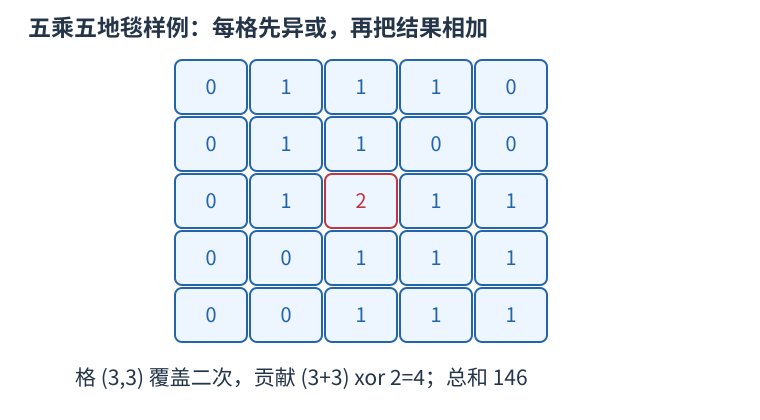

# P13787 二维差分还原覆盖数后逐格异或累加 题解

## 目录

| 题号 | 题名 | 考点 | 难度 |
|---|---|---|---|
| A | 地毯 加强版 | 差分 + 前缀和 + 位运算 | 1500 |

## A. 地毯 加强版

> 原题：[P13787](https://www.luogu.com.cn/problem/P13787)
> 解法：二维差分还原覆盖数后逐格异或累加 · C++17

### 题意

给定许多覆盖闭区间格子的矩形地毯，求所有格子的 (行号+列号) xor 覆盖次数之和。

<!-- reusable-foundations:start -->

### 从零讲：C++ 输入输出：把数据读进变量，把结果写到标准输出

程序运行时从标准输入接收题目给的数据，把答案送到标准输出。`cin` 和 `cout` 定义在 `<iostream>`；写 `using namespace std;` 后可以省略它们前面的 `std::`。最小完整程序是：

```cxx
#include <iostream>
using namespace std;
int main() {
    int a, b;
    cin >> a >> b;
    cout << a + b << '\n';
    return 0;
}
```

输入二十和三十，两个变量分别保存二十、三十，输出五十。`int a, b;` 声明两个整数变量；`cin >> a` 才给变量赋入输入值。多个 `>>` 从左到右读取，读取整数时会跳过空格、制表符、换行，所以两个整数可以分处两行。负号属于整数，不需要另读一个符号。

`cout <<` 后可以接数值、字符或字符串。`' '` 是一个空格字符，`'\n'` 是换行字符，`"Hello"` 是字符串。`cout << a << ' ' << b << '\n';` 输出两个以空格分开的整数并换行。评测程序只需要答案，不应加入“请输入”等提示。

读取 `char c; cin >> c;` 会跳过前导空白。要读取包含空格的一整行，用 `<string>` 中的 `string s; getline(cin, s);`。若此前用 `cin >> n` 读取过整数，换行还留在输入中，需要先处理那一个剩余换行；不能盲目把所有空格都删掉，因为字符画的行首空格和文本中的空格可能就是数据。

`fixed << setprecision(3)`（需要 `<iomanip>`）表示以小数形式保留三位小数，例如把 $2.5$ 输出成 $2.500$；不用 `fixed` 时，`setprecision` 指有效数字总数。设置会影响后续输出，使用前应确认所需精度。

竞赛中可在首次输入输出前调用 `ios::sync_with_stdio(false); cin.tie(nullptr);`，减少 C++ 流与 C 标准输入输出的同步、绑定开销。随后保持使用 `cin/cout`，不要混用另一套 `scanf/printf`。交互题还要在需要对方回应前主动刷新，例如 `cout << query << endl;`；普通题用换行字符即可。

读入长度为 $L$ 的文本、或输出 $L$ 个字符，至少需要 $O(L)$ 时间。数据类型仍要能容纳结果：把两个整数相乘时，即使保存到 `long long`，也要让乘法本身在这个类型中进行，例如先把输入声明为 `long long`。

### 从零讲：分支与循环：按条件选择，按次序重复

`if (条件) { ... } else { ... }` 根据条件的真假选择一条分支。比较运算 `==`、`!=`、`<`、`<=`、`>`、`>=` 返回真假值；`=` 是赋值，不能代替相等比较。`&&` 表示两边都成立，`||` 表示至少一边成立，`!` 把真假反转。

```cxx
int score = 85;
if (score >= 90) cout << "A";
else if (score >= 60) cout << "B";
else cout << "C"; // 这个例子输出 B
```

这条分支链只执行第一个符合条件的分支。先处理高分后，第二个条件自然只会接到低于九十分的数。几个独立的 `if` 则可能执行多次；两种结构代表不同问题。逻辑运算会短路：`i < n && a[i] == 0` 先确认下标合法，才读取那一格。

`for (初始化; 继续条件; 每轮更新)` 适合知道重复范围的情况。例如下列代码依次处理一到四，总和是十：

```cxx
int sum = 0;
for (int i = 1; i <= 4; ++i) {
    sum += i;
}
cout << sum;
```

初始化只做一次；每轮先判断条件，条件为真才执行循环体，随后执行更新。`++i` 把 $i$ 加一，`sum += i` 等价于把旧 sum 加 $i$ 再保存。应明确每个变量在循环前、循环后分别表示什么；最大值相同时是否更新，决定了保留较早还是较晚的答案。

`while (条件)` 适合“不满足目标就再做一步”：

```cxx
int x = 13, times = 0;
while (x > 1) {
    x /= 2;
    ++times;
}
// x 依次是 13、6、3、1，执行三次
```

循环开始前先检查条件，初始已满足目标时可能一次也不执行。每次执行必须推进状态，否则可能无限循环。`break` 结束最内层循环，`continue` 跳过本轮剩余部分；`for` 中的 continue 之后仍会执行每轮更新。

复杂度由实际执行次数决定。上述求和执行 $n$ 次是 $O(n)$；每次将正整数减半只执行 $O(\log n)$ 次。两层循环不能仅凭外观判定为平方：内层若总共只前进 $n$ 次，总量仍可能线性。变量应在正确作用范围初始化；多组数据的计数器若未重置，下一组会错误继承上一组结果。

### 从零讲：数组：用下标定位一组状态

数组把同一类型的若干值按位置保存。`int a[5] = {};` 创建五个初始为零的整数，合法下标是零到四；`a[2] = 7;` 只修改第三格。下标表示位置，格子中保存的值是另一回事。

```cxx
int a[4] = {4, 3, 0, 5};
int sum = 0;
for (int i = 0; i < 4; ++i) sum += a[i];
// 和为十二；a[0] 是四，a[3] 是五
```

读写一个给定下标的格子是 $O(1)$。扫描全部 $n$ 格为 $O(n)$，保存 $n$ 格的空间为 $O(n)$。不能访问负下标或 $a[n]$，越界属于未定义行为，可能表现为随机数或崩溃，编译通过不代表安全。

`bool seen[34] = {};` 可以保存号码是否出现过，初始全为 false；`seen[x]=true` 表示记录出现状态。再次赋 true 不改变结果，因此适合去重、标记删除；若操作是开关翻转，则要写 `seen[x]=!seen[x]`。标记真假和记录出现次数是不同任务，后者需要整数计数数组。

若题目用一到 $n$ 编号，可以创建 $n+1$ 格并预留零号，统一按原编号访问。或者读入时改成零到 $n-1$，但必须让全部循环与公式使用同一套下标。

二维数组 `int a[5][6] = {};` 有五行六列，`a[r][c]` 表示第 $r$ 行第 $c$ 列。三维数组再加一个方向，用三个下标定位单位格子。逐格扫描的时间是各维长度的乘积，空间也按格子总数计算。

固定数组的长度需要在编译时确定，不能在标准 C++17 中写依赖输入的 `int a[n]`。输入后才确定大小时使用 `vector<int> a(n,0)`；它同样从零编号，也可以按下标访问，但仍须检查下标边界。大数组应避免放在空间有限的函数栈上，可以用动态容器或全局数组。数组里的旧状态是否应该保留，需要根据当前问题决定，多组测试不能意外继承上一组的内容。

### 从零讲：vector：长度可变的连续数组

`vector<T>` 保存一串同类型的元素，适合按下标访问、扫描、排序。`T` 是元素类型，例如 `vector<int>` 保存整数，`vector<pair<int,int>>` 保存整数对，`vector<vector<int>>` 可保存每个顶点各自的邻居。需要 `<vector>`。

```cxx
vector<int> a(3, 7);   // 三个元素，内容是 7、7、7
a.push_back(9);       // 在末尾追加，现在长度为 4
int x = a[1];         // 从 0 编号，这里得到 7
a[1] = 2;            // 改第二个元素
int n = int(a.size());
```

`vector<int> a(3)` 创建三个值为零的元素；`a.reserve(3)` 只预留容量，元素数仍为零，此时不能访问 `a[0]`。长度 `size()` 与容量 `capacity()` 是不同概念。

下标访问为 $O(1)$，遍历为 $O(n)$。末尾追加通常为 $O(1)$；容量不足时会分配更大的连续空间并搬移元素，这次可能为 $O(n)$，一连串追加的平均成本称为摊还 $O(1)$。中间插入或删除会搬移后续元素，最坏 $O(n)$。内存是元素量的 $O(n)$，并可能预留部分尚未使用的容量。

`begin()` 指向首元素，`end()` 指向尾后位置，`sort(a.begin(),a.end())` 操作整个数组。`a[i]` 不检查越界；下标须满足 $0\le i<\mathrm{size}$。`at(i)` 会检查越界并抛异常。空数组不能访问 `front()`、`back()`；`pop_back()` 也要求非空。

扩容后指向旧存储的迭代器、引用和指针会失效。遍历的同时 `push_back`，不能假定此前取得的引用仍可用。读取大数组的函数常用 `const vector<int>& a` 按常量引用传入，既不复制也禁止通过该引用修改；`vector<int> a` 按值传参则复制内容。选择副本还是引用取决于是否要保留独立数据。

### 从零讲：具名函数：给可复用计算一个明确接口

函数把一段计算包装成“输入参数 → 返回结果”。例如判断整数是否为偶数：

```cxx
bool even(int x) {
    return x % 2 == 0;
}
int main() {
    bool a = even(8); // a 为 true
    bool b = even(7); // b 为 false
}
```

`bool` 是返回类型，`even` 是函数名，`int x` 是参数声明。调用 `even(8)` 时，实参八传入这个新调用的局部变量 $x$，执行 return 后把真假值交回调用处。定义本身不执行计算，只有调用才执行。函数应在调用处之前定义，或提前写声明。

普通数值参数按值传递，函数里修改 $x$ 不会改变调用者原变量。参数写成 `int &x` 时才引用调用者对象；必须让这个对象在调用期间有效。`const vector<int>& a` 用引用避免复制整个容器，并承诺不通过这个引用修改它。返回局部变量的值是安全的，返回局部变量的引用则在函数结束后失效。

函数名应说明它回答的问题，调用处负责传哪些数据。例如闰年判定只接收一个年份并返回真假，枚举年份范围和输出格式由调用者处理。同一判定被多次使用时，这能减少规则不一致；但函数包装不会自动降低算法复杂度，仍要把每次调用实际做的工作计入时间。

如果函数内部又调用自身，就是递归，需要明确最小情况如何直接返回、每次调用如何逼近它；递归会占用调用栈。普通辅助函数可以不使用递归，不应仅因写成函数就称作递归算法。

### 从零讲：整数类型、整除与溢出

计算前先看每一步可能达到的范围。常见环境中 `int` 是 32 位，上界约 $2.1\times10^9$；`long long` 至少 64 位，常见有符号 64 位上界约 $9.22\times10^{18}$。`using ll = long long;` 只是为已有类型起别名。

```cxx
int a = 100000, b = 100000;
long long wrong = a * b;      // 右边先按 int 乘，可能已溢出
long long right = 1LL * a * b; // 先把运算提升到 long long
```

不能指望“接收结果的变量够大”修复此前已经溢出的计算。先提高操作数类型，再做乘法。超过 64 位时，GCC 的 `__int128` 可作中间量，但它不是标准 C++17 类型，也没有标准流输出重载；先证明范围，再选择工具。

整数 `/` 对有符号数向零截断：`7/3==2`、`-7/3==-2`。对非负数才等于向下取整。余数满足 `a == (a/b)*b + a%b`，除数不能为零；要将余数归入 $[0,m-1]$（$m>0$），可用 `(a % m + m) % m`，同时保证中间加法不溢出。

非负 $a$、正 $b$ 的向上取整可写 `a/b + (a%b != 0)`，比 `(a+b-1)/b` 更容易避免加法溢出。比较平方时也应在宽类型内计算；浮点数不适合作为大整数相等的默认判断方式。

`size()` 返回无符号类型。空容器上写 `size()-1` 会绕到很大的数，逆序遍历可以先转成有符号、确认长度，或使用逆向迭代器。`abs` 对最小有符号数无法在同类型中表达其正值，需先约束输入差值范围。一般机器整数运算按常数时间估算，宽类型解决表示范围，不改变算法的增长阶。

### 从零讲：二维差分：四个角登记一块矩形的增量

一维差分让一次区间加法只登记开始和结束：开始加、结束后一位减，前缀还原后只有区间内部保留增量。二维把这个思路分别用于行和列。

先约定使用半开矩形：行在 [x1,x2)、列在 [y1,y2)。每格加 $v$ 的四个事件为左上 $+v$、右上 $-v$、左下 $-v$、右下 $+v$。这里的上下指行号增大向下；不同题面可能把 $x$ 作为水平方向，算法只依赖两个独立坐标，保持约定一致即可。


把左上的 $+v$ 想成对所有右下方格子生效。超过右边界时用右上 $-v$ 撤销，超过下边界时用左下 $-v$ 撤销；两者右下交叠区域被减两次，必须在右下再加 $v$。于是矩形内留下 $v$，外面全部抵消。这里的四项不是四个矩形面积，而是还原时会扩散的边界事件。

还原为二维前缀和。上方前缀与左方前缀有一块共同的左上区域，所以要扣一次：$value[x][y]=diff[x][y]+value[x-1][y]+value[x][y-1]-value[x-1][y-1]$。从小行、小列到大行、大列，三份来源均已还原，可以原地更新。

```cxx
int rows = 4, columns = 5;
vector<vector<int>> diff(rows+1, vector<int>(columns+1));
int x1 = 1, y1 = 1, x2 = 3, y2 = 4;
++diff[x1][y1]; --diff[x1][y2];
--diff[x2][y1]; ++diff[x2][y2];
int covered = 0;
for (int x = 0; x < rows; ++x) {
    for (int y = 0; y < columns; ++y) {
        if (x > 0) diff[x][y] += diff[x-1][y];
        if (y > 0) diff[x][y] += diff[x][y-1];
        if (x > 0 && y > 0) diff[x][y] -= diff[x-1][y-1];
        covered += diff[x][y] == 1;
    }
}
```

例子中 covered=6，行一、二与列一、二、三的格子为一，其余为零。多次修改只需重复四角登记，全部修改结束后还原一次。若修改与查询任意交替，不能每次仍宣称只付一次还原成本，需要按查询频次选择重新扫描或其它数据结构。

闭区间格子 $[l, r]$ 应先改写为 [$l, r+1$)，所以撤销在 $r+1$；连续坐标的矩形面积本来可按半开边界处理，不额外加一。终点事件要有合法下标，因此数组多开一行一列。$R \times C$ 网格、M 次矩形修改的时间为 $O(M+RC)$，空间 $O(RC)$。若只需要单格面积且坐标间隔不为一，离散化后还须乘实际宽与高，不能只数格子。

### 从零讲：位运算：把非负整数看成一组二进制开关

五写成二进制为 $0101_2$，三为 $0011_2$。同一列各代表一位：按位与 `&` 两边都为一才得一，按位或 `|` 任一为一就得一，按位异或 `^` 不同才为一。所以 $5\mathbin{\&}3=1$，$5\mathbin{|}3=7$，$5\mathbin{\oplus}3=6$。


`1ULL << k` 把一移到第 $k$ 位。对非负无符号整数，`(mask >> k) & 1ULL` 读该位，`mask | (1ULL<<k)` 置一，`mask & ~(1ULL<<k)` 清零，`mask ^ (1ULL<<k)` 翻转。最低位编号为零。

```cxx
unsigned long long mask = 5; // 第 0、2 位为一
bool has = (mask >> 2) & 1ULL; // true
mask |= 1ULL << 1;             // 变成 7
```

位移次数必须小于类型位宽，且不能为负；不要用普通 `1` 去移到超出 int 范围的位置。C++17 有符号负数右移和溢出的规则不适合直接套“乘除二的幂”，用明确范围的无符号数更容易保证行为。`^` 是异或，绝不是乘方。

逻辑与 `&&`、逻辑或 `||` 将整体条件视为真假，并会短路；按位 `&`、`|` 逐位计算，不会因此跳过右侧表达式。运算符优先级可能与直觉不同，写 `(mask & bit) != 0`，别省掉关键括号。

固定机器字内的一次位运算按 $O(1)$ 估算；枚举全部 $k$ 位状态仍有 $2^k$ 种，不能因为每次运算快就忽略状态数。`x & (x-1)` 对正无符号数清掉最低的一位；GCC 的 `__builtin_popcountll(x)` 统计一的数量，注意实参位宽与具体编译器支持。

<!-- reusable-foundations:end -->

### 思路

这次坐标代表格子编号，右下角的格子也被覆盖，所以与连续面积题不同，撤销必须放在终点的下一格：左上加一，(x2+1,y1) 与 (x1,y2+1) 减一，(x2+1,y2+1) 加一。



格内数字只表示覆盖次数；坐标从一开始，只有格三三叠了两块地毯。

二维还原时，当前覆盖数等于原差分加上上一行已还原值、左边已还原值，再减左上角已还原值，因为那部分被前两项重复包含。按行从上到下、列从左到右扫描，三份来源都已算好，可直接在差分数组原地保存最终覆盖数。

题目最后的“和”是普通加法，只有每个格子内部把 $i+j$ 与 F 做按位异或。代码必须明确写 `answer+=((i+j)^coverage)`，不能把所有格子也整体异或起来，更不能把 xor 当乘方。最大单格覆盖数为 $m$，但 $n^2$ 个格子相加可能远超 int。

$n \le 5000$，二维 int 数组约一亿字节。使用连续的一维 vector 按 $row \times stride+column$ 索引，保留 $n+2$ 的行列边界，避免再复制一份同规模前缀表。地毯条数只影响四角更新，总扫描仍是 $n^2$。

时间 $O(m+n^2)$、空间 $O(n^2)$。

### 参考代码

```cpp
#include <bits/stdc++.h>
using namespace std;

int main() {
    ios::sync_with_stdio(false);
    cin.tie(nullptr);
int n,m;cin>>n>>m;int stride=n+2;vector<int>grid((size_t)stride*stride);
while(m--){int x1,y1,x2,y2;cin>>x1>>y1>>x2>>y2;
    ++grid[(size_t)x1*stride+y1];--grid[(size_t)(x2+1)*stride+y1];
    --grid[(size_t)x1*stride+y2+1];++grid[(size_t)(x2+1)*stride+y2+1];
}
long long answer=0;
for(int i=1;i<=n;++i)for(int j=1;j<=n;++j){size_t at=(size_t)i*stride+j;
    grid[at]+=grid[at-stride]+grid[at-1]-grid[at-stride-1];answer+=((i+j)^grid[at]);
}
cout<<answer<<'\n';
    return 0;
}
```

### 易错点

闭区间在终点后一格撤销；每格先异或再普通求和；只保留一份二维数组。

## 实测记录

本地 C++17 编译、1 组原站样例与 151 组独立边界/小域校验通过。
正文参考程序与源码逐字核对；没有向原站提交。
