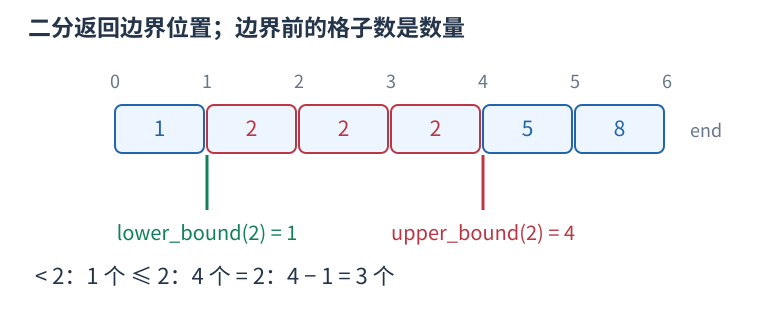
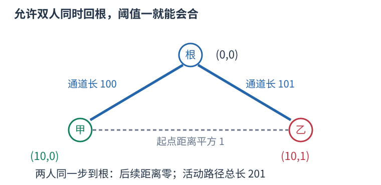

# P13824 双人状态的最小瓶颈递推，再按阈值查询最长路径 题解

## 目录

| 题号 | 题名 | 考点 | 难度 |
|---|---|---|---|
| A | 在水一方 | 递推 + 二分查找 + 图论 | 1800 |

## A. 在水一方

> 原题：[P13824](https://www.luogu.com.cn/problem/P13824)
> 解法：双人状态的最小瓶颈递推，再按阈值查询最长路径 · C++17

### 题意

两人在树上某活动路径的端点，每次可一人或两人各向根走一条边，位置平方距离不得超过给定阈值，求能成功会合的最长活动路径及最小端点编号。

<!-- reusable-foundations:start -->

### 从零讲：C++ 输入输出：把数据读进变量，把结果写到标准输出

程序运行时从标准输入接收题目给的数据，把答案送到标准输出。`cin` 和 `cout` 定义在 `<iostream>`；写 `using namespace std;` 后可以省略它们前面的 `std::`。最小完整程序是：

```cxx
#include <iostream>
using namespace std;
int main() {
    int a, b;
    cin >> a >> b;
    cout << a + b << '\n';
    return 0;
}
```

输入二十和三十，两个变量分别保存二十、三十，输出五十。`int a, b;` 声明两个整数变量；`cin >> a` 才给变量赋入输入值。多个 `>>` 从左到右读取，读取整数时会跳过空格、制表符、换行，所以两个整数可以分处两行。负号属于整数，不需要另读一个符号。

`cout <<` 后可以接数值、字符或字符串。`' '` 是一个空格字符，`'\n'` 是换行字符，`"Hello"` 是字符串。`cout << a << ' ' << b << '\n';` 输出两个以空格分开的整数并换行。评测程序只需要答案，不应加入“请输入”等提示。

读取 `char c; cin >> c;` 会跳过前导空白。要读取包含空格的一整行，用 `<string>` 中的 `string s; getline(cin, s);`。若此前用 `cin >> n` 读取过整数，换行还留在输入中，需要先处理那一个剩余换行；不能盲目把所有空格都删掉，因为字符画的行首空格和文本中的空格可能就是数据。

`fixed << setprecision(3)`（需要 `<iomanip>`）表示以小数形式保留三位小数，例如把 $2.5$ 输出成 $2.500$；不用 `fixed` 时，`setprecision` 指有效数字总数。设置会影响后续输出，使用前应确认所需精度。

竞赛中可在首次输入输出前调用 `ios::sync_with_stdio(false); cin.tie(nullptr);`，减少 C++ 流与 C 标准输入输出的同步、绑定开销。随后保持使用 `cin/cout`，不要混用另一套 `scanf/printf`。交互题还要在需要对方回应前主动刷新，例如 `cout << query << endl;`；普通题用换行字符即可。

读入长度为 $L$ 的文本、或输出 $L$ 个字符，至少需要 $O(L)$ 时间。数据类型仍要能容纳结果：把两个整数相乘时，即使保存到 `long long`，也要让乘法本身在这个类型中进行，例如先把输入声明为 `long long`。

### 从零讲：分支与循环：按条件选择，按次序重复

`if (条件) { ... } else { ... }` 根据条件的真假选择一条分支。比较运算 `==`、`!=`、`<`、`<=`、`>`、`>=` 返回真假值；`=` 是赋值，不能代替相等比较。`&&` 表示两边都成立，`||` 表示至少一边成立，`!` 把真假反转。

```cxx
int score = 85;
if (score >= 90) cout << "A";
else if (score >= 60) cout << "B";
else cout << "C"; // 这个例子输出 B
```

这条分支链只执行第一个符合条件的分支。先处理高分后，第二个条件自然只会接到低于九十分的数。几个独立的 `if` 则可能执行多次；两种结构代表不同问题。逻辑运算会短路：`i < n && a[i] == 0` 先确认下标合法，才读取那一格。

`for (初始化; 继续条件; 每轮更新)` 适合知道重复范围的情况。例如下列代码依次处理一到四，总和是十：

```cxx
int sum = 0;
for (int i = 1; i <= 4; ++i) {
    sum += i;
}
cout << sum;
```

初始化只做一次；每轮先判断条件，条件为真才执行循环体，随后执行更新。`++i` 把 $i$ 加一，`sum += i` 等价于把旧 sum 加 $i$ 再保存。应明确每个变量在循环前、循环后分别表示什么；最大值相同时是否更新，决定了保留较早还是较晚的答案。

`while (条件)` 适合“不满足目标就再做一步”：

```cxx
int x = 13, times = 0;
while (x > 1) {
    x /= 2;
    ++times;
}
// x 依次是 13、6、3、1，执行三次
```

循环开始前先检查条件，初始已满足目标时可能一次也不执行。每次执行必须推进状态，否则可能无限循环。`break` 结束最内层循环，`continue` 跳过本轮剩余部分；`for` 中的 continue 之后仍会执行每轮更新。

复杂度由实际执行次数决定。上述求和执行 $n$ 次是 $O(n)$；每次将正整数减半只执行 $O(\log n)$ 次。两层循环不能仅凭外观判定为平方：内层若总共只前进 $n$ 次，总量仍可能线性。变量应在正确作用范围初始化；多组数据的计数器若未重置，下一组会错误继承上一组结果。

### 从零讲：vector：长度可变的连续数组

`vector<T>` 保存一串同类型的元素，适合按下标访问、扫描、排序。`T` 是元素类型，例如 `vector<int>` 保存整数，`vector<pair<int,int>>` 保存整数对，`vector<vector<int>>` 可保存每个顶点各自的邻居。需要 `<vector>`。

```cxx
vector<int> a(3, 7);   // 三个元素，内容是 7、7、7
a.push_back(9);       // 在末尾追加，现在长度为 4
int x = a[1];         // 从 0 编号，这里得到 7
a[1] = 2;            // 改第二个元素
int n = int(a.size());
```

`vector<int> a(3)` 创建三个值为零的元素；`a.reserve(3)` 只预留容量，元素数仍为零，此时不能访问 `a[0]`。长度 `size()` 与容量 `capacity()` 是不同概念。

下标访问为 $O(1)$，遍历为 $O(n)$。末尾追加通常为 $O(1)$；容量不足时会分配更大的连续空间并搬移元素，这次可能为 $O(n)$，一连串追加的平均成本称为摊还 $O(1)$。中间插入或删除会搬移后续元素，最坏 $O(n)$。内存是元素量的 $O(n)$，并可能预留部分尚未使用的容量。

`begin()` 指向首元素，`end()` 指向尾后位置，`sort(a.begin(),a.end())` 操作整个数组。`a[i]` 不检查越界；下标须满足 $0\le i<\mathrm{size}$。`at(i)` 会检查越界并抛异常。空数组不能访问 `front()`、`back()`；`pop_back()` 也要求非空。

扩容后指向旧存储的迭代器、引用和指针会失效。遍历的同时 `push_back`，不能假定此前取得的引用仍可用。读取大数组的函数常用 `const vector<int>& a` 按常量引用传入，既不复制也禁止通过该引用修改；`vector<int> a` 按值传参则复制内容。选择副本还是引用取决于是否要保留独立数据。

### 从零讲：整数类型、整除与溢出

计算前先看每一步可能达到的范围。常见环境中 `int` 是 32 位，上界约 $2.1\times10^9$；`long long` 至少 64 位，常见有符号 64 位上界约 $9.22\times10^{18}$。`using ll = long long;` 只是为已有类型起别名。

```cxx
int a = 100000, b = 100000;
long long wrong = a * b;      // 右边先按 int 乘，可能已溢出
long long right = 1LL * a * b; // 先把运算提升到 long long
```

不能指望“接收结果的变量够大”修复此前已经溢出的计算。先提高操作数类型，再做乘法。超过 64 位时，GCC 的 `__int128` 可作中间量，但它不是标准 C++17 类型，也没有标准流输出重载；先证明范围，再选择工具。

整数 `/` 对有符号数向零截断：`7/3==2`、`-7/3==-2`。对非负数才等于向下取整。余数满足 `a == (a/b)*b + a%b`，除数不能为零；要将余数归入 $[0,m-1]$（$m>0$），可用 `(a % m + m) % m`，同时保证中间加法不溢出。

非负 $a$、正 $b$ 的向上取整可写 `a/b + (a%b != 0)`，比 `(a+b-1)/b` 更容易避免加法溢出。比较平方时也应在宽类型内计算；浮点数不适合作为大整数相等的默认判断方式。

`size()` 返回无符号类型。空容器上写 `size()-1` 会绕到很大的数，逆序遍历可以先转成有符号、确认长度，或使用逆向迭代器。`abs` 对最小有符号数无法在同类型中表达其正值，需先约束输入差值范围。一般机器整数运算按常数时间估算，宽类型解决表示范围，不改变算法的增长阶。

### 从零讲：sort 与比较器：先建立统一的顺序

排序把原来任意排列的数据，按照可比较的键整理成有序序列，便于查边界、比较相邻项和按顺序处理。头文件 `<algorithm>`；普通数组和 `vector` 可用 `sort(first,last)`，范围为左闭右开。

```cxx
vector<int> a{5, 2, 5, 1};
sort(a.begin(), a.end());     // 变成 1、2、5、5，重复值仍保留
sort(a.begin(), a.end(), greater<int>());  // 降序
```

`sort` 时间 $O(n\log n)$，不是每次比较都扫描整个数组。C++ 标准规定复杂度要求，不规定必须使用某一固定内部排序实现，不能统一称它为快速排序。

对 `pair`，默认先比较 `first`，相同再比较 `second`，都是升序。自定义比较器 `cmp(a,b)` 返回真表示“$a$ 必须排在 $b$ 前面”。例如按分数降序、同分按编号升序：

```cxx
sort(students.begin(), students.end(), [](const auto& a, const auto& b) {
    if (a.score != b.score) return a.score > b.score;
    return a.id < b.id;
});
```

规则必须自洽：元素不能排在自己前面，不能出现 $a$ 在 $b$ 前、$b$ 在 $c$ 前、$c$ 又在 $a$ 前的循环。`<=` 会让相同元素也必须互相在前，因此不是合法的严格比较器。排序过程中也不能改变比较依据。

排序会改变原位置；若编号或两项的配对有意义，应将完整记录一起排序或另存查询副本，不能把两个相关字段各自排序后继续当作原配对。普通 `sort` 不保证同键元素保持输入先后；确需稳定顺序时用 `stable_sort` 或将原编号纳入比较键。排序只建立顺序，不能代替贪心策略的正确性证明。

### 从零讲：迭代器、begin/end 与左闭右开范围

迭代器表示容器中的一个位置。`*it` 读取它指向的元素，`++it` 向后移动，`it == c.end()` 判断是否已经到尾后。把末尾之后的位置作为边界，使空范围、整个容器和一段子区间都能用同一形式表示。

```cxx
vector<int> a{4, 7, 9};
for (auto it = a.begin(); it != a.end(); ++it) {
    cout << *it << ' ';   // 输出 4 7 9
}
```

`[first,last)` 包含 `first`，排除 `last`。`[begin,begin)` 是空范围，`[begin,end)` 包含所有元素。不能读取 `*end()`；找不到时返回 `end()` 是合法结果，必须先判断再读取。

数组和 `vector` 的迭代器支持随机访问：`begin()+k` 跳到下标 $k$，`it-begin()` 得到下标，均为 $O(1)$。例如指向下标二的位置之前有零、一两个元素，故减起点也能表示前面有几个数。相减只对同一容器中可相减的迭代器有效。

`list`、`set`、`map` 的迭代器通常只能逐步移动，不支持 `it-begin()`。`distance(begin,it)` 可以计算距离，但在这些容器上需要走过中间位置，时间为 $O(k)$；不能因为写了一个函数就认为它是常数时间。

容器修改后，旧位置可能失效：`vector` 扩容会使旧位置失效，删除元素会影响该处及其后位置。需要跨修改保存“第几个”时可保存下标，再按新数据重新取得迭代器，同时核对下标是否仍然合法。

### 从零讲：lower_bound 与 upper_bound：从位置到数量

#### 什么时候使用

有一批可以比较大小的数据，需要反复问“小于某数的有几个”“某个值出现几次”“第一个达到要求的元素在哪”。先排序，再查边界，能避免每次从头扫描。这里先讨论从小到大的 `vector<int>`，头文件为 `<algorithm>` 和 `<vector>`，适用于 C++17。

#### 先弄清返回的是什么

`a.begin()` 指向第一个元素，`a.end()` 指向末元素之后的空位置。`[a.begin(), a.end())` 包含左端、不包含右端。迭代器可以理解为指向容器中某个位置的标记；它不是元素的值，也不是数量。

设有序数组为 $[1,2,2,2,5,8]$，下标从零开始，查询 $x=2$：



- `lower_bound(a.begin(), a.end(), x)` 返回第一个**大于等于** `x` 的位置，这里是下标一。
- `upper_bound(a.begin(), a.end(), x)` 返回第一个**严格大于** `x` 的位置，这里是下标四。

把名字与等号绑定记忆：`lower_bound` 是相等区间的左边界，`upper_bound` 是相等区间的右边界；没有相等元素时两条边界重合。两个函数均不保证命中 `x`。

```cxx
vector<int> a{1, 2, 2, 2, 5, 8};
int x = 2;
auto lo = lower_bound(a.begin(), a.end(), x);
auto hi = upper_bound(a.begin(), a.end(), x);
int less = int(lo - a.begin());          // 1 个元素 < 2
int lessEqual = int(hi - a.begin());     // 4 个元素 <= 2
int equal = int(hi - lo);                // 3 个元素 == 2
```

#### 为什么“位置减 begin”可以计数

`lo` 之前恰有下标 $0$ 到 $0$ 的一个元素。一般地，第一个大于等于 $x$ 的位置如果是 $k$，它前面的下标为 $0,1,\ldots,k-1$，恰有 $k$ 个；有序性保证这 $k$ 个全部严格小于 $x$，之后没有漏下的小数。对 `vector`，`lo-a.begin()` 就是跨过的格子数 $k$。

同理，`hi` 之前全部不大于 $x$，所以它的下标就是不大于 $x$ 的数量。令数组长度为 $n$，便有：

| 要统计的元素 | C++ 表达式 | 本例结果 |
|---|---|---|
| 小于 $x$ | `lo - a.begin()` | $1$ |
| 不大于 $x$ | `hi - a.begin()` | $4$ |
| 大于等于 $x$ | `a.end() - lo` | $5$ |
| 大于 $x$ | `a.end() - hi` | $2$ |
| 等于 $x$ | `hi - lo` | $3$ |

因此，函数本身找的是分界位置，计数来自分界两边的长度。查询闭区间 $[L,R]$ 中的数量（保证 $L\le R$），用 `upper_bound(..., R)-lower_bound(..., L)`；这也避免了写 `L-1` 时可能发生的整数下溢。

#### 底层怎样二分

下面返回下标，展示 `lower_bound` 的核心逻辑，不依赖库函数：

```cxx
int first_ge(const vector<int>& a, int x) {
    int left = 0, right = int(a.size());
    // 答案在位置 [left, right] 内；待判断元素在 [left, right)。
    while (left < right) {
        int mid = left + (right - left) / 2;
        if (a[mid] < x) left = mid + 1;
        else right = mid;
    }
    return left;  // 可以等于 a.size()，表示没有符合条件的元素
}
```

若中点小于 $x$，它左侧都小于 $x$，连同中点一起排除；否则答案不会在中点右侧，把右边界移到中点，保留中点本身作为可能答案。每次排除约一半候选，区间长度从 $n$ 变成约 $n/2,n/4,\ldots$，经过约 $\log_2 n$ 次就剩一个边界，所以时间为 $O(\log n)$，额外空间为 $O(1)$。

实现 `upper_bound` 时，把 `a[mid] < x` 改为 `a[mid] <= x`：遇到相等也继续向右，才能越过全部重复值。比如六个数查二，`lower_bound` 的左边界、右边界和中点三个下标依次为 $(0,6,3)$、$(0,3,1)$、$(0,1,0)$，最终返回一；`upper_bound` 依次为 $(0,6,3)$、$(4,6,5)$、$(4,5,4)$，最终返回四。

#### 使用条件和边界

第一次排序花 $O(n\log n)$，之后 $q$ 次查询共花 $O(q\log n)$。每次查询前都重新排序，会丢掉复用有序数组的优势。若还需要原来的配对、编号或顺序，应另存原数据，再排序供查询的副本。

查零时两条边界都在 `begin()`；查十时都在 `end()`；查三时都指向五。空数组也会返回 `end()`，计数自然为零。**可以拿 `end()` 计算长度，不能解引用它。** 查是否存在应写 `it != a.end() && *it == x`。

一般前提是比较条件能把范围分成两段；完整升序是最易保证的方式。普通乱序数组不能直接套用。降序或自定义排序必须使用匹配的比较器，不能沿用上表的自然大小解释。

`vector`、数组的随机访问迭代器支持常数时间跳到中点和相减，所以总时间为 $O(\log n)$。`list` 或 `set` 的迭代器不支持相减，通用二分虽然比较次数是对数，迭代器移动却可能达到线性；在 `set`、`map` 上优先用成员函数 `s.lower_bound(x)`、`s.upper_bound(x)`，它们沿树查找为 $O(\log n)$。成员函数得到的迭代器到 `begin()` 的距离仍未必能快速计算。

规范核对：[C++ 工作草案：二分边界算法](https://eel.is/c++draft/alg.binary.search)。本文只使用 C++17 已有接口。

### 从零讲：结构体：把一个对象的相关数据保存在一起

结构体给一组不同类型的字段起一个整体类型名。例如一个学生有姓名和三科分数：

```cxx
struct Student {
    string name;
    int chinese, math, english;
};
Student a{"Lin", 90, 95, 92};
cout << a.name << ' ' << a.math; // Lin 95
```

`Student` 是新类型，$a$ 是这个类型的对象，点号选择对象中的某个字段。创建 `vector<Student> students(n)` 就能保存 $n$ 个学生，`students[i].math` 表示第 $i$ 个学生的数学分。这样一名学生的数据随对象一起移动，不会在排序时只移动姓名而忘记移动分数。

字段必须在使用前初始化或读入。`Student a{};` 会让字符串为空、整数为零；不加初始化的局部整数成员不能假定为零。字段名的访问本身为常数时间，但复制对象的成本取决于成员：复制很长的字符串会复制它的内容。只读取现有对象时可用 `const Student&` 避免复制。

结构体不会自动规定大小顺序。排序若要按分数降序、并列按姓名升序，需要另外提供满足严格弱序的比较函数。枚举输入已排序对象时，则可以直接沿用题目保证的顺序。先明确要比较的是对象的哪些字段，再决定是否需要排序。

### 从零讲：具名函数：给可复用计算一个明确接口

函数把一段计算包装成“输入参数 → 返回结果”。例如判断整数是否为偶数：

```cxx
bool even(int x) {
    return x % 2 == 0;
}
int main() {
    bool a = even(8); // a 为 true
    bool b = even(7); // b 为 false
}
```

`bool` 是返回类型，`even` 是函数名，`int x` 是参数声明。调用 `even(8)` 时，实参八传入这个新调用的局部变量 $x$，执行 return 后把真假值交回调用处。定义本身不执行计算，只有调用才执行。函数应在调用处之前定义，或提前写声明。

普通数值参数按值传递，函数里修改 $x$ 不会改变调用者原变量。参数写成 `int &x` 时才引用调用者对象；必须让这个对象在调用期间有效。`const vector<int>& a` 用引用避免复制整个容器，并承诺不通过这个引用修改它。返回局部变量的值是安全的，返回局部变量的引用则在函数结束后失效。

函数名应说明它回答的问题，调用处负责传哪些数据。例如闰年判定只接收一个年份并返回真假，枚举年份范围和输出格式由调用者处理。同一判定被多次使用时，这能减少规则不一致；但函数包装不会自动降低算法复杂度，仍要把每次调用实际做的工作计入时间。

如果函数内部又调用自身，就是递归，需要明确最小情况如何直接返回、每次调用如何逼近它；递归会占用调用栈。普通辅助函数可以不使用递归，不应仅因写成函数就称作递归算法。

### 从零讲：图的表示、BFS 与 DFS

图由顶点与边组成，适合表达“哪些对象之间能一步到达”。有向边只允许一个方向；无向边需保存两个方向。邻接表 `vector<vector<int>> graph(n)` 为每个顶点保存邻居，空间 $O(n+m)$，无向边在表中出现两次。

以边 $0-1,0-2,1-3$ 为例，从零出发：


#### BFS 为什么得到最少边数

初始顶点距离为零，入先进先出的队列。弹出顶点时，将尚未到达的邻居距离设为当前距离加一，并立刻标记入队。距离为一的顶点都会先于距离为二的处理，因此第一次发现就是最少边数。

```cxx
vector<int> distance(n, -1);
queue<int> q;
distance[start] = 0; q.push(start);
while (!q.empty()) {
    int u = q.front(); q.pop();
    for (int v : graph[u]) if (distance[v] == -1) {
        distance[v] = distance[u] + 1;
        q.push(v);
    }
}
```

适用于无权或所有边代价相同的最少步数。边权不同，第一次发现未必费用最小，不能继续套这一结论。多起点 BFS 先把所有合法起点设零并入队。

#### DFS 的调用代表一整块未探索区域

DFS 标记当前点后，递归处理每个尚未访问的邻点；也可用显式栈。上例可能按 $0,1,3,2$ 的顺序深入，但顺序取决于邻居存放方式。它擅长检查连通性、处理子树和回溯，不保证最短路径。

两种遍历在每个顶点入队或调用一次、每条边检查常数次的实现下，时间均为 $O(n+m)$，额外标记和队列/栈为 $O(n)$。不要等出队才首次标记，否则同一顶点可能重复入队。图不连通时，从一个起点无法覆盖所有点；统计连通块应从每个尚未访问点再启动一次遍历。树的深递归可能用尽调用栈。

### 从零讲：树的根、子树、DFS 序与倍增

树是连通且无环的无向图，$n$ 个顶点有 $n-1$ 条边。指定一个根后，每个非根顶点有唯一父亲，其他向下邻居是孩子。子树包含自己和全部后代；换根会改变父子关系，但不改变原边。


#### 子树信息按依赖顺序计算

例如子树大小 `size[u]` 初始为一，每个孩子处理完后累加 `size[v]`。一来自节点自己，不能漏掉。树形 DP 也如此：先明确某状态允许怎样选择，再合并各孩子提供的信息；孩子独立性来自树上没有跨子树边，仍可能因总预算或选中父亲等条件产生状态关联。

换根 DP 先求一个根的状态，再沿边换根，将“来自孩子的一侧”和“来自父亲的一侧”合并。应画清只有哪条边的方向改变、哪些量不变；不能仅凭两张答案表代替依赖解释。普通遍历每条边常数次为 $O(n)$，背包式合并可能更大，按实际合并循环计算。

#### DFS 序为什么能把子树变成区间

进入节点时分配编号 `tin[u]`，完成整棵子树后记录最后编号 `tout[u]`。深度优先在返回父亲前会完整处理这棵子树，因此它的所有编号连续，恰是 $[tin[u],tout[u]]$。这允许把子树和等查询交给数组结构。若同时记录进出事件，区间定义会不同，不可混用两种序列。

#### 倍增与最近公共祖先

`up[k][u]` 存 $u$ 向上 $2^k$ 条边到达的祖先。基础 `up[0][u]=parent[u]`，递推为 `up[k][u]=up[k-1][up[k-1][u]]`，因为连续走两段 $2^{k-1}$。跳十三层可拆为八加四加一，只需对数个跳跃。

LCA 是两个节点公共祖先中最深者。先把更深的一方跳到同深度；若已经相同就是答案。否则从大到小试跳，祖先不同才两边同时上移，最后它们的父亲就是 LCA。预处理 $O(n\log n)$、每次查询 $O(\log n)$，表空间 $O(n\log n)$。根的虚拟祖先需统一定义，不能访问非法下标。

树的直径在非负无权边长等常见条件下可用两次最远点搜索求出；带负权时要重新判断。虚树则将关注节点按 DFS 序组织，补上相邻节点的 LCA 后连接祖先关系，边应携带原路径含义，不能把压缩后一条边误当原图一步。深链上的递归也须留意栈深度。

### 从零讲：动态规划：保存明确子问题的答案

若多个决策会反复遇到相同的剩余问题，可以为每个不同问题保存一次答案。状态不是“当前操作到了哪儿”的模糊描述，而是一个有完整条件、能独立提问的问题。

例如台阶一次走一或二级，求到达第 $i$ 级的方式数。令 $f_i$ 为恰好到第 $i$ 级的方案数。最后一步只有两类：从 $i-1$ 走一级，或从 $i-2$ 走两级，类别互斥且覆盖所有方案，所以 $f_i=f_{i-1}+f_{i-2}$。


起点 $f_0=1$ 表示原地不走的一种空方案，$f_1=1$。于是 $f_2=2,f_3=3,f_4=5$。从小到大计算，因为当前格依赖的格都已经完成。`f[0]=0` 会把“空方案”错误删掉。

```cxx
vector<long long> f(n + 1, 0);
f[0] = 1;
for (int i = 1; i <= n; ++i) {
    f[i] = f[i - 1];
    if (i >= 2) f[i] += f[i - 2];
}
```

另一个问题若问最小费用，就应对候选取 `min`；问最大收益取 `max`；问数量才在不重不漏的分类下相加。不能只把加号替换掉，初值也要随状态含义重新决定。不可达状态应与合法的零答案区别。

时间通常为状态数乘每个状态枚举的转移数，本例 $O(n)$；保存整表用 $O(n)$。只依赖最近两格时可滚动到 $O(1)$ 空间，但要先保存仍需读取的旧值。若下标不够决定后续可选动作，就缺少状态维度，不能把不同问题混在同一格。

检查一份 DP 时依次核对：状态的问题、基础答案、最后一步分类、依赖计算顺序、最终读哪一格。记忆化搜索使用同样的子问题，只是按递归需要计算；它也需要终止条件并避免状态依赖成环。

<!-- reusable-foundations:end -->

### 思路

令 $B[u][v]$ 为从两位置成功会合所需的最小阈值。$B[u][u]=0$；其它状态取当前平方距离与“所有合法下一状态的最小 B”之间的最大值。合法转移包括左人走、右人走、两人同时走，不能越过活动路径的最高点。按父先子后次序枚举 $u$、$v$ 即可递推全部状态。将每对起点的阈值和树路径长度排序，前缀保留最长且编号最小者，查询二分阈值。



实线是树上的通道，虚线只表示两人位置间的距离，不能当成额外树边。图形布局表示树结构，坐标数值写在节点旁。

时间 $O(n^2\log(n+1)+t\log(n+1))$、空间 $O(n^2)$。

### 参考代码

```cpp
#include <bits/stdc++.h>
using namespace std;
struct Point{long long x,y;};
long long distance2(const Point&a,const Point&b){long long x=a.x-b.x,y=a.y-b.y;return x*x+y*y;}
struct Option{long long required,length;int u,v;};
bool by_requirement(const Option&a,const Option&b){return a.required<b.required;}
int main() {
    ios::sync_with_stdio(false);
    cin.tie(nullptr);
int n,queries;cin>>n>>queries;vector<Point>point(n+1);for(int i=1;i<=n;++i)cin>>point[i].x>>point[i].y;
vector<vector<int>>graph(n+1);for(int i=1;i<n;++i){int u,v;cin>>u>>v;graph[u].push_back(v);graph[v].push_back(u);}
vector<int>parent(n+1),order={1};vector<long long>edge_length(n+1);
for(size_t i=0;i<order.size();++i){int u=order[i];for(int v:graph[u])if(v!=parent[u]){parent[v]=u;edge_length[v]=distance2(point[u],point[v]);order.push_back(v);}}
vector<vector<int>>ancestor(n+1,vector<int>(n+1));
for(int v=1;v<=n;++v)for(int u=v;u!=0;u=parent[u])ancestor[u][v]=1;
vector<vector<long long>>required(n+1,vector<long long>(n+1)),length(n+1,vector<long long>(n+1));
for(int u:order)for(int v:order)if(u!=v){
    bool move_u=!ancestor[u][v],move_v=!ancestor[v][u];long long next=LLONG_MAX;
    if(move_u)next=min(next,required[parent[u]][v]);if(move_v)next=min(next,required[u][parent[v]]);
    if(move_u&&move_v)next=min(next,required[parent[u]][parent[v]]); // 两人同时移动不能漏
    required[u][v]=max(distance2(point[u],point[v]),next);
    if(move_u)length[u][v]=edge_length[u]+length[parent[u]][v];
    else length[u][v]=edge_length[v]+length[u][parent[v]];
}
vector<Option>options;options.reserve(n*(n+1)/2);
for(int u=1;u<=n;++u)for(int v=u;v<=n;++v)options.push_back({required[u][v],length[u][v],u,v});
sort(options.begin(),options.end(),by_requirement);vector<long long>threshold;vector<int>best_u,best_v;
threshold.reserve(options.size());best_u.reserve(options.size());best_v.reserve(options.size());long long best_length=-1;int p=1,q=1;
for(auto option:options){
    if(option.length>best_length||(option.length==best_length&&(option.u<p||(option.u==p&&option.v<q)))){best_length=option.length;p=option.u;q=option.v;}
    threshold.push_back(option.required);best_u.push_back(p);best_v.push_back(q);
}
while(queries--){long long d;cin>>d;int at=(int)(upper_bound(threshold.begin(),threshold.end(),d)-threshold.begin())-1;cout<<best_u[at]<<' '<<best_v[at]<<'\n';}
    return 0;
}
```

### 易错点

平方距离不取根；两人同时走是一种独立选择；祖先端不能继续向根离开活动路径。

## 实测记录

本地 C++17 编译、1 组原站样例与 56 组独立边界/小域校验通过。
正文参考程序与源码逐字核对；没有向原站提交。
