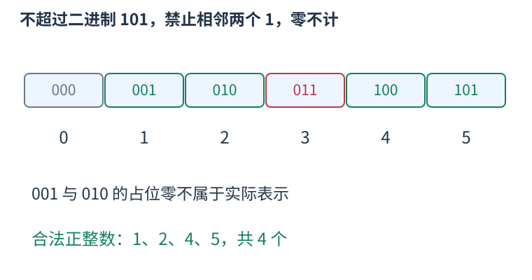
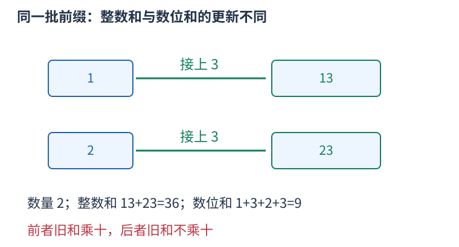
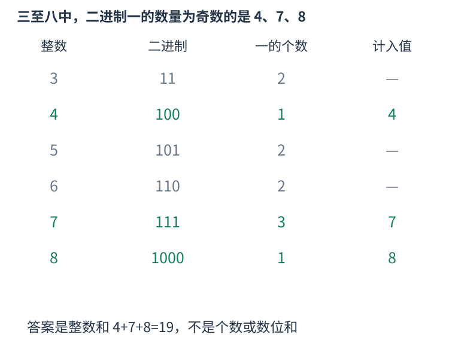

# P14074 同时保存方案数与数值和，只保留二进制奇数个一 题解

## 目录

| 题号 | 题名 | 考点 | 难度 |
|---|---|---|---|
| A | 有趣的数字和 | 数位 DP | 1500 |

## A. 有趣的数字和

> 原题：[P14074](https://www.luogu.com.cn/problem/P14074)
> 解法：同时保存方案数与数值和，只保留二进制奇数个一 · C++17

### 题意

求区间中二进制表示里一的数量为奇数的所有整数之和，不是求这些数的数位和。

<!-- reusable-foundations:start -->

### 从零讲：C++ 输入输出：把数据读进变量，把结果写到标准输出

程序运行时从标准输入接收题目给的数据，把答案送到标准输出。`cin` 和 `cout` 定义在 `<iostream>`；写 `using namespace std;` 后可以省略它们前面的 `std::`。最小完整程序是：

```cxx
#include <iostream>
using namespace std;
int main() {
    int a, b;
    cin >> a >> b;
    cout << a + b << '\n';
    return 0;
}
```

输入二十和三十，两个变量分别保存二十、三十，输出五十。`int a, b;` 声明两个整数变量；`cin >> a` 才给变量赋入输入值。多个 `>>` 从左到右读取，读取整数时会跳过空格、制表符、换行，所以两个整数可以分处两行。负号属于整数，不需要另读一个符号。

`cout <<` 后可以接数值、字符或字符串。`' '` 是一个空格字符，`'\n'` 是换行字符，`"Hello"` 是字符串。`cout << a << ' ' << b << '\n';` 输出两个以空格分开的整数并换行。评测程序只需要答案，不应加入“请输入”等提示。

读取 `char c; cin >> c;` 会跳过前导空白。要读取包含空格的一整行，用 `<string>` 中的 `string s; getline(cin, s);`。若此前用 `cin >> n` 读取过整数，换行还留在输入中，需要先处理那一个剩余换行；不能盲目把所有空格都删掉，因为字符画的行首空格和文本中的空格可能就是数据。

`fixed << setprecision(3)`（需要 `<iomanip>`）表示以小数形式保留三位小数，例如把 $2.5$ 输出成 $2.500$；不用 `fixed` 时，`setprecision` 指有效数字总数。设置会影响后续输出，使用前应确认所需精度。

竞赛中可在首次输入输出前调用 `ios::sync_with_stdio(false); cin.tie(nullptr);`，减少 C++ 流与 C 标准输入输出的同步、绑定开销。随后保持使用 `cin/cout`，不要混用另一套 `scanf/printf`。交互题还要在需要对方回应前主动刷新，例如 `cout << query << endl;`；普通题用换行字符即可。

读入长度为 $L$ 的文本、或输出 $L$ 个字符，至少需要 $O(L)$ 时间。数据类型仍要能容纳结果：把两个整数相乘时，即使保存到 `long long`，也要让乘法本身在这个类型中进行，例如先把输入声明为 `long long`。

### 从零讲：分支与循环：按条件选择，按次序重复

`if (条件) { ... } else { ... }` 根据条件的真假选择一条分支。比较运算 `==`、`!=`、`<`、`<=`、`>`、`>=` 返回真假值；`=` 是赋值，不能代替相等比较。`&&` 表示两边都成立，`||` 表示至少一边成立，`!` 把真假反转。

```cxx
int score = 85;
if (score >= 90) cout << "A";
else if (score >= 60) cout << "B";
else cout << "C"; // 这个例子输出 B
```

这条分支链只执行第一个符合条件的分支。先处理高分后，第二个条件自然只会接到低于九十分的数。几个独立的 `if` 则可能执行多次；两种结构代表不同问题。逻辑运算会短路：`i < n && a[i] == 0` 先确认下标合法，才读取那一格。

`for (初始化; 继续条件; 每轮更新)` 适合知道重复范围的情况。例如下列代码依次处理一到四，总和是十：

```cxx
int sum = 0;
for (int i = 1; i <= 4; ++i) {
    sum += i;
}
cout << sum;
```

初始化只做一次；每轮先判断条件，条件为真才执行循环体，随后执行更新。`++i` 把 $i$ 加一，`sum += i` 等价于把旧 sum 加 $i$ 再保存。应明确每个变量在循环前、循环后分别表示什么；最大值相同时是否更新，决定了保留较早还是较晚的答案。

`while (条件)` 适合“不满足目标就再做一步”：

```cxx
int x = 13, times = 0;
while (x > 1) {
    x /= 2;
    ++times;
}
// x 依次是 13、6、3、1，执行三次
```

循环开始前先检查条件，初始已满足目标时可能一次也不执行。每次执行必须推进状态，否则可能无限循环。`break` 结束最内层循环，`continue` 跳过本轮剩余部分；`for` 中的 continue 之后仍会执行每轮更新。

复杂度由实际执行次数决定。上述求和执行 $n$ 次是 $O(n)$；每次将正整数减半只执行 $O(\log n)$ 次。两层循环不能仅凭外观判定为平方：内层若总共只前进 $n$ 次，总量仍可能线性。变量应在正确作用范围初始化；多组数据的计数器若未重置，下一组会错误继承上一组结果。

### 从零讲：vector：长度可变的连续数组

`vector<T>` 保存一串同类型的元素，适合按下标访问、扫描、排序。`T` 是元素类型，例如 `vector<int>` 保存整数，`vector<pair<int,int>>` 保存整数对，`vector<vector<int>>` 可保存每个顶点各自的邻居。需要 `<vector>`。

```cxx
vector<int> a(3, 7);   // 三个元素，内容是 7、7、7
a.push_back(9);       // 在末尾追加，现在长度为 4
int x = a[1];         // 从 0 编号，这里得到 7
a[1] = 2;            // 改第二个元素
int n = int(a.size());
```

`vector<int> a(3)` 创建三个值为零的元素；`a.reserve(3)` 只预留容量，元素数仍为零，此时不能访问 `a[0]`。长度 `size()` 与容量 `capacity()` 是不同概念。

下标访问为 $O(1)$，遍历为 $O(n)$。末尾追加通常为 $O(1)$；容量不足时会分配更大的连续空间并搬移元素，这次可能为 $O(n)$，一连串追加的平均成本称为摊还 $O(1)$。中间插入或删除会搬移后续元素，最坏 $O(n)$。内存是元素量的 $O(n)$，并可能预留部分尚未使用的容量。

`begin()` 指向首元素，`end()` 指向尾后位置，`sort(a.begin(),a.end())` 操作整个数组。`a[i]` 不检查越界；下标须满足 $0\le i<\mathrm{size}$。`at(i)` 会检查越界并抛异常。空数组不能访问 `front()`、`back()`；`pop_back()` 也要求非空。

扩容后指向旧存储的迭代器、引用和指针会失效。遍历的同时 `push_back`，不能假定此前取得的引用仍可用。读取大数组的函数常用 `const vector<int>& a` 按常量引用传入，既不复制也禁止通过该引用修改；`vector<int> a` 按值传参则复制内容。选择副本还是引用取决于是否要保留独立数据。

### 从零讲：整数类型、整除与溢出

计算前先看每一步可能达到的范围。常见环境中 `int` 是 32 位，上界约 $2.1\times10^9$；`long long` 至少 64 位，常见有符号 64 位上界约 $9.22\times10^{18}$。`using ll = long long;` 只是为已有类型起别名。

```cxx
int a = 100000, b = 100000;
long long wrong = a * b;      // 右边先按 int 乘，可能已溢出
long long right = 1LL * a * b; // 先把运算提升到 long long
```

不能指望“接收结果的变量够大”修复此前已经溢出的计算。先提高操作数类型，再做乘法。超过 64 位时，GCC 的 `__int128` 可作中间量，但它不是标准 C++17 类型，也没有标准流输出重载；先证明范围，再选择工具。

整数 `/` 对有符号数向零截断：`7/3==2`、`-7/3==-2`。对非负数才等于向下取整。余数满足 `a == (a/b)*b + a%b`，除数不能为零；要将余数归入 $[0,m-1]$（$m>0$），可用 `(a % m + m) % m`，同时保证中间加法不溢出。

非负 $a$、正 $b$ 的向上取整可写 `a/b + (a%b != 0)`，比 `(a+b-1)/b` 更容易避免加法溢出。比较平方时也应在宽类型内计算；浮点数不适合作为大整数相等的默认判断方式。

`size()` 返回无符号类型。空容器上写 `size()-1` 会绕到很大的数，逆序遍历可以先转成有符号、确认长度，或使用逆向迭代器。`abs` 对最小有符号数无法在同类型中表达其正值，需先约束输入差值范围。一般机器整数运算按常数时间估算，宽类型解决表示范围，不改变算法的增长阶。

### 从零讲：具名函数：给可复用计算一个明确接口

函数把一段计算包装成“输入参数 → 返回结果”。例如判断整数是否为偶数：

```cxx
bool even(int x) {
    return x % 2 == 0;
}
int main() {
    bool a = even(8); // a 为 true
    bool b = even(7); // b 为 false
}
```

`bool` 是返回类型，`even` 是函数名，`int x` 是参数声明。调用 `even(8)` 时，实参八传入这个新调用的局部变量 $x$，执行 return 后把真假值交回调用处。定义本身不执行计算，只有调用才执行。函数应在调用处之前定义，或提前写声明。

普通数值参数按值传递，函数里修改 $x$ 不会改变调用者原变量。参数写成 `int &x` 时才引用调用者对象；必须让这个对象在调用期间有效。`const vector<int>& a` 用引用避免复制整个容器，并承诺不通过这个引用修改它。返回局部变量的值是安全的，返回局部变量的引用则在函数结束后失效。

函数名应说明它回答的问题，调用处负责传哪些数据。例如闰年判定只接收一个年份并返回真假，枚举年份范围和输出格式由调用者处理。同一判定被多次使用时，这能减少规则不一致；但函数包装不会自动降低算法复杂度，仍要把每次调用实际做的工作计入时间。

如果函数内部又调用自身，就是递归，需要明确最小情况如何直接返回、每次调用如何逼近它；递归会占用调用栈。普通辅助函数可以不使用递归，不应仅因写成函数就称作递归算法。

### 从零讲：动态规划：保存明确子问题的答案

若多个决策会反复遇到相同的剩余问题，可以为每个不同问题保存一次答案。状态不是“当前操作到了哪儿”的模糊描述，而是一个有完整条件、能独立提问的问题。

例如台阶一次走一或二级，求到达第 $i$ 级的方式数。令 $f_i$ 为恰好到第 $i$ 级的方案数。最后一步只有两类：从 $i-1$ 走一级，或从 $i-2$ 走两级，类别互斥且覆盖所有方案，所以 $f_i=f_{i-1}+f_{i-2}$。


起点 $f_0=1$ 表示原地不走的一种空方案，$f_1=1$。于是 $f_2=2,f_3=3,f_4=5$。从小到大计算，因为当前格依赖的格都已经完成。`f[0]=0` 会把“空方案”错误删掉。

```cxx
vector<long long> f(n + 1, 0);
f[0] = 1;
for (int i = 1; i <= n; ++i) {
    f[i] = f[i - 1];
    if (i >= 2) f[i] += f[i - 2];
}
```

另一个问题若问最小费用，就应对候选取 `min`；问最大收益取 `max`；问数量才在不重不漏的分类下相加。不能只把加号替换掉，初值也要随状态含义重新决定。不可达状态应与合法的零答案区别。

时间通常为状态数乘每个状态枚举的转移数，本例 $O(n)$；保存整表用 $O(n)$。只依赖最近两格时可滚动到 $O(1)$ 空间，但要先保存仍需读取的旧值。若下标不够决定后续可选动作，就缺少状态维度，不能把不同问题混在同一格。

检查一份 DP 时依次核对：状态的问题、基础答案、最后一步分类、依赖计算顺序、最终读哪一格。记忆化搜索使用同样的子问题，只是按递归需要计算；它也需要终止条件并避免状态依赖成环。

### 从零讲：数位 DP：按前缀状态统计上界以内的整数

一个区间可能包含十亿个数，但所有数的表示只有几十位。如果某个前缀对未来的影响能压成少量状态，就可以把具有相同影响的前缀合并计数。

先定义$F(x)$统计一至$x$的合法正整数，则闭区间答案为$F(r)$减F(l减一)。上界为零时F返回零。接下来只需要处理一个上界。



从高位向低位填数。tight为真，表示前面每一位都与上界相同，本位最多填上界的本位；选了较小数字后tight变假，后面可选整个数码范围。下一次tight必须同时要求旧tight为真且本位相等；已经小于上界的前缀不会再次变回贴界。

较短整数可以在统一宽度中补前导零，但占位零通常不属于实际表示。例如二进制1不能因为补成001就算有两个实际零。started表示是否已经遇到真实首位：未开始时填零仍未开始，非零位才开始。开始后的零要正常参加题目约束。

下面的独立例子统计正整数一至$n$中，二进制不含相邻两个一的数。未来只需知道前一实际位是否为一，故状态为started、previous、tight；位置由循环固定。接一时若previous已经为一就拒绝。全占位零最后排除。

```cxx
#include <bits/stdc++.h>
using namespace std;
long long countWithout11(long long n){
    if(n<=0) return 0;
    vector<int>bits;
    for(long long x=n;x;x>>=1) bits.push_back(x&1);
    reverse(bits.begin(),bits.end());
    long long dp[2][2][2]={};dp[0][0][1]=1;
    for(int bit:bits){
        long long next[2][2][2]={};
        for(int started=0;started<2;++started)
        for(int previous=0;previous<2;++previous)
        for(int tight=0;tight<2;++tight){
            int limit=tight?bit:1;
            for(int d=0;d<=limit;++d){
                if(started&&previous&&d) continue;
                int ns=started||d,np=ns?d:0;
                int nt=tight&&d==limit;
                next[ns][np][nt]+=dp[started][previous][tight];
            }
        }
        for(int s=0;s<2;++s) for(int p=0;p<2;++p)
        for(int t=0;t<2;++t) dp[s][p][t]=next[s][p][t];
    }
    long long answer=0;
    for(int p=0;p<2;++p) for(int t=0;t<2;++t) answer+=dp[1][p][t];
    return answer;
}
int main(){
    long long n;cin>>n;
    cout<<countWithout11(n)<<'\n';
}
```

输入十，输出七，分别对应一、二、四、五、八、九、十。输入五，输出四，图中逐个列出这些表示。不是把五前面的所有三位二进制串都当成三位实际表示。

每轮要从旧dp读取并写入清零的新表，避免当前位刚加入的数量又被同一轮延长。状态里存的是前缀数量，两个不同前缀汇入同一状态时要累加。

也可以用记忆化搜索。缓存只包含不贴界状态时，未来可选范围不依赖上界后面的具体字符；若跨询问复用，缓存的位置最好明确表示“还剩几位”，而不是另一个上界下的绝对下标。

这个例子状态数固定，时间与二进制位数成正比，滚动表额外空间为常数；保存上界位数组需要位数级空间。计数类型仍应按上界范围选择，不能因为状态少就假设答案小。

### 从零讲：位运算：把非负整数看成一组二进制开关

五写成二进制为 $0101_2$，三为 $0011_2$。同一列各代表一位：按位与 `&` 两边都为一才得一，按位或 `|` 任一为一就得一，按位异或 `^` 不同才为一。所以 $5\mathbin{\&}3=1$，$5\mathbin{|}3=7$，$5\mathbin{\oplus}3=6$。


`1ULL << k` 把一移到第 $k$ 位。对非负无符号整数，`(mask >> k) & 1ULL` 读该位，`mask | (1ULL<<k)` 置一，`mask & ~(1ULL<<k)` 清零，`mask ^ (1ULL<<k)` 翻转。最低位编号为零。

```cxx
unsigned long long mask = 5; // 第 0、2 位为一
bool has = (mask >> 2) & 1ULL; // true
mask |= 1ULL << 1;             // 变成 7
```

位移次数必须小于类型位宽，且不能为负；不要用普通 `1` 去移到超出 int 范围的位置。C++17 有符号负数右移和溢出的规则不适合直接套“乘除二的幂”，用明确范围的无符号数更容易保证行为。`^` 是异或，绝不是乘方。

逻辑与 `&&`、逻辑或 `||` 将整体条件视为真假，并会短路；按位 `&`、`|` 逐位计算，不会因此跳过右侧表达式。运算符优先级可能与直觉不同，写 `(mask & bit) != 0`，别省掉关键括号。

固定机器字内的一次位运算按 $O(1)$ 估算；枚举全部 $k$ 位状态仍有 $2^k$ 种，不能因为每次运算快就忽略状态数。`x & (x-1)` 对正无符号数清掉最低的一位；GCC 的 `__builtin_popcountll(x)` 统计一的数量，注意实参位宽与具体编译器支持。

### 从零讲：数位统计：方案数、整数数值和与数位和是三种量

如果很多前缀被合并到同一状态，想求它们延长后的数值总和，必须同时保存方案数。只知道旧总和，不知道要给多少个数各加一次新末位。



设有C个前缀，整数数值之和为S，各位数字之和的总和为D。每个前缀后面接数码$d$，进制为B。每个数值$v$变成B乘$v$加$d$，所以新数值和为：

$$S'=BS+dC.$$

原数码本身没有改变，只是多了一个数码$d$，因此新的数位和总和为：

$$D'=D+dC.$$

两个式子只有第一个将旧和乘B。把二者混淆，会把“所有整数相加”误做成“它们的数字相加”。数量C在同一固定数码分支内保持不变；若枚举多个不同数码分支，再把每个分支的数量与总和分别累加。

```cxx
#include <bits/stdc++.h>
using namespace std;
int main(){
    vector<int>prefixes={1,2};
    long long count=prefixes.size(),numeric=0,digits=0;
    for(int value:prefixes){
        numeric+=value;
        for(int x=value;x;x/=10) digits+=x%10;
    }
    int base=10,digit=3;
    long long nextNumeric=base*numeric+digit*count;
    long long nextDigits=digits+digit*count;
    cout<<count<<' '<<nextNumeric<<' '<<nextDigits<<'\n';
}
```

输出二、三十六、九，表示得到两个数十三与二十三；整数之和为三十六，数位和总和为九。二进制只需把B换成二，数值左移一位就对应乘二。

放进数位DP时，每个逻辑状态各保存C、S或C、D，转移目标还要满足该题的掩码、余数、奇偶等限制。每轮写新表，汇入同一目标的分支分别增加其数量与总和。

若答案取模，数量与总和都要在同一模数下转移，乘法本身先使用足够宽的类型。数量余数为零可能只是原数量恰为模数倍数，此时总和余数仍可能非零；不能只因C为零就跳过整个状态，应检查需要传播的所有量。

是否把前导零当作实际数码，要按具体约束决定。对于单纯数值或数位和，占位零贡献零；若限制数码种类或实际零的个数，就还需要是否开始的状态，不能把占位零登记成实际数码零。

### 从零讲：lambda：完整例子、捕获规则与局部变量的生命周期

#### 它解决什么问题

一段操作在当前函数里需要调用多次，或者某个算法需要你提供“怎样比较”的规则，可以把这段操作写成 lambda。lambda 表达式产生一个可以像函数一样调用的对象；“匿名”指它没有普通函数声明中的函数名，仍可以用变量保存并命名。

```cxx
auto add = [](int a, int b) -> int {
    return a + b;
};
int answer = add(2, 3);  // 调用后得到 5；定义本身不会执行函数体
```

读法是：用 `auto` 保存对象；`[](){}` 中的方括号部分是捕获列表；圆括号是每次调用传入的参数；`-> int` 指定返回类型；花括号里写执行过程；定义后的分号结束赋值。返回类型能够推导时可省略，所以也常见 `auto add = [](int a,int b) { return a+b; };`。


#### 参数和捕获有什么区别

参数每次调用都由调用者提供；捕获让函数体使用定义位置附近的局部变量，调用时不用重复传它。例如阈值来自当前环境，待判断的值每次变化：

```cxx
int threshold = 10;
auto enough = [threshold](int value) {
    return value >= threshold;
};
bool a = enough(12);  // true，value 是本次传入的 12
```

这里 `threshold` 是捕获，`value` 是参数。常用的捕获方式如下：

| 写法 | 意思 | 适合的需要 |
|---|---|---|
| `[](){}` | 不捕获局部变量 | 只依赖参数的计算或比较 |
| `[x](){}` | 保存定义时 `x` 的副本 | 需要固定一份快照 |
| `[&x](){}` | 引用外面的 `x` | 读取最新值或修改原变量 |
| `[=](){}` | 按值捕获实际需要的局部变量 | 需要多个快照 |
| `[&](){}` | 按引用捕获实际需要的局部变量 | 当前作用域内的辅助函数 |
| `[&a, limit](){}` | 引用 `a`，复制 `limit` | 显式区分共享数据和快照 |

`[&](){}` 不是“把参数按引用传递”；是否按引用传参由圆括号里的 `int&`、`const vector<int>&` 等类型决定。全局变量可以直接访问，无需捕获。

#### 用可观察的结果区分复制与引用

```cxx
int base = 10;
auto snapshot = [base](int x) { return base + x; };
auto current = [&base](int x) { return base + x; };
base = 20;
int a = snapshot(1);  // 11：使用定义时保存的 10
int b = current(1);   // 21：使用外面的最新值 20
```

默认情况下不能在 lambda 内修改按值捕获的副本。加 `mutable` 才能修改副本，但仍不会改外面的原变量：`auto next = [base]() mutable { return ++base; };`。对大数组按值捕获可能复制整个数组；如果只在数组仍然存活时查询，显式引用可避免这份复制。

#### 两种常见用法

**局部辅助函数。** 把“给一个参数就求出结果”的操作命名后，主流程只写调用。外层数组保持原处，辅助函数按引用读取，能减少重复代码，并让环境依赖集中在定义附近。对多个调用位置修正一处逻辑即可。普通独立函数也能做到复用，但外层局部数据通常需要显式传参。

**作为算法的规则。** 把比较方式直接交给 `sort`，能在调用处看到排序依据：

```cxx
vector<pair<int,int>> items={{2,7},{1,2},{1,4}};
sort(items.begin(), items.end(), [](const auto& a, const auto& b) {
    if (a.first != b.first) return a.first < b.first;
    return a.second > b.second;
});
```

先按第一项升序，第一项相同时按第二项降序。比较器必须形成严格弱序，同一个元素与自己比较应为假；写成 `<=` 可能破坏排序前提。传 `const auto&` 可以避免每次比较都复制元素。

#### 递归时怎样引用自己

在 `auto f = ...` 的初始化表达式中不能直接假定 `f` 的类型已确定。C++17 可以把自己作为参数传进去：

```cxx
auto factorial = [](auto&& self, int n) -> long long {
    if (n <= 1) return 1;
    return n * self(self, n - 1);
};
long long value = factorial(factorial, 5);  // 120
```

也可先声明 `std::function<long long(int)> f` 再赋 lambda，通过引用调用 `f`；需要 `<functional>`。`std::function` 用统一类型包装可调用对象，便于存储和传递，但可能有间接调用、分配等额外开销。只在当前地方使用时，`auto` 常更直接。这些是组织代码的选择，不会改变原算法的复杂度。

#### 生命周期和复杂度

引用捕获不会延长被引用变量的生命。把引用局部数组的 lambda 返回到函数外，局部数组已经销毁，再调用就会访问失效对象；放入异步任务或长久保存时，也须检查这一点。必要时捕获一份拥有数据的副本，或设计明确的共享所有权。

调用一次 lambda 的时间取决于函数体：内部扫描 $n$ 个元素就是 $O(n)$，做两次有序数组二分就是 $O(\log n)$。创建时复制大容器还会有与数据量相关的成本。lambda 的优势是局部表达、复用和传递行为，本身不保证运行更快。

规范核对：[C++ 工作草案：捕获](https://eel.is/c++draft/expr.prim.lambda.capture)、[函数对象](https://eel.is/c++draft/function.objects)。示例均为 C++17 写法。

<!-- reusable-foundations:end -->

### 思路




二进制逐位填上界以内的数，状态记上界关系与已填一的个数奇偶。每格同时存数量C和这些前缀的数值和S；接上位$d$后，新数值总和为二乘S加$d$乘C，奇偶再异或$d$。前导零不改变奇偶或数值，末尾只取奇数状态。用两个前缀和相减，全部运算用六十四位。

设二进制位数为D，时间 $O(D)$，额外空间 $O(1)$。

### 参考代码

```cpp
#include <bits/stdc++.h>
using namespace std;

int main() {
    ios::sync_with_stdio(false);
    cin.tie(nullptr);
long long l,r;cin>>l>>r;
auto prefix=[&](long long x){
    if(x<0) return 0LL;long long count[2][2]={},sum[2][2]={};count[1][0]=1;
    for(int pos=30;pos>=0;--pos){
        long long nextCount[2][2]={},nextSum[2][2]={};int bit=(x>>pos)&1;
        for(int tight=0;tight<2;++tight) for(int parity=0;parity<2;++parity){
            int limit=tight?bit:1;
            for(int d=0;d<=limit;++d){
                int nt=tight&&d==limit,np=parity^d;
                nextCount[nt][np]+=count[tight][parity];nextSum[nt][np]+=2*sum[tight][parity]+d*count[tight][parity];
            }
        }
        for(int t=0;t<2;++t) for(int p=0;p<2;++p){count[t][p]=nextCount[t][p];sum[t][p]=nextSum[t][p];}
    }
    return sum[0][1]+sum[1][1];
};
cout<<prefix(r)-prefix(l-1)<<'\n';
    return 0;
}
```

### 易错点

求整数之和；接二进制位时旧数值乘二；新位要乘方案数；奇偶只由位一翻转；每轮重建表；总和用六十四位。

## 实测记录

本地 C++17 编译、2 组原站样例与 225 组独立边界/小域校验通过。
正文参考程序与源码逐字核对；没有向原站提交。
