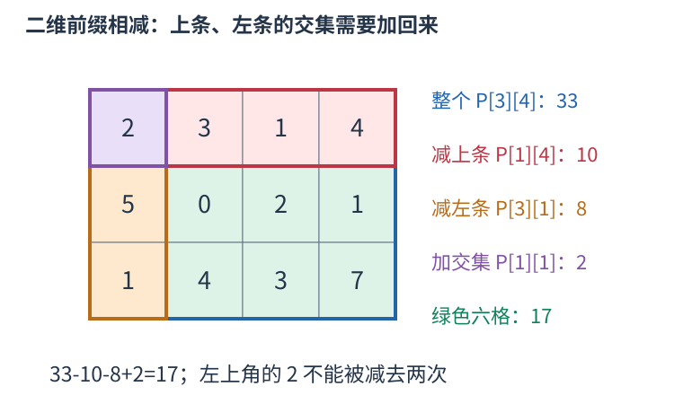
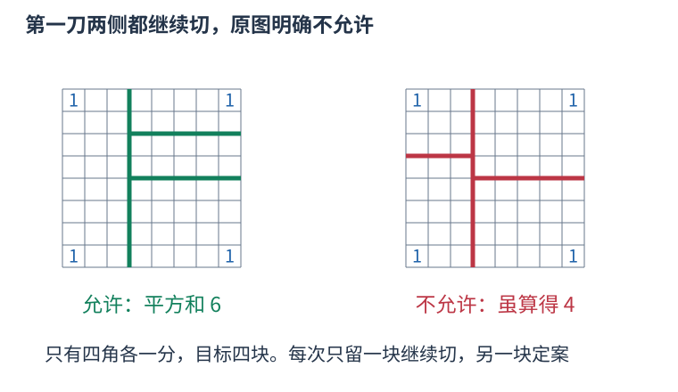

# P1436 每次定下一块不再切，只让另一块继续产生剩余份数 题解

## 目录

| 题号 | 题名 | 考点 | 难度 |
|---|---|---|---|
| A | 棋盘分割 | 区间 DP + 前缀和 | 1800 |

## A. 棋盘分割

> 原题：[P1436](https://www.luogu.com.cn/problem/P1436)
> 解法：每次定下一块不再切，只让另一块继续产生剩余份数 · C++17

### 题意

八乘八非负分值棋盘切成$n$块，沿格线切下矩形并从这次所得两块中选一块继续切，求各块分值和的平方之和最小。

<!-- reusable-foundations:start -->

### 从零讲：C++ 输入输出：把数据读进变量，把结果写到标准输出

程序运行时从标准输入接收题目给的数据，把答案送到标准输出。`cin` 和 `cout` 定义在 `<iostream>`；写 `using namespace std;` 后可以省略它们前面的 `std::`。最小完整程序是：

```cxx
#include <iostream>
using namespace std;
int main() {
    int a, b;
    cin >> a >> b;
    cout << a + b << '\n';
    return 0;
}
```

输入二十和三十，两个变量分别保存二十、三十，输出五十。`int a, b;` 声明两个整数变量；`cin >> a` 才给变量赋入输入值。多个 `>>` 从左到右读取，读取整数时会跳过空格、制表符、换行，所以两个整数可以分处两行。负号属于整数，不需要另读一个符号。

`cout <<` 后可以接数值、字符或字符串。`' '` 是一个空格字符，`'\n'` 是换行字符，`"Hello"` 是字符串。`cout << a << ' ' << b << '\n';` 输出两个以空格分开的整数并换行。评测程序只需要答案，不应加入“请输入”等提示。

读取 `char c; cin >> c;` 会跳过前导空白。要读取包含空格的一整行，用 `<string>` 中的 `string s; getline(cin, s);`。若此前用 `cin >> n` 读取过整数，换行还留在输入中，需要先处理那一个剩余换行；不能盲目把所有空格都删掉，因为字符画的行首空格和文本中的空格可能就是数据。

`fixed << setprecision(3)`（需要 `<iomanip>`）表示以小数形式保留三位小数，例如把 $2.5$ 输出成 $2.500$；不用 `fixed` 时，`setprecision` 指有效数字总数。设置会影响后续输出，使用前应确认所需精度。

竞赛中可在首次输入输出前调用 `ios::sync_with_stdio(false); cin.tie(nullptr);`，减少 C++ 流与 C 标准输入输出的同步、绑定开销。随后保持使用 `cin/cout`，不要混用另一套 `scanf/printf`。交互题还要在需要对方回应前主动刷新，例如 `cout << query << endl;`；普通题用换行字符即可。

读入长度为 $L$ 的文本、或输出 $L$ 个字符，至少需要 $O(L)$ 时间。数据类型仍要能容纳结果：把两个整数相乘时，即使保存到 `long long`，也要让乘法本身在这个类型中进行，例如先把输入声明为 `long long`。

### 从零讲：分支与循环：按条件选择，按次序重复

`if (条件) { ... } else { ... }` 根据条件的真假选择一条分支。比较运算 `==`、`!=`、`<`、`<=`、`>`、`>=` 返回真假值；`=` 是赋值，不能代替相等比较。`&&` 表示两边都成立，`||` 表示至少一边成立，`!` 把真假反转。

```cxx
int score = 85;
if (score >= 90) cout << "A";
else if (score >= 60) cout << "B";
else cout << "C"; // 这个例子输出 B
```

这条分支链只执行第一个符合条件的分支。先处理高分后，第二个条件自然只会接到低于九十分的数。几个独立的 `if` 则可能执行多次；两种结构代表不同问题。逻辑运算会短路：`i < n && a[i] == 0` 先确认下标合法，才读取那一格。

`for (初始化; 继续条件; 每轮更新)` 适合知道重复范围的情况。例如下列代码依次处理一到四，总和是十：

```cxx
int sum = 0;
for (int i = 1; i <= 4; ++i) {
    sum += i;
}
cout << sum;
```

初始化只做一次；每轮先判断条件，条件为真才执行循环体，随后执行更新。`++i` 把 $i$ 加一，`sum += i` 等价于把旧 sum 加 $i$ 再保存。应明确每个变量在循环前、循环后分别表示什么；最大值相同时是否更新，决定了保留较早还是较晚的答案。

`while (条件)` 适合“不满足目标就再做一步”：

```cxx
int x = 13, times = 0;
while (x > 1) {
    x /= 2;
    ++times;
}
// x 依次是 13、6、3、1，执行三次
```

循环开始前先检查条件，初始已满足目标时可能一次也不执行。每次执行必须推进状态，否则可能无限循环。`break` 结束最内层循环，`continue` 跳过本轮剩余部分；`for` 中的 continue 之后仍会执行每轮更新。

复杂度由实际执行次数决定。上述求和执行 $n$ 次是 $O(n)$；每次将正整数减半只执行 $O(\log n)$ 次。两层循环不能仅凭外观判定为平方：内层若总共只前进 $n$ 次，总量仍可能线性。变量应在正确作用范围初始化；多组数据的计数器若未重置，下一组会错误继承上一组结果。

### 从零讲：vector：长度可变的连续数组

`vector<T>` 保存一串同类型的元素，适合按下标访问、扫描、排序。`T` 是元素类型，例如 `vector<int>` 保存整数，`vector<pair<int,int>>` 保存整数对，`vector<vector<int>>` 可保存每个顶点各自的邻居。需要 `<vector>`。

```cxx
vector<int> a(3, 7);   // 三个元素，内容是 7、7、7
a.push_back(9);       // 在末尾追加，现在长度为 4
int x = a[1];         // 从 0 编号，这里得到 7
a[1] = 2;            // 改第二个元素
int n = int(a.size());
```

`vector<int> a(3)` 创建三个值为零的元素；`a.reserve(3)` 只预留容量，元素数仍为零，此时不能访问 `a[0]`。长度 `size()` 与容量 `capacity()` 是不同概念。

下标访问为 $O(1)$，遍历为 $O(n)$。末尾追加通常为 $O(1)$；容量不足时会分配更大的连续空间并搬移元素，这次可能为 $O(n)$，一连串追加的平均成本称为摊还 $O(1)$。中间插入或删除会搬移后续元素，最坏 $O(n)$。内存是元素量的 $O(n)$，并可能预留部分尚未使用的容量。

`begin()` 指向首元素，`end()` 指向尾后位置，`sort(a.begin(),a.end())` 操作整个数组。`a[i]` 不检查越界；下标须满足 $0\le i<\mathrm{size}$。`at(i)` 会检查越界并抛异常。空数组不能访问 `front()`、`back()`；`pop_back()` 也要求非空。

扩容后指向旧存储的迭代器、引用和指针会失效。遍历的同时 `push_back`，不能假定此前取得的引用仍可用。读取大数组的函数常用 `const vector<int>& a` 按常量引用传入，既不复制也禁止通过该引用修改；`vector<int> a` 按值传参则复制内容。选择副本还是引用取决于是否要保留独立数据。

### 从零讲：整数类型、整除与溢出

计算前先看每一步可能达到的范围。常见环境中 `int` 是 32 位，上界约 $2.1\times10^9$；`long long` 至少 64 位，常见有符号 64 位上界约 $9.22\times10^{18}$。`using ll = long long;` 只是为已有类型起别名。

```cxx
int a = 100000, b = 100000;
long long wrong = a * b;      // 右边先按 int 乘，可能已溢出
long long right = 1LL * a * b; // 先把运算提升到 long long
```

不能指望“接收结果的变量够大”修复此前已经溢出的计算。先提高操作数类型，再做乘法。超过 64 位时，GCC 的 `__int128` 可作中间量，但它不是标准 C++17 类型，也没有标准流输出重载；先证明范围，再选择工具。

整数 `/` 对有符号数向零截断：`7/3==2`、`-7/3==-2`。对非负数才等于向下取整。余数满足 `a == (a/b)*b + a%b`，除数不能为零；要将余数归入 $[0,m-1]$（$m>0$），可用 `(a % m + m) % m`，同时保证中间加法不溢出。

非负 $a$、正 $b$ 的向上取整可写 `a/b + (a%b != 0)`，比 `(a+b-1)/b` 更容易避免加法溢出。比较平方时也应在宽类型内计算；浮点数不适合作为大整数相等的默认判断方式。

`size()` 返回无符号类型。空容器上写 `size()-1` 会绕到很大的数，逆序遍历可以先转成有符号、确认长度，或使用逆向迭代器。`abs` 对最小有符号数无法在同类型中表达其正值，需先约束输入差值范围。一般机器整数运算按常数时间估算，宽类型解决表示范围，不改变算法的增长阶。

### 从零讲：具名函数：给可复用计算一个明确接口

函数把一段计算包装成“输入参数 → 返回结果”。例如判断整数是否为偶数：

```cxx
bool even(int x) {
    return x % 2 == 0;
}
int main() {
    bool a = even(8); // a 为 true
    bool b = even(7); // b 为 false
}
```

`bool` 是返回类型，`even` 是函数名，`int x` 是参数声明。调用 `even(8)` 时，实参八传入这个新调用的局部变量 $x$，执行 return 后把真假值交回调用处。定义本身不执行计算，只有调用才执行。函数应在调用处之前定义，或提前写声明。

普通数值参数按值传递，函数里修改 $x$ 不会改变调用者原变量。参数写成 `int &x` 时才引用调用者对象；必须让这个对象在调用期间有效。`const vector<int>& a` 用引用避免复制整个容器，并承诺不通过这个引用修改它。返回局部变量的值是安全的，返回局部变量的引用则在函数结束后失效。

函数名应说明它回答的问题，调用处负责传哪些数据。例如闰年判定只接收一个年份并返回真假，枚举年份范围和输出格式由调用者处理。同一判定被多次使用时，这能减少规则不一致；但函数包装不会自动降低算法复杂度，仍要把每次调用实际做的工作计入时间。

如果函数内部又调用自身，就是递归，需要明确最小情况如何直接返回、每次调用如何逼近它；递归会占用调用栈。普通辅助函数可以不使用递归，不应仅因写成函数就称作递归算法。

### 从零讲：动态规划：保存明确子问题的答案

若多个决策会反复遇到相同的剩余问题，可以为每个不同问题保存一次答案。状态不是“当前操作到了哪儿”的模糊描述，而是一个有完整条件、能独立提问的问题。

例如台阶一次走一或二级，求到达第 $i$ 级的方式数。令 $f_i$ 为恰好到第 $i$ 级的方案数。最后一步只有两类：从 $i-1$ 走一级，或从 $i-2$ 走两级，类别互斥且覆盖所有方案，所以 $f_i=f_{i-1}+f_{i-2}$。


起点 $f_0=1$ 表示原地不走的一种空方案，$f_1=1$。于是 $f_2=2,f_3=3,f_4=5$。从小到大计算，因为当前格依赖的格都已经完成。`f[0]=0` 会把“空方案”错误删掉。

```cxx
vector<long long> f(n + 1, 0);
f[0] = 1;
for (int i = 1; i <= n; ++i) {
    f[i] = f[i - 1];
    if (i >= 2) f[i] += f[i - 2];
}
```

另一个问题若问最小费用，就应对候选取 `min`；问最大收益取 `max`；问数量才在不重不漏的分类下相加。不能只把加号替换掉，初值也要随状态含义重新决定。不可达状态应与合法的零答案区别。

时间通常为状态数乘每个状态枚举的转移数，本例 $O(n)$；保存整表用 $O(n)$。只依赖最近两格时可滚动到 $O(1)$ 空间，但要先保存仍需读取的旧值。若下标不够决定后续可选动作，就缺少状态维度，不能把不同问题混在同一格。

检查一份 DP 时依次核对：状态的问题、基础答案、最后一步分类、依赖计算顺序、最终读哪一格。记忆化搜索使用同样的子问题，只是按递归需要计算；它也需要终止条件并避免状态依赖成环。

### 从零讲：二维前缀和：矩形总和减上方、减左方、补交集

表格中的一块矩形需要反复求和时，逐格重算会多次访问同一元素。先保存从左上角开始的矩形和，就能用四个数回答一次查询。

约定原表从零开始编号，$P[x][y]$表示前$x$行、前$y$列的总和，行下标小于$x$、列下标小于$y$。零行或零列是空矩形，和为零。下图给出三行四列的实际数字，绿色部分是行下标一到二、列下标一到三的六格。



目标矩形采用半开边界 $[x_1,x_2)\times[y_1,y_2)$。先取 $P[x_2][y_2]$，它包含目标、上方和左方；减去 $P[x_1][y_2]$ 与 $P[x_2][y_1]$。两块多余区域的左上交集被减了两次，补回一次 $P[x_1][y_1]$，恰好留下目标：

$$S=P[x_2][y_2]-P[x_1][y_2]-P[x_2][y_1]+P[x_1][y_1].$$

图中查询前一行之后、第一列之后的六格，即边界为 $[1,3)\times[1,4)$，结果为 $33-10-8+2=17$。空边界不需要另判：x1或y1为零时，相应前缀就是零。

建表也按同样的面积关系。新前缀由上方前缀、左方前缀和右下这一格组成，上方与左方的共同区域被加了两次，扣一次：

$$P[x][y]=P[x-1][y]+P[x][y-1]-P[x-1][y-1]+a[x-1][y-1].$$

按行、列递增计算，三个旧前缀都已存在。

```cxx
vector<vector<long long>> a = {
    {2, 3, 1, 4},
    {5, 0, 2, 1},
    {1, 4, 3, 7}
};
int n = 3, m = 4;
vector<vector<long long>> p(n+1, vector<long long>(m+1));
for (int x = 1; x <= n; ++x) {
    for (int y = 1; y <= m; ++y) {
        p[x][y] = p[x-1][y] + p[x][y-1]
                - p[x-1][y-1] + a[x-1][y-1];
    }
}
long long sum = p[3][4] - p[1][4] - p[3][1] + p[1][1];
cout << sum << '\n'; // 17
```

建立$n$乘$m$的前缀表耗时、空间均为 $O(nm)$，每次矩形查询只做四项加减，为 $O(1)$。元素为负数仍可相消；累计总和可能超出单格范围，应选择足够宽的类型。

原表改变后，许多旧前缀也会受影响。这里用于静态矩形求和；频繁修改时，需要重新建表或选择支持修改的数据结构。半开边界与一开始的闭区间写法都能使用，但一次计算中必须统一下标约定。

### 从零讲：递归：把一个任务交给更小的同类任务

递归函数在执行时再次调用自己。要先明确每次调用代表什么、什么时候不再递归、每次为何更接近终点。例如求阶乘：$f(0)=1$，$f(n)=n f(n-1)$；求五的阶乘会先请求四的阶乘，直到零，再逐层返回乘积。

```cxx
long long factorial(int n) {
    if (n == 0) return 1;
    return n * factorial(n - 1);
}
```

`factorial(3)` 的调用链是 $3\to2\to1\to0$，返回链依次为 $1,1,2,6$。每层保留自己的参数和等待执行的后续操作，因此递归不是所有层共享同一个局部变量。

树上遍历时，一次调用可以代表“处理以 $u$ 为根的子树”。先处理子节点再汇总是后序；先给自己信息再向下传是先序。无向图中需要访问标记，树上至少排除父节点，否则会沿同一条边来回递归。

时间要看所有调用做了多少工作，不能只看代码短。每个树节点访问一次、每条边检查常数次为 $O(n+m)$；反复求相同子问题可能指数增长。可以用记忆化保存结果，但缓存键必须包含影响结果的全部参数。

递归深度为 $h$ 时，调用栈通常用 $O(h)$ 空间。链状树可能深到 $n$，有栈溢出风险，可用显式栈模拟。回溯还须在返回前撤销对共享状态的本层修改；局部变量自然消失，外部数组的修改不会自动恢复。C++17 lambda 的递归另见 lambda 课中的显式 self 参数写法。

<!-- reusable-foundations:end -->

### 思路




原题示意图左侧允许先分出一个不再处理的长条，再只在另一侧继续切；右侧把首刀两边各切一刀，明确标为“不允许”。因此不能直接使用任意矩形剖分的“两侧各分若干块”转移。

一个最小区别例子是四个角各一分、其它格零，要求四块。若两侧都能继续切，可把四角各放一块，平方和四；原规则第一刀无论横竖，定下的一侧都会含两个角，已经贡献四，另一侧的两个一分即使分开也还要二，总最优为六。这个差别来自合法操作集合，不是数值精度。

用 $f(R,k)$ 表示唯一仍可继续切的矩形R，需要在其中产生$k$块时的最小平方和。$k$为一，整块直接结束，费用为矩形分值和的平方。$k$超过矩形格数时不可行。

否则枚举贯穿R的某条格线，得到两个矩形A、B。本刀必须定下一侧不再切，因此只有

$$f(R,k)=\min\bigl(S(A)^2+f(B,k-1),\ f(A,k-1)+S(B)^2\bigr)$$

这两种方向，再对所有横、竖切线取最小。每种合法切割过程的第一刀与继续方向都被枚举；反过来每个转移只继续一个子矩形，也符合原图限制。

矩形分值和S用二维前缀和求出。$P[x][y]$表示前$x$行、前$y$列之和。若R采用从零开始的半开边界 $[x_1,x_2)\times[y_1,y_2)$，先取整个左上大矩形，减去上条与左条，再加回被减两次的左上交集：

$$S(R)=P[x_2][y_2]-P[x_1][y_2]-P[x_2][y_1]+P[x_1][y_1].$$

状态由四个边界与块数确定，记忆化避免反复求同一子问题；递归每次块数减少，最多十五层。输出的是平方和本身，不做方差、开方或格式化小数。

H=W=8、K为块数，时间 $O(KH^2W^2(H+W))$，空间 $O(KH^2W^2)$。

### 参考代码

```cpp
#include <bits/stdc++.h>
using namespace std;
long long prefix[9][9],memo[16][9][9][9][9];const long long INF=LLONG_MAX/4;
long long square(int x1,int y1,int x2,int y2){long long s=prefix[x2][y2]-prefix[x1][y2]-prefix[x2][y1]+prefix[x1][y1];return s*s;}
long long solve(int k,int x1,int y1,int x2,int y2){
    if((x2-x1)*(y2-y1)<k)return INF;auto &answer=memo[k][x1][y1][x2][y2];if(answer!=-1)return answer;
    if(k==1)return answer=square(x1,y1,x2,y2);answer=INF;
    for(int cut=x1+1;cut<x2;++cut){answer=min(answer,square(x1,y1,cut,y2)+solve(k-1,cut,y1,x2,y2));answer=min(answer,solve(k-1,x1,y1,cut,y2)+square(cut,y1,x2,y2));}
    for(int cut=y1+1;cut<y2;++cut){answer=min(answer,square(x1,y1,x2,cut)+solve(k-1,x1,cut,x2,y2));answer=min(answer,solve(k-1,x1,y1,x2,cut)+square(x1,cut,x2,y2));}
    return answer;
}
int main() {
    ios::sync_with_stdio(false);
    cin.tie(nullptr);
int pieces;cin>>pieces;for(int i=1;i<=8;++i)for(int j=1;j<=8;++j){long long x;cin>>x;prefix[i][j]=x+prefix[i-1][j]+prefix[i][j-1]-prefix[i-1][j-1];}
memset(memo,-1,sizeof memo);cout<<solve(pieces,0,0,8,8)<<'\n';
    return 0;
}
```

### 易错点

首刀两边不能都继续分；每个转移固定一侧为一块；枚举两种继续方向；区域不足$k$格不可行；输出平方和而非标准差。

## 实测记录

本地 C++17 编译、1 组原站样例与 213 组独立边界/小域校验通过。
正文参考程序与源码逐字核对；没有向原站提交。
