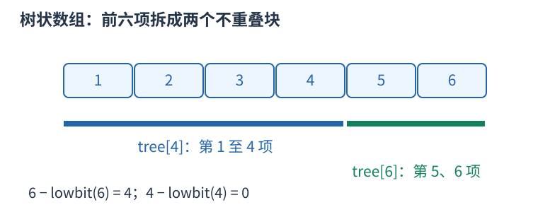
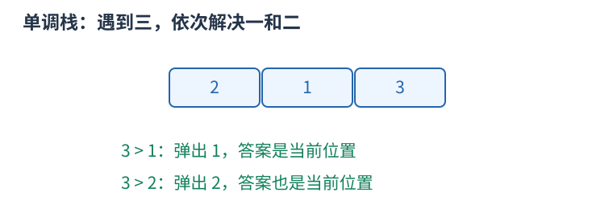
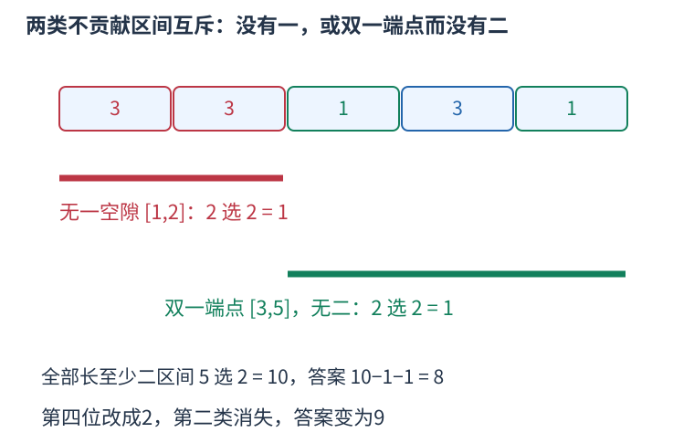

# P14379 只维护没有一的空隙，以及没有二的块内一的数量 题解

## 目录

| 题号 | 题名 | 考点 | 难度 |
|---|---|---|---|
| A | 摩天大楼 | 树状数组 + 组合计数 | 2100 |

## A. 摩天大楼

> 原题：[P14379](https://www.luogu.com.cn/problem/P14379)
> 解法：只维护没有一的空隙，以及没有二的块内一的数量 · C++17

### 题意

单点修改高度后，统计长度至少二的区间中，能够选一处切开使左右正整数MEX不同的区间数。

<!-- reusable-foundations:start -->

### 从零讲：C++ 输入输出：把数据读进变量，把结果写到标准输出

程序运行时从标准输入接收题目给的数据，把答案送到标准输出。`cin` 和 `cout` 定义在 `<iostream>`；写 `using namespace std;` 后可以省略它们前面的 `std::`。最小完整程序是：

```cxx
#include <iostream>
using namespace std;
int main() {
    int a, b;
    cin >> a >> b;
    cout << a + b << '\n';
    return 0;
}
```

输入二十和三十，两个变量分别保存二十、三十，输出五十。`int a, b;` 声明两个整数变量；`cin >> a` 才给变量赋入输入值。多个 `>>` 从左到右读取，读取整数时会跳过空格、制表符、换行，所以两个整数可以分处两行。负号属于整数，不需要另读一个符号。

`cout <<` 后可以接数值、字符或字符串。`' '` 是一个空格字符，`'\n'` 是换行字符，`"Hello"` 是字符串。`cout << a << ' ' << b << '\n';` 输出两个以空格分开的整数并换行。评测程序只需要答案，不应加入“请输入”等提示。

读取 `char c; cin >> c;` 会跳过前导空白。要读取包含空格的一整行，用 `<string>` 中的 `string s; getline(cin, s);`。若此前用 `cin >> n` 读取过整数，换行还留在输入中，需要先处理那一个剩余换行；不能盲目把所有空格都删掉，因为字符画的行首空格和文本中的空格可能就是数据。

`fixed << setprecision(3)`（需要 `<iomanip>`）表示以小数形式保留三位小数，例如把 $2.5$ 输出成 $2.500$；不用 `fixed` 时，`setprecision` 指有效数字总数。设置会影响后续输出，使用前应确认所需精度。

竞赛中可在首次输入输出前调用 `ios::sync_with_stdio(false); cin.tie(nullptr);`，减少 C++ 流与 C 标准输入输出的同步、绑定开销。随后保持使用 `cin/cout`，不要混用另一套 `scanf/printf`。交互题还要在需要对方回应前主动刷新，例如 `cout << query << endl;`；普通题用换行字符即可。

读入长度为 $L$ 的文本、或输出 $L$ 个字符，至少需要 $O(L)$ 时间。数据类型仍要能容纳结果：把两个整数相乘时，即使保存到 `long long`，也要让乘法本身在这个类型中进行，例如先把输入声明为 `long long`。

### 从零讲：分支与循环：按条件选择，按次序重复

`if (条件) { ... } else { ... }` 根据条件的真假选择一条分支。比较运算 `==`、`!=`、`<`、`<=`、`>`、`>=` 返回真假值；`=` 是赋值，不能代替相等比较。`&&` 表示两边都成立，`||` 表示至少一边成立，`!` 把真假反转。

```cxx
int score = 85;
if (score >= 90) cout << "A";
else if (score >= 60) cout << "B";
else cout << "C"; // 这个例子输出 B
```

这条分支链只执行第一个符合条件的分支。先处理高分后，第二个条件自然只会接到低于九十分的数。几个独立的 `if` 则可能执行多次；两种结构代表不同问题。逻辑运算会短路：`i < n && a[i] == 0` 先确认下标合法，才读取那一格。

`for (初始化; 继续条件; 每轮更新)` 适合知道重复范围的情况。例如下列代码依次处理一到四，总和是十：

```cxx
int sum = 0;
for (int i = 1; i <= 4; ++i) {
    sum += i;
}
cout << sum;
```

初始化只做一次；每轮先判断条件，条件为真才执行循环体，随后执行更新。`++i` 把 $i$ 加一，`sum += i` 等价于把旧 sum 加 $i$ 再保存。应明确每个变量在循环前、循环后分别表示什么；最大值相同时是否更新，决定了保留较早还是较晚的答案。

`while (条件)` 适合“不满足目标就再做一步”：

```cxx
int x = 13, times = 0;
while (x > 1) {
    x /= 2;
    ++times;
}
// x 依次是 13、6、3、1，执行三次
```

循环开始前先检查条件，初始已满足目标时可能一次也不执行。每次执行必须推进状态，否则可能无限循环。`break` 结束最内层循环，`continue` 跳过本轮剩余部分；`for` 中的 continue 之后仍会执行每轮更新。

复杂度由实际执行次数决定。上述求和执行 $n$ 次是 $O(n)$；每次将正整数减半只执行 $O(\log n)$ 次。两层循环不能仅凭外观判定为平方：内层若总共只前进 $n$ 次，总量仍可能线性。变量应在正确作用范围初始化；多组数据的计数器若未重置，下一组会错误继承上一组结果。

### 从零讲：vector：长度可变的连续数组

`vector<T>` 保存一串同类型的元素，适合按下标访问、扫描、排序。`T` 是元素类型，例如 `vector<int>` 保存整数，`vector<pair<int,int>>` 保存整数对，`vector<vector<int>>` 可保存每个顶点各自的邻居。需要 `<vector>`。

```cxx
vector<int> a(3, 7);   // 三个元素，内容是 7、7、7
a.push_back(9);       // 在末尾追加，现在长度为 4
int x = a[1];         // 从 0 编号，这里得到 7
a[1] = 2;            // 改第二个元素
int n = int(a.size());
```

`vector<int> a(3)` 创建三个值为零的元素；`a.reserve(3)` 只预留容量，元素数仍为零，此时不能访问 `a[0]`。长度 `size()` 与容量 `capacity()` 是不同概念。

下标访问为 $O(1)$，遍历为 $O(n)$。末尾追加通常为 $O(1)$；容量不足时会分配更大的连续空间并搬移元素，这次可能为 $O(n)$，一连串追加的平均成本称为摊还 $O(1)$。中间插入或删除会搬移后续元素，最坏 $O(n)$。内存是元素量的 $O(n)$，并可能预留部分尚未使用的容量。

`begin()` 指向首元素，`end()` 指向尾后位置，`sort(a.begin(),a.end())` 操作整个数组。`a[i]` 不检查越界；下标须满足 $0\le i<\mathrm{size}$。`at(i)` 会检查越界并抛异常。空数组不能访问 `front()`、`back()`；`pop_back()` 也要求非空。

扩容后指向旧存储的迭代器、引用和指针会失效。遍历的同时 `push_back`，不能假定此前取得的引用仍可用。读取大数组的函数常用 `const vector<int>& a` 按常量引用传入，既不复制也禁止通过该引用修改；`vector<int> a` 按值传参则复制内容。选择副本还是引用取决于是否要保留独立数据。

### 从零讲：整数类型、整除与溢出

计算前先看每一步可能达到的范围。常见环境中 `int` 是 32 位，上界约 $2.1\times10^9$；`long long` 至少 64 位，常见有符号 64 位上界约 $9.22\times10^{18}$。`using ll = long long;` 只是为已有类型起别名。

```cxx
int a = 100000, b = 100000;
long long wrong = a * b;      // 右边先按 int 乘，可能已溢出
long long right = 1LL * a * b; // 先把运算提升到 long long
```

不能指望“接收结果的变量够大”修复此前已经溢出的计算。先提高操作数类型，再做乘法。超过 64 位时，GCC 的 `__int128` 可作中间量，但它不是标准 C++17 类型，也没有标准流输出重载；先证明范围，再选择工具。

整数 `/` 对有符号数向零截断：`7/3==2`、`-7/3==-2`。对非负数才等于向下取整。余数满足 `a == (a/b)*b + a%b`，除数不能为零；要将余数归入 $[0,m-1]$（$m>0$），可用 `(a % m + m) % m`，同时保证中间加法不溢出。

非负 $a$、正 $b$ 的向上取整可写 `a/b + (a%b != 0)`，比 `(a+b-1)/b` 更容易避免加法溢出。比较平方时也应在宽类型内计算；浮点数不适合作为大整数相等的默认判断方式。

`size()` 返回无符号类型。空容器上写 `size()-1` 会绕到很大的数，逆序遍历可以先转成有符号、确认长度，或使用逆向迭代器。`abs` 对最小有符号数无法在同类型中表达其正值，需先约束输入差值范围。一般机器整数运算按常数时间估算，宽类型解决表示范围，不改变算法的增长阶。

### 从零讲：具名函数：给可复用计算一个明确接口

函数把一段计算包装成“输入参数 → 返回结果”。例如判断整数是否为偶数：

```cxx
bool even(int x) {
    return x % 2 == 0;
}
int main() {
    bool a = even(8); // a 为 true
    bool b = even(7); // b 为 false
}
```

`bool` 是返回类型，`even` 是函数名，`int x` 是参数声明。调用 `even(8)` 时，实参八传入这个新调用的局部变量 $x$，执行 return 后把真假值交回调用处。定义本身不执行计算，只有调用才执行。函数应在调用处之前定义，或提前写声明。

普通数值参数按值传递，函数里修改 $x$ 不会改变调用者原变量。参数写成 `int &x` 时才引用调用者对象；必须让这个对象在调用期间有效。`const vector<int>& a` 用引用避免复制整个容器，并承诺不通过这个引用修改它。返回局部变量的值是安全的，返回局部变量的引用则在函数结束后失效。

函数名应说明它回答的问题，调用处负责传哪些数据。例如闰年判定只接收一个年份并返回真假，枚举年份范围和输出格式由调用者处理。同一判定被多次使用时，这能减少规则不一致；但函数包装不会自动降低算法复杂度，仍要把每次调用实际做的工作计入时间。

如果函数内部又调用自身，就是递归，需要明确最小情况如何直接返回、每次调用如何逼近它；递归会占用调用栈。普通辅助函数可以不使用递归，不应仅因写成函数就称作递归算法。

### 从零讲：树状数组：动态前缀和

前缀和数组适合不修改的序列；若要不断给单点加值并查询前缀总和，树状数组把每个前缀拆成少量已维护的小块。

从一编号，`lowbit(i)=i&-i` 是二进制最低的一位所代表的数。`tree[i]` 维护区间 $[i-\operatorname{lowbit}(i)+1,i]$ 的和。例如 $i=6$、二进制 $110_2$，lowbit 为二，维护第五、第六项；查询前六项时再转到四，取第一到第四项。



```cxx
void add(int i, long long delta) {
    for (; i <= n; i += i & -i) tree[i] += delta;
}
long long prefix(int i) {
    long long sum = 0;
    for (; i > 0; i -= i & -i) sum += tree[i];
    return sum;
}
```

查询每次去掉最低的一位，区间块恰好首尾衔接；更新则访问所有覆盖原位置的上层块。二进制位数为 $O(\log n)$，所以两种操作均为 $O(\log n)$，空间 $O(n)$。区间 $[l,r]$ 的和仍为 `prefix(r)-prefix(l-1)`。

`add` 接收增量，不是新值；赋新值需减去旧值。下标零会使更新步长为零，导致死循环，必须从一开始。坐标稀疏时可先离散化。求第 $k$ 小的倍增搜索还要求维护的频次非负，不能将任意带负数的前缀误认为单调。

### 从零讲：计数：先确定一个方案包含哪些选择

加法用于互斥类别，乘法用于逐步选择，除法用于消除确切的重复。公式每一项都应能对应一个实际对象，不能只凭“看起来有几个位置”相乘。

三个人中选两人且指定先后：第一人三种选择，第二人只能从剩下两人中选，得到六种。若只选一个无序小组，AB 和 BA 表示同组，每组恰数两次，除以二得到三组。


一般地，$n$ 个不同对象选 $k$ 个且排序有 $n(n-1)\cdots(n-k+1)$ 种；不区分内部顺序，恰有 $k!$ 个排列表示同一子集，所以

$$\binom nk=\frac{n!}{k!(n-k)!}.$$

这个除法成立依赖“每个最终对象被数同样多次”。若含相同元素、对称或禁用条件，重复倍数可能改变，要重新证明。比如组的内部无序和组之间无序是两种不同的对称性，不应混成一句“除去重复”。

互相独立不是乘法原则唯一的表述；逐步计数只需每种前序选择都有相同数量的后续选择。若后续数量随前序变化，就应分别计算后求和。

在模数下计算组合数时，普通整数除法不能直接替代分母逆元。若用阶乘和逆阶乘，须满足逆元存在等前提。答案可能指数增长，先确定取模或大整数方式；数值范围也决定预处理是否可行。

### 从零讲：前缀和：一段和由两段前缀相减

一串数需要反复询问连续一段的总和，逐段扫描会重复加很多相同元素。先保存从头到每个位置的累计量，就能复用这些工作。

对从一编号的数组定义 $S_0=0$，$S_i=a_1+\cdots+a_i$。例如 $a=[2,3,1,4]$，前缀为 $S=[0,2,5,6,10]$。


查询 $[2,4]$ 时，$S_4$ 包含第一个数，减去 $S_1$ 后留下 $3+1+4=8$。一般地，$S_r-S_{l-1}$ 中前 $l-1$ 项逐项抵消，只留下第 $l$ 到第 $r$ 项。

```cxx
vector<long long> s(n + 1, 0);
for (int i = 1; i <= n; ++i) s[i] = s[i - 1] + a[i];
long long sum = s[r] - s[l - 1];
```

预处理 $O(n)$ 时间和空间，每次查询 $O(1)$，比 $q$ 次逐段扫描的最坏 $O(nq)$ 更适合大量静态区间和。若使用从零编号的原数组，也可定义 $P_i$ 为前 $i$ 项之和，查询闭区间 $[l,r]$ 为 $P_{r+1}-P_l$；不要混用两套下标。

前缀可以累积满足条件的次数，把每项变成零或一；也可以保存异或，此时相同前缀通过异或抵消。最小值没有同样的可逆减法，不能直接套区间最小值。原数组改变后，后续许多前缀都受影响；频繁在线修改时可考虑树状数组或线段树。

首个空前缀零不可漏，累加类型要覆盖总和。数学上的减法可能得到负值，别让无符号类型把它变成巨大正数。

### 从零讲：单调栈与单调队列：删去以后不会更优的候选

若某个新候选在所有未来场景都不劣于一个旧候选，就可以永久删去旧候选。这种支配关系使栈或双端队列中的值保持单调，而不是仅仅为了“看上去有序”。

#### 单调栈找下一个更大项

从左扫描 $[2,1,3]$，栈保存尚未找到答案的下标。读三时，它大于栈顶的一，故一的首个右侧更大值为三；再大于二，二的答案也是三。每个值在自己的答案被首次发现时出栈。



```cxx
for (int i = 0; i < n; ++i) {
    while (!st.empty() && a[st.back()] < a[i]) {
        answer[st.back()] = i;
        st.pop_back();
    }
    st.push_back(i);
}
```

严格大于用 `<` 弹出；若问大于等于，等号处理会改变。栈里保存下标，才能计算距离和识别相同数的不同位置。没有答案的项保留约定哨兵。

#### 单调队列维护固定窗口最大值

队首保存当前最大项的下标。新值到来，从队尾删除不大于它的旧值：新值更晚过期且不小，不会比这些旧值差；再把过期下标从队首移走。查询最大值读队首。

每个下标都只入、出一次，所以两者总时间 $O(n)$，空间最坏 $O(n)$。这是摊还分析，不能把“一个 while 里有时弹很多项”误算为必然平方，也不能把每次操作都说成严格常数。删候选之前应证明它在剩余有效期内永远不更优；窗口范围改变或查询目标不同，支配关系也要重证。

### 从零讲：pair、tuple 与结构化绑定

有些数据天然需要成组：一个区间有两个端点，一个队列状态有坐标和距离。`pair<A,B>` 保存两项，用 `.first`、`.second` 读取；`tuple<A,B,C>` 可保存更多项，用 `get<0>(t)` 等读取。分别需要 `<utility>`、`<tuple>`。

C++17 的结构化绑定能为一组分量起局部名字：

```cxx
pair<int,int> point{3, 5};
auto [x, y] = point;      // 复制出两个分量
x = 9;                  // point.first 仍为 3
auto& [u, v] = point;    // 绑定原对象的分量
u = 7;                  // point.first 变为 7
```

`for (auto [l,r] : segments)` 每轮读取一对值；`for (const auto& [l,r] : segments)` 以只读引用读取，避免复制；需要修改原记录时才用 `auto&`。引用必须在原对象还存在且位置未失效时使用。

`pair` 和 `tuple` 的默认比较是字典序：从第一项起，第一个不同的分量决定顺序。`priority_queue<pair<int,int>>` 因而先比较第一项，再以第二项破同分，不能误认为只看第一项。这类语法只让记录组织和访问更清楚，拆分本身的成本取决于分量是否需要复制。

### 从零讲：lambda：完整例子、捕获规则与局部变量的生命周期

#### 它解决什么问题

一段操作在当前函数里需要调用多次，或者某个算法需要你提供“怎样比较”的规则，可以把这段操作写成 lambda。lambda 表达式产生一个可以像函数一样调用的对象；“匿名”指它没有普通函数声明中的函数名，仍可以用变量保存并命名。

```cxx
auto add = [](int a, int b) -> int {
    return a + b;
};
int answer = add(2, 3);  // 调用后得到 5；定义本身不会执行函数体
```

读法是：用 `auto` 保存对象；`[](){}` 中的方括号部分是捕获列表；圆括号是每次调用传入的参数；`-> int` 指定返回类型；花括号里写执行过程；定义后的分号结束赋值。返回类型能够推导时可省略，所以也常见 `auto add = [](int a,int b) { return a+b; };`。


#### 参数和捕获有什么区别

参数每次调用都由调用者提供；捕获让函数体使用定义位置附近的局部变量，调用时不用重复传它。例如阈值来自当前环境，待判断的值每次变化：

```cxx
int threshold = 10;
auto enough = [threshold](int value) {
    return value >= threshold;
};
bool a = enough(12);  // true，value 是本次传入的 12
```

这里 `threshold` 是捕获，`value` 是参数。常用的捕获方式如下：

| 写法 | 意思 | 适合的需要 |
|---|---|---|
| `[](){}` | 不捕获局部变量 | 只依赖参数的计算或比较 |
| `[x](){}` | 保存定义时 `x` 的副本 | 需要固定一份快照 |
| `[&x](){}` | 引用外面的 `x` | 读取最新值或修改原变量 |
| `[=](){}` | 按值捕获实际需要的局部变量 | 需要多个快照 |
| `[&](){}` | 按引用捕获实际需要的局部变量 | 当前作用域内的辅助函数 |
| `[&a, limit](){}` | 引用 `a`，复制 `limit` | 显式区分共享数据和快照 |

`[&](){}` 不是“把参数按引用传递”；是否按引用传参由圆括号里的 `int&`、`const vector<int>&` 等类型决定。全局变量可以直接访问，无需捕获。

#### 用可观察的结果区分复制与引用

```cxx
int base = 10;
auto snapshot = [base](int x) { return base + x; };
auto current = [&base](int x) { return base + x; };
base = 20;
int a = snapshot(1);  // 11：使用定义时保存的 10
int b = current(1);   // 21：使用外面的最新值 20
```

默认情况下不能在 lambda 内修改按值捕获的副本。加 `mutable` 才能修改副本，但仍不会改外面的原变量：`auto next = [base]() mutable { return ++base; };`。对大数组按值捕获可能复制整个数组；如果只在数组仍然存活时查询，显式引用可避免这份复制。

#### 两种常见用法

**局部辅助函数。** 把“给一个参数就求出结果”的操作命名后，主流程只写调用。外层数组保持原处，辅助函数按引用读取，能减少重复代码，并让环境依赖集中在定义附近。对多个调用位置修正一处逻辑即可。普通独立函数也能做到复用，但外层局部数据通常需要显式传参。

**作为算法的规则。** 把比较方式直接交给 `sort`，能在调用处看到排序依据：

```cxx
vector<pair<int,int>> items={{2,7},{1,2},{1,4}};
sort(items.begin(), items.end(), [](const auto& a, const auto& b) {
    if (a.first != b.first) return a.first < b.first;
    return a.second > b.second;
});
```

先按第一项升序，第一项相同时按第二项降序。比较器必须形成严格弱序，同一个元素与自己比较应为假；写成 `<=` 可能破坏排序前提。传 `const auto&` 可以避免每次比较都复制元素。

#### 递归时怎样引用自己

在 `auto f = ...` 的初始化表达式中不能直接假定 `f` 的类型已确定。C++17 可以把自己作为参数传进去：

```cxx
auto factorial = [](auto&& self, int n) -> long long {
    if (n <= 1) return 1;
    return n * self(self, n - 1);
};
long long value = factorial(factorial, 5);  // 120
```

也可先声明 `std::function<long long(int)> f` 再赋 lambda，通过引用调用 `f`；需要 `<functional>`。`std::function` 用统一类型包装可调用对象，便于存储和传递，但可能有间接调用、分配等额外开销。只在当前地方使用时，`auto` 常更直接。这些是组织代码的选择，不会改变原算法的复杂度。

#### 生命周期和复杂度

引用捕获不会延长被引用变量的生命。把引用局部数组的 lambda 返回到函数外，局部数组已经销毁，再调用就会访问失效对象；放入异步任务或长久保存时，也须检查这一点。必要时捕获一份拥有数据的副本，或设计明确的共享所有权。

调用一次 lambda 的时间取决于函数体：内部扫描 $n$ 个元素就是 $O(n)$，做两次有序数组二分就是 $O(\log n)$。创建时复制大容器还会有与数据量相关的成本。lambda 的优势是局部表达、复用和传递行为，本身不保证运行更快。

规范核对：[C++ 工作草案：捕获](https://eel.is/c++draft/expr.prim.lambda.capture)、[函数对象](https://eel.is/c++draft/function.objects)。示例均为 C++17 写法。

<!-- reusable-foundations:end -->

### 思路




题目的MEX从正整数一开始。若一个区间没有一，不管怎样切，左右MEX都是一，贡献零。若有一而某个端点不是一，将这个端点单独切出，或把一侧无一的部分切出，就能得到一与至少二，贡献一。

剩下两端都是一的情况。任一切法的两侧都有一；若整段没有二，两侧MEX始终都是二。若中间有二，在第一个二之前切开，左侧有一无二，MEX为二；右侧含一和二，MEX至少三。因此不贡献恰为“无一”，以及“端点均为一且无二”两类，且两类不重叠。

只统计长度至少二。无一的一个极长空隙长$g$，区间数为$g$乘$g$减一除二。无二的一个极长块里有$c$个一，任选两个不同的一作端点就是第二类区间，共$c$选二；中间允许其它大于二的数。

分别维护两类总数noOne、twoFree，答案为$n$选二减去两者。所有大于二的值在这里等价，修改前后同属第三类时不必动数据结构。

用两棵频次树记录一、二的位置。查一个位置$p$前有多少次出现，配合第$k$项搜索即可找到前驱、后继；不存在的邻居使用零、$n$加一哨兵，哨兵不放进树。

第$k$项搜索维护一个已确认前缀长度pos和仍需跳过的次数$k$，按二进制位从大到小尝试向右一块。若该块总频次严格小于$k$，就整块跳过并扣除它的频次；否则在更小位继续找。最后pos加一是首个累计次数至少$k$的位置。频次始终为零或一，因此前缀单调；$k$只取一至当前总次数，不能对空集合硬查。代码最高步长为二的二十次方，覆盖本题至多一百万位置。

插入一个一，会把无一空隙分成左右两段，用两段的组合数替换整段。同时，所在无二块原来有$c$个一，新增一形成$c$个新的双一端点区间。删除一个一则把两个空隙合并，并从所在块减去$c$减一个配对。注意先查旧数量，再更新一的频次。

插入一个二，把原无二块分成左右，若两侧分别有L、R个一，跨过新二的L乘R个端点对不再属于twoFree。删除一个二则恢复这些跨界配对。左右一的数量用一频次树的前缀差计算。

一次修改先删除旧类别，再插入新类别，特别是从一改二时，拆块计数必须使用已经删除旧一的状态。总答案可达约五千亿，组合数与乘法均使用long long。

题面引用building2至building7附件，但缓存只含第一组具体样例；原引用保留，不将未取得附件计为已跑样例。

初始化 $O(n)$，每次修改 $O(\log n)$，空间 $O(n)$。

### 参考代码

```cpp
#include <bits/stdc++.h>
using namespace std;
struct Fenwick {
    int n; vector<int> tree;
    explicit Fenwick(int size):n(size),tree(size+1){}
    void add(int p,int v){for(;p<=n;p+=p&-p) tree[p]+=v;}
    int sum(int p) const {int value=0;for(;p;p-=p&-p) value+=tree[p];return value;}
    int kth(int k) const {int p=0;for(int step=1<<20;step;step>>=1){int q=p+step;if(q<=n&&tree[q]<k){p=q;k-=tree[q];}}return p+1;}
};
int main() {
    ios::sync_with_stdio(false);
    cin.tie(nullptr);
int n,q;cin>>n>>q;vector<int>a(n+1);Fenwick ones(n),twos(n);long long noOne=0,twoFree=0;int gap=0,count=0;
auto choose=[](long long x){return x*(x-1)/2;};
for(int i=1;i<=n;++i){cin>>a[i];if(a[i]==1){ones.tree[i]=1;noOne+=choose(gap);gap=0;++count;}else ++gap;if(a[i]==2){twos.tree[i]=1;twoFree+=choose(count);count=0;}}
noOne+=choose(gap);twoFree+=choose(count);for(int i=1;i<=n;++i){int j=i+(i&-i);if(j<=n){ones.tree[j]+=ones.tree[i];twos.tree[j]+=twos.tree[i];}}
int numberOne=ones.sum(n),numberTwo=twos.sum(n);
auto neighbors=[&](const Fenwick &bit,int total,int p,bool present){int before=bit.sum(p-1);int l=before?bit.kth(before):0;int nextRank=before+1+present;int r=nextRank<=total?bit.kth(nextRank):n+1;return pair<int,int>{l,r};};
auto change=[&](int p,int value,int delta){
    if(value==1){auto [l,r]=neighbors(ones,numberOne,p,delta==-1);long long split=choose(p-l-1)+choose(r-p-1)-choose(r-l-1);noOne+=delta*split;auto [left,right]=neighbors(twos,numberTwo,p,false);int c=ones.sum(right-1)-ones.sum(left);twoFree+=delta==1?c:-(c-1);ones.add(p,delta);numberOne+=delta;}
    else if(value==2){auto [l,r]=neighbors(twos,numberTwo,p,delta==-1);int middle=ones.sum(p);long long left=middle-ones.sum(l),right=ones.sum(r-1)-middle;twoFree-=delta*left*right;twos.add(p,delta);numberTwo+=delta;}
};
while(q--){int p,value;cin>>p>>value;int oldCategory=min(a[p],3),newCategory=min(value,3);if(oldCategory!=newCategory){change(p,oldCategory,-1);change(p,newCategory,1);}a[p]=value;cout<<choose(n)-noOne-twoFree<<'\n';}
    return 0;
}
```

### 易错点

正整数MEX；只计长度至少二；无一与双一无二两类互斥；其它高度同类；先删旧再加新；第$k$项要求非负频次与合法$k$；哨兵不入树；组合数六十四位。

## 实测记录

本地 C++17 编译、1 组原站样例与 182 组独立边界/小域校验通过。
正文参考程序与源码逐字核对；没有向原站提交。
