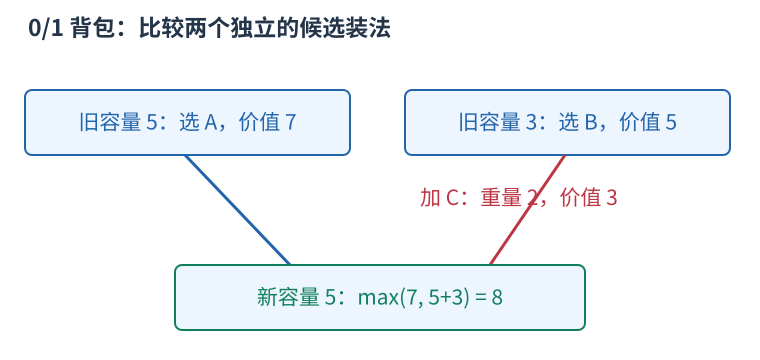
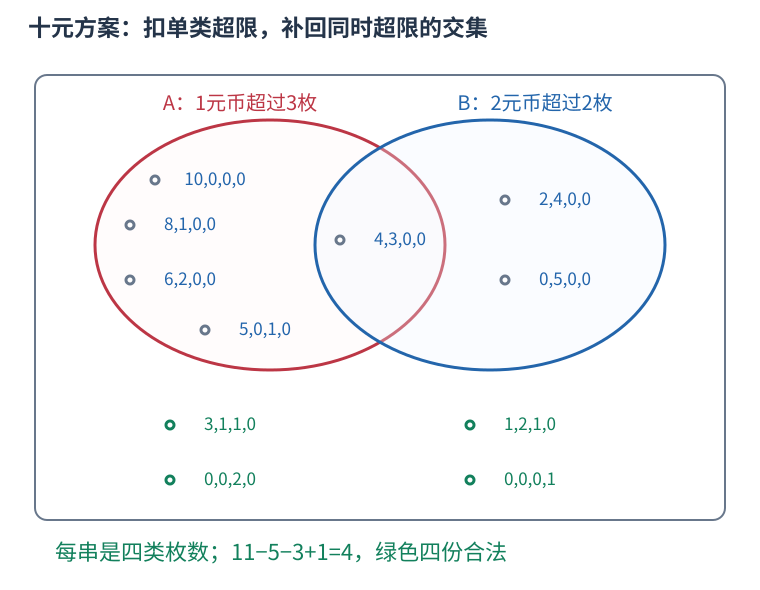

# P1450 先求无限硬币方案，再容斥扣掉各类数量超限者 题解

## 目录

| 题号 | 题名 | 考点 | 难度 |
|---|---|---|---|
| A | 硬币购物 | 背包 DP + 容斥 | 2100 |

## A. 硬币购物

> 原题：[P1450](https://www.luogu.com.cn/problem/P1450)
> 解法：先求无限硬币方案，再容斥扣掉各类数量超限者 · C++17

### 题意

四种面值固定，每次给四种可用枚数与目标总额，求按各类硬币枚数区分的付款方案数。

<!-- reusable-foundations:start -->

### 从零讲：C++ 输入输出：把数据读进变量，把结果写到标准输出

程序运行时从标准输入接收题目给的数据，把答案送到标准输出。`cin` 和 `cout` 定义在 `<iostream>`；写 `using namespace std;` 后可以省略它们前面的 `std::`。最小完整程序是：

```cxx
#include <iostream>
using namespace std;
int main() {
    int a, b;
    cin >> a >> b;
    cout << a + b << '\n';
    return 0;
}
```

输入二十和三十，两个变量分别保存二十、三十，输出五十。`int a, b;` 声明两个整数变量；`cin >> a` 才给变量赋入输入值。多个 `>>` 从左到右读取，读取整数时会跳过空格、制表符、换行，所以两个整数可以分处两行。负号属于整数，不需要另读一个符号。

`cout <<` 后可以接数值、字符或字符串。`' '` 是一个空格字符，`'\n'` 是换行字符，`"Hello"` 是字符串。`cout << a << ' ' << b << '\n';` 输出两个以空格分开的整数并换行。评测程序只需要答案，不应加入“请输入”等提示。

读取 `char c; cin >> c;` 会跳过前导空白。要读取包含空格的一整行，用 `<string>` 中的 `string s; getline(cin, s);`。若此前用 `cin >> n` 读取过整数，换行还留在输入中，需要先处理那一个剩余换行；不能盲目把所有空格都删掉，因为字符画的行首空格和文本中的空格可能就是数据。

`fixed << setprecision(3)`（需要 `<iomanip>`）表示以小数形式保留三位小数，例如把 $2.5$ 输出成 $2.500$；不用 `fixed` 时，`setprecision` 指有效数字总数。设置会影响后续输出，使用前应确认所需精度。

竞赛中可在首次输入输出前调用 `ios::sync_with_stdio(false); cin.tie(nullptr);`，减少 C++ 流与 C 标准输入输出的同步、绑定开销。随后保持使用 `cin/cout`，不要混用另一套 `scanf/printf`。交互题还要在需要对方回应前主动刷新，例如 `cout << query << endl;`；普通题用换行字符即可。

读入长度为 $L$ 的文本、或输出 $L$ 个字符，至少需要 $O(L)$ 时间。数据类型仍要能容纳结果：把两个整数相乘时，即使保存到 `long long`，也要让乘法本身在这个类型中进行，例如先把输入声明为 `long long`。

### 从零讲：分支与循环：按条件选择，按次序重复

`if (条件) { ... } else { ... }` 根据条件的真假选择一条分支。比较运算 `==`、`!=`、`<`、`<=`、`>`、`>=` 返回真假值；`=` 是赋值，不能代替相等比较。`&&` 表示两边都成立，`||` 表示至少一边成立，`!` 把真假反转。

```cxx
int score = 85;
if (score >= 90) cout << "A";
else if (score >= 60) cout << "B";
else cout << "C"; // 这个例子输出 B
```

这条分支链只执行第一个符合条件的分支。先处理高分后，第二个条件自然只会接到低于九十分的数。几个独立的 `if` 则可能执行多次；两种结构代表不同问题。逻辑运算会短路：`i < n && a[i] == 0` 先确认下标合法，才读取那一格。

`for (初始化; 继续条件; 每轮更新)` 适合知道重复范围的情况。例如下列代码依次处理一到四，总和是十：

```cxx
int sum = 0;
for (int i = 1; i <= 4; ++i) {
    sum += i;
}
cout << sum;
```

初始化只做一次；每轮先判断条件，条件为真才执行循环体，随后执行更新。`++i` 把 $i$ 加一，`sum += i` 等价于把旧 sum 加 $i$ 再保存。应明确每个变量在循环前、循环后分别表示什么；最大值相同时是否更新，决定了保留较早还是较晚的答案。

`while (条件)` 适合“不满足目标就再做一步”：

```cxx
int x = 13, times = 0;
while (x > 1) {
    x /= 2;
    ++times;
}
// x 依次是 13、6、3、1，执行三次
```

循环开始前先检查条件，初始已满足目标时可能一次也不执行。每次执行必须推进状态，否则可能无限循环。`break` 结束最内层循环，`continue` 跳过本轮剩余部分；`for` 中的 continue 之后仍会执行每轮更新。

复杂度由实际执行次数决定。上述求和执行 $n$ 次是 $O(n)$；每次将正整数减半只执行 $O(\log n)$ 次。两层循环不能仅凭外观判定为平方：内层若总共只前进 $n$ 次，总量仍可能线性。变量应在正确作用范围初始化；多组数据的计数器若未重置，下一组会错误继承上一组结果。

### 从零讲：vector：长度可变的连续数组

`vector<T>` 保存一串同类型的元素，适合按下标访问、扫描、排序。`T` 是元素类型，例如 `vector<int>` 保存整数，`vector<pair<int,int>>` 保存整数对，`vector<vector<int>>` 可保存每个顶点各自的邻居。需要 `<vector>`。

```cxx
vector<int> a(3, 7);   // 三个元素，内容是 7、7、7
a.push_back(9);       // 在末尾追加，现在长度为 4
int x = a[1];         // 从 0 编号，这里得到 7
a[1] = 2;            // 改第二个元素
int n = int(a.size());
```

`vector<int> a(3)` 创建三个值为零的元素；`a.reserve(3)` 只预留容量，元素数仍为零，此时不能访问 `a[0]`。长度 `size()` 与容量 `capacity()` 是不同概念。

下标访问为 $O(1)$，遍历为 $O(n)$。末尾追加通常为 $O(1)$；容量不足时会分配更大的连续空间并搬移元素，这次可能为 $O(n)$，一连串追加的平均成本称为摊还 $O(1)$。中间插入或删除会搬移后续元素，最坏 $O(n)$。内存是元素量的 $O(n)$，并可能预留部分尚未使用的容量。

`begin()` 指向首元素，`end()` 指向尾后位置，`sort(a.begin(),a.end())` 操作整个数组。`a[i]` 不检查越界；下标须满足 $0\le i<\mathrm{size}$。`at(i)` 会检查越界并抛异常。空数组不能访问 `front()`、`back()`；`pop_back()` 也要求非空。

扩容后指向旧存储的迭代器、引用和指针会失效。遍历的同时 `push_back`，不能假定此前取得的引用仍可用。读取大数组的函数常用 `const vector<int>& a` 按常量引用传入，既不复制也禁止通过该引用修改；`vector<int> a` 按值传参则复制内容。选择副本还是引用取决于是否要保留独立数据。

### 从零讲：整数类型、整除与溢出

计算前先看每一步可能达到的范围。常见环境中 `int` 是 32 位，上界约 $2.1\times10^9$；`long long` 至少 64 位，常见有符号 64 位上界约 $9.22\times10^{18}$。`using ll = long long;` 只是为已有类型起别名。

```cxx
int a = 100000, b = 100000;
long long wrong = a * b;      // 右边先按 int 乘，可能已溢出
long long right = 1LL * a * b; // 先把运算提升到 long long
```

不能指望“接收结果的变量够大”修复此前已经溢出的计算。先提高操作数类型，再做乘法。超过 64 位时，GCC 的 `__int128` 可作中间量，但它不是标准 C++17 类型，也没有标准流输出重载；先证明范围，再选择工具。

整数 `/` 对有符号数向零截断：`7/3==2`、`-7/3==-2`。对非负数才等于向下取整。余数满足 `a == (a/b)*b + a%b`，除数不能为零；要将余数归入 $[0,m-1]$（$m>0$），可用 `(a % m + m) % m`，同时保证中间加法不溢出。

非负 $a$、正 $b$ 的向上取整可写 `a/b + (a%b != 0)`，比 `(a+b-1)/b` 更容易避免加法溢出。比较平方时也应在宽类型内计算；浮点数不适合作为大整数相等的默认判断方式。

`size()` 返回无符号类型。空容器上写 `size()-1` 会绕到很大的数，逆序遍历可以先转成有符号、确认长度，或使用逆向迭代器。`abs` 对最小有符号数无法在同类型中表达其正值，需先约束输入差值范围。一般机器整数运算按常数时间估算，宽类型解决表示范围，不改变算法的增长阶。

### 从零讲：具名函数：给可复用计算一个明确接口

函数把一段计算包装成“输入参数 → 返回结果”。例如判断整数是否为偶数：

```cxx
bool even(int x) {
    return x % 2 == 0;
}
int main() {
    bool a = even(8); // a 为 true
    bool b = even(7); // b 为 false
}
```

`bool` 是返回类型，`even` 是函数名，`int x` 是参数声明。调用 `even(8)` 时，实参八传入这个新调用的局部变量 $x$，执行 return 后把真假值交回调用处。定义本身不执行计算，只有调用才执行。函数应在调用处之前定义，或提前写声明。

普通数值参数按值传递，函数里修改 $x$ 不会改变调用者原变量。参数写成 `int &x` 时才引用调用者对象；必须让这个对象在调用期间有效。`const vector<int>& a` 用引用避免复制整个容器，并承诺不通过这个引用修改它。返回局部变量的值是安全的，返回局部变量的引用则在函数结束后失效。

函数名应说明它回答的问题，调用处负责传哪些数据。例如闰年判定只接收一个年份并返回真假，枚举年份范围和输出格式由调用者处理。同一判定被多次使用时，这能减少规则不一致；但函数包装不会自动降低算法复杂度，仍要把每次调用实际做的工作计入时间。

如果函数内部又调用自身，就是递归，需要明确最小情况如何直接返回、每次调用如何逼近它；递归会占用调用栈。普通辅助函数可以不使用递归，不应仅因写成函数就称作递归算法。

### 从零讲：位运算：把非负整数看成一组二进制开关

五写成二进制为 $0101_2$，三为 $0011_2$。同一列各代表一位：按位与 `&` 两边都为一才得一，按位或 `|` 任一为一就得一，按位异或 `^` 不同才为一。所以 $5\mathbin{\&}3=1$，$5\mathbin{|}3=7$，$5\mathbin{\oplus}3=6$。


`1ULL << k` 把一移到第 $k$ 位。对非负无符号整数，`(mask >> k) & 1ULL` 读该位，`mask | (1ULL<<k)` 置一，`mask & ~(1ULL<<k)` 清零，`mask ^ (1ULL<<k)` 翻转。最低位编号为零。

```cxx
unsigned long long mask = 5; // 第 0、2 位为一
bool has = (mask >> 2) & 1ULL; // true
mask |= 1ULL << 1;             // 变成 7
```

位移次数必须小于类型位宽，且不能为负；不要用普通 `1` 去移到超出 int 范围的位置。C++17 有符号负数右移和溢出的规则不适合直接套“乘除二的幂”，用明确范围的无符号数更容易保证行为。`^` 是异或，绝不是乘方。

逻辑与 `&&`、逻辑或 `||` 将整体条件视为真假，并会短路；按位 `&`、`|` 逐位计算，不会因此跳过右侧表达式。运算符优先级可能与直觉不同，写 `(mask & bit) != 0`，别省掉关键括号。

固定机器字内的一次位运算按 $O(1)$ 估算；枚举全部 $k$ 位状态仍有 $2^k$ 种，不能因为每次运算快就忽略状态数。`x & (x-1)` 对正无符号数清掉最低的一位；GCC 的 `__builtin_popcountll(x)` 统计一的数量，注意实参位宽与具体编译器支持。

### 从零讲：动态规划：保存明确子问题的答案

若多个决策会反复遇到相同的剩余问题，可以为每个不同问题保存一次答案。状态不是“当前操作到了哪儿”的模糊描述，而是一个有完整条件、能独立提问的问题。

例如台阶一次走一或二级，求到达第 $i$ 级的方式数。令 $f_i$ 为恰好到第 $i$ 级的方案数。最后一步只有两类：从 $i-1$ 走一级，或从 $i-2$ 走两级，类别互斥且覆盖所有方案，所以 $f_i=f_{i-1}+f_{i-2}$。


起点 $f_0=1$ 表示原地不走的一种空方案，$f_1=1$。于是 $f_2=2,f_3=3,f_4=5$。从小到大计算，因为当前格依赖的格都已经完成。`f[0]=0` 会把“空方案”错误删掉。

```cxx
vector<long long> f(n + 1, 0);
f[0] = 1;
for (int i = 1; i <= n; ++i) {
    f[i] = f[i - 1];
    if (i >= 2) f[i] += f[i - 2];
}
```

另一个问题若问最小费用，就应对候选取 `min`；问最大收益取 `max`；问数量才在不重不漏的分类下相加。不能只把加号替换掉，初值也要随状态含义重新决定。不可达状态应与合法的零答案区别。

时间通常为状态数乘每个状态枚举的转移数，本例 $O(n)$；保存整表用 $O(n)$。只依赖最近两格时可滚动到 $O(1)$ 空间，但要先保存仍需读取的旧值。若下标不够决定后续可选动作，就缺少状态维度，不能把不同问题混在同一格。

检查一份 DP 时依次核对：状态的问题、基础答案、最后一步分类、依赖计算顺序、最终读哪一格。记忆化搜索使用同样的子问题，只是按递归需要计算；它也需要终止条件并避免状态依赖成环。

### 从零讲：状态压缩与记忆化：把集合也作为状态的一部分

对象数量很少、每个只区分选或没选时，可用二进制位表示集合。第 $k$ 位为一代表第 $k$ 项在集合里，三项的全部集合为掩码零到七。

例如掩码五的二进制是 $101_2$，表示选第零、第二项。`mask | (1<<k)` 加入 $k$，`(mask>>k)&1` 判断是否已经选，状态数量为 $2^n$，不是 $n$。

一个常见状态 `dp[mask][last]` 表示恰好访问 mask 中的顶点、最后停在 last 的最小费用。只存 mask 不足以确定下一条边的代价，因为不同终点的后续选择不同。起点状态为零，其余为不可达；尝试加入尚未选的 next，更新对应新集合和终点。

状态数 $O(n2^n)$，每个枚举 $n$ 个下一步时为 $O(n^2 2^n)$，表空间 $O(n2^n)$。$n$ 稍增，指数即成为瓶颈；位运算为常数不意味着整体线性。位移不能越过整型位宽。

记忆化按“需要某状态才计算”的方式保存结果。不能用零兼作“尚未计算”，因为零可能是合法最优值或方案数；单独保存访问状态。缓存键要包含每个影响未来的条件，若函数还读取会变化的外部数组，旧缓存可能不再对应同一个问题。

数位 DP 将数字按位构造，状态常有位置、是否仍受上界限制、是否已开始、问题所需的余数或计数。前导零是否算有效数字需按题意定义，带 tight 的状态不能随意跨不同上界复用。区间 DP 则按区间长度增加，保证读取的子区间已完成；两类 DP 的具体状态仍须从目标推导，不能只换数组名字。

### 从零讲：背包 DP：容量约束下保留不同选择

给若干物品，每件有重量和价值，容量有限，想选出总价值最大且不超重的组合。每件最多选一次是 0/1 背包；每种可以无限选是完全背包，两者不能使用同样的原地更新顺序。

容量五，A 为重量四价值七，B 为三和五，C 为二和三。单件价值最高的是 A，但 B+C 总价值八更好，因此只拿眼下价值最高或性价比最高的物品不能保证正确。

令 $f_{i,c}$ 表示只考虑前 $i$ 件、容量上限为 $c$ 的最大价值。不同的 $c$ 是不同问题的答案，不是同一个背包逐步塞东西。考虑 C 时，容量五比较两类候选：不选 C 保留旧答案七；选 C 从前两件的容量三最优值五，加上 C 的三，得到八。



一般地，$c\ge w_i$ 时：

$$f_{i,c}=\max(f_{i-1,c},\ f_{i-1,c-w_i}+v_i).$$

没有物品且允许空方案时，所有 $f_{0,c}=0$。不够放时只保留不选的候选。每个候选都对应合法装法，所有装法按选不选当前物品分为两类，所以转移不漏最优解。

两行可以合成一行，0/1 背包按容量倒序：

```cxx
for (int i = 0; i < n; ++i)
    for (int c = capacity; c >= weight[i]; --c)
        dp[c] = max(dp[c], dp[c - weight[i]] + value[i]);
```

倒序保证 `dp[c-weight[i]]` 还是没有处理当前物品的旧行。若只有一件重量二价值三、容量四，正序先写 `dp[2]=3`，再读它得到 `dp[4]=6`，实际重复选了同一件；完全背包允许重复时，正序正好表达这种选择。

若要求恰好装满，容量零初始为零，其他容量应为不可达，不能全填零。若重量为零，递推和完全背包的有界性还需单独分析。复杂度为 $O(nC)$ 时间、$O(C)$ 空间，依赖容量数值 $C$，容量极大时并不适用。

### 从零讲：计数：先确定一个方案包含哪些选择

加法用于互斥类别，乘法用于逐步选择，除法用于消除确切的重复。公式每一项都应能对应一个实际对象，不能只凭“看起来有几个位置”相乘。

三个人中选两人且指定先后：第一人三种选择，第二人只能从剩下两人中选，得到六种。若只选一个无序小组，AB 和 BA 表示同组，每组恰数两次，除以二得到三组。


一般地，$n$ 个不同对象选 $k$ 个且排序有 $n(n-1)\cdots(n-k+1)$ 种；不区分内部顺序，恰有 $k!$ 个排列表示同一子集，所以

$$\binom nk=\frac{n!}{k!(n-k)!}.$$

这个除法成立依赖“每个最终对象被数同样多次”。若含相同元素、对称或禁用条件，重复倍数可能改变，要重新证明。比如组的内部无序和组之间无序是两种不同的对称性，不应混成一句“除去重复”。

互相独立不是乘法原则唯一的表述；逐步计数只需每种前序选择都有相同数量的后续选择。若后续数量随前序变化，就应分别计算后求和。

在模数下计算组合数时，普通整数除法不能直接替代分母逆元。若用阶乘和逆阶乘，须满足逆元存在等前提。答案可能指数增长，先确定取模或大整数方式；数值范围也决定预处理是否可行。

### 从零讲：array：长度在编译时固定的标准库数组

`array<T,N>`保存N个T类型元素，长度写在类型中，运行时不会伸长。它需要头文件`<array>`，支持下标访问、整体复制、范围for以及begin、end，因此长度已知的四科题数适合用array保存。[C++标准草案中的array定义](https://eel.is/c++draft/array.overview)规定它连续存放固定数量的元素。

下标从零开始，四个元素的下标为零到三，访问第四号下标已经越界。方括号访问不自动检查范围；at会检查，但不能因此忽略合法边界。

```cxx
array<int,4> counts{}; // 四个整数全部初始化为零
counts[0] = 2;
counts[1] = 3;
auto saved = counts; // 整体复制，后续各自修改
counts.fill(1);
int sum = 0;
for (int x : saved) sum += x;
cout << saved.size() << ' ' << sum << ' ' << counts[0] << '\n';
```

这段程序输出四、五、一，依次是固定长度、复制前数组的元素和，以及fill后当前数组的首项。空花括号使整数初始为零；如果只声明局部的array而不初始化，不能在赋值前读其中的整数。题解中的counts没有花括号，但它的每一项都先被输入写入，随后才会读取。

范围for中的`int x`是副本，改变$x$不会改变数组；需要逐项写入时使用`int &x`。例如输入循环中的引用让cin直接修改对应元素。长度由输入$n$决定时改用vector；不要把运行时变量$n$直接当作array类型参数。

一次下标访问为常数时间，复制或fill需要遍历N项。array本身不会像vector一样提供push_back来增加元素。

<!-- reusable-foundations:end -->

### 思路




预处理四类硬币无限供应时恰好凑出每个总额的方案数。某类超限意味着至少用了$d$加一枚，把这部分固定拿走后，剩余仍是无限硬币问题。枚举十六个超限种类子集，奇数类减、偶数类加，对剩余非负总额查表，得到每次全部上限同时满足的数量。

设最大目标为S、询问$q$次，时间 $O(S+16q)$，空间 $O(S+q)$。

### 参考代码

```cpp
#include <bits/stdc++.h>
using namespace std;

int main() {
    ios::sync_with_stdio(false);
    cin.tie(nullptr);
vector<int>coin(4);for(int &c:coin) cin>>c;int queries;cin>>queries;
vector<array<int,5>>data(queries);int maximum=0;for(auto &q:data){for(int &x:q) cin>>x;maximum=max(maximum,q[4]);}
vector<long long>ways(maximum+1);ways[0]=1;
for(int c:coin) for(int sum=c;sum<=maximum;++sum) ways[sum]+=ways[sum-c];
for(auto q:data){
    long long answer=0;
    for(int mask=0;mask<16;++mask){
        long long remaining=q[4];int selected=0;
        for(int i=0;i<4;++i) if(mask>>i&1){remaining-=1LL*(q[i]+1)*coin[i];++selected;}
        if(remaining>=0){if(selected%2) answer-=ways[remaining];else answer+=ways[remaining];}
    }
    cout<<answer<<'\n';
}
    return 0;
}
```

### 易错点

区分枚数而非付款顺序；超限阈值为$d$加一；坏事件交集容斥；负剩余贡献零；乘法先升六十四位；无需取模。

## 实测记录

本地 C++17 编译、1 组原站样例与 182 组独立边界/小域校验通过。
正文参考程序与源码逐字核对；没有向原站提交。
