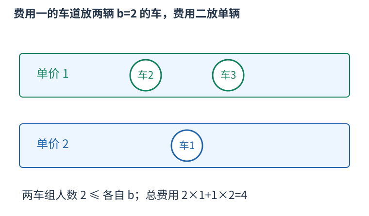

# P15232 便宜车道先放最大合法组，成员选承受人数最多者 题解

## 目录

| 题号 | 题名 | 考点 | 难度 |
|---|---|---|---|
| A | 浣熊的快车道 | 排序 + 贪心 | 1500 |

## A. 浣熊的快车道

> 原题：[P15232](https://www.luogu.com.cn/problem/P15232)
> 解法：便宜车道先放最大合法组，成员选承受人数最多者 · C++17

### 题意

每辆车选择一条收费车道，该车道最终总车数不能超过这辆车的$b$值，求精确最小总费用，不可分配输出负一。

<!-- reusable-foundations:start -->

### 从零讲：C++ 输入输出：把数据读进变量，把结果写到标准输出

程序运行时从标准输入接收题目给的数据，把答案送到标准输出。`cin` 和 `cout` 定义在 `<iostream>`；写 `using namespace std;` 后可以省略它们前面的 `std::`。最小完整程序是：

```cxx
#include <iostream>
using namespace std;
int main() {
    int a, b;
    cin >> a >> b;
    cout << a + b << '\n';
    return 0;
}
```

输入二十和三十，两个变量分别保存二十、三十，输出五十。`int a, b;` 声明两个整数变量；`cin >> a` 才给变量赋入输入值。多个 `>>` 从左到右读取，读取整数时会跳过空格、制表符、换行，所以两个整数可以分处两行。负号属于整数，不需要另读一个符号。

`cout <<` 后可以接数值、字符或字符串。`' '` 是一个空格字符，`'\n'` 是换行字符，`"Hello"` 是字符串。`cout << a << ' ' << b << '\n';` 输出两个以空格分开的整数并换行。评测程序只需要答案，不应加入“请输入”等提示。

读取 `char c; cin >> c;` 会跳过前导空白。要读取包含空格的一整行，用 `<string>` 中的 `string s; getline(cin, s);`。若此前用 `cin >> n` 读取过整数，换行还留在输入中，需要先处理那一个剩余换行；不能盲目把所有空格都删掉，因为字符画的行首空格和文本中的空格可能就是数据。

`fixed << setprecision(3)`（需要 `<iomanip>`）表示以小数形式保留三位小数，例如把 $2.5$ 输出成 $2.500$；不用 `fixed` 时，`setprecision` 指有效数字总数。设置会影响后续输出，使用前应确认所需精度。

竞赛中可在首次输入输出前调用 `ios::sync_with_stdio(false); cin.tie(nullptr);`，减少 C++ 流与 C 标准输入输出的同步、绑定开销。随后保持使用 `cin/cout`，不要混用另一套 `scanf/printf`。交互题还要在需要对方回应前主动刷新，例如 `cout << query << endl;`；普通题用换行字符即可。

读入长度为 $L$ 的文本、或输出 $L$ 个字符，至少需要 $O(L)$ 时间。数据类型仍要能容纳结果：把两个整数相乘时，即使保存到 `long long`，也要让乘法本身在这个类型中进行，例如先把输入声明为 `long long`。

### 从零讲：分支与循环：按条件选择，按次序重复

`if (条件) { ... } else { ... }` 根据条件的真假选择一条分支。比较运算 `==`、`!=`、`<`、`<=`、`>`、`>=` 返回真假值；`=` 是赋值，不能代替相等比较。`&&` 表示两边都成立，`||` 表示至少一边成立，`!` 把真假反转。

```cxx
int score = 85;
if (score >= 90) cout << "A";
else if (score >= 60) cout << "B";
else cout << "C"; // 这个例子输出 B
```

这条分支链只执行第一个符合条件的分支。先处理高分后，第二个条件自然只会接到低于九十分的数。几个独立的 `if` 则可能执行多次；两种结构代表不同问题。逻辑运算会短路：`i < n && a[i] == 0` 先确认下标合法，才读取那一格。

`for (初始化; 继续条件; 每轮更新)` 适合知道重复范围的情况。例如下列代码依次处理一到四，总和是十：

```cxx
int sum = 0;
for (int i = 1; i <= 4; ++i) {
    sum += i;
}
cout << sum;
```

初始化只做一次；每轮先判断条件，条件为真才执行循环体，随后执行更新。`++i` 把 $i$ 加一，`sum += i` 等价于把旧 sum 加 $i$ 再保存。应明确每个变量在循环前、循环后分别表示什么；最大值相同时是否更新，决定了保留较早还是较晚的答案。

`while (条件)` 适合“不满足目标就再做一步”：

```cxx
int x = 13, times = 0;
while (x > 1) {
    x /= 2;
    ++times;
}
// x 依次是 13、6、3、1，执行三次
```

循环开始前先检查条件，初始已满足目标时可能一次也不执行。每次执行必须推进状态，否则可能无限循环。`break` 结束最内层循环，`continue` 跳过本轮剩余部分；`for` 中的 continue 之后仍会执行每轮更新。

复杂度由实际执行次数决定。上述求和执行 $n$ 次是 $O(n)$；每次将正整数减半只执行 $O(\log n)$ 次。两层循环不能仅凭外观判定为平方：内层若总共只前进 $n$ 次，总量仍可能线性。变量应在正确作用范围初始化；多组数据的计数器若未重置，下一组会错误继承上一组结果。

### 从零讲：vector：长度可变的连续数组

`vector<T>` 保存一串同类型的元素，适合按下标访问、扫描、排序。`T` 是元素类型，例如 `vector<int>` 保存整数，`vector<pair<int,int>>` 保存整数对，`vector<vector<int>>` 可保存每个顶点各自的邻居。需要 `<vector>`。

```cxx
vector<int> a(3, 7);   // 三个元素，内容是 7、7、7
a.push_back(9);       // 在末尾追加，现在长度为 4
int x = a[1];         // 从 0 编号，这里得到 7
a[1] = 2;            // 改第二个元素
int n = int(a.size());
```

`vector<int> a(3)` 创建三个值为零的元素；`a.reserve(3)` 只预留容量，元素数仍为零，此时不能访问 `a[0]`。长度 `size()` 与容量 `capacity()` 是不同概念。

下标访问为 $O(1)$，遍历为 $O(n)$。末尾追加通常为 $O(1)$；容量不足时会分配更大的连续空间并搬移元素，这次可能为 $O(n)$，一连串追加的平均成本称为摊还 $O(1)$。中间插入或删除会搬移后续元素，最坏 $O(n)$。内存是元素量的 $O(n)$，并可能预留部分尚未使用的容量。

`begin()` 指向首元素，`end()` 指向尾后位置，`sort(a.begin(),a.end())` 操作整个数组。`a[i]` 不检查越界；下标须满足 $0\le i<\mathrm{size}$。`at(i)` 会检查越界并抛异常。空数组不能访问 `front()`、`back()`；`pop_back()` 也要求非空。

扩容后指向旧存储的迭代器、引用和指针会失效。遍历的同时 `push_back`，不能假定此前取得的引用仍可用。读取大数组的函数常用 `const vector<int>& a` 按常量引用传入，既不复制也禁止通过该引用修改；`vector<int> a` 按值传参则复制内容。选择副本还是引用取决于是否要保留独立数据。

### 从零讲：整数类型、整除与溢出

计算前先看每一步可能达到的范围。常见环境中 `int` 是 32 位，上界约 $2.1\times10^9$；`long long` 至少 64 位，常见有符号 64 位上界约 $9.22\times10^{18}$。`using ll = long long;` 只是为已有类型起别名。

```cxx
int a = 100000, b = 100000;
long long wrong = a * b;      // 右边先按 int 乘，可能已溢出
long long right = 1LL * a * b; // 先把运算提升到 long long
```

不能指望“接收结果的变量够大”修复此前已经溢出的计算。先提高操作数类型，再做乘法。超过 64 位时，GCC 的 `__int128` 可作中间量，但它不是标准 C++17 类型，也没有标准流输出重载；先证明范围，再选择工具。

整数 `/` 对有符号数向零截断：`7/3==2`、`-7/3==-2`。对非负数才等于向下取整。余数满足 `a == (a/b)*b + a%b`，除数不能为零；要将余数归入 $[0,m-1]$（$m>0$），可用 `(a % m + m) % m`，同时保证中间加法不溢出。

非负 $a$、正 $b$ 的向上取整可写 `a/b + (a%b != 0)`，比 `(a+b-1)/b` 更容易避免加法溢出。比较平方时也应在宽类型内计算；浮点数不适合作为大整数相等的默认判断方式。

`size()` 返回无符号类型。空容器上写 `size()-1` 会绕到很大的数，逆序遍历可以先转成有符号、确认长度，或使用逆向迭代器。`abs` 对最小有符号数无法在同类型中表达其正值，需先约束输入差值范围。一般机器整数运算按常数时间估算，宽类型解决表示范围，不改变算法的增长阶。

### 从零讲：具名函数：给可复用计算一个明确接口

函数把一段计算包装成“输入参数 → 返回结果”。例如判断整数是否为偶数：

```cxx
bool even(int x) {
    return x % 2 == 0;
}
int main() {
    bool a = even(8); // a 为 true
    bool b = even(7); // b 为 false
}
```

`bool` 是返回类型，`even` 是函数名，`int x` 是参数声明。调用 `even(8)` 时，实参八传入这个新调用的局部变量 $x$，执行 return 后把真假值交回调用处。定义本身不执行计算，只有调用才执行。函数应在调用处之前定义，或提前写声明。

普通数值参数按值传递，函数里修改 $x$ 不会改变调用者原变量。参数写成 `int &x` 时才引用调用者对象；必须让这个对象在调用期间有效。`const vector<int>& a` 用引用避免复制整个容器，并承诺不通过这个引用修改它。返回局部变量的值是安全的，返回局部变量的引用则在函数结束后失效。

函数名应说明它回答的问题，调用处负责传哪些数据。例如闰年判定只接收一个年份并返回真假，枚举年份范围和输出格式由调用者处理。同一判定被多次使用时，这能减少规则不一致；但函数包装不会自动降低算法复杂度，仍要把每次调用实际做的工作计入时间。

如果函数内部又调用自身，就是递归，需要明确最小情况如何直接返回、每次调用如何逼近它；递归会占用调用栈。普通辅助函数可以不使用递归，不应仅因写成函数就称作递归算法。

### 从零讲：sort 与比较器：先建立统一的顺序

排序把原来任意排列的数据，按照可比较的键整理成有序序列，便于查边界、比较相邻项和按顺序处理。头文件 `<algorithm>`；普通数组和 `vector` 可用 `sort(first,last)`，范围为左闭右开。

```cxx
vector<int> a{5, 2, 5, 1};
sort(a.begin(), a.end());     // 变成 1、2、5、5，重复值仍保留
sort(a.begin(), a.end(), greater<int>());  // 降序
```

`sort` 时间 $O(n\log n)$，不是每次比较都扫描整个数组。C++ 标准规定复杂度要求，不规定必须使用某一固定内部排序实现，不能统一称它为快速排序。

对 `pair`，默认先比较 `first`，相同再比较 `second`，都是升序。自定义比较器 `cmp(a,b)` 返回真表示“$a$ 必须排在 $b$ 前面”。例如按分数降序、同分按编号升序：

```cxx
sort(students.begin(), students.end(), [](const auto& a, const auto& b) {
    if (a.score != b.score) return a.score > b.score;
    return a.id < b.id;
});
```

规则必须自洽：元素不能排在自己前面，不能出现 $a$ 在 $b$ 前、$b$ 在 $c$ 前、$c$ 又在 $a$ 前的循环。`<=` 会让相同元素也必须互相在前，因此不是合法的严格比较器。排序过程中也不能改变比较依据。

排序会改变原位置；若编号或两项的配对有意义，应将完整记录一起排序或另存查询副本，不能把两个相关字段各自排序后继续当作原配对。普通 `sort` 不保证同键元素保持输入先后；确需稳定顺序时用 `stable_sort` 或将原编号纳入比较键。排序只建立顺序，不能代替贪心策略的正确性证明。

### 从零讲：贪心：先证明当前选择不会丢掉最优解

贪心每一步确定一个局部选择，不再撤回。它能省去搜索，但必须解释为什么始终存在一个最优方案也做这个选择。

例如选择最多个互不重叠的活动（这里允许后一活动起点等于前一活动终点）。每次选结束最早的活动：若最优方案的首项结束更晚，把它换成最早结束者，后续原本能接的活动仍能接，数量不变。这就是交换论证；换完首项，剩余问题仍为同类问题。


实现时按结束时间升序排序，维护上一次选中活动的结束时刻，依次选合法项。排序 $O(n\log n)$，扫描 $O(n)$，保存活动为 $O(n)$。若题目不允许端点相接，判断须从大于等于改成严格大于。

“选最长”“选价值最高”“选最靠左”都是不同策略。没有交换、支配关系或不变量的依据，不能只凭排序键直觉宣布正确。比如有容量和价值的物品选择，眼前价值最高者可能挡住两个总价值更高的小物品。

写题解时说明被替换的是哪一项、替换后什么约束仍满足、目标为何不变差，并说明余下状态为何允许重复同样论证。若选择还影响未保存的条件，就可能需要更丰富的状态或动态规划。

<!-- reusable-foundations:end -->

### 思路




限制是“每辆车所处车道最终有多少车”，不是每条车道自带固定容量。一组车辆放同一车道，其合法容量由组内最小$b$限制，组大小必须不超过这个最小值。

先按车道价格从小到大排序。任何固定的合法分组，都可把较大的组放在较便宜车道：交换两整组的位置不改变组内人数与$b$约束，而大组付低价不会更贵。

因此存在最优方案，最便宜车道承载某个最大组，设大小$h$。这个组又可换成剩余车辆里$b$最大的$h$辆。若目标车辆原来在另一组，用当前组中较小$b$的车交换过去也合法，因为另一组人数不超过$h$，而被换出的车原先已能承受$h$人。

设剩余$b$从大到小排列，最大可组成的人数为$q$，即前$q$辆的$b$都至少$q$。显然$q$不小于$h$。继续把排名$h$加一至$q$的车辆移入最便宜组，它们都能承受$q$人；原来的其它组只减少人数，约束更宽松。费用也不会增加，因为这些车转去的车道不比原车道贵。

这就证明存在一个最优方案，第一组恰是$b$最大的$q$辆。固定它后，对剩余车和剩余价格做同样选择，归纳得到整体最优。

扫描降序$b$时，逐渐增大group，只要新组大小不超过新加入车辆的$b$，就还能加入。第一次不满足后，后面的$b$只会更小，不能通过跳过它凑出更大的合法组。所有车辆总共被扫描一次，排序以后不需要逐车搜索车道。

如果$n$条车道已经用尽仍有车辆，上述交换论证说明任何可行方案都能改造成相同首组选取，因此不存在另一种分组能凭更少车道完成，输出负一。每车费用至多十亿，十万辆总费可达十的十四次方，用long long输出精确整数。

时间 $O(n\log n+m\log m)$，空间 $O(n+m)$。

### 参考代码

```cpp
#include <bits/stdc++.h>
using namespace std;

int main() {
    ios::sync_with_stdio(false);
    cin.tie(nullptr);
int n,m;cin>>n>>m;vector<long long>cost(n),capacity(m);for(auto &x:cost) cin>>x;for(auto &x:capacity) cin>>x;
sort(cost.begin(),cost.end());sort(capacity.begin(),capacity.end(),greater<long long>());
long long answer=0;int first=0,lane=0;
while(first<m){if(lane==n){cout<<-1<<'\n';return 0;}int group=0;while(first+group<m&&group+1<=capacity[first+group]) ++group;answer+=group*cost[lane];first+=group;++lane;}
cout<<answer<<'\n';
    return 0;
}
```

### 易错点

$b$属于车辆而非车道；检查最终组人数；费用按每辆车支付；$b$降序、价格升序；先确定整组再前进；没有结果取模；总费用用六十四位。

## 实测记录

本地 C++17 编译、1 组原站样例与 183 组独立边界/小域校验通过。
正文参考程序与源码逐字核对；没有向原站提交。
