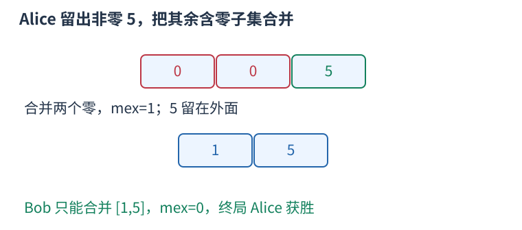

# P15320 只区分零与非零的终局构造 题解

## 目录

| 题号 | 题名 | 考点 | 难度 |
|---|---|---|---|
| A | Ah, It's Yesterday Once More | 博弈论 | 1200 |

## A. Ah, It's Yesterday Once More

> 原题：[P15320](https://www.luogu.com.cn/problem/P15320)
> 解法：只区分零与非零的终局构造 · C++17

### 题意

轮流选至少两个数，用它们的 mex 替换；只剩一个数时，零则 Alice 赢，否则 Bob 赢，求最优博弈结果。

<!-- reusable-foundations:start -->

### 从零讲：C++ 输入输出：把数据读进变量，把结果写到标准输出

程序运行时从标准输入接收题目给的数据，把答案送到标准输出。`cin` 和 `cout` 定义在 `<iostream>`；写 `using namespace std;` 后可以省略它们前面的 `std::`。最小完整程序是：

```cxx
#include <iostream>
using namespace std;
int main() {
    int a, b;
    cin >> a >> b;
    cout << a + b << '\n';
    return 0;
}
```

输入二十和三十，两个变量分别保存二十、三十，输出五十。`int a, b;` 声明两个整数变量；`cin >> a` 才给变量赋入输入值。多个 `>>` 从左到右读取，读取整数时会跳过空格、制表符、换行，所以两个整数可以分处两行。负号属于整数，不需要另读一个符号。

`cout <<` 后可以接数值、字符或字符串。`' '` 是一个空格字符，`'\n'` 是换行字符，`"Hello"` 是字符串。`cout << a << ' ' << b << '\n';` 输出两个以空格分开的整数并换行。评测程序只需要答案，不应加入“请输入”等提示。

读取 `char c; cin >> c;` 会跳过前导空白。要读取包含空格的一整行，用 `<string>` 中的 `string s; getline(cin, s);`。若此前用 `cin >> n` 读取过整数，换行还留在输入中，需要先处理那一个剩余换行；不能盲目把所有空格都删掉，因为字符画的行首空格和文本中的空格可能就是数据。

`fixed << setprecision(3)`（需要 `<iomanip>`）表示以小数形式保留三位小数，例如把 $2.5$ 输出成 $2.500$；不用 `fixed` 时，`setprecision` 指有效数字总数。设置会影响后续输出，使用前应确认所需精度。

竞赛中可在首次输入输出前调用 `ios::sync_with_stdio(false); cin.tie(nullptr);`，减少 C++ 流与 C 标准输入输出的同步、绑定开销。随后保持使用 `cin/cout`，不要混用另一套 `scanf/printf`。交互题还要在需要对方回应前主动刷新，例如 `cout << query << endl;`；普通题用换行字符即可。

读入长度为 $L$ 的文本、或输出 $L$ 个字符，至少需要 $O(L)$ 时间。数据类型仍要能容纳结果：把两个整数相乘时，即使保存到 `long long`，也要让乘法本身在这个类型中进行，例如先把输入声明为 `long long`。

### 从零讲：分支与循环：按条件选择，按次序重复

`if (条件) { ... } else { ... }` 根据条件的真假选择一条分支。比较运算 `==`、`!=`、`<`、`<=`、`>`、`>=` 返回真假值；`=` 是赋值，不能代替相等比较。`&&` 表示两边都成立，`||` 表示至少一边成立，`!` 把真假反转。

```cxx
int score = 85;
if (score >= 90) cout << "A";
else if (score >= 60) cout << "B";
else cout << "C"; // 这个例子输出 B
```

这条分支链只执行第一个符合条件的分支。先处理高分后，第二个条件自然只会接到低于九十分的数。几个独立的 `if` 则可能执行多次；两种结构代表不同问题。逻辑运算会短路：`i < n && a[i] == 0` 先确认下标合法，才读取那一格。

`for (初始化; 继续条件; 每轮更新)` 适合知道重复范围的情况。例如下列代码依次处理一到四，总和是十：

```cxx
int sum = 0;
for (int i = 1; i <= 4; ++i) {
    sum += i;
}
cout << sum;
```

初始化只做一次；每轮先判断条件，条件为真才执行循环体，随后执行更新。`++i` 把 $i$ 加一，`sum += i` 等价于把旧 sum 加 $i$ 再保存。应明确每个变量在循环前、循环后分别表示什么；最大值相同时是否更新，决定了保留较早还是较晚的答案。

`while (条件)` 适合“不满足目标就再做一步”：

```cxx
int x = 13, times = 0;
while (x > 1) {
    x /= 2;
    ++times;
}
// x 依次是 13、6、3、1，执行三次
```

循环开始前先检查条件，初始已满足目标时可能一次也不执行。每次执行必须推进状态，否则可能无限循环。`break` 结束最内层循环，`continue` 跳过本轮剩余部分；`for` 中的 continue 之后仍会执行每轮更新。

复杂度由实际执行次数决定。上述求和执行 $n$ 次是 $O(n)$；每次将正整数减半只执行 $O(\log n)$ 次。两层循环不能仅凭外观判定为平方：内层若总共只前进 $n$ 次，总量仍可能线性。变量应在正确作用范围初始化；多组数据的计数器若未重置，下一组会错误继承上一组结果。

### 从零讲：博弈状态：自己的选择与对方的选择不同

两人轮流行动、都想获胜时，状态要包含足以决定合法动作的全部信息，并明确轮到谁。先约定正常玩法：没有合法动作的一方失败。

在有限且无环的状态图中，一个状态必胜，当且仅当存在一步能走到对手的必败状态；必败，当且仅当所有合法下一步都是对手的必胜状态。前者是“存在”，后者是“全部”，不能把对手的决定当成随机或替自己选择。

例如每次拿一或两颗石子：零颗必败，一、二颗必胜，三颗两种走法都交给对手必胜态，所以必败；四、五又能走向三，因此必胜。由此猜出三的倍数是败态，还须用这两种方向覆盖所有余数来证明。

若多个独立游戏可任选一个行动，且满足公平、有限、无环、正常玩法等条件，可给每个状态定义 SG 值：取所有后继 SG 值集合的 mex，即未出现的最小非负数。无后继时为零，多个独立游戏总 SG 为异或；不能将这个规则套到双方可选动作不同的非公平游戏。

按状态图顺序计算的成本为状态数加转移数，递归求解需记忆化，否则相同局面会反复展开。带环游戏可能出现平局或无限过程，直接照搬无环递推会循环；行动步数受限时，剩余步数也可能必须放入状态。

结论题要说明题目采用的终止和胜负规则。若最后行动者失败，或者一方只能水平走而另一方可四向走，必须重新建模，不能把经典取石子的公式直接移植。

<!-- reusable-foundations:end -->

### 思路

单元素直接判终值。两个元素只能合并全部，只有两者都非零才让 Alice 赢。至少三个元素时：全零必败；只要有非零，Alice 就能直接结束或留下两个非零让 Bob 被迫合成零。



操作子集有两项所以合法；留下的是恰好两个非零数，而非任意多个。

每组时间 $O(n)$、额外空间 $O(1)$。

### 参考代码

```cpp
#include <bits/stdc++.h>
using namespace std;

int main() {
    ios::sync_with_stdio(false);
    cin.tie(nullptr);
int t;cin>>t;while(t--){int n;cin>>n;int zeros=0;
    for(int i=0;i<n;++i){int x;cin>>x;zeros+=x==0;}
    bool alice=n==1?zeros==1:n==2?zeros==0:zeros<n;
    cout<<(alice?"Alice":"Bob")<<'\n';
}
    return 0;
}
```

### 易错点

胜负由最后数是否为零决定，不是不能操作的人输；$n=1$、$n=2$ 必须独立处理。

## 实测记录

本地 C++17 编译、1 组原站样例与 1 组独立边界/小域校验通过。
正文参考程序与源码逐字核对；没有向原站提交。
