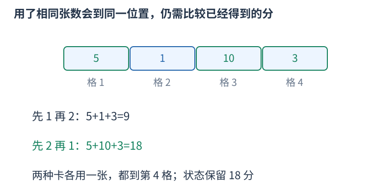

# P1541 相同点数卡片只记已经用了多少张 题解

## 目录

| 题号 | 题名 | 考点 | 难度 |
|---|---|---|---|
| A | 乌龟棋 | 线性 DP | 1800 |

## A. 乌龟棋

> 原题：[P1541](https://www.luogu.com.cn/problem/P1541)
> 解法：相同点数卡片只记已经用了多少张 · C++17

### 题意

乌龟沿单行棋盘前进，每张一至四步的卡片使用一次，每次到达格及起点都得分，全部卡片恰好走到终点，求最大分数。

<!-- reusable-foundations:start -->

### 从零讲：C++ 输入输出：把数据读进变量，把结果写到标准输出

程序运行时从标准输入接收题目给的数据，把答案送到标准输出。`cin` 和 `cout` 定义在 `<iostream>`；写 `using namespace std;` 后可以省略它们前面的 `std::`。最小完整程序是：

```cxx
#include <iostream>
using namespace std;
int main() {
    int a, b;
    cin >> a >> b;
    cout << a + b << '\n';
    return 0;
}
```

输入二十和三十，两个变量分别保存二十、三十，输出五十。`int a, b;` 声明两个整数变量；`cin >> a` 才给变量赋入输入值。多个 `>>` 从左到右读取，读取整数时会跳过空格、制表符、换行，所以两个整数可以分处两行。负号属于整数，不需要另读一个符号。

`cout <<` 后可以接数值、字符或字符串。`' '` 是一个空格字符，`'\n'` 是换行字符，`"Hello"` 是字符串。`cout << a << ' ' << b << '\n';` 输出两个以空格分开的整数并换行。评测程序只需要答案，不应加入“请输入”等提示。

读取 `char c; cin >> c;` 会跳过前导空白。要读取包含空格的一整行，用 `<string>` 中的 `string s; getline(cin, s);`。若此前用 `cin >> n` 读取过整数，换行还留在输入中，需要先处理那一个剩余换行；不能盲目把所有空格都删掉，因为字符画的行首空格和文本中的空格可能就是数据。

`fixed << setprecision(3)`（需要 `<iomanip>`）表示以小数形式保留三位小数，例如把 $2.5$ 输出成 $2.500$；不用 `fixed` 时，`setprecision` 指有效数字总数。设置会影响后续输出，使用前应确认所需精度。

竞赛中可在首次输入输出前调用 `ios::sync_with_stdio(false); cin.tie(nullptr);`，减少 C++ 流与 C 标准输入输出的同步、绑定开销。随后保持使用 `cin/cout`，不要混用另一套 `scanf/printf`。交互题还要在需要对方回应前主动刷新，例如 `cout << query << endl;`；普通题用换行字符即可。

读入长度为 $L$ 的文本、或输出 $L$ 个字符，至少需要 $O(L)$ 时间。数据类型仍要能容纳结果：把两个整数相乘时，即使保存到 `long long`，也要让乘法本身在这个类型中进行，例如先把输入声明为 `long long`。

### 从零讲：分支与循环：按条件选择，按次序重复

`if (条件) { ... } else { ... }` 根据条件的真假选择一条分支。比较运算 `==`、`!=`、`<`、`<=`、`>`、`>=` 返回真假值；`=` 是赋值，不能代替相等比较。`&&` 表示两边都成立，`||` 表示至少一边成立，`!` 把真假反转。

```cxx
int score = 85;
if (score >= 90) cout << "A";
else if (score >= 60) cout << "B";
else cout << "C"; // 这个例子输出 B
```

这条分支链只执行第一个符合条件的分支。先处理高分后，第二个条件自然只会接到低于九十分的数。几个独立的 `if` 则可能执行多次；两种结构代表不同问题。逻辑运算会短路：`i < n && a[i] == 0` 先确认下标合法，才读取那一格。

`for (初始化; 继续条件; 每轮更新)` 适合知道重复范围的情况。例如下列代码依次处理一到四，总和是十：

```cxx
int sum = 0;
for (int i = 1; i <= 4; ++i) {
    sum += i;
}
cout << sum;
```

初始化只做一次；每轮先判断条件，条件为真才执行循环体，随后执行更新。`++i` 把 $i$ 加一，`sum += i` 等价于把旧 sum 加 $i$ 再保存。应明确每个变量在循环前、循环后分别表示什么；最大值相同时是否更新，决定了保留较早还是较晚的答案。

`while (条件)` 适合“不满足目标就再做一步”：

```cxx
int x = 13, times = 0;
while (x > 1) {
    x /= 2;
    ++times;
}
// x 依次是 13、6、3、1，执行三次
```

循环开始前先检查条件，初始已满足目标时可能一次也不执行。每次执行必须推进状态，否则可能无限循环。`break` 结束最内层循环，`continue` 跳过本轮剩余部分；`for` 中的 continue 之后仍会执行每轮更新。

复杂度由实际执行次数决定。上述求和执行 $n$ 次是 $O(n)$；每次将正整数减半只执行 $O(\log n)$ 次。两层循环不能仅凭外观判定为平方：内层若总共只前进 $n$ 次，总量仍可能线性。变量应在正确作用范围初始化；多组数据的计数器若未重置，下一组会错误继承上一组结果。

### 从零讲：vector：长度可变的连续数组

`vector<T>` 保存一串同类型的元素，适合按下标访问、扫描、排序。`T` 是元素类型，例如 `vector<int>` 保存整数，`vector<pair<int,int>>` 保存整数对，`vector<vector<int>>` 可保存每个顶点各自的邻居。需要 `<vector>`。

```cxx
vector<int> a(3, 7);   // 三个元素，内容是 7、7、7
a.push_back(9);       // 在末尾追加，现在长度为 4
int x = a[1];         // 从 0 编号，这里得到 7
a[1] = 2;            // 改第二个元素
int n = int(a.size());
```

`vector<int> a(3)` 创建三个值为零的元素；`a.reserve(3)` 只预留容量，元素数仍为零，此时不能访问 `a[0]`。长度 `size()` 与容量 `capacity()` 是不同概念。

下标访问为 $O(1)$，遍历为 $O(n)$。末尾追加通常为 $O(1)$；容量不足时会分配更大的连续空间并搬移元素，这次可能为 $O(n)$，一连串追加的平均成本称为摊还 $O(1)$。中间插入或删除会搬移后续元素，最坏 $O(n)$。内存是元素量的 $O(n)$，并可能预留部分尚未使用的容量。

`begin()` 指向首元素，`end()` 指向尾后位置，`sort(a.begin(),a.end())` 操作整个数组。`a[i]` 不检查越界；下标须满足 $0\le i<\mathrm{size}$。`at(i)` 会检查越界并抛异常。空数组不能访问 `front()`、`back()`；`pop_back()` 也要求非空。

扩容后指向旧存储的迭代器、引用和指针会失效。遍历的同时 `push_back`，不能假定此前取得的引用仍可用。读取大数组的函数常用 `const vector<int>& a` 按常量引用传入，既不复制也禁止通过该引用修改；`vector<int> a` 按值传参则复制内容。选择副本还是引用取决于是否要保留独立数据。

### 从零讲：整数类型、整除与溢出

计算前先看每一步可能达到的范围。常见环境中 `int` 是 32 位，上界约 $2.1\times10^9$；`long long` 至少 64 位，常见有符号 64 位上界约 $9.22\times10^{18}$。`using ll = long long;` 只是为已有类型起别名。

```cxx
int a = 100000, b = 100000;
long long wrong = a * b;      // 右边先按 int 乘，可能已溢出
long long right = 1LL * a * b; // 先把运算提升到 long long
```

不能指望“接收结果的变量够大”修复此前已经溢出的计算。先提高操作数类型，再做乘法。超过 64 位时，GCC 的 `__int128` 可作中间量，但它不是标准 C++17 类型，也没有标准流输出重载；先证明范围，再选择工具。

整数 `/` 对有符号数向零截断：`7/3==2`、`-7/3==-2`。对非负数才等于向下取整。余数满足 `a == (a/b)*b + a%b`，除数不能为零；要将余数归入 $[0,m-1]$（$m>0$），可用 `(a % m + m) % m`，同时保证中间加法不溢出。

非负 $a$、正 $b$ 的向上取整可写 `a/b + (a%b != 0)`，比 `(a+b-1)/b` 更容易避免加法溢出。比较平方时也应在宽类型内计算；浮点数不适合作为大整数相等的默认判断方式。

`size()` 返回无符号类型。空容器上写 `size()-1` 会绕到很大的数，逆序遍历可以先转成有符号、确认长度，或使用逆向迭代器。`abs` 对最小有符号数无法在同类型中表达其正值，需先约束输入差值范围。一般机器整数运算按常数时间估算，宽类型解决表示范围，不改变算法的增长阶。

### 从零讲：具名函数：给可复用计算一个明确接口

函数把一段计算包装成“输入参数 → 返回结果”。例如判断整数是否为偶数：

```cxx
bool even(int x) {
    return x % 2 == 0;
}
int main() {
    bool a = even(8); // a 为 true
    bool b = even(7); // b 为 false
}
```

`bool` 是返回类型，`even` 是函数名，`int x` 是参数声明。调用 `even(8)` 时，实参八传入这个新调用的局部变量 $x$，执行 return 后把真假值交回调用处。定义本身不执行计算，只有调用才执行。函数应在调用处之前定义，或提前写声明。

普通数值参数按值传递，函数里修改 $x$ 不会改变调用者原变量。参数写成 `int &x` 时才引用调用者对象；必须让这个对象在调用期间有效。`const vector<int>& a` 用引用避免复制整个容器，并承诺不通过这个引用修改它。返回局部变量的值是安全的，返回局部变量的引用则在函数结束后失效。

函数名应说明它回答的问题，调用处负责传哪些数据。例如闰年判定只接收一个年份并返回真假，枚举年份范围和输出格式由调用者处理。同一判定被多次使用时，这能减少规则不一致；但函数包装不会自动降低算法复杂度，仍要把每次调用实际做的工作计入时间。

如果函数内部又调用自身，就是递归，需要明确最小情况如何直接返回、每次调用如何逼近它；递归会占用调用栈。普通辅助函数可以不使用递归，不应仅因写成函数就称作递归算法。

### 从零讲：动态规划：保存明确子问题的答案

若多个决策会反复遇到相同的剩余问题，可以为每个不同问题保存一次答案。状态不是“当前操作到了哪儿”的模糊描述，而是一个有完整条件、能独立提问的问题。

例如台阶一次走一或二级，求到达第 $i$ 级的方式数。令 $f_i$ 为恰好到第 $i$ 级的方案数。最后一步只有两类：从 $i-1$ 走一级，或从 $i-2$ 走两级，类别互斥且覆盖所有方案，所以 $f_i=f_{i-1}+f_{i-2}$。


起点 $f_0=1$ 表示原地不走的一种空方案，$f_1=1$。于是 $f_2=2,f_3=3,f_4=5$。从小到大计算，因为当前格依赖的格都已经完成。`f[0]=0` 会把“空方案”错误删掉。

```cxx
vector<long long> f(n + 1, 0);
f[0] = 1;
for (int i = 1; i <= n; ++i) {
    f[i] = f[i - 1];
    if (i >= 2) f[i] += f[i - 2];
}
```

另一个问题若问最小费用，就应对候选取 `min`；问最大收益取 `max`；问数量才在不重不漏的分类下相加。不能只把加号替换掉，初值也要随状态含义重新决定。不可达状态应与合法的零答案区别。

时间通常为状态数乘每个状态枚举的转移数，本例 $O(n)$；保存整表用 $O(n)$。只依赖最近两格时可滚动到 $O(1)$ 空间，但要先保存仍需读取的旧值。若下标不够决定后续可选动作，就缺少状态维度，不能把不同问题混在同一格。

检查一份 DP 时依次核对：状态的问题、基础答案、最后一步分类、依赖计算顺序、最终读哪一格。记忆化搜索使用同样的子问题，只是按递归需要计算；它也需要终止条件并避免状态依赖成环。

### 从零讲：lambda：完整例子、捕获规则与局部变量的生命周期

#### 它解决什么问题

一段操作在当前函数里需要调用多次，或者某个算法需要你提供“怎样比较”的规则，可以把这段操作写成 lambda。lambda 表达式产生一个可以像函数一样调用的对象；“匿名”指它没有普通函数声明中的函数名，仍可以用变量保存并命名。

```cxx
auto add = [](int a, int b) -> int {
    return a + b;
};
int answer = add(2, 3);  // 调用后得到 5；定义本身不会执行函数体
```

读法是：用 `auto` 保存对象；`[](){}` 中的方括号部分是捕获列表；圆括号是每次调用传入的参数；`-> int` 指定返回类型；花括号里写执行过程；定义后的分号结束赋值。返回类型能够推导时可省略，所以也常见 `auto add = [](int a,int b) { return a+b; };`。


#### 参数和捕获有什么区别

参数每次调用都由调用者提供；捕获让函数体使用定义位置附近的局部变量，调用时不用重复传它。例如阈值来自当前环境，待判断的值每次变化：

```cxx
int threshold = 10;
auto enough = [threshold](int value) {
    return value >= threshold;
};
bool a = enough(12);  // true，value 是本次传入的 12
```

这里 `threshold` 是捕获，`value` 是参数。常用的捕获方式如下：

| 写法 | 意思 | 适合的需要 |
|---|---|---|
| `[](){}` | 不捕获局部变量 | 只依赖参数的计算或比较 |
| `[x](){}` | 保存定义时 `x` 的副本 | 需要固定一份快照 |
| `[&x](){}` | 引用外面的 `x` | 读取最新值或修改原变量 |
| `[=](){}` | 按值捕获实际需要的局部变量 | 需要多个快照 |
| `[&](){}` | 按引用捕获实际需要的局部变量 | 当前作用域内的辅助函数 |
| `[&a, limit](){}` | 引用 `a`，复制 `limit` | 显式区分共享数据和快照 |

`[&](){}` 不是“把参数按引用传递”；是否按引用传参由圆括号里的 `int&`、`const vector<int>&` 等类型决定。全局变量可以直接访问，无需捕获。

#### 用可观察的结果区分复制与引用

```cxx
int base = 10;
auto snapshot = [base](int x) { return base + x; };
auto current = [&base](int x) { return base + x; };
base = 20;
int a = snapshot(1);  // 11：使用定义时保存的 10
int b = current(1);   // 21：使用外面的最新值 20
```

默认情况下不能在 lambda 内修改按值捕获的副本。加 `mutable` 才能修改副本，但仍不会改外面的原变量：`auto next = [base]() mutable { return ++base; };`。对大数组按值捕获可能复制整个数组；如果只在数组仍然存活时查询，显式引用可避免这份复制。

#### 两种常见用法

**局部辅助函数。** 把“给一个参数就求出结果”的操作命名后，主流程只写调用。外层数组保持原处，辅助函数按引用读取，能减少重复代码，并让环境依赖集中在定义附近。对多个调用位置修正一处逻辑即可。普通独立函数也能做到复用，但外层局部数据通常需要显式传参。

**作为算法的规则。** 把比较方式直接交给 `sort`，能在调用处看到排序依据：

```cxx
vector<pair<int,int>> items={{2,7},{1,2},{1,4}};
sort(items.begin(), items.end(), [](const auto& a, const auto& b) {
    if (a.first != b.first) return a.first < b.first;
    return a.second > b.second;
});
```

先按第一项升序，第一项相同时按第二项降序。比较器必须形成严格弱序，同一个元素与自己比较应为假；写成 `<=` 可能破坏排序前提。传 `const auto&` 可以避免每次比较都复制元素。

#### 递归时怎样引用自己

在 `auto f = ...` 的初始化表达式中不能直接假定 `f` 的类型已确定。C++17 可以把自己作为参数传进去：

```cxx
auto factorial = [](auto&& self, int n) -> long long {
    if (n <= 1) return 1;
    return n * self(self, n - 1);
};
long long value = factorial(factorial, 5);  // 120
```

也可先声明 `std::function<long long(int)> f` 再赋 lambda，通过引用调用 `f`；需要 `<functional>`。`std::function` 用统一类型包装可调用对象，便于存储和传递，但可能有间接调用、分配等额外开销。只在当前地方使用时，`auto` 常更直接。这些是组织代码的选择，不会改变原算法的复杂度。

#### 生命周期和复杂度

引用捕获不会延长被引用变量的生命。把引用局部数组的 lambda 返回到函数外，局部数组已经销毁，再调用就会访问失效对象；放入异步任务或长久保存时，也须检查这一点。必要时捕获一份拥有数据的副本，或设计明确的共享所有权。

调用一次 lambda 的时间取决于函数体：内部扫描 $n$ 个元素就是 $O(n)$，做两次有序数组二分就是 $O(\log n)$。创建时复制大容器还会有与数据量相关的成本。lambda 的优势是局部表达、复用和传递行为，本身不保证运行更快。

规范核对：[C++ 工作草案：捕获](https://eel.is/c++draft/expr.prim.lambda.capture)、[函数对象](https://eel.is/c++draft/function.objects)。示例均为 C++17 写法。

<!-- reusable-foundations:end -->

### 思路




两张一步卡在先后次序里交换，不会改变任何经过位置，所以不必把每张卡片单独当作一种状态。真正影响未来的，是四种点数各还剩多少张。

使用$a$张一步、$b$张两步、$c$张三步、$d$张四步时，从起点向前的距离固定为 $a+2b+3c+4d$。位置无需再增加一维，它已由四个计数决定。状态$f(a, b, c, d)$保存按这些卡片走到这里时可取得的最大总分。

最后一张可能是任一计数大于零的类型；去掉它就是对应计数减一的状态。所有候选到达的是同一个当前位置，比较前驱得分后再加当前位置分数即可。前驱计数更小，四重递增循环就保证它已经计算完。

零张卡片时乌龟已经站在第一格，初始分数是$a[0]$而非零。最后读取四类卡片都用完的状态，题目保证此时正好到终点。程序将四维计数展平到一维数组，索引按各维容量依次乘加；这只改变存储方式，不改变状态含义。

令四类张数为c1至c4，状态数 $P=\prod_{i=1}^4(c_i+1)$，时间 $O(n+m+P)$，空间 $O(n+P)$。

### 参考代码

```cpp
#include <bits/stdc++.h>
using namespace std;

int main() {
    ios::sync_with_stdio(false);
    cin.tie(nullptr);
int n,m;cin>>n>>m;vector<int>score(n);for(int &x:score)cin>>x;int count[5]={};for(int i=0,v;i<m;++i){cin>>v;++count[v];}
int B=count[2]+1,C=count[3]+1,E=count[4]+1;auto index=[&](int a,int b,int c,int d){return ((a*B+b)*C+c)*E+d;};
vector<int>dp((count[1]+1)*B*C*E);dp[0]=score[0];
for(int a=0;a<=count[1];++a)for(int b=0;b<=count[2];++b)for(int c=0;c<=count[3];++c)for(int d=0;d<=count[4];++d){if(a+b+c+d==0)continue;int best=0;
    if(a)best=max(best,dp[index(a-1,b,c,d)]);if(b)best=max(best,dp[index(a,b-1,c,d)]);if(c)best=max(best,dp[index(a,b,c-1,d)]);if(d)best=max(best,dp[index(a,b,c,d-1)]);
    dp[index(a,b,c,d)]=best+score[a+2*b+3*c+4*d];
}cout<<dp[index(count[1],count[2],count[3],count[4])]<<'\n';
    return 0;
}
```

### 易错点

起点自动得分；位置由卡片计数确定；同类卡不区分身份；前驱只减一类计数；读取全用完状态。

## 实测记录

本地 C++17 编译、1 组原站样例与 232 组独立边界/小域校验通过。
正文参考程序与源码逐字核对；没有向原站提交。
