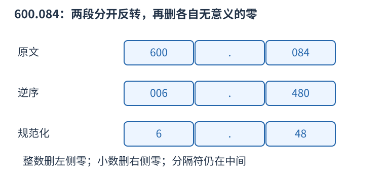

# P1553 分段逆序并按种类去零 题解

## 目录

| 题号 | 题名 | 考点 | 难度 |
|---|---|---|---|
| A | 数字反转（升级版） | 模拟 | 1200 |

## A. 数字反转（升级版）

> 原题：[P1553](https://www.luogu.com.cn/problem/P1553)
> 解法：分段逆序并按种类去零 · C++17

### 题意

对整数、小数、分数、百分数分别反转数字，保留分隔符；整数部分去前导零，小数部分去末尾零，至少保留一个零。

<!-- reusable-foundations:start -->

### 从零讲：C++ 输入输出：把数据读进变量，把结果写到标准输出

程序运行时从标准输入接收题目给的数据，把答案送到标准输出。`cin` 和 `cout` 定义在 `<iostream>`；写 `using namespace std;` 后可以省略它们前面的 `std::`。最小完整程序是：

```cxx
#include <iostream>
using namespace std;
int main() {
    int a, b;
    cin >> a >> b;
    cout << a + b << '\n';
    return 0;
}
```

输入二十和三十，两个变量分别保存二十、三十，输出五十。`int a, b;` 声明两个整数变量；`cin >> a` 才给变量赋入输入值。多个 `>>` 从左到右读取，读取整数时会跳过空格、制表符、换行，所以两个整数可以分处两行。负号属于整数，不需要另读一个符号。

`cout <<` 后可以接数值、字符或字符串。`' '` 是一个空格字符，`'\n'` 是换行字符，`"Hello"` 是字符串。`cout << a << ' ' << b << '\n';` 输出两个以空格分开的整数并换行。评测程序只需要答案，不应加入“请输入”等提示。

读取 `char c; cin >> c;` 会跳过前导空白。要读取包含空格的一整行，用 `<string>` 中的 `string s; getline(cin, s);`。若此前用 `cin >> n` 读取过整数，换行还留在输入中，需要先处理那一个剩余换行；不能盲目把所有空格都删掉，因为字符画的行首空格和文本中的空格可能就是数据。

`fixed << setprecision(3)`（需要 `<iomanip>`）表示以小数形式保留三位小数，例如把 $2.5$ 输出成 $2.500$；不用 `fixed` 时，`setprecision` 指有效数字总数。设置会影响后续输出，使用前应确认所需精度。

竞赛中可在首次输入输出前调用 `ios::sync_with_stdio(false); cin.tie(nullptr);`，减少 C++ 流与 C 标准输入输出的同步、绑定开销。随后保持使用 `cin/cout`，不要混用另一套 `scanf/printf`。交互题还要在需要对方回应前主动刷新，例如 `cout << query << endl;`；普通题用换行字符即可。

读入长度为 $L$ 的文本、或输出 $L$ 个字符，至少需要 $O(L)$ 时间。数据类型仍要能容纳结果：把两个整数相乘时，即使保存到 `long long`，也要让乘法本身在这个类型中进行，例如先把输入声明为 `long long`。

### 从零讲：string：字符、下标与子串

`string` 保存字符序列。`string s="abca";` 的长度为四，下标从零开始，`s[0]=='a'`、`s[3]=='a'`。字符用单引号，字符串用双引号；二者类型不同。需要 `<string>`。

`cin >> s` 读到空白停止；整行含空格时使用 `getline`，并留意前一次格式化输入残留的换行。`s.size()` 是字符单元数量，不一定等于 UTF-8 中文字数；竞赛英文小写字母题通常一个字符对应一个单元。

```cxx
string s = "abca";
string middle = s.substr(1, 2); // 从下标 1 开始取 2 个字符，得到 bc
size_t pos = s.find('c');       // 得到 2；找不到是 string::npos
if (pos != string::npos) cout << s[pos];
```

`substr(start,length)` 的第二项是长度，不是右端点。普通下标访问为 $O(1)$；复制长为 $k$ 的子串需要 $O(k)$ 时间和空间，循环里反复截取可能累积成平方成本。字符串比较按第一个不同字符决定字典序，公共前缀可能需要线性比较。

常见字符转数字是 `c-'0'`，前提 `c` 在 `'0'` 到 `'9'`。修改原串可用 `for(char& c:s)`，只读使用 `char c`。`reverse(s.begin(),s.end())` 原地翻转；若还需要原串，应先复制。空串不能访问首尾，尾后位置不能当普通字符读取。

### 从零讲：字符串修改、数字转换与字符判断

处理文本时先区分三种对象：字符如 `'7'`、字符序列如 `"275"`、整数如 `275`。它们的表示和运算规则不同。字符减 `'0'` 只适用于单个十进制数字；多位数字可以用 `stoi` 或 `stoll` 转换。

```cxx
string s = "275";
int x = stoi(s);               // 得到整数二百七十五
long long y = stoll("10000000000");
string equation = s + "+125=" + to_string(x + 125);
// equation 为 275+125=400
```

`stoi` 返回 int，`stoll` 返回 long long；`to_string` 把整数转为十进制字符串，也会保留负号。转换读取十进制数字需要合法输入并且结果在返回类型范围内；非法或越界的转换会抛异常。题目保证格式正确时可以直接使用，处理不可信文本时应检查错误与是否完整消费了输入。转换长度为 L 的整数文本需要 $O(L)$ 时间。

`isdigit` 与 `tolower` 定义在 `<cctype>`。`isdigit(c)` 判断一个字符是不是数字，`tolower(c)` 把可转换的大写字母转成小写，其它字符保持不变。向这类函数传入普通 char 前，应先转成 unsigned char，避免负的 char 值超出接口允许范围：

```cxx
char c = 'A';
c = static_cast<char>(tolower(static_cast<unsigned char>(c))); // a
bool digit = isdigit(static_cast<unsigned char>('7'));         // true
```

下面的操作直接修改字符串；它们改变的是字符位置，不能把旧下标当成某个字符永远不变的身份：

```cxx
string text = "bcd";
text.insert(1, "XX"); // 在旧下标一之前插入，得到 bXXcd
text += "e";          // 追加，得到 bXXcde
text.pop_back();      // 删除末尾 e，恢复 bXXcd
char last = text.back(); // d，前提是非空
size_t where = text.find_first_of("./%"); // 没有这些字符，返回 npos
size_t first = string("00070").find_first_not_of('0'); // 三，从零编号
```

`find` 查找整个子串，`find_first_of` 查找给定字符集合中的任意一个，`find_first_not_of` 查找首个不在指定集合中的字符。这些函数返回位置或 `string::npos`，不是直接返回真假。合法的零号位置不能误判为“没有找到”；输出找不到时应显式处理 npos，不能依赖把无符号大数转换成负数。

`insert` 要移动插入点后面的字符，长度为 L 的串中插入 $k$ 个字符通常需要 $O(L+k)$ 时间，并可能重新分配存储，旧指针、引用和迭代器可能失效。删除末尾和读取 back 为常数操作，但都要求字符串非空。子串查找的最坏复杂度可能与文本长度和模式长度的乘积相关，不能一律写成常数或对数。

### 从零讲：具名函数：给可复用计算一个明确接口

函数把一段计算包装成“输入参数 → 返回结果”。例如判断整数是否为偶数：

```cxx
bool even(int x) {
    return x % 2 == 0;
}
int main() {
    bool a = even(8); // a 为 true
    bool b = even(7); // b 为 false
}
```

`bool` 是返回类型，`even` 是函数名，`int x` 是参数声明。调用 `even(8)` 时，实参八传入这个新调用的局部变量 $x$，执行 return 后把真假值交回调用处。定义本身不执行计算，只有调用才执行。函数应在调用处之前定义，或提前写声明。

普通数值参数按值传递，函数里修改 $x$ 不会改变调用者原变量。参数写成 `int &x` 时才引用调用者对象；必须让这个对象在调用期间有效。`const vector<int>& a` 用引用避免复制整个容器，并承诺不通过这个引用修改它。返回局部变量的值是安全的，返回局部变量的引用则在函数结束后失效。

函数名应说明它回答的问题，调用处负责传哪些数据。例如闰年判定只接收一个年份并返回真假，枚举年份范围和输出格式由调用者处理。同一判定被多次使用时，这能减少规则不一致；但函数包装不会自动降低算法复杂度，仍要把每次调用实际做的工作计入时间。

如果函数内部又调用自身，就是递归，需要明确最小情况如何直接返回、每次调用如何逼近它；递归会占用调用栈。普通辅助函数可以不使用递归，不应仅因写成函数就称作递归算法。

<!-- reusable-foundations:end -->

### 思路

先按点号、斜杠或百分号辨认类型。每一段单独反转，再按该段的语义去掉无意义的零，最后拼回分隔符。



整数部分去前导零，小数部分去末尾零，得到六点四八。

字符串长为 L，时间与空间均为 $O(L)$。

### 参考代码

```cpp
#include <bits/stdc++.h>
using namespace std;
string turn(string s,bool fractional){
    reverse(s.begin(),s.end());
    if(fractional){while(s.size()>1 && s.back()=='0')s.pop_back();}
    else {size_t p=s.find_first_not_of('0');s=p==string::npos?"0":s.substr(p);}
    return s;
}
int main() {
    ios::sync_with_stdio(false);
    cin.tie(nullptr);
string s;cin>>s;
size_t pos=s.find_first_of("./%");
if(pos==string::npos) cout<<turn(s,false);
else if(s[pos]=='%') cout<<turn(s.substr(0,pos),false)<<'%';
else cout<<turn(s.substr(0,pos),false)<<s[pos]<<turn(s.substr(pos+1),s[pos]=='.');
cout<<'\n';
    return 0;
}
```

### 易错点

小数右段去末尾零，整数和分数段去前导零；每段至少留一个数字。

## 实测记录

本地 C++17 编译、4 组原站样例与 220 组独立边界/小域校验通过。
正文参考程序与源码逐字核对；没有向原站提交。
