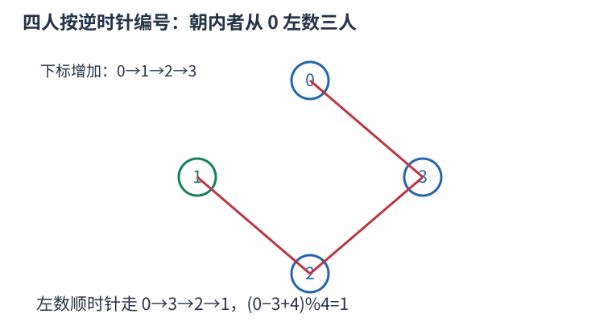

# P1563 先列表判方向再模 $n$ 移动 题解

## 目录

| 题号 | 题名 | 考点 | 难度 |
|---|---|---|---|
| A | 玩具谜题 | 模拟 | 1200 |

## A. 玩具谜题

> 原题：[P1563](https://www.luogu.com.cn/problem/P1563)
> 解法：先列表判方向再模 $n$ 移动 · C++17

### 题意

小人按逆时针顺序输入，每步依据当前小人的朝向与左右指令移动，输出最终职业。

<!-- reusable-foundations:start -->

### 从零讲：C++ 输入输出：把数据读进变量，把结果写到标准输出

程序运行时从标准输入接收题目给的数据，把答案送到标准输出。`cin` 和 `cout` 定义在 `<iostream>`；写 `using namespace std;` 后可以省略它们前面的 `std::`。最小完整程序是：

```cxx
#include <iostream>
using namespace std;
int main() {
    int a, b;
    cin >> a >> b;
    cout << a + b << '\n';
    return 0;
}
```

输入二十和三十，两个变量分别保存二十、三十，输出五十。`int a, b;` 声明两个整数变量；`cin >> a` 才给变量赋入输入值。多个 `>>` 从左到右读取，读取整数时会跳过空格、制表符、换行，所以两个整数可以分处两行。负号属于整数，不需要另读一个符号。

`cout <<` 后可以接数值、字符或字符串。`' '` 是一个空格字符，`'\n'` 是换行字符，`"Hello"` 是字符串。`cout << a << ' ' << b << '\n';` 输出两个以空格分开的整数并换行。评测程序只需要答案，不应加入“请输入”等提示。

读取 `char c; cin >> c;` 会跳过前导空白。要读取包含空格的一整行，用 `<string>` 中的 `string s; getline(cin, s);`。若此前用 `cin >> n` 读取过整数，换行还留在输入中，需要先处理那一个剩余换行；不能盲目把所有空格都删掉，因为字符画的行首空格和文本中的空格可能就是数据。

`fixed << setprecision(3)`（需要 `<iomanip>`）表示以小数形式保留三位小数，例如把 $2.5$ 输出成 $2.500$；不用 `fixed` 时，`setprecision` 指有效数字总数。设置会影响后续输出，使用前应确认所需精度。

竞赛中可在首次输入输出前调用 `ios::sync_with_stdio(false); cin.tie(nullptr);`，减少 C++ 流与 C 标准输入输出的同步、绑定开销。随后保持使用 `cin/cout`，不要混用另一套 `scanf/printf`。交互题还要在需要对方回应前主动刷新，例如 `cout << query << endl;`；普通题用换行字符即可。

读入长度为 $L$ 的文本、或输出 $L$ 个字符，至少需要 $O(L)$ 时间。数据类型仍要能容纳结果：把两个整数相乘时，即使保存到 `long long`，也要让乘法本身在这个类型中进行，例如先把输入声明为 `long long`。

### 从零讲：数组：用下标定位一组状态

数组把同一类型的若干值按位置保存。`int a[5] = {};` 创建五个初始为零的整数，合法下标是零到四；`a[2] = 7;` 只修改第三格。下标表示位置，格子中保存的值是另一回事。

```cxx
int a[4] = {4, 3, 0, 5};
int sum = 0;
for (int i = 0; i < 4; ++i) sum += a[i];
// 和为十二；a[0] 是四，a[3] 是五
```

读写一个给定下标的格子是 $O(1)$。扫描全部 $n$ 格为 $O(n)$，保存 $n$ 格的空间为 $O(n)$。不能访问负下标或 $a[n]$，越界属于未定义行为，可能表现为随机数或崩溃，编译通过不代表安全。

`bool seen[34] = {};` 可以保存号码是否出现过，初始全为 false；`seen[x]=true` 表示记录出现状态。再次赋 true 不改变结果，因此适合去重、标记删除；若操作是开关翻转，则要写 `seen[x]=!seen[x]`。标记真假和记录出现次数是不同任务，后者需要整数计数数组。

若题目用一到 $n$ 编号，可以创建 $n+1$ 格并预留零号，统一按原编号访问。或者读入时改成零到 $n-1$，但必须让全部循环与公式使用同一套下标。

二维数组 `int a[5][6] = {};` 有五行六列，`a[r][c]` 表示第 $r$ 行第 $c$ 列。三维数组再加一个方向，用三个下标定位单位格子。逐格扫描的时间是各维长度的乘积，空间也按格子总数计算。

固定数组的长度需要在编译时确定，不能在标准 C++17 中写依赖输入的 `int a[n]`。输入后才确定大小时使用 `vector<int> a(n,0)`；它同样从零编号，也可以按下标访问，但仍须检查下标边界。大数组应避免放在空间有限的函数栈上，可以用动态容器或全局数组。数组里的旧状态是否应该保留，需要根据当前问题决定，多组测试不能意外继承上一组的内容。

### 从零讲：vector：长度可变的连续数组

`vector<T>` 保存一串同类型的元素，适合按下标访问、扫描、排序。`T` 是元素类型，例如 `vector<int>` 保存整数，`vector<pair<int,int>>` 保存整数对，`vector<vector<int>>` 可保存每个顶点各自的邻居。需要 `<vector>`。

```cxx
vector<int> a(3, 7);   // 三个元素，内容是 7、7、7
a.push_back(9);       // 在末尾追加，现在长度为 4
int x = a[1];         // 从 0 编号，这里得到 7
a[1] = 2;            // 改第二个元素
int n = int(a.size());
```

`vector<int> a(3)` 创建三个值为零的元素；`a.reserve(3)` 只预留容量，元素数仍为零，此时不能访问 `a[0]`。长度 `size()` 与容量 `capacity()` 是不同概念。

下标访问为 $O(1)$，遍历为 $O(n)$。末尾追加通常为 $O(1)$；容量不足时会分配更大的连续空间并搬移元素，这次可能为 $O(n)$，一连串追加的平均成本称为摊还 $O(1)$。中间插入或删除会搬移后续元素，最坏 $O(n)$。内存是元素量的 $O(n)$，并可能预留部分尚未使用的容量。

`begin()` 指向首元素，`end()` 指向尾后位置，`sort(a.begin(),a.end())` 操作整个数组。`a[i]` 不检查越界；下标须满足 $0\le i<\mathrm{size}$。`at(i)` 会检查越界并抛异常。空数组不能访问 `front()`、`back()`；`pop_back()` 也要求非空。

扩容后指向旧存储的迭代器、引用和指针会失效。遍历的同时 `push_back`，不能假定此前取得的引用仍可用。读取大数组的函数常用 `const vector<int>& a` 按常量引用传入，既不复制也禁止通过该引用修改；`vector<int> a` 按值传参则复制内容。选择副本还是引用取决于是否要保留独立数据。

### 从零讲：分支与循环：按条件选择，按次序重复

`if (条件) { ... } else { ... }` 根据条件的真假选择一条分支。比较运算 `==`、`!=`、`<`、`<=`、`>`、`>=` 返回真假值；`=` 是赋值，不能代替相等比较。`&&` 表示两边都成立，`||` 表示至少一边成立，`!` 把真假反转。

```cxx
int score = 85;
if (score >= 90) cout << "A";
else if (score >= 60) cout << "B";
else cout << "C"; // 这个例子输出 B
```

这条分支链只执行第一个符合条件的分支。先处理高分后，第二个条件自然只会接到低于九十分的数。几个独立的 `if` 则可能执行多次；两种结构代表不同问题。逻辑运算会短路：`i < n && a[i] == 0` 先确认下标合法，才读取那一格。

`for (初始化; 继续条件; 每轮更新)` 适合知道重复范围的情况。例如下列代码依次处理一到四，总和是十：

```cxx
int sum = 0;
for (int i = 1; i <= 4; ++i) {
    sum += i;
}
cout << sum;
```

初始化只做一次；每轮先判断条件，条件为真才执行循环体，随后执行更新。`++i` 把 $i$ 加一，`sum += i` 等价于把旧 sum 加 $i$ 再保存。应明确每个变量在循环前、循环后分别表示什么；最大值相同时是否更新，决定了保留较早还是较晚的答案。

`while (条件)` 适合“不满足目标就再做一步”：

```cxx
int x = 13, times = 0;
while (x > 1) {
    x /= 2;
    ++times;
}
// x 依次是 13、6、3、1，执行三次
```

循环开始前先检查条件，初始已满足目标时可能一次也不执行。每次执行必须推进状态，否则可能无限循环。`break` 结束最内层循环，`continue` 跳过本轮剩余部分；`for` 中的 continue 之后仍会执行每轮更新。

复杂度由实际执行次数决定。上述求和执行 $n$ 次是 $O(n)$；每次将正整数减半只执行 $O(\log n)$ 次。两层循环不能仅凭外观判定为平方：内层若总共只前进 $n$ 次，总量仍可能线性。变量应在正确作用范围初始化；多组数据的计数器若未重置，下一组会错误继承上一组结果。

### 从零讲：string：字符、下标与子串

`string` 保存字符序列。`string s="abca";` 的长度为四，下标从零开始，`s[0]=='a'`、`s[3]=='a'`。字符用单引号，字符串用双引号；二者类型不同。需要 `<string>`。

`cin >> s` 读到空白停止；整行含空格时使用 `getline`，并留意前一次格式化输入残留的换行。`s.size()` 是字符单元数量，不一定等于 UTF-8 中文字数；竞赛英文小写字母题通常一个字符对应一个单元。

```cxx
string s = "abca";
string middle = s.substr(1, 2); // 从下标 1 开始取 2 个字符，得到 bc
size_t pos = s.find('c');       // 得到 2；找不到是 string::npos
if (pos != string::npos) cout << s[pos];
```

`substr(start,length)` 的第二项是长度，不是右端点。普通下标访问为 $O(1)$；复制长为 $k$ 的子串需要 $O(k)$ 时间和空间，循环里反复截取可能累积成平方成本。字符串比较按第一个不同字符决定字典序，公共前缀可能需要线性比较。

常见字符转数字是 `c-'0'`，前提 `c` 在 `'0'` 到 `'9'`。修改原串可用 `for(char& c:s)`，只读使用 `char c`。`reverse(s.begin(),s.end())` 原地翻转；若还需要原串，应先复制。空串不能访问首尾，尾后位置不能当普通字符读取。

### 从零讲：取模、快速幂与乘法逆元

模正整数 $m$ 把数按余数归为 $0$ 到 $m-1$。加法、减法和乘法可以在中途取模而保持最终同余结果；除法需要额外条件。

例如模七，八与一同余，十与三同余；$8+10$ 的余数为四，先算 $1+3$ 也为四。C++ 负数 `%` 可能为负，需在安全范围内用 `(x % m + m) % m` 归一。相乘之前仍须避免机器整数溢出，取模并不能修复已经溢出的乘法。

#### 快速幂为什么只需对数次

计算 $a^e$，将指数写成二进制。十三等于八加四加一，所以只需 $a^8,a^4,a$ 三项相乘。逐次平方得到 $a,a^2,a^4,a^8$，指数每轮除二。

```cxx
long long power(long long a, long long e, long long mod) {
    a %= mod;
    if (a < 0) a += mod;
    long long result = 1 % mod;
    while (e > 0) {
        if (e & 1) result = result * a % mod;
        a = a * a % mod;
        e >>= 1;
    }
    return result;
}
```

这里要求 $e\ge0,m>0$，并保证两个乘积能用 `long long` 表示。模数不超过 $10^9+7$ 时两个归一余数的乘积可放进常见有符号 64 位；更大的模数要额外处理乘法。时间 $O(\log(e+1))$，额外空间 $O(1)$，零次幂返回一的余数。

#### 模意义的除法

$b$ 的乘法逆元是满足 $bb^{-1}\equiv1\pmod m$ 的数。模七时二的逆元为四，因为 $2\times4\equiv1$；因此八除二的模七结果为 $(8\bmod7)\times4\bmod7=4$，不是把一直接整除二得到零。

逆元存在当且仅当 $\gcd(b,m)=1$。若 $m$ 为质数且 $b$ 不为其倍数，可用费马小定理求 $b^{m-2}\bmod m$；合数模不能照抄这个指数。阶乘下标达到模质数时，阶乘可能为零，普通逆阶乘方法也失去前提。若普通整数公式中的分子可整除分母，仍不意味着先取模再整除保持正确。

<!-- reusable-foundations:end -->

### 思路

把逆时针对应下标增加。朝向和左右指令相同时向下标减小方向移动，不同时向增加方向；每步都以当前所在小人为准。



图中每人都朝圆心；红色连线标出左数三步的顺序，终点是下标一。

时间 $O(n+m)$、空间 $O(n)$。

### 参考代码

```cpp
#include <bits/stdc++.h>
using namespace std;

int main() {
    ios::sync_with_stdio(false);
    cin.tie(nullptr);
int n,m;cin>>n>>m;vector<int>face(n);vector<string>name(n);
for(int i=0;i<n;++i)cin>>face[i]>>name[i];int pos=0;
while(m--){int direction,steps;cin>>direction>>steps;
    if(face[pos]==direction)pos=(pos-steps+n)%n;else pos=(pos+steps)%n;
}cout<<name[pos]<<'\n';
    return 0;
}
```

### 易错点

下标递增是逆时针；每一步使用当前位置朝向，取余前避免负数。

## 实测记录

本地 C++17 编译、2 组原站样例与 180 组独立边界/小域校验通过。
正文参考程序与源码逐字核对；没有向原站提交。
