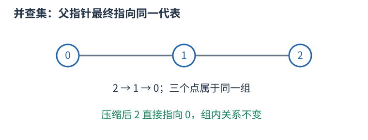

# P1621 筛出质数，把区间里同一大质因数的倍数合并 题解

## 目录

| 题号 | 题名 | 考点 | 难度 |
|---|---|---|---|
| A | 集合 | 并查集 + 素数 | 1800 |

## A. 集合

> 原题：[P1621](https://www.luogu.com.cn/problem/P1621)
> 解法：筛出质数，把区间里同一大质因数的倍数合并 · C++17

### 题意

初始每个区间整数单独成组，允许合并拥有不小于 $p$ 的共同质因数的两个整数，求最终组数。

<!-- reusable-foundations:start -->

### 从零讲：C++ 输入输出：把数据读进变量，把结果写到标准输出

程序运行时从标准输入接收题目给的数据，把答案送到标准输出。`cin` 和 `cout` 定义在 `<iostream>`；写 `using namespace std;` 后可以省略它们前面的 `std::`。最小完整程序是：

```cxx
#include <iostream>
using namespace std;
int main() {
    int a, b;
    cin >> a >> b;
    cout << a + b << '\n';
    return 0;
}
```

输入二十和三十，两个变量分别保存二十、三十，输出五十。`int a, b;` 声明两个整数变量；`cin >> a` 才给变量赋入输入值。多个 `>>` 从左到右读取，读取整数时会跳过空格、制表符、换行，所以两个整数可以分处两行。负号属于整数，不需要另读一个符号。

`cout <<` 后可以接数值、字符或字符串。`' '` 是一个空格字符，`'\n'` 是换行字符，`"Hello"` 是字符串。`cout << a << ' ' << b << '\n';` 输出两个以空格分开的整数并换行。评测程序只需要答案，不应加入“请输入”等提示。

读取 `char c; cin >> c;` 会跳过前导空白。要读取包含空格的一整行，用 `<string>` 中的 `string s; getline(cin, s);`。若此前用 `cin >> n` 读取过整数，换行还留在输入中，需要先处理那一个剩余换行；不能盲目把所有空格都删掉，因为字符画的行首空格和文本中的空格可能就是数据。

`fixed << setprecision(3)`（需要 `<iomanip>`）表示以小数形式保留三位小数，例如把 $2.5$ 输出成 $2.500$；不用 `fixed` 时，`setprecision` 指有效数字总数。设置会影响后续输出，使用前应确认所需精度。

竞赛中可在首次输入输出前调用 `ios::sync_with_stdio(false); cin.tie(nullptr);`，减少 C++ 流与 C 标准输入输出的同步、绑定开销。随后保持使用 `cin/cout`，不要混用另一套 `scanf/printf`。交互题还要在需要对方回应前主动刷新，例如 `cout << query << endl;`；普通题用换行字符即可。

读入长度为 $L$ 的文本、或输出 $L$ 个字符，至少需要 $O(L)$ 时间。数据类型仍要能容纳结果：把两个整数相乘时，即使保存到 `long long`，也要让乘法本身在这个类型中进行，例如先把输入声明为 `long long`。

### 从零讲：分支与循环：按条件选择，按次序重复

`if (条件) { ... } else { ... }` 根据条件的真假选择一条分支。比较运算 `==`、`!=`、`<`、`<=`、`>`、`>=` 返回真假值；`=` 是赋值，不能代替相等比较。`&&` 表示两边都成立，`||` 表示至少一边成立，`!` 把真假反转。

```cxx
int score = 85;
if (score >= 90) cout << "A";
else if (score >= 60) cout << "B";
else cout << "C"; // 这个例子输出 B
```

这条分支链只执行第一个符合条件的分支。先处理高分后，第二个条件自然只会接到低于九十分的数。几个独立的 `if` 则可能执行多次；两种结构代表不同问题。逻辑运算会短路：`i < n && a[i] == 0` 先确认下标合法，才读取那一格。

`for (初始化; 继续条件; 每轮更新)` 适合知道重复范围的情况。例如下列代码依次处理一到四，总和是十：

```cxx
int sum = 0;
for (int i = 1; i <= 4; ++i) {
    sum += i;
}
cout << sum;
```

初始化只做一次；每轮先判断条件，条件为真才执行循环体，随后执行更新。`++i` 把 $i$ 加一，`sum += i` 等价于把旧 sum 加 $i$ 再保存。应明确每个变量在循环前、循环后分别表示什么；最大值相同时是否更新，决定了保留较早还是较晚的答案。

`while (条件)` 适合“不满足目标就再做一步”：

```cxx
int x = 13, times = 0;
while (x > 1) {
    x /= 2;
    ++times;
}
// x 依次是 13、6、3、1，执行三次
```

循环开始前先检查条件，初始已满足目标时可能一次也不执行。每次执行必须推进状态，否则可能无限循环。`break` 结束最内层循环，`continue` 跳过本轮剩余部分；`for` 中的 continue 之后仍会执行每轮更新。

复杂度由实际执行次数决定。上述求和执行 $n$ 次是 $O(n)$；每次将正整数减半只执行 $O(\log n)$ 次。两层循环不能仅凭外观判定为平方：内层若总共只前进 $n$ 次，总量仍可能线性。变量应在正确作用范围初始化；多组数据的计数器若未重置，下一组会错误继承上一组结果。

### 从零讲：vector：长度可变的连续数组

`vector<T>` 保存一串同类型的元素，适合按下标访问、扫描、排序。`T` 是元素类型，例如 `vector<int>` 保存整数，`vector<pair<int,int>>` 保存整数对，`vector<vector<int>>` 可保存每个顶点各自的邻居。需要 `<vector>`。

```cxx
vector<int> a(3, 7);   // 三个元素，内容是 7、7、7
a.push_back(9);       // 在末尾追加，现在长度为 4
int x = a[1];         // 从 0 编号，这里得到 7
a[1] = 2;            // 改第二个元素
int n = int(a.size());
```

`vector<int> a(3)` 创建三个值为零的元素；`a.reserve(3)` 只预留容量，元素数仍为零，此时不能访问 `a[0]`。长度 `size()` 与容量 `capacity()` 是不同概念。

下标访问为 $O(1)$，遍历为 $O(n)$。末尾追加通常为 $O(1)$；容量不足时会分配更大的连续空间并搬移元素，这次可能为 $O(n)$，一连串追加的平均成本称为摊还 $O(1)$。中间插入或删除会搬移后续元素，最坏 $O(n)$。内存是元素量的 $O(n)$，并可能预留部分尚未使用的容量。

`begin()` 指向首元素，`end()` 指向尾后位置，`sort(a.begin(),a.end())` 操作整个数组。`a[i]` 不检查越界；下标须满足 $0\le i<\mathrm{size}$。`at(i)` 会检查越界并抛异常。空数组不能访问 `front()`、`back()`；`pop_back()` 也要求非空。

扩容后指向旧存储的迭代器、引用和指针会失效。遍历的同时 `push_back`，不能假定此前取得的引用仍可用。读取大数组的函数常用 `const vector<int>& a` 按常量引用传入，既不复制也禁止通过该引用修改；`vector<int> a` 按值传参则复制内容。选择副本还是引用取决于是否要保留独立数据。

### 从零讲：整数类型、整除与溢出

计算前先看每一步可能达到的范围。常见环境中 `int` 是 32 位，上界约 $2.1\times10^9$；`long long` 至少 64 位，常见有符号 64 位上界约 $9.22\times10^{18}$。`using ll = long long;` 只是为已有类型起别名。

```cxx
int a = 100000, b = 100000;
long long wrong = a * b;      // 右边先按 int 乘，可能已溢出
long long right = 1LL * a * b; // 先把运算提升到 long long
```

不能指望“接收结果的变量够大”修复此前已经溢出的计算。先提高操作数类型，再做乘法。超过 64 位时，GCC 的 `__int128` 可作中间量，但它不是标准 C++17 类型，也没有标准流输出重载；先证明范围，再选择工具。

整数 `/` 对有符号数向零截断：`7/3==2`、`-7/3==-2`。对非负数才等于向下取整。余数满足 `a == (a/b)*b + a%b`，除数不能为零；要将余数归入 $[0,m-1]$（$m>0$），可用 `(a % m + m) % m`，同时保证中间加法不溢出。

非负 $a$、正 $b$ 的向上取整可写 `a/b + (a%b != 0)`，比 `(a+b-1)/b` 更容易避免加法溢出。比较平方时也应在宽类型内计算；浮点数不适合作为大整数相等的默认判断方式。

`size()` 返回无符号类型。空容器上写 `size()-1` 会绕到很大的数，逆序遍历可以先转成有符号、确认长度，或使用逆向迭代器。`abs` 对最小有符号数无法在同类型中表达其正值，需先约束输入差值范围。一般机器整数运算按常数时间估算，宽类型解决表示范围，不改变算法的增长阶。

### 从零讲：具名函数：给可复用计算一个明确接口

函数把一段计算包装成“输入参数 → 返回结果”。例如判断整数是否为偶数：

```cxx
bool even(int x) {
    return x % 2 == 0;
}
int main() {
    bool a = even(8); // a 为 true
    bool b = even(7); // b 为 false
}
```

`bool` 是返回类型，`even` 是函数名，`int x` 是参数声明。调用 `even(8)` 时，实参八传入这个新调用的局部变量 $x$，执行 return 后把真假值交回调用处。定义本身不执行计算，只有调用才执行。函数应在调用处之前定义，或提前写声明。

普通数值参数按值传递，函数里修改 $x$ 不会改变调用者原变量。参数写成 `int &x` 时才引用调用者对象；必须让这个对象在调用期间有效。`const vector<int>& a` 用引用避免复制整个容器，并承诺不通过这个引用修改它。返回局部变量的值是安全的，返回局部变量的引用则在函数结束后失效。

函数名应说明它回答的问题，调用处负责传哪些数据。例如闰年判定只接收一个年份并返回真假，枚举年份范围和输出格式由调用者处理。同一判定被多次使用时，这能减少规则不一致；但函数包装不会自动降低算法复杂度，仍要把每次调用实际做的工作计入时间。

如果函数内部又调用自身，就是递归，需要明确最小情况如何直接返回、每次调用如何逼近它；递归会占用调用栈。普通辅助函数可以不使用递归，不应仅因写成函数就称作递归算法。

### 从零讲：并查集：维护哪些对象已属于同一组

从每个元素独立成组开始，反复合并两组、判断两项是否连通。并查集用父指针形成若干棵树，每棵树的根代表一组；根的编号只是代表，不一定是最小编号或有特殊题意。



```cxx
struct DSU {
    vector<int> parent, size;
    DSU(int n): parent(n), size(n, 1) {
        iota(parent.begin(), parent.end(), 0);
    }
    int find(int x) {
        return parent[x] == x ? x : parent[x] = find(parent[x]);
    }
    bool merge(int a, int b) {
        a = find(a); b = find(b);
        if (a == b) return false;
        if (size[a] < size[b]) swap(a, b);
        parent[b] = a; size[a] += size[b];
        return true;
    }
};
```

合并 $0,1$ 再合并 $1,2$ 后，三者的 `find` 相同，即使零和二没有直接边。这表示路径连通，不表示两项相邻。路径压缩将访问链上的父亲直接改为根；按大小合并把小树挂到大树，避免人为形成长链。

初始化 $O(n)$，两种优化一起使用时，一连串操作的摊还成本为 $O(\alpha(n))$ 每次，常见规模近似常数；不能说每一次都严格 $O(1)$。数组空间 $O(n)$。

普通并查集擅长增加连通关系，不直接支持删边和拆组。回滚版本通常不用路径压缩，并保存每次合并改变的值；带权版本还需维护到父亲的关系，不能只合并普通 parent。分组大小等统计应读根上的记录。

### 从零讲：埃氏筛：一次求出整个上界内的所有素数

若只判断一个小整数是否为素数，可以试除到平方根；若需要上界 $n$ 内的完整素数表，对每个数重复试除会做很多重复工作。埃氏筛反过来，从一个素数出发排除它的倍数。

先把二到 $n$ 都当作候选，零和一明确排除。从二开始扫描，尚未被排除的 $p$ 就是素数；把 $p^2$、$p^2+p$、$p^2+2p \ldots\ldots$标成合数。小于 $p^2$ 的 $p$ 的倍数已经含有小于 $p$ 的因子，早先被处理，不必再从二倍 $p$ 开始。

例如上界三十：二排除 4、6、8……；三从九开始排除 9、12、15……；四已被排除，跳过；五从二十五开始排除。最终留下 2、3、5、7、11、13、17、19、23、29。

```cxx
int limit = 30;
vector<bool> is_prime(limit+1, true);
is_prime[0] = false;
if (limit >= 1) is_prime[1] = false;
for (int p = 2; p <= limit/p; ++p) {
    if (!is_prime[p]) continue;
    for (long long multiple = 1LL*p*p; multiple <= limit; multiple += p)
        is_prime[multiple] = false;
}
vector<int> primes;
for (int x = 2; x <= limit; ++x)
    if (is_prime[x]) primes.push_back(x);
```

输入约定上界为非负整数，输出是布尔判定表与有序素数数组。外层只需到平方根，因为每个合数都有不超过平方根的素因子；最后收集仍须扫到 $n$，不能漏掉大于平方根的素数。

`p<=limit/p` 避免外层平方判定溢出，倍数循环用 long long 使乘法和步长也有足够范围。`vector<bool>` 是按位存储的标准库特化，适合这里的下标读写；不要假设其元素是普通 bool 引用，也不需要用引用遍历修改它。

标记次数约为 $n$ 乘各素数倒数之和，埃氏筛时间 $O(n \log \log n)$，保存标记与结果空间 $O(n)$。它适合按数值上界开表的场景；上界太大时，不应仅因输入项很少就开同样大的数组。这里不是线性筛，同一个合数可以被多个素数标记。

### 从零讲：整除、最大公约数与质因数

正整数 $d$ 整除 $n$，表示 $n$ 能分成整数个大小为 $d$ 的组，即 `n % d == 0`。公约数同时整除两个数，其中最大者为最大公约数。欧几里得算法使用 $\gcd(a,b)=\gcd(b,a\bmod b)$，因为共同整除两者的数也恰好整除余数。

例如 $\gcd(18,12)=\gcd(12,6)=\gcd(6,0)=6$。每两轮较大参数至少缩半，故为 $O(\log\max(a,b))$。C++17 `<numeric>` 提供 `gcd`；最小公倍数可按 `a/gcd(a,b)*b` 计算以减少中间量，但最终乘积仍须检查范围。

质数是大于一、只有一和自身两个正因数的整数，一不是质数。合数一定有不超过平方根的质因数：若一对因数都超过平方根，乘积会大于原数。因此试除只需检查到平方根。

```cxx
vector<pair<long long,int>> factor(long long n) {
    vector<pair<long long,int>> result;
    for (long long p = 2; p <= n / p; ++p) {
        if (n % p != 0) continue;
        int exponent = 0;
        while (n % p == 0) { n /= p; ++exponent; }
        result.push_back({p, exponent});
    }
    if (n > 1) result.push_back({n, 1});
    return result;
}
```

正整数六十拆成 $2^2\times3\times5$。每个因子的指数可从零选到其最大次数，所以因数数量为 $(2+1)(1+1)(1+1)=12$。剩余大于一的部分必须作为一个质因数保留。条件 `p<=n/p` 避免为检查平方而溢出。

试除最坏约 $O(\sqrt n)$。要处理从一到 $N$ 的大量质数问题，可用筛法：埃氏筛从每个质数的平方起标记倍数，时间 $O(N\log\log N)$、空间 $O(N)$。线性筛额外维护最小质因子，使每个合数只由规定的一次生成；不能把任意双循环标倍数都称为线性筛。

<!-- reusable-foundations:end -->

### 思路

判定条件是共同质因数，不是最大公约数本身大于 $p$。例如两个数的 $\gcd$ 为六、$p$ 为五时，公因数六虽大于五，质因数却只有二和三，不满足条件。

对某个合法质数 $q$，区间内所有 $q$ 的倍数都可直接相互合并。只需选第一个倍数 $f$ 作为中间点，把其它倍数接向 $f$，连接成一组即可，不必把每对倍数建边。

第一项 $f$ 等于 $ceil(a/q)$ 乘 $q$；正整数运算可写成 $(a+q-1)/q$*$q$。如果 $f>b$，这个质数在区间没有倍数；只有一个倍数时也不会成功合并。筛法只枚举质数，不能把四、六等合数当作独立的合法质因数。

程序每次成功合并都来自共享 $q \ge p$，所以不会额外连接不合法的对象。反过来，任何一对拥有合法共同质因数的原整数，都在该质数的倍数组中连通；所以算法最终包含题目允许的全部边及其传递闭包。

父数组按原整数值开到 $b$，但连通块计数从 $b-a+1$ 开始，循环只对区间内倍数合并。小于 $a$ 的数组位置只是未用槽位，不能加入答案。重复由不同质数连接同一组时，merge 返回 false，不再减数。

筛法 $O(b\log\log b)$；倍数访问数不超过 $O(b\log\log b)$，合并摊还再乘 $\alpha(b)$；空间 $O(b)$。

### 参考代码

```cpp
#include <bits/stdc++.h>
using namespace std;
struct DSU {
    vector<int>parent,size;
    DSU(int n):parent(n+1),size(n+1,1){iota(parent.begin(),parent.end(),0);}
    int find(int x){return parent[x]==x?x:parent[x]=find(parent[x]);}
    bool merge(int a,int b){
        a=find(a);b=find(b);if(a==b)return false;
        if(size[a]<size[b])swap(a,b);
        parent[b]=a;size[a]+=size[b];return true;
    }
};
int main() {
    ios::sync_with_stdio(false);
    cin.tie(nullptr);
int a,b,p;cin>>a>>b>>p;vector<int>composite(b+1);DSU groups(b);int components=b-a+1;
for(int q=2;q<=b;++q)if(!composite[q]){
    if(q<=b/q)for(int multiple=q*q;multiple<=b;multiple+=q)composite[multiple]=1;
    if(q<p)continue;int first=(a+q-1)/q*q;
    for(int x=first+q;x<=b;x+=q)if(groups.merge(first,x))--components;
}
cout<<components<<'\n';
    return 0;
}
```

### 易错点

枚举质数而非全部大公因数；只合并区间内倍数；组数不含小于 $a$ 的槽位。

## 实测记录

本地 C++17 编译、1 组原站样例与 301 组独立边界/小域校验通过。
正文参考程序与源码逐字核对；没有向原站提交。
