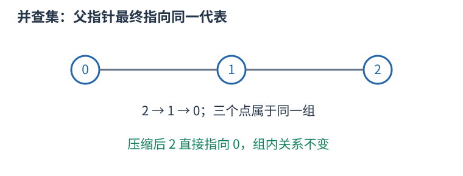
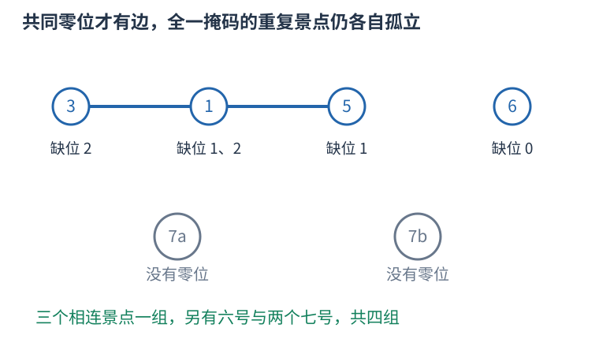

# P16495 同缺一种景色就相连，把景点连通性压到至多六十个零位 题解

## 目录

| 题号 | 题名 | 考点 | 难度 |
|---|---|---|---|
| A | 踏青南陌上，寄远展壮游 | 并查集 + 位运算 + 图论 | 1800 |

## A. 踏青南陌上，寄远展壮游

> 原题：[P16495](https://www.luogu.com.cn/problem/P16495)
> 解法：同缺一种景色就相连，把景点连通性压到至多六十个零位 · C++17

### 题意

依次插入景点位掩码，每次输出最少几次踏青能访问目前全部景点。一次路线允许重复访问，相邻两景点的按位或必须不是全一。

<!-- reusable-foundations:start -->

### 从零讲：C++ 输入输出：把数据读进变量，把结果写到标准输出

程序运行时从标准输入接收题目给的数据，把答案送到标准输出。`cin` 和 `cout` 定义在 `<iostream>`；写 `using namespace std;` 后可以省略它们前面的 `std::`。最小完整程序是：

```cxx
#include <iostream>
using namespace std;
int main() {
    int a, b;
    cin >> a >> b;
    cout << a + b << '\n';
    return 0;
}
```

输入二十和三十，两个变量分别保存二十、三十，输出五十。`int a, b;` 声明两个整数变量；`cin >> a` 才给变量赋入输入值。多个 `>>` 从左到右读取，读取整数时会跳过空格、制表符、换行，所以两个整数可以分处两行。负号属于整数，不需要另读一个符号。

`cout <<` 后可以接数值、字符或字符串。`' '` 是一个空格字符，`'\n'` 是换行字符，`"Hello"` 是字符串。`cout << a << ' ' << b << '\n';` 输出两个以空格分开的整数并换行。评测程序只需要答案，不应加入“请输入”等提示。

读取 `char c; cin >> c;` 会跳过前导空白。要读取包含空格的一整行，用 `<string>` 中的 `string s; getline(cin, s);`。若此前用 `cin >> n` 读取过整数，换行还留在输入中，需要先处理那一个剩余换行；不能盲目把所有空格都删掉，因为字符画的行首空格和文本中的空格可能就是数据。

`fixed << setprecision(3)`（需要 `<iomanip>`）表示以小数形式保留三位小数，例如把 $2.5$ 输出成 $2.500$；不用 `fixed` 时，`setprecision` 指有效数字总数。设置会影响后续输出，使用前应确认所需精度。

竞赛中可在首次输入输出前调用 `ios::sync_with_stdio(false); cin.tie(nullptr);`，减少 C++ 流与 C 标准输入输出的同步、绑定开销。随后保持使用 `cin/cout`，不要混用另一套 `scanf/printf`。交互题还要在需要对方回应前主动刷新，例如 `cout << query << endl;`；普通题用换行字符即可。

读入长度为 $L$ 的文本、或输出 $L$ 个字符，至少需要 $O(L)$ 时间。数据类型仍要能容纳结果：把两个整数相乘时，即使保存到 `long long`，也要让乘法本身在这个类型中进行，例如先把输入声明为 `long long`。

### 从零讲：分支与循环：按条件选择，按次序重复

`if (条件) { ... } else { ... }` 根据条件的真假选择一条分支。比较运算 `==`、`!=`、`<`、`<=`、`>`、`>=` 返回真假值；`=` 是赋值，不能代替相等比较。`&&` 表示两边都成立，`||` 表示至少一边成立，`!` 把真假反转。

```cxx
int score = 85;
if (score >= 90) cout << "A";
else if (score >= 60) cout << "B";
else cout << "C"; // 这个例子输出 B
```

这条分支链只执行第一个符合条件的分支。先处理高分后，第二个条件自然只会接到低于九十分的数。几个独立的 `if` 则可能执行多次；两种结构代表不同问题。逻辑运算会短路：`i < n && a[i] == 0` 先确认下标合法，才读取那一格。

`for (初始化; 继续条件; 每轮更新)` 适合知道重复范围的情况。例如下列代码依次处理一到四，总和是十：

```cxx
int sum = 0;
for (int i = 1; i <= 4; ++i) {
    sum += i;
}
cout << sum;
```

初始化只做一次；每轮先判断条件，条件为真才执行循环体，随后执行更新。`++i` 把 $i$ 加一，`sum += i` 等价于把旧 sum 加 $i$ 再保存。应明确每个变量在循环前、循环后分别表示什么；最大值相同时是否更新，决定了保留较早还是较晚的答案。

`while (条件)` 适合“不满足目标就再做一步”：

```cxx
int x = 13, times = 0;
while (x > 1) {
    x /= 2;
    ++times;
}
// x 依次是 13、6、3、1，执行三次
```

循环开始前先检查条件，初始已满足目标时可能一次也不执行。每次执行必须推进状态，否则可能无限循环。`break` 结束最内层循环，`continue` 跳过本轮剩余部分；`for` 中的 continue 之后仍会执行每轮更新。

复杂度由实际执行次数决定。上述求和执行 $n$ 次是 $O(n)$；每次将正整数减半只执行 $O(\log n)$ 次。两层循环不能仅凭外观判定为平方：内层若总共只前进 $n$ 次，总量仍可能线性。变量应在正确作用范围初始化；多组数据的计数器若未重置，下一组会错误继承上一组结果。

### 从零讲：vector：长度可变的连续数组

`vector<T>` 保存一串同类型的元素，适合按下标访问、扫描、排序。`T` 是元素类型，例如 `vector<int>` 保存整数，`vector<pair<int,int>>` 保存整数对，`vector<vector<int>>` 可保存每个顶点各自的邻居。需要 `<vector>`。

```cxx
vector<int> a(3, 7);   // 三个元素，内容是 7、7、7
a.push_back(9);       // 在末尾追加，现在长度为 4
int x = a[1];         // 从 0 编号，这里得到 7
a[1] = 2;            // 改第二个元素
int n = int(a.size());
```

`vector<int> a(3)` 创建三个值为零的元素；`a.reserve(3)` 只预留容量，元素数仍为零，此时不能访问 `a[0]`。长度 `size()` 与容量 `capacity()` 是不同概念。

下标访问为 $O(1)$，遍历为 $O(n)$。末尾追加通常为 $O(1)$；容量不足时会分配更大的连续空间并搬移元素，这次可能为 $O(n)$，一连串追加的平均成本称为摊还 $O(1)$。中间插入或删除会搬移后续元素，最坏 $O(n)$。内存是元素量的 $O(n)$，并可能预留部分尚未使用的容量。

`begin()` 指向首元素，`end()` 指向尾后位置，`sort(a.begin(),a.end())` 操作整个数组。`a[i]` 不检查越界；下标须满足 $0\le i<\mathrm{size}$。`at(i)` 会检查越界并抛异常。空数组不能访问 `front()`、`back()`；`pop_back()` 也要求非空。

扩容后指向旧存储的迭代器、引用和指针会失效。遍历的同时 `push_back`，不能假定此前取得的引用仍可用。读取大数组的函数常用 `const vector<int>& a` 按常量引用传入，既不复制也禁止通过该引用修改；`vector<int> a` 按值传参则复制内容。选择副本还是引用取决于是否要保留独立数据。

### 从零讲：整数类型、整除与溢出

计算前先看每一步可能达到的范围。常见环境中 `int` 是 32 位，上界约 $2.1\times10^9$；`long long` 至少 64 位，常见有符号 64 位上界约 $9.22\times10^{18}$。`using ll = long long;` 只是为已有类型起别名。

```cxx
int a = 100000, b = 100000;
long long wrong = a * b;      // 右边先按 int 乘，可能已溢出
long long right = 1LL * a * b; // 先把运算提升到 long long
```

不能指望“接收结果的变量够大”修复此前已经溢出的计算。先提高操作数类型，再做乘法。超过 64 位时，GCC 的 `__int128` 可作中间量，但它不是标准 C++17 类型，也没有标准流输出重载；先证明范围，再选择工具。

整数 `/` 对有符号数向零截断：`7/3==2`、`-7/3==-2`。对非负数才等于向下取整。余数满足 `a == (a/b)*b + a%b`，除数不能为零；要将余数归入 $[0,m-1]$（$m>0$），可用 `(a % m + m) % m`，同时保证中间加法不溢出。

非负 $a$、正 $b$ 的向上取整可写 `a/b + (a%b != 0)`，比 `(a+b-1)/b` 更容易避免加法溢出。比较平方时也应在宽类型内计算；浮点数不适合作为大整数相等的默认判断方式。

`size()` 返回无符号类型。空容器上写 `size()-1` 会绕到很大的数，逆序遍历可以先转成有符号、确认长度，或使用逆向迭代器。`abs` 对最小有符号数无法在同类型中表达其正值，需先约束输入差值范围。一般机器整数运算按常数时间估算，宽类型解决表示范围，不改变算法的增长阶。

### 从零讲：具名函数：给可复用计算一个明确接口

函数把一段计算包装成“输入参数 → 返回结果”。例如判断整数是否为偶数：

```cxx
bool even(int x) {
    return x % 2 == 0;
}
int main() {
    bool a = even(8); // a 为 true
    bool b = even(7); // b 为 false
}
```

`bool` 是返回类型，`even` 是函数名，`int x` 是参数声明。调用 `even(8)` 时，实参八传入这个新调用的局部变量 $x$，执行 return 后把真假值交回调用处。定义本身不执行计算，只有调用才执行。函数应在调用处之前定义，或提前写声明。

普通数值参数按值传递，函数里修改 $x$ 不会改变调用者原变量。参数写成 `int &x` 时才引用调用者对象；必须让这个对象在调用期间有效。`const vector<int>& a` 用引用避免复制整个容器，并承诺不通过这个引用修改它。返回局部变量的值是安全的，返回局部变量的引用则在函数结束后失效。

函数名应说明它回答的问题，调用处负责传哪些数据。例如闰年判定只接收一个年份并返回真假，枚举年份范围和输出格式由调用者处理。同一判定被多次使用时，这能减少规则不一致；但函数包装不会自动降低算法复杂度，仍要把每次调用实际做的工作计入时间。

如果函数内部又调用自身，就是递归，需要明确最小情况如何直接返回、每次调用如何逼近它；递归会占用调用栈。普通辅助函数可以不使用递归，不应仅因写成函数就称作递归算法。

### 从零讲：并查集：维护哪些对象已属于同一组

从每个元素独立成组开始，反复合并两组、判断两项是否连通。并查集用父指针形成若干棵树，每棵树的根代表一组；根的编号只是代表，不一定是最小编号或有特殊题意。



```cxx
struct DSU {
    vector<int> parent, size;
    DSU(int n): parent(n), size(n, 1) {
        iota(parent.begin(), parent.end(), 0);
    }
    int find(int x) {
        return parent[x] == x ? x : parent[x] = find(parent[x]);
    }
    bool merge(int a, int b) {
        a = find(a); b = find(b);
        if (a == b) return false;
        if (size[a] < size[b]) swap(a, b);
        parent[b] = a; size[a] += size[b];
        return true;
    }
};
```

合并 $0,1$ 再合并 $1,2$ 后，三者的 `find` 相同，即使零和二没有直接边。这表示路径连通，不表示两项相邻。路径压缩将访问链上的父亲直接改为根；按大小合并把小树挂到大树，避免人为形成长链。

初始化 $O(n)$，两种优化一起使用时，一连串操作的摊还成本为 $O(\alpha(n))$ 每次，常见规模近似常数；不能说每一次都严格 $O(1)$。数组空间 $O(n)$。

普通并查集擅长增加连通关系，不直接支持删边和拆组。回滚版本通常不用路径压缩，并保存每次合并改变的值；带权版本还需维护到父亲的关系，不能只合并普通 parent。分组大小等统计应读根上的记录。

### 从零讲：图的表示、BFS 与 DFS

图由顶点与边组成，适合表达“哪些对象之间能一步到达”。有向边只允许一个方向；无向边需保存两个方向。邻接表 `vector<vector<int>> graph(n)` 为每个顶点保存邻居，空间 $O(n+m)$，无向边在表中出现两次。

以边 $0-1,0-2,1-3$ 为例，从零出发：


#### BFS 为什么得到最少边数

初始顶点距离为零，入先进先出的队列。弹出顶点时，将尚未到达的邻居距离设为当前距离加一，并立刻标记入队。距离为一的顶点都会先于距离为二的处理，因此第一次发现就是最少边数。

```cxx
vector<int> distance(n, -1);
queue<int> q;
distance[start] = 0; q.push(start);
while (!q.empty()) {
    int u = q.front(); q.pop();
    for (int v : graph[u]) if (distance[v] == -1) {
        distance[v] = distance[u] + 1;
        q.push(v);
    }
}
```

适用于无权或所有边代价相同的最少步数。边权不同，第一次发现未必费用最小，不能继续套这一结论。多起点 BFS 先把所有合法起点设零并入队。

#### DFS 的调用代表一整块未探索区域

DFS 标记当前点后，递归处理每个尚未访问的邻点；也可用显式栈。上例可能按 $0,1,3,2$ 的顺序深入，但顺序取决于邻居存放方式。它擅长检查连通性、处理子树和回溯，不保证最短路径。

两种遍历在每个顶点入队或调用一次、每条边检查常数次的实现下，时间均为 $O(n+m)$，额外标记和队列/栈为 $O(n)$。不要等出队才首次标记，否则同一顶点可能重复入队。图不连通时，从一个起点无法覆盖所有点；统计连通块应从每个尚未访问点再启动一次遍历。树的深递归可能用尽调用栈。

### 从零讲：位运算：把非负整数看成一组二进制开关

五写成二进制为 $0101_2$，三为 $0011_2$。同一列各代表一位：按位与 `&` 两边都为一才得一，按位或 `|` 任一为一就得一，按位异或 `^` 不同才为一。所以 $5\mathbin{\&}3=1$，$5\mathbin{|}3=7$，$5\mathbin{\oplus}3=6$。


`1ULL << k` 把一移到第 $k$ 位。对非负无符号整数，`(mask >> k) & 1ULL` 读该位，`mask | (1ULL<<k)` 置一，`mask & ~(1ULL<<k)` 清零，`mask ^ (1ULL<<k)` 翻转。最低位编号为零。

```cxx
unsigned long long mask = 5; // 第 0、2 位为一
bool has = (mask >> 2) & 1ULL; // true
mask |= 1ULL << 1;             // 变成 7
```

位移次数必须小于类型位宽，且不能为负；不要用普通 `1` 去移到超出 int 范围的位置。C++17 有符号负数右移和溢出的规则不适合直接套“乘除二的幂”，用明确范围的无符号数更容易保证行为。`^` 是异或，绝不是乘方。

逻辑与 `&&`、逻辑或 `||` 将整体条件视为真假，并会短路；按位 `&`、`|` 逐位计算，不会因此跳过右侧表达式。运算符优先级可能与直觉不同，写 `(mask & bit) != 0`，别省掉关键括号。

固定机器字内的一次位运算按 $O(1)$ 估算；枚举全部 $k$ 位状态仍有 $2^k$ 种，不能因为每次运算快就忽略状态数。`x & (x-1)` 对正无符号数清掉最低的一位；GCC 的 `__builtin_popcountll(x)` 统计一的数量，注意实参位宽与具体编译器支持。

### 从零讲：无符号六十四位整数与模二的六十四次方

`<cstdint>` 的 `uint64_t` 是恰好六十四位的无符号整数类型，取值范围从零到 $2^{64}-1$。这类精确宽度别名在平台具有相应整数类型时提供；本项目使用的 GNU C++17 目标平台支持它。与 `long long` 的常见有符号范围相比，它不保存负数，最高位也参与表示非负数值。

#### 加法回绕是语言规则

无符号整数的加、减、乘会按其位数对应的二次幂取模。最大值加一得到零，零减一得到最大值。六十四位无符号数因此正好进行模 $2^{64}$ 运算，前提是操作本身在这个类型中发生。

```cxx
#include <cstdint>
#include <limits>
using namespace std;
int main() {
    uint64_t top = numeric_limits<uint64_t>::max();
    uint64_t zero = top + uint64_t(1);
    uint64_t wrapped = uint64_t(0) - uint64_t(1);
    uint64_t product = uint64_t(1000000000) * uint64_t(1000000000);
    // zero 为零，wrapped 等于 top，product 为 10^18。
}
```

不能先用 int 相乘，再存到 `uint64_t`：右侧可能早已按 int 溢出。有符号溢出也不能代替这条回绕规则；C++ 对有符号溢出没有规定应得到模值。需要的是模 $2^{64}$ 时，让两边操作数及累计量都使用对应的无符号类型，而不是等到最后再转换。

#### 模值不能用来比较真实大小

回绕保留的是余数，不再保留原数的大小关系。最大值加一的数学结果比最大值大，但保存的余数零却小于它。因此最小费用、大小排序和贪心判断应先根据不会回绕的真实量完成，最后仅对累加的答案使用模运算。

不要写 `1ULL << 64` 生成模数：移位数量必须小于左操作数的位宽，移六十四位不合法。也不需要显式写出无法用 `uint64_t` 保存的 $2^{64}$；让无符号算术自然取模即可。一般只计算机器宽度的运算，单次时间与空间均为 $O(1)$。

<!-- reusable-foundations:end -->

### 思路

允许重复访问意味着不用求不重复的路径。一个连通块可从任意点出发，沿生成树往返走遍全部点，用一次踏青覆盖；不同连通块之间没有合法相邻步骤，不能放在同一路线。因此答案就是当前景点图的连通块数。



仅看低三位，按顺序插入三、一、五、六、七、七。两个七号为不同次得到的景点，不能共享一条合法相邻边。

两个掩码按位或不为全一，等价于某一位在两者中都为零。对每种景色设一个“缺少它”的中介点，一个景点连接其全部零位。共享零位的两个景点就经同一中介连通；反过来，沿中介连接的景点链每一步都共享某个零位，恰好是合法路线。

一个非全一景点至少有一个零位，把这些位合并后，它属于一个有效位连通块。刚出现的新零位先成为独立块，数量加一；合并不同位块时数量减一。最终有效位块与非全一景点连通块一一对应，不必为每次插入新建景点节点。

全一景点没有任何零位，与任何其它景点的或都为全一，即使两个掩码相同也不能相邻。不同次搜索得到的全一景点是分别待覆盖的景点，必须每次单独加一；不能把重复全一掩码去重。其它重复掩码则共享零位，会自然连在一起。

用 $(1ULL<<n)-1$ 表示低 $n$ 位全一，$n \le 60$，位移和掩码均用 unsigned long long。遍历零到 $n-1$ 位，不能把高位补零也当缺少的景色。时间与位数 $n$ 成正比，但只维护至多六十个中介，不维护五十万个景点。

时间 $O(qn\alpha(n))$，额外空间 $O(n)$，其中 $n\le60$。

### 参考代码

```cpp
#include <bits/stdc++.h>
using namespace std;
struct DSU {
    vector<int>parent,size;
    DSU(int n):parent(n+1),size(n+1,1){iota(parent.begin(),parent.end(),0);}
    int find(int x){return parent[x]==x?x:parent[x]=find(parent[x]);}
    bool merge(int a,int b){
        a=find(a);b=find(b);if(a==b)return false;
        if(size[a]<size[b])swap(a,b);
        parent[b]=a;size[a]+=size[b];return true;
    }
};
int main() {
    ios::sync_with_stdio(false);
    cin.tie(nullptr);
int n,q;cin>>n>>q;DSU groups(n);vector<int>used(n);int components=0,isolated=0;
unsigned long long full=(1ULL<<n)-1;
while(q--){unsigned long long value;cin>>value;if(value==full){++isolated;cout<<components+isolated<<'\n';continue;}
    int first=-1;
    for(int bit=0;bit<n;++bit)if(((value>>bit)&1ULL)==0){
        if(!used[bit]){used[bit]=1;++components;}
        if(first==-1)first=bit;else if(groups.merge(first,bit))--components;
    }
    cout<<components+isolated<<'\n';
}
    return 0;
}
```

### 易错点

允许重复访问，所以求连通块而非哈密顿路径；合并零位；全一每次独立；仅处理低 $n$ 位。

## 实测记录

本地 C++17 编译、1 组原站样例与 542 组独立边界/小域校验通过。
正文参考程序与源码逐字核对；没有向原站提交。
